# Coze 扩容方案：手搓一个专属 LLM 外挂，3000 字超细实操


# 作者寄语

大家好，我是龙哥，一直在研究怎么和 AI 更好地配合，让自己变得更强。下面是我的自我介绍：


# 为什么要给工作流换个大脑

PS：只想看干货的同学可以直接跳到【实操流程】

先说说为什么要自己做一个【插件形态的大模型】节点。

是不是经常觉得 Coze 里的模型不够用？不够聪明、不够稳？

先别急着怪平台。很多时候，限制来自于没给它配对的算力。

Coze 本质是一个 AI 流程搭建平台，而插件就是给流程扩容的外挂。就像一个创业团队需要招更强的人才一样，插件就是把你想要的大模型招进团队。

有了插件，你就可以把 Agent 的推理能力从默认模型里解放出来。用国内模型不顺手？换一个更匹配当前任务的模型即可。

说白了，就是让你的工作流能接入任何你想要的大模型。Claude、GPT-4，随便选。

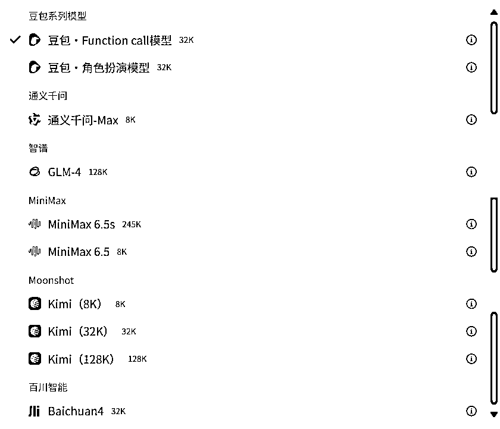

这些东西，光看是学不会的，得上手做。

# 5 分钟搭出你的第一个外接模型插件，真的能做到

## Coze IDE：新手也能上手的开发环境

*   在个人空间里做的插件，只有你自己能用。
*   在团队空间里做的插件，整个团队都能调用。
*   插件一旦发布新版本，已使用它的 Bot 会自动生效最新版。

# 实操流程

下面就开始复刻，5 分钟搞定一个专属的外接大模型插件。

### 新建插件

先进入【工作空间】，确定插件要放在哪个空间。个人空间和团队空间的区别很简单：

个人空间的插件只能自己调用，团队空间的插件可以给团队里的小伙伴共享。

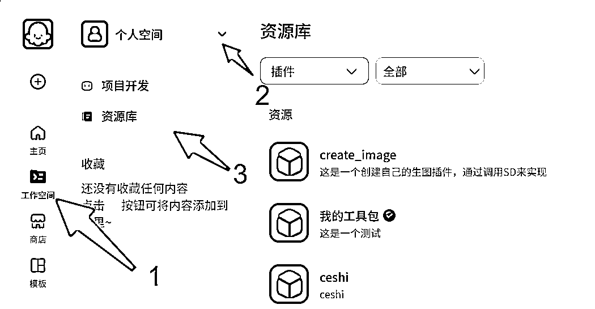

这里演示个人空间，界面右上角点新增资源，直接选【插件】。

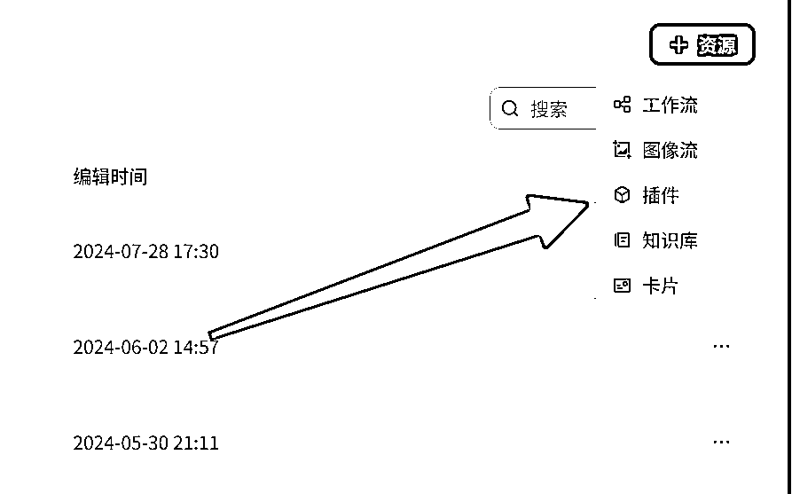

在新建插件页，填写基本配置。插件类型选【云端插件】，语言选 Python。

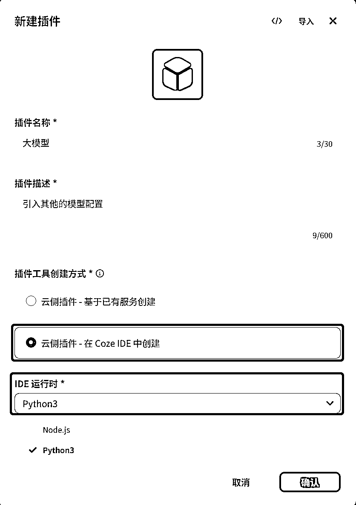

接着选择在 IDE 里新建工具。

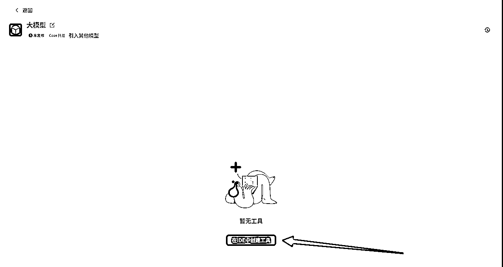

填好工具的基础信息后提交。

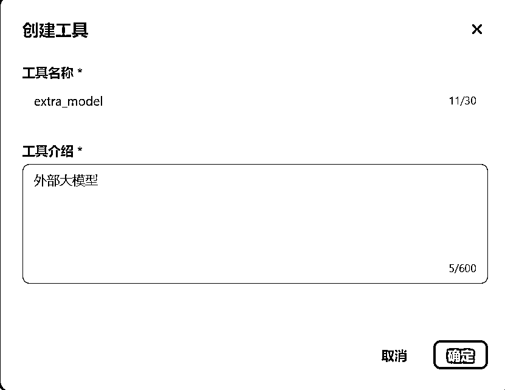

看到这个页面，说明插件的骨架已经建好了。

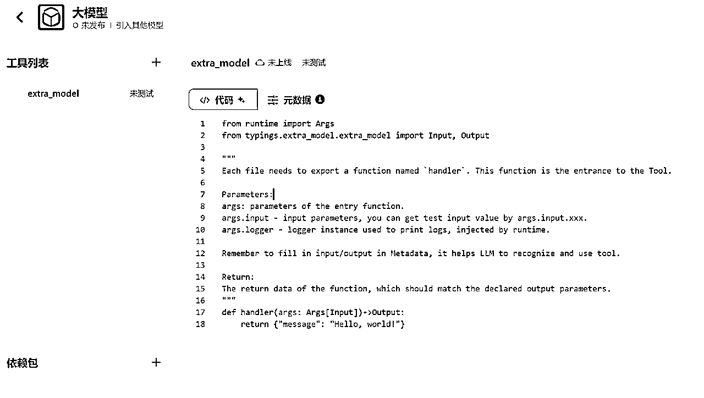

### 选定 Claude 接口

这次以 Claude 为例演示外部模型接入：

小白补课：API 是什么？

可以把 API 想象成电源插座。你不需要懂发电原理，插上就能用电。

API 就是一套调用别的程序能力的接口，Coze 通过几行代码就能调用 Claude 的能力。

国内用户直接上官方 Claude API 难度和风险都比较大，所以我们走第三方中转的 Claude API 服务来实现。

### 用 AI 帮你写插件代码

我用的是国内一家提供 Claude API 中转的平台：https://api.mjdjourney.cn

注册登录后进入后台，点击令牌。

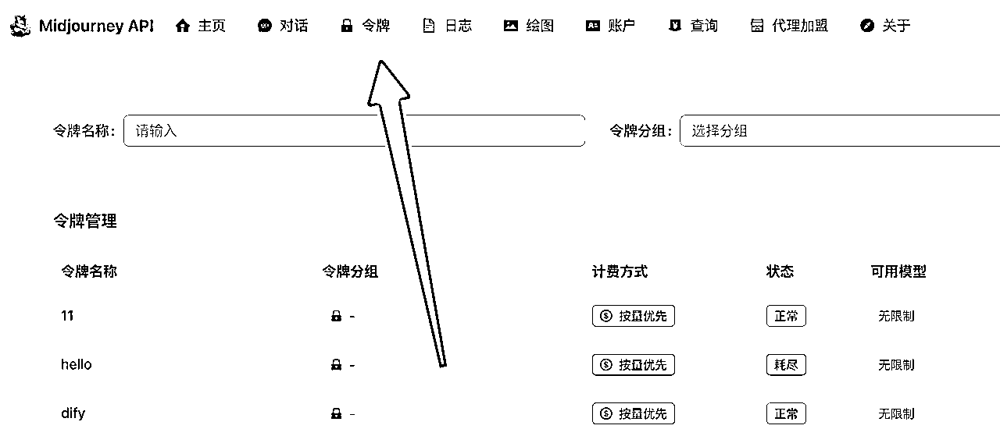

新建一个令牌，按需配置好参数。创建完后点请求示例：

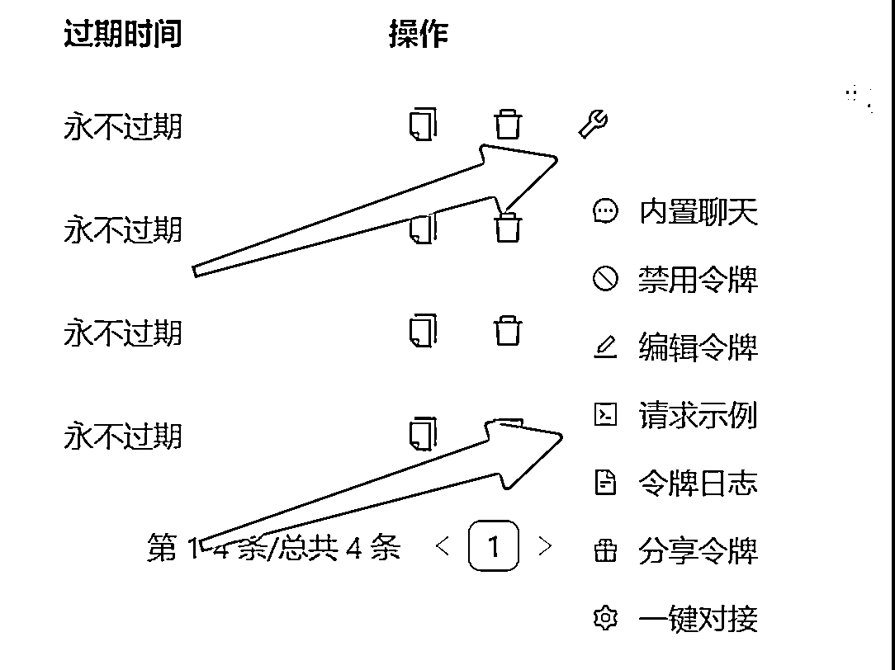

选 Python SDK，再选你要用的 Claude 模型。模型列表可以在【账户】里查看，点即可复制。把示例代码先复制下来备用。

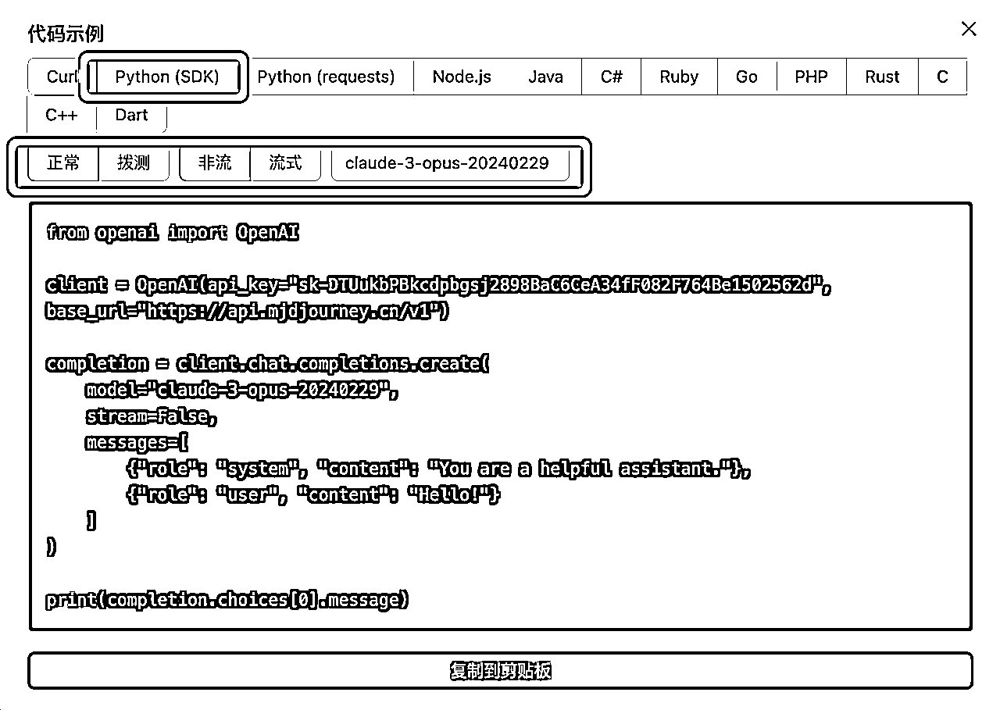

打开 Kimi，https://kimi.moonshot.cn，把 Coze 插件页面的代码框架丢进去。

告诉它你要实现什么功能，让它帮你补全。报错了就把报错信息一起丢给它，让它改。

下面是全程修改记录：

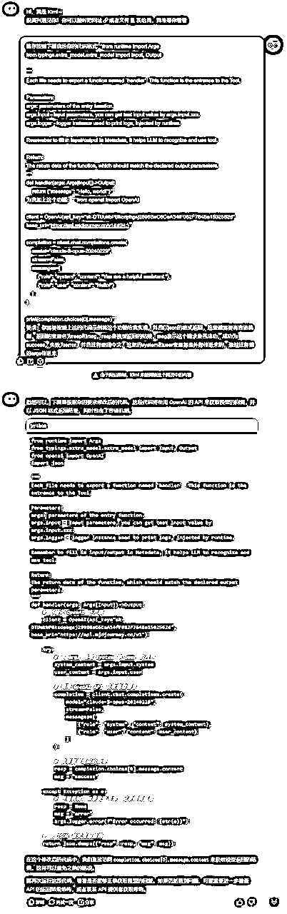

请严格参照我给你的代码格式

```from runtime import Args

from typings.extra_model.extra_model import Input, Output

"""

Each file needs to export a function named handler. This function is the entrance to the Tool.

Parameters:

args: parameters of the entry function.

args.input - input parameters, you can get test input value by args.input.xxx.

args.logger - logger instance used to print logs, injected by runtime.

Remember to fill in input/output in Metadata, it helps LLM to recognize and use tool.

Return:

The return data of the function, which should match the declared output parameters.

"""

def handler(args: Args[Input])->Output:

return {"message": "Hello, world!"}```

帮我加上这个需求：```from openai import OpenAI

client = OpenAI(api_key="sk-DTUukbPBkcdpbgsj2898BaC6CeA34fF082F764Be1502562d", base_url="https://api.mjdjourney.cn/v1")

completion = client.chat.completions.create(

model="claude-3-opus-20240229",

stream=False,

messages=[

{"role": "system", "content": "You are a helpful assistant."},

{"role": "user", "content": "Hello!"}

]

)

print(completion.choices[0].message)```

要求输出符合指定格式的完整代码，用 JSON 返回，字段包括 resp 和 msg。resp 放模型结果，msg 表示执行状态，成功写 success，失败写 error。注释写中文，system 和 user 两个变量由外部传入，通过注释里的 args 接收。

最终成稿的代码：我微调过，直接复制就能跑，但前提是插件名称和我保持一致，否则包名会不一致报错。报了错也没关系，把错误和代码一起丢给 Kimi 它会修。注意代码里的 api_key 要换成你自己在平台申请的 key。

```
from runtime import Args
from typings.extra_model.extra_model import Input, Output
from openai import OpenAI

"""
Each file needs to export a function named `handler`. This function is the entrance to the Tool.

Parameters:
args: parameters of the entry function.
args.input - input parameters, you can get test input value by args.input.xxx.
args.logger - logger instance used to print logs, injected by runtime.

Remember to fill in input/output in Metadata, it helps LLM to recognize and use tool.

Return:
The return data of the function, which should match the declared output parameters.
"""
def handler(args: Args[Input])->Output:
    # 初始化 OpenAI 客户端
    # 这里的api_key请替换成自己的key，就在上述文档中的平台去购买申请，这里只是公益的Key
    # 额度不多，请大家仅做测试使用
    # 整个代码之后这里的api_key需要替换成自己的，其他的都可以不用动
    client = OpenAI(api_key="sk-DTUukbPBkcdpbgsj2898BaC6CeA34fF082F764Be1502562d", base_url="https://api.mjdjourney.cn/v1")

    try:
        # 从 args 获取 system 和 user 的内容
        system_content = args.input.system
        user_content = args.input.user

        # 调用 OpenAI API 获取模型回复
        completion = client.chat.completions.create(
            model="claude-3-opus-20240229",
            stream=False,
            messages=[
                {"role": "system", "content": system_content},
                {"role": "user", "content": user_content}
            ]
        )

        # 获取模型返回的结果
        resp = completion.choices[0].message.content
        msg = "success"

    except Exception as e:
        # 容错机制，如果发生异常，记录错误信息
        resp = None
        msg = "error"
        args.logger.error(f"Error occurred: {str(e)}")

    result = {
        "resp": resp,
        "msg": msg
    }

    # 以 JSON 格式返回结果
    return result
```

这是 Coze 内的运行效果：

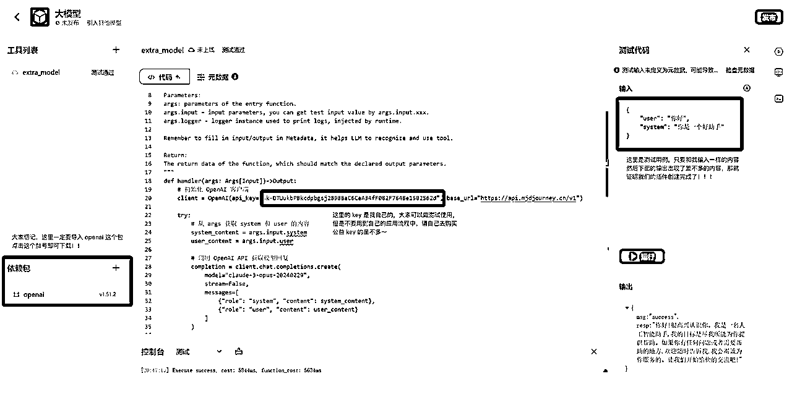

上图的代码可直接拿去跑，留意标注的注意事项，测试用例⬇️

```
{
    "user": "你好",
    "system": "你是一个好助手"
}
```

到这里，插件本体基本就成了，只剩下最后一步小配置⬇️

### 元数据配置与发布

设置元数据 -> 保存 -> 测试 -> 发布。

点开【元数据】按钮，按下图填写，填完保存。

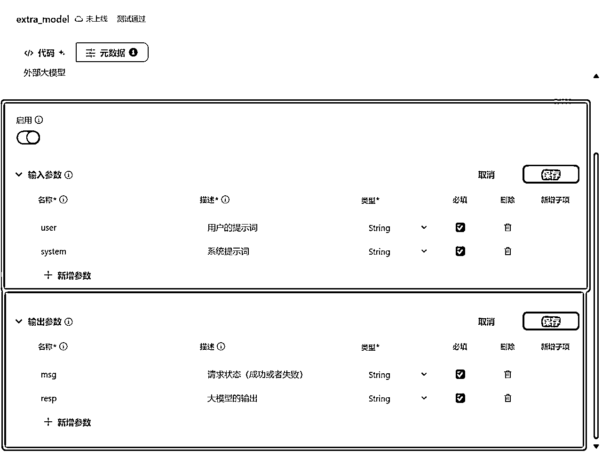

再次测试通过后就点击发布！

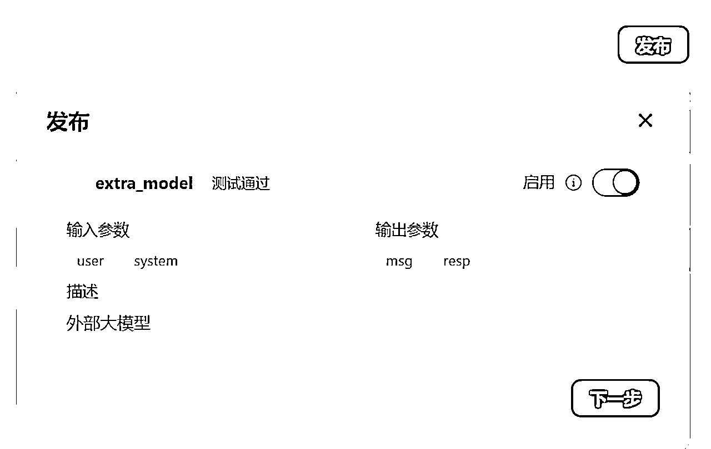

发布后，在工作流里直接调用这个外接的 Claude 节点即可。

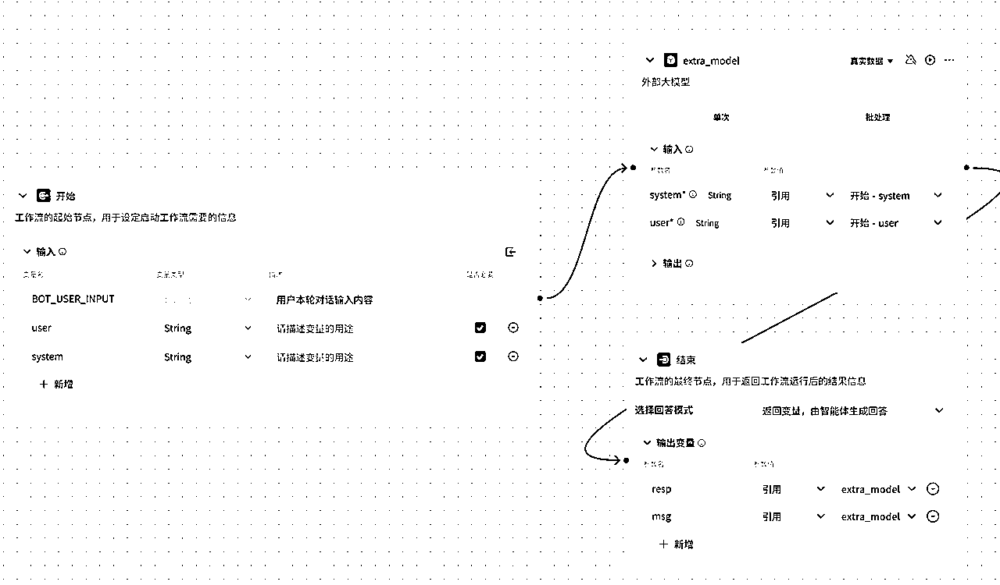

运行效果如下：

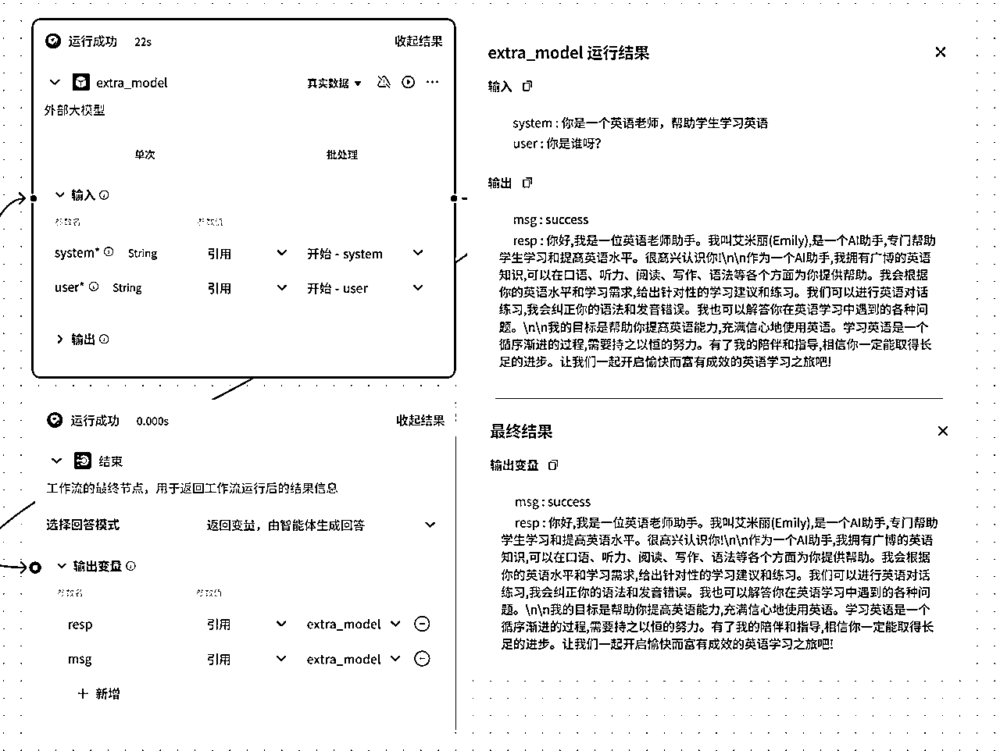

到这一步，外接大模型插件就完整上线了！

# 总结

1.  写代码不是程序员专属，你不需要会编程。
2.  AI 可以帮你把代码写出来。
3.  遇到问题就把问题丢给 AI，让它解决。你唯一要做的就是把需求讲清楚。
4.  这个思路不止适用于 Claude，换成其他大模型也一样能做。

别被技术名词吓住。AI 时代，会用工具比会技术更重要。