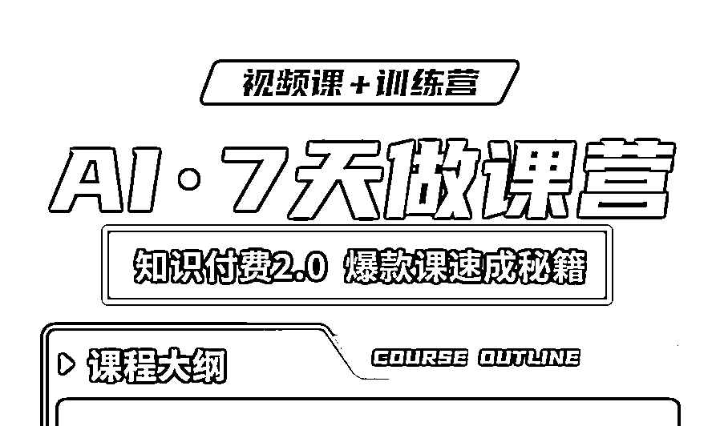
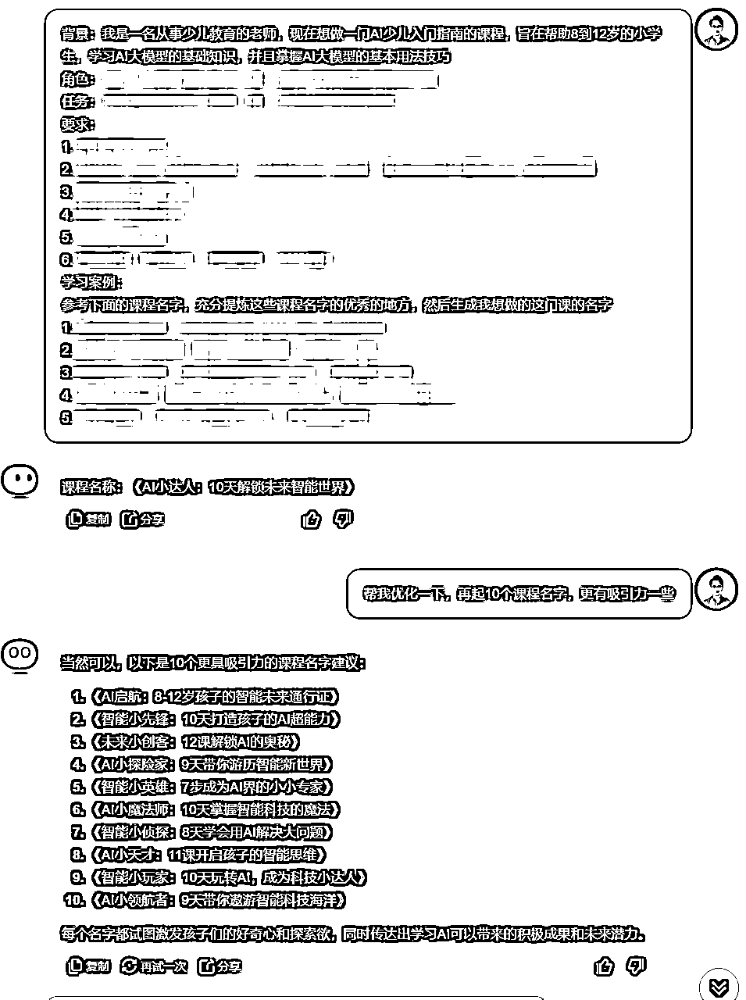

# 哪些课程更好卖？怎么起一个自带流量的课名？AI 真的是取名神器
作者：龙哥

👀 上期跟大家聊了做课需要哪些 AI 工具⬇️

https://t.zsxq.com/MycFR

工具搞定后，下一步就是定位。这篇内容会用一个不太一样的视角，带你搞定课程的精确定位方法，以及怎么借助 AI 选出自带流量的课程名字。

先说说课程定位是什么？

💥 用一句话概括：你靠卖什么产品或服务，给哪类人群解决什么痛点。

🌹 举个例子，半目的课程定位是这样的：用 AI 工具+提示词，帮助自媒体创业者和想做副业的人，高效完成知识付费产品的制作和上线。

别小看这句话，未来它就是你朋友圈签名、👸号简介、📕置顶的标配。相当于陌生人第一次认识你，问你做什么，如果你说不清自己在干嘛，那专业度瞬间就没了。

定位吃透了，再配一个自带流量的名字，就能正式开课了。

# 让爱好、擅长和赚钱三件事兼得

到底做什么课，才能让兴趣、能力、变现三者平衡？

🚬 我建议你今晚抽个时间，关上门，一个人安静下来，端杯酒或点根烟，照着下面的 ①②③④⑤ 顺序，逐层思考这五个问题：

① 我真正喜欢什么？

② 我擅长什么？

③ 我想去学什么？

④ 找对标博主，看这条赛道是否已被验证，跑通情况如何？

⑤ 和而不同 + 差异化

前四点逻辑很直观，主课里有详细拆解和案例。这里重点展开第⑤点【和而不同+差异化】。

举个例子，我在调研做课这个方向时，在抖音、📕、视频号、知识星球都看到不少人在做，而且规模不小。要是我贸然跟风挤进【做课】这个赛道，估计要等很久才能冒头。后来我换了个刁钻视角，切入【AI+做课】这个细分赛道，同样是做课，但我是用 AI 来做课，烟火气一样，但味道不一样，这就是差异化。所以一定要找个巧妙的切入口，这点很关键。

那【和】而不同是什么意思？不同就是差异化，已经讲过。那为什么还要【和】？

还是以我自己为例，你看我的课程海报、头像风格、配色，乍一看就知道是个做知识付费的老师，整体形象很统一。就是要让朋友圈、海报、物料一眼就能看出你在干嘛。如果你打扮花哨、朋友圈随意，客户很难信任你。先在同行框架内【和】起来，再叠加差异化加成，这样的差异化才有根基，后续才有延展空间。

🌙 现在回到书房或沙发，把烟掐了，酒杯放下。结合上面 ①②③④⑤ 的思考，给自己定一句定位：

一句话课程定位：你通过出售xx产品/服务，满足xx人的xx需求。

# 用 AI 起课名，让名字自带流量

方向想清楚了，市场也验证过，接下来就是起一个自带流量的名字。课程名怎么起才有传播力？AI 能不能帮忙？

### <1> 起名的 4 个核心原则

① 名字字数要控制

② 尽量植入行业核心关键词

③ 多用数字

④ 突出结果、收益、效果

后三点比较好理解，主课有详细展开。下面重点聊第①点【字数限制】。

☞ 课名大概分两种形态：

● 偏短款，5-7 个字左右。比如《AI·7天做课营》，适合海报、封面图、文章标题，短小好记，便于传播。

● 偏长款，12-21 个字左右，也叫副标题。比如《知识付费2.0爆款课速成秘籍》，这种长标题的作用是进一步解释主题，通常会带“秘籍”、“手册”等词，用来吸睛，一般放在主标题下方。

● 当然，长标题也可以直接当主标题用，也很常见。

● 半目的建议是，成年人不做选择，长短都要有。

● 海报、宣传图、标题党场景用短名；课程平台上架、详情页等不受字数限制的场景就用长标题，长标题关键词多，对搜索和引流更友好。

### <2> AI 提示词怎么用

上面提炼了 4 大起名原则，不一定全部满足，能往上靠就行。

如果你已经懂原理却不知道怎么落地，卡在【懂了但不会写】的阶段，那就可以交给 AI 来破局。

⭐️【打磨好的「取课名」AI 提示词】是半目老师学员的专属内容，为了保护付费权益，这里就不公开了，还请理解❤️

🎯 以《AI少儿入门指南》为例，可以看到 AI 提示词的产出效果：

💡 AI 给出的结果里，会有很多有灵感的关键词词组，可以做排列组合，再结合上面的 4 大原则，尤其是【行业关键词必须包含】这条，就能拼出一个你满意且自带流量的名字✔️

定位清晰了，名字也有流量了。下一期半目会带大家看一个特别重要的环节：【那种一看就想买的课程目录，用 AI 该怎么写？】

🔚 看完如果有收获，就给半目点个赞👍。也欢迎在【AI+课程制作】这个领域多提问，任何问题我都会尽量毫无保留地解答！