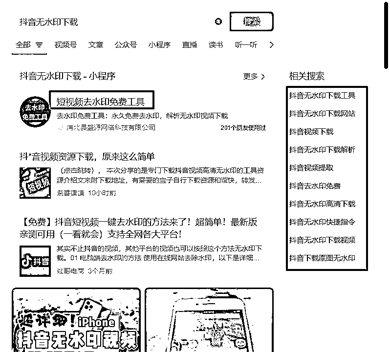
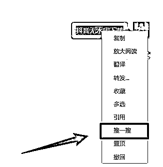
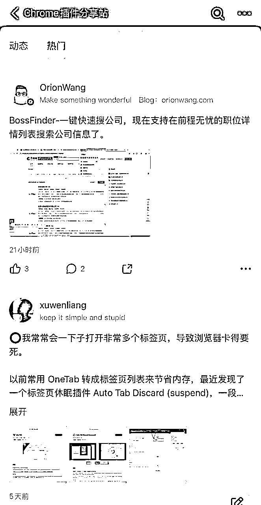
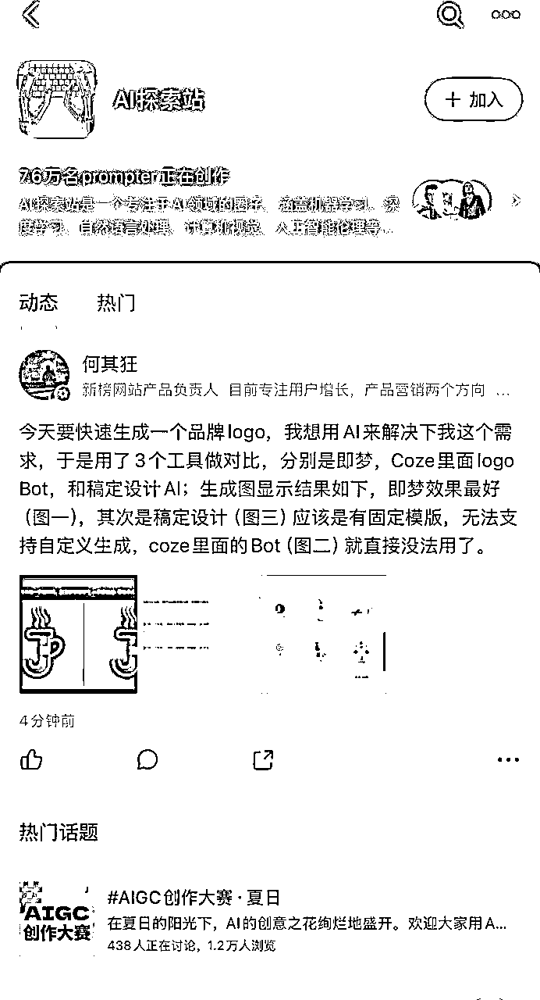

# 提效降本的一百个工具分享

工欲善其事，必先利其器。不管你是做内容、搞运营，还是研究各种项目，手里有几款趁手的工具，效率翻倍、成本减半真不是说说而已。

今天这篇内容，来自我对“提效降本”主题的整理，主要分成几大块：各平台的实战资料库、数据分析工具、AI 黑科技、自动化处理类工具，以及一些找工具的私藏心得。最后我想说的是：与其直接给你一条鱼，不如教会你怎么去钓鱼。

先看资料库这块。龙哥盟的航海实战资料库，基本覆盖了主流内容平台：视频号、抖音、小红书、B站、公众号，还有英文工具站、亚马逊、快团团，甚至资料整理本身都有专门的实战资料库。很多人觉得某个平台的工具只能用于那个平台，其实不然——抖音的工具挪到小红书上一样能打，公众号的玩法换到B站也未必失灵。关键是你得真的点开、试用、然后慢慢迁移思路。

接下来是数据分析工具，这也是运营人最容易花钱的地方，其实很多可以省钱。

做抖音电商，蝉妈妈可以帮你找达人、挖爆品、看直播间和品牌小店，闲鱼上九块钱一张日卡，性价比很高。抖查查则更适合盯直播榜、达人涨粉榜、热销商品和飙升视频。考古加更全面，达人、商品、直播、小店、品牌、视频、关键词都能查，各种榜单也一应俱全。巨量百应是抖音官方给达人、商家、机构服务商提供的商品分享管理平台，可以在里面管橱窗商品、管直播间商品，还能看自己账号的整体交易数据。它免费，但只对五类人开放：开通了商品分享权限的达人、MCN机构服务商、小店精选联盟商家、被邀请合作的外部商家，以及和抖音对接的电商平台。

小红书这边，蝉小红能看博主榜、笔记榜、品牌榜和热搜词；千瓜则擅长商品和达人挖掘，同时还能做热门内容分析和品牌营销行为分析。

视频号数据可以看新视，能找视频号、查榜单，还能做直播分析和直播商品分析，以及流量推广和商务对接。友望数据同样覆盖视频号，有榜单和直播带货榜，也能拆解视频、达人和直播数据。

淘宝商家离不开生意参谋，它能看店铺数据，比如搜索人气、点击量、支付转化率，还有选词助手、商品温度计这些辅助功能。B站这边有火烧云数据，专门分析大盘流量、UP主带货和上单情况。查App数据用蝉大师，苹果和安卓的排名、点击量、下载量都查得到。最后还有5118，做网站SEO和行业词库的，能查到各行业搜索热门词。

小提示：上面这些工具，基本都能在闲鱼买到便宜的日卡，适合短周期集中处理完一批数据。如果某个工具你天天要用，再考虑开月卡或年卡，别盲目长租。

再说说AI工具，这部分真的花活很多。

Podcastfy可以把任何网页、PDF或者纯文本自动变成多语言的播客音频。它是开源的Python项目，和NotebookLM这种偏向笔记整合的工具不太一样，它专注于把文本内容批量“说”出来。

Ebook2Audiobook则是电子书转有声书的好手，支持多语言和声音克隆，还能自动生成章节信息。它整合了Calibre和Coqui XTTS，一条命令或一个网页界面就能完成转换，通勤听书党狂喜。

Voice-Pro是更综合的语音工具箱，支持超过100种语言、400多种声音。基于Whisper等模型，你可以把音视频里的语音转成文字、自动生成字幕、翻译成多国语言，再合成不同语言的配音，一站式搞定。

PimEyes是个反向人脸搜索引擎，上传一张照片，它就能在全网找出哪些网站发过你的图。保护隐私、追踪盗图特别好用，付费版还有监控提醒和删除申请功能。

Bolt.new是StackBlitz出的AI开发神器，不需要配置任何本地环境，直接在浏览器里用AI写代码、跑代码、调代码，最后还能一键部署全栈应用。只要有浏览器，你就能完成整个开发流程。

Open NotebookLM可以把PDF变成播客，开源项目，用Llama 3.1和meloTTS驱动。支持中文，语气和长度都能调，上传文件或链接就能生成自然的对话音频。

Screenpipe更像一个24小时在岗的AI助理，持续记录你的屏幕和麦克风数据，再配合AI替你自动干活。它是Rewind.ai的开源替代品，数据全存在本地，隐私和安全性完全由你把控。

对创意工作者来说，StoryTribe是个免费的在线故事板工具，不需要会画画，拖拖拽拽就能把脚本变成可视化的分镜方案，拍短视频、做营销、做UX设计都用得上。

ComfyUI-AdvancedLivePortrait能从静态照片里提取面部表情，再编辑调整后插进视频里，让人物“动”起来，甚至在没有原视频的情况下也能生成新动画。

HivisionIDPhotos是国产的AI证件照神器，轻量又高效。它支持精准抠图、生成各种规格的标准证件照、排版成六寸照片，还能随意换背景颜色，以后拍证件照真不用再跑照相馆了。

Cursor Directory相当于给AI代码编辑器Cursor准备的最强配置文件库和提示词库。针对不同语言和框架，帮你把代码补全、调试、生成做得更顺手。

PDF Guru Anki是个以PDF为中心的全能办公室工具箱，支持Win、macOS和Linux。它分四大板块：PDF处理、Anki快速制卡、Anki辅助增强、视频笔记，尤其适合学生党和知识工作者。

SD变现宝则是玩ComfyUI的搞钱神器，能把ComfyUI工作流一键变成微信小程序、抖音小程序、微信内H5或普通H5，还自带支付功能。你的工作流API数据存在本地，不会上传服务器，安全性更高；也支持多平台多设备并发，还能设置推广分成，直接走商业化变现路线。

Vozo是个AI视频重写工具，用提示词就能重写脚本、自动配音、翻译语言并同步口型，几秒钟生成一条新视频。想做病毒传播视频或者给老片子换个玩法，它很顺手。

OmniParse是开源的自动数据清洗整理工具，支持文档、表格、图片、视频、音频、网页等多种格式，能把一堆乱糟糟的非结构化数据变成标准、可用的结构化数据，喂给AI做进一步分析。

bilin.ai是沉浸式翻译团队的新作品，主打多语言搜索。你用中文提问，它会自动翻译成多种语言去搜，然后你再选择结果显示语言。想同时看日本、法国、德国等不同语言的资料，又不想一个一个翻墙找，这个工具能把语言障碍彻底抹掉。

Exa AI就更酷了，它要做的是“AI领域的Google”。它拿下了1700万美元的A轮融资，Lightspeed领投，英伟达和Y Combinator也跟投了。它跟那种想取代传统谷歌的AI搜索不一样，Exa专门为AI模型设计搜索，用向量数据库和嵌入模型来理解复杂查询，过滤掉互联网上的垃圾信息，直接返回真正有用的答案。

好了，工具就聊到这里。最后我想强调一句：授人以鱼不如授人以渔。信息整合的能力，其实比工具本身更值钱。看到一份工具清单，别急着收藏吃灰，挑三五个跟你业务相关的，去用、去试、去折腾，再把不同平台的玩法互相迁移，你才能真正体会到“提效降本”的威力。

希望这份清单对你有启发，我们下次继续挖好料。

## 从一张草稿开始：MistoLine与我的工具践行笔记

最近在研究AI工具时，碰到了MistoLine。简单说，它是基于SDXL-ControlNet打造的图像生成模型，擅长适配各种风格迥异的线稿，并生成与原始轮廓丝丝入扣的高质量成品。不论你丢给它手绘草图、其他预处理器提取的线稿，还是模型自动描绘的轮廓线，它都能稳稳接住，让想象落成画面。这段介绍来自@小互的付费内容摘录。

说实话，我买下这份资料后也没逐字啃完，但为了写这篇文章，我开始重新挖掘自己的信息源，把一个一个工具亲手用起来。这让我再次确信：最有效的成长路径，其实就是做一个“践写者”——在写作中去实践，在实践里再写作，两者互为助推。动手试过，你就知道接下来该写什么、该往哪里深挖；而写着写着，你又会发现自己还需要学什么、做什么。写激活行动，行动反哺写作，循环越来越顺。

### 一、AI时代，先让自动化工具帮你省时间

为什么非要研究自动化？有句话让我至今难忘：“你浪费了数年，因为你无法浪费几小时。”换句话说，我们常常陷在忙碌里，却没勇气花一小段时间跳出来思考。关于这个陷阱，有太多值得咀嚼的瞬间：

- 上学时，不问原因照做作业会被表扬；工作后，不问“为什么做”却被现实狠狠教育。
- 忙碌是个恶性循环：今天忙，明天只会更忙，永远没空质疑、委派或重新排序。
- 如果你不知道自己最重要的问题是什么——恭喜，你正好发现了它。
- 拼命清空收件箱，往往只是在制造新的回复。
- 一天不是24小时，扣除睡眠这个“时间税”，你真正支配的只有16小时。
- 如果忙到连20分钟思考当天要事的时间都没有，那大概率该停下来花1小时思考。
- 打开去年同期的日历，以今天的视角回看，你会发现自己浪费了多少时间。
- 能量剃刀法则：不主动安排“充电型”行动，它永远不会发生；不监控“耗电型”行动，它会无限膨胀。失去掌控感的道路，最终都通向熵增。
- 带着流水线工人的思维走进无限杠杆时代，就像戴着拳击手套去参加无人机战争。
- 技术工作者平均不到6分钟就会检查一次通讯工具；许多人忙到飞起，却几乎没什么产出。
- 清晰思考的价值从未如此之高，忙碌的价值从未如此之低。

所以，自动化工具的价值，就是“花几小时搭建，替未来省下无数小时”。

**1. Coze智能体航海手册**

如果ChatGPT代表AI 1.0，那以Coze为代表的智能体就是AI 2.0。它不完全依赖对话，而是直接帮你执行：生成PPT、把抖音视频改写成小红书笔记、处理证件照换脸……过去那些重复的文案搬运和SOP式工作，一键就能交给智能体。手册链接：https://scys.com/view/docx/FfxLddw8DoDHnLx51EbcnAHDn3g （可在龙哥盟索引站打开）

**2. RPA提效航海手册**

RPA（Robotic Process Automation）最擅长处理那些重复且规则固定的操作，把人从繁杂劳动中解放出来，去做更有创造力的工作。对于没有编程基础的人来说，RPA是上手自动化的最友好入口——不需要写代码，也能组装出属于自己的7×24小时数字员工。手册链接：https://scys.com/view/docx/Onl7dyK2vosOPuxVq3mcCXqtnbc （龙哥盟索引站可打开）

**3. AI编程航海手册**

过去写代码需要懂Python、C++、Java，非科班出身总觉得门槛太高。但随着ChatGPT 4o、Claude 3.5等大模型出现，编程变得前所未有地简单：你只需要提供想法，AI不仅能写码，还能帮你查Bug，几乎零基础也能完成工具开发。手册链接：https://scys.com/mobile/activity/landing?id=4246 （龙哥盟索引站可打开）

### 二、数据整理工具：国内外靠谱数据源一网打尽

做研究、写报告、定决策，离不开可靠数据。下面这些网站，基本覆盖从宏观经济到行业细分的需求。

**国内数据源**

1. 大数据导航（https://hao.199it.com/）——集合数据分析、可视化工具及行业数据源的综合导航站，适合分析师、市场研究人员快速定位资源。
2. 国家统计局（https://www.stats.gov.cn/）——官方权威统计门户，提供宏观经济、人口、社会等维度的全面数据，学者、政策研究者、企业决策者必备。
3. 阿里研究院（http://www.aliresearch.com/cn/index）——聚焦数字经济、互联网经济的前沿研究，适合电商、科技领域研究者与投资人获取趋势洞察。
4. 中国统计信息网（http://www.tjcn.org/）——提供各地区、各行业的详细统计信息，企业管理者和研究人员可以按需查询。
5. 统计年鉴（https://www.zgtjnj.org/index.aspx）——在线查阅历年《中国统计年鉴》，适合做历史数据对比和系统性分析。
6. 商务部官网（https://www.mofcom.gov.cn/）——想了解国际贸易、投资、商务政策动态，这里是最权威的信息源之一。
7. 中国政府网（https://www.gov.cn/）——中央政府的官方门户，政策文件、公告、政务信息都能第一时间查看到。
8. 文旅部政府信息公开专栏（https://zwgk.mct.gov.cn/zfxxgkml/447/465/index_3081.html）——专注文化和旅游领域的法规、政策与行业信息，从业者和研究者都能用上。

**国外数据源**

1. 世界贸易组织（https://www.wto.org/）——全球贸易规则、谈判进展、争端解决案例以及各国贸易数据，外贸从业者和经济学者可以在这里查到大量一手信息。
2. 世界银行数据中文版（https://data.worldbank.org.cn/）——覆盖全球发展数据，支持交互式可视化、趋势比较、历史数据下载，是发展研究者的宝藏。
3. 美国经济分析局（https://www.bea.gov/）——查询美国GDP、个人收入、国际贸易等核心经济指标，并提供详细的分析报告，想研究美国经济必看。

**行业数据与洞察**

1. 移动观象台（https://mi.talkingdata.com/index.html）——TalkingData旗下移动应用数据分析平台，App开发者、营销人可查市场数据、用户行为，还能追踪广告效果。
2. 极光大数据（https://www.moonfox.cn/insight/report）——提供App与行业分析报告，移动互联网从业者、投资分析师可快速获取用户画像与行业趋势。
3. 前瞻经济学人（https://www.qianzhan.com/analyst/）——深度行业研究报告与宏观经济数据，适合企业决策者、战略研究者。
4. 七麦数据（https://www.qimai.cn/）——专注App榜单、下载量、ASO优化，产品经理、推广从业者可以在这里做竞品分析和关键词研究。
5. IT桔子（https://www.itjuzi.com/）——创业公司与投资机构的信息库，投融资事件、行业动态、创业生态分析都能在这找到。
6. 镝数聚（https://www.dydata.io/）——在线数据可视化与图表制作工具，提供丰富模板，适合数据工作者快速产出图表。
7. 易观智库（https://www.analysys.cn/article/analysis/）——互联网行业分析报告与用户行为数据，研究新兴技术和商业模式很有价值。
8. 企鹅智库（https://news.qq.com/ch/tech）——腾讯新闻旗下科技频道，提供最新科技新闻、行业分析和产品评测，普通读者也能轻松阅读。
9. 数位观察（https://www.swguancha.com/）——专注数字经济和科技创新的分析平台，对数字化转型政策和商业模式创新感兴趣的可以关注。

这些数据源覆盖了宏观数据、行业研究、投融资、可视化等领域，基本能支撑大多数研究、写作和商业决策需求。

### 三、10个提升幸福感的小工具

除了大而全的数据平台和自动化框架，下面这些小工具也经常让我眼前一亮。

1. **好用便签**：跨Windows/macOS/iOS/Android的云端便签，界面干净无广告，适合随手记笔记和待办。下载：http://m.haoyong333.com/
2. **手写体文稿生成器**：免费手写模拟工具，内置十几种手写字体。复制粘贴就能生成手写稿，帮家长和学生省掉大量誊抄时间。使用：https://vtool.pro/handwriting/index.html
3. **VertiTab**：浏览器标签页管理插件，支持Chrome/Edge，把标签页改造成垂直侧边栏，还带缩略图、画中画、视频控制、阅读进度等功能。下载：https://www.rabbitpair.com/zh
4. **uBlacklist**：Google搜索结果过滤插件，支持匹配模式或正则表达式指定规则，屏蔽不想看的网站，也支持多个搜索引擎。安装：https://chromewebstore.google.com/detail/ublacklist/pncfbmialoiaghdehhbnbhkkgmjanfhe?pli=1
5. **核烁复制粘贴助手**：Windows剪贴板工具，快捷键处理文本、图片和数学表达式，还能导出为图片、Word、PDF等格式，附带自动去空白、合并多行、计算表达式等效率功能。下载：https://www.wodeabc.com/article/show/8002660
6. **AskAITools**：AI工具搜索引擎，快速查找文本生成、图像处理、数据分析等方向的AI工具，适合给项目找帮手。访问：https://askaitools.ai/
7. **OncePower**：基于Flutter开发的批量重命名工具，支持Windows，还能批量删除空文件夹、移动文件。支持前缀后缀替换、CSV批量指定文件名，不用学正则就能应付高级匹配。下载：https://github.com/ilgnefz/once_power/releases
8. **Fideo**：开源的直播录制软件，支持抖音、YouTube、Twitch、Bilibili等平台，可以监控直播并录成MP4。官网：https://www.fideo.site/cn ，下载：https://github.com/chenfan0/fideo-live-record/releases
9. **小云搜索**：网盘资源搜索引擎，覆盖阿里云盘、夸克、百度、迅雷、蓝奏云、天翼云等，输入关键词就能找到分享链接。访问：https://www.yunso.net/
10. **codebox**：浏览器插件，支持Chrome/Edge/Firefox，在CSDN、知乎等网站一键复制代码，还能下载整篇文章的HTML或Markdown，并自动去除登录弹窗、关注提示。下载：https://github.com/027xiguapi/code-box

这些小工具我会持续更新在飞书文档里，大家有问题也欢迎随时指正。

### 四、找工具的方法论：搜索框+论坛

最后聊聊我是怎么发现这些工具的。其实很简单，就是用好你触手可及的搜索框。

- 龙哥盟索引站
- 浏览器：百度、谷歌、搜狗、搜狐等
- 微信搜索：
- 更绝的是，在微信里随便长按一条消息，点「搜一搜」，也能直接跳到搜索界面，非常方便。
- 自媒体平台：抖音、小红书、快手、即刻、Twitter（X）、Telegram……这些平台的信息量极其庞大，用好搜索框，基本能解决99%的需求。

另外就是各类论坛，最典型的比如GitHub（https://github.com/，需科学上网）。上面的开源项目、工具仓库、开发者讨论，常常藏着意想不到的宝藏。

本文整理过程中，一部分是人工收录，一部分由AI辅助成稿，欢迎大家在评论区补充更多好用的工具。

在这个信息泛滥的年代，真正值钱的不是“信息量”，而是知道好东西去哪儿找。

先说GitHub。在代码托管这个领域，GitHub就是绕不开的“顶流”。短短几个字背后，是全世界最大的开源社区：代码完全公开，谁都能围观、修改、拿去用，本质上给程序员和开发团队配了一套集中式的在线协作工具。底层跑的是Git技术，分支管理、版本控制、问题追踪、代码审查这些硬核功能全都集成在里面，从单打独斗的极客到几十人的技术团队，基本都离不开它。

再来看吾爱破解论坛。英文名Love Crack Group，缩写LCG，专注软件安全和病毒分析，也兼顾PC和移动端的攻防技术交流。在国内破解圈子里，它的名号最响亮，想钻研逆向、破解、安全防护的老手新手，多半都在这儿出没过。

CSDN则走的是“专业开发者社区”路线，给广大开发者提供趁手的工具和免费平台，你可以快速搭建属于自己的开发者主页，然后在社区里大方分享经验和项目成果，技术氛围相当浓。

说实话，上面这几个渠道，对普通人来说已经能覆盖九成以上的日常需求。不管是为了工作提效，还是想学点生活技巧，里面的信息量都超乎想象（这套方法来自张子安）。

除了这三个，还有一个平台也值得重点挖——即刻。

在即刻里，“Chrome插件分享站”绝对让人上瘾。Chrome浏览器最迷人的地方就在于扩展插件，装上之后功能像搭积木一样越加越丰富，有时候一款不起眼的小插件，就能彻底刷新你的使用体验。

另一个宝藏圈子是“AI探索站”。这里专攻AI领域，话题覆盖机器学习、深度学习、自然语言处理、计算机视觉、人工智能伦理等方方面面。你既能刷到前沿技术和最新研究成果，也能把自家经验摆上台面，和行家、同好一起交流碰撞。

当然，想再往上走，付费也是绕不开的路。花钱进星球、进圈子，意味着你能挖到更多有趣有用的工具，更关键的是那些“工具怎么用才值钱”的打法。这层就不展开推荐了，留给你们自己去探索。

希望这篇整理能给你一点启发。有疏漏的地方，欢迎指正；有更好的补充，也随时欢迎交流。