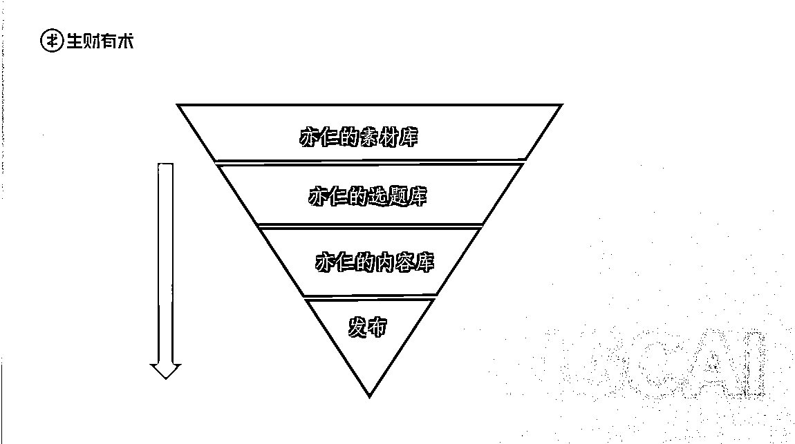
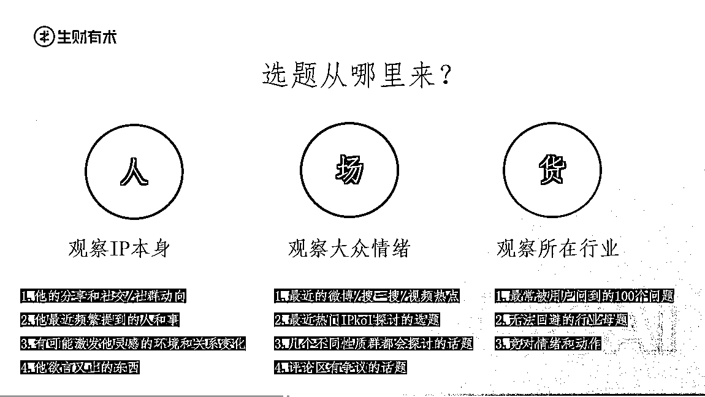
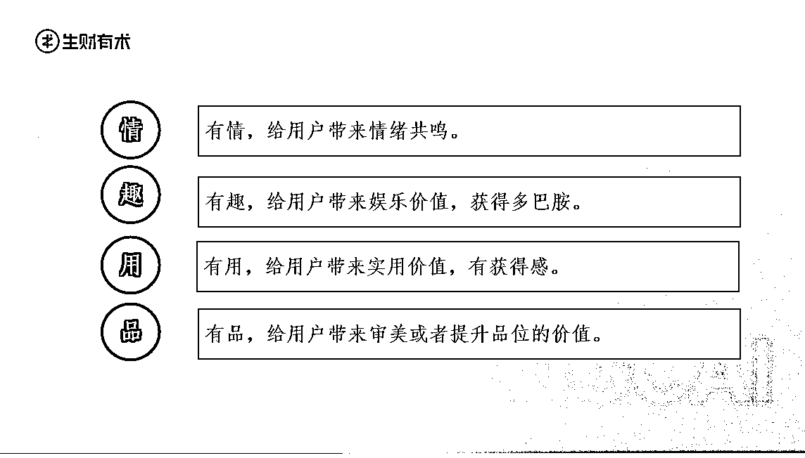
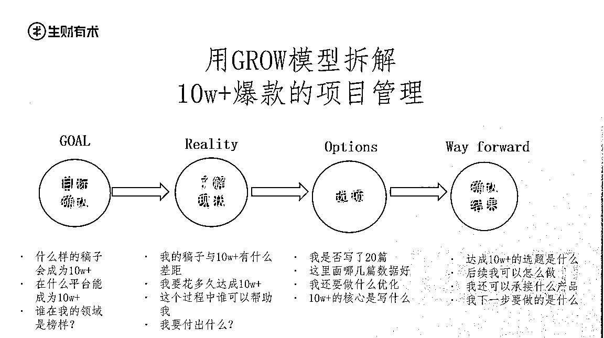
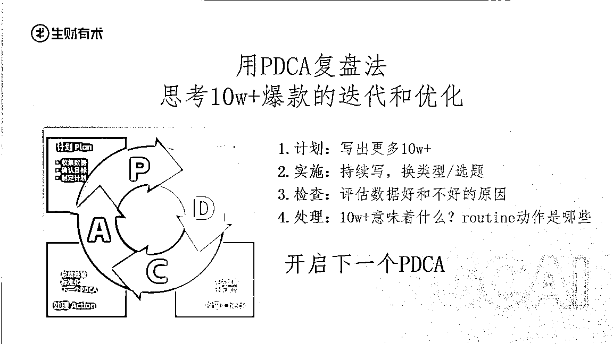
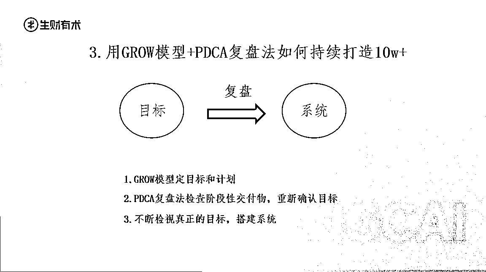

# 10年内容人、两本书作者拆解：爆款选题到底怎么长出来的

> 来源：[https://shengcaiyoushu01.feishu.cn/docx/CtmxdygV8oizIjxgojocK4Axnrd](https://shengcaiyoushu01.feishu.cn/docx/CtmxdygV8oizIjxgojocK4Axnrd)

大家好，我是七天。曾操盘《精进：如何成为一个很厉害的人》的百万级营销，在网易、阿里做内容运营五年，同时也是两本畅销书的作者。《大大的城市，小小的我》卖出了繁体版权，《别在成长的年纪选择平庸》拿到2018年当当新人作家。

上期聊了什么叫好内容，这期就直接聊干货：如何打磨出能爆的选题。

## 谁在决定一个选题算不算爆款

先抛个问题，爆款的定义权在谁手里？作者自己？平台？还是用户？

直觉上很多人会说用户或平台。

平台确实会推。但平台的推荐逻辑是区域性的，它推的是当下它判断为合适的方向，比如前两年猛推露营，去年推户外夜骑和社区小店逛吃。

但平台的内容池极大，它很难做上限管理，更多是在划下限，告诉你什么不能发，违禁词是什么。只要选题没踩红线，平台是允许你去试的。

那试的结果谁来判定？自然是用户。

点赞、收藏、评论就是最直接的反馈信号。能撬动用户主动互动的选题，才是真正的好选题。

换句话说，你的主旨能不能戳中特定人群的关注点，结论有没有分歧和讨论空间。

比如龙哥小灯塔的“心力”系列是怎么来的。当时外界都在喊钱难赚，如果我们继续鼓吹赚钱机会多，反而脱离了用户的情绪现场。

我注意到李翔的《论心力》引发了关注，“看一看”里教员的《心之力》也在走红。大家普遍处于能量低谷，这时候不如提供一些抚慰和缓冲，让用户先把心力蓄满，把赚钱当成一场持久战。

于是小灯塔的内容就呈现出立体感：《如果财富归零，我去哪里找赚钱机会》是干货，《如何对各种赚钱信息做有效判断》是认知，《如何提升自己的心力》是情绪。

IP一旦能覆盖用户的多维情绪，在不同层面持续表达，就更容易获得反馈。想做持续爆款，别盯着爆款本身，要先建立持续获取反馈的系统。

## 怎么做出10万+级别的爆款

聊到选题，很多朋友第一反应是找对标、抄竞品。但要问清楚，竞品火的是选题、标题、内容还是形式？

关键在于识别爆款的构成因子。

我自己总结的一个框架是：
爆款选题 = 客观概率 × 情感共鸣 × 角度创新

### 1.客观概率：爆款是算出来的，不是撞大运

好选题一定是站在大盘上的小切口，并且能持续产出。

人物写作课里提过，爆款基本集中在四类公共议题：社会议题、互联网议题、情感议题、性别议题。

切法分两种：新议题，和旧议题的新角度。比如年轻人对考公入体制态度的转变，就是旧议题的新角度；70%的00后想做数字游民这类数据，则属于新议题。

选题要够宽以覆盖人群，够窄以让人有感，而且要能连写。

怎么连写？
第一，保持素材库，持续收割最新热点和信息；
第二，保持选题库，把灵感和观点沉淀下来；
第三，抓住表达窗口，在用户情绪峰值点把观点抛出去。

以龙哥的选题库搭建为例：
第一步，用漏斗模型做素材→选题→发布库→发布的闭环；
第二步，用“人货场”模型把选题类型穷举出来，每周迭代补充。

### 2.情感共鸣：好选题用四个字概括

有情、有趣、有用、有品。

有情，是带来情绪共鸣；
有趣，是带来娱乐和多巴胺；
有用，是带来实用价值和获得感；
有品，是带来审美和品位提升。

### 3.让用户有反应，选题才算成立

我之前在小红书发过一篇《一个过得不好的女孩的共性：极度拧巴》，很快破5000赞。评论区最高频的不是夸我写得好，而是“这不就是我吗”“拧巴本拧，焦虑本虑”。好内容就是替用户把想说的话说出来。

所以看竞对，不要抄内容，要拆观点。标题、金句、核心观点是参考点，爆的原因是选题精准击中了用户的真实需求。

### 4.角度创新：风格即壁垒

比如意公子的文艺娓娓风，tim的极客geek风。脱口秀里豆豆的表演型，呼兰的历史夹私货式嘲讽，唐香玉的幽默自嘲+女性视角。

风格本身就是注意力抓手，注意力最终会转化为点赞评论。

风格怎么来？
IP没有优劣，只有是否系统化表达。
故事是你的外在、内在与挑战；
成就是你的背书、经历与案例；
专业是你的金句、资料与知识。

把这些元素做成SOP，灵活重组，就是可复制的个人风格。

## 我的8条选题实操思路

1. 热门爆款的评论区，就是下一批选题池。
2. 盯异常值。比如闲鱼二次元产品置换量激增，电子茅台这类话题就值得切入。
3. 从自己的日常痛点出发。下班没电、副业变现焦虑，都是真实选题。
4. 看人物、36氪近一年高阅读文章，热门基本还是四类议题，可分为新议题和旧议题新角度。
5. 从商业解读入手。以拼多多为例，拆解创始人风格、 黄铮的原文，提炼观点。
6. 建素材库，让零散信息为主题服务。做主题时不用现找菜，料齐了自然成文。
7. 从全网热点反推本质。热点的关键不是热点本身，而是背后的为什么。比如电子父母火了，本质是情感代偿，类似逻辑可推演到电子房东、电子地主，都是情绪价值与现实落差产生的现象。
8. 学会重新定义。钱是什么？钱是你价值的奖励。你赚了谁的钱，就要为谁打工。这类定义型提问本身就是好选题。

对创作者来说，爆款选题不该是目标，而应该是系统的结果。

最后三点收敛：
1. 建爆款内容系统，而非单点爆款选题。系统才能让正确的事情持续发生。
2. 用产品经理思维写作，拆解、复盘、设定发酵周期。
3. 任何爆款都是在特定时间、空间里，击中了特定人群的情感需求，产生了共振与链接。

如果你在做IP，或卡在内容持续化上，欢迎在评论区聊聊你的卡点和思路。