# ('如何从数据分析看股市，以及一些投资工具总结', (2, 23))

最近A股的热度简直能把人烤化，开户和加仓成了朋友圈高频词。我刚好刷到一个深度分析股市的视频，又翻了些实用工具，一并整理出来分享给大家。

先来一个老故事：牛顿在1720年那场股市泡沫里几乎亏光了积蓄，他感叹，天体的运行轨迹我能算清，可人性的疯狂永远算不准。这话放在今天的A股，依然像一句预言。

视频是老周横眉制作的。他花了上百个小时，把上海证券交易所2005至2023年间的统计年鉴翻了个遍。这些报告每本都有八九百页，厚一点的甚至上千页，公开挂在官网，但极少有人能认真读完。老周把其中最核心的规律和数据抽了出来，我再做了点补充，下面进入正题。

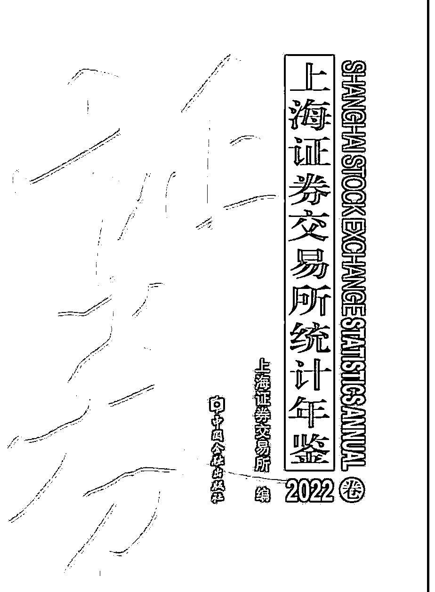

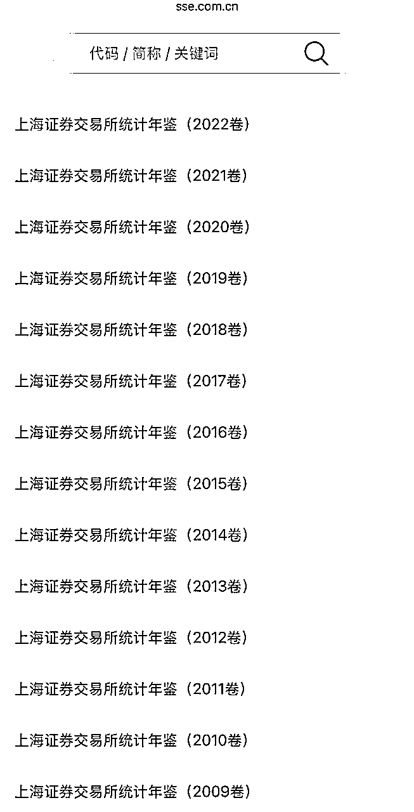

先看中美两国的股市曲线对比。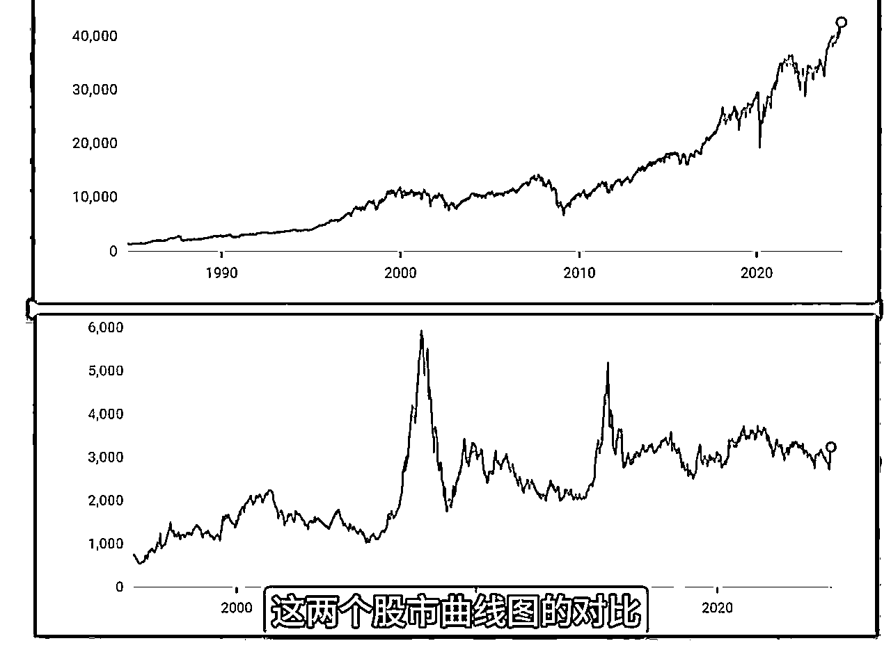 美股道琼斯指数在近40年里基本一路向上，只有碰上2008年金融危机、2020年新冠疫情这类黑天鹅事件才会明显回撤，但随后总能收复失地。1985年拿出10万元买纳斯达克综合指数ETF，放到现在市值约745万元。反观上证指数，总是在某个时点突然疯涨，然后突然崩盘，折腾几十年几乎没长进。每一轮疯牛之后必定跟着股灾，而股灾的本质就是一场大规模财富再分配——富人越富，中产越穷，底层沦入赤贫。

A股为什么这样暴涨暴跌？第一，它是典型的政策市，并不遵守市场规律。1992年以来，中国GDP从4270亿美元膨胀到18.5万亿美元，翻了43倍，而上证指数几乎原地踏步。2020年全球疫情肆虐、2022年多地封城停产，A股也没有怎么跌。所谓“股市是经济晴雨表”，在A股完全是个伪命题。

第二个原因更关键：投资者结构。美股接近八成成交来自专业机构，散户的贡献只有两成。A股则完全倒挂：82%的成交量由散户促成，机构只占18%。

截至2022年末，中国共有4638万个持股账户，其中机构和企业账户只有12.49万，个人投资者多达4626万，占比高达99.73%。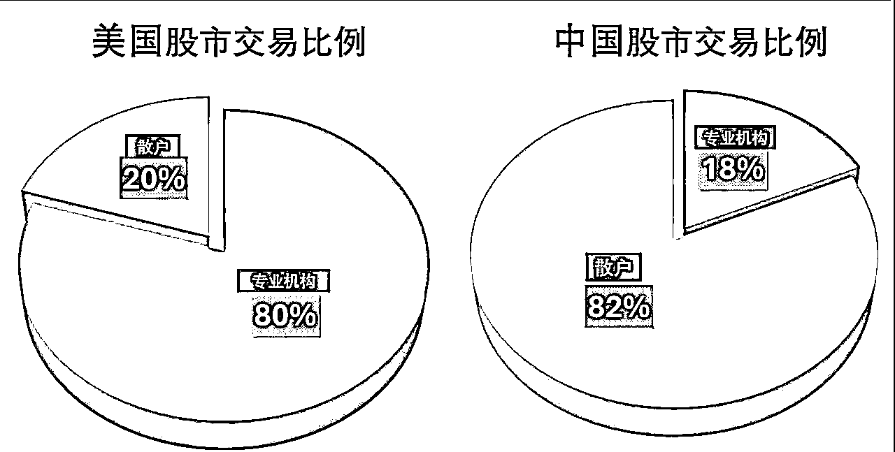 这当中近90%的投资者本金不超过100万元。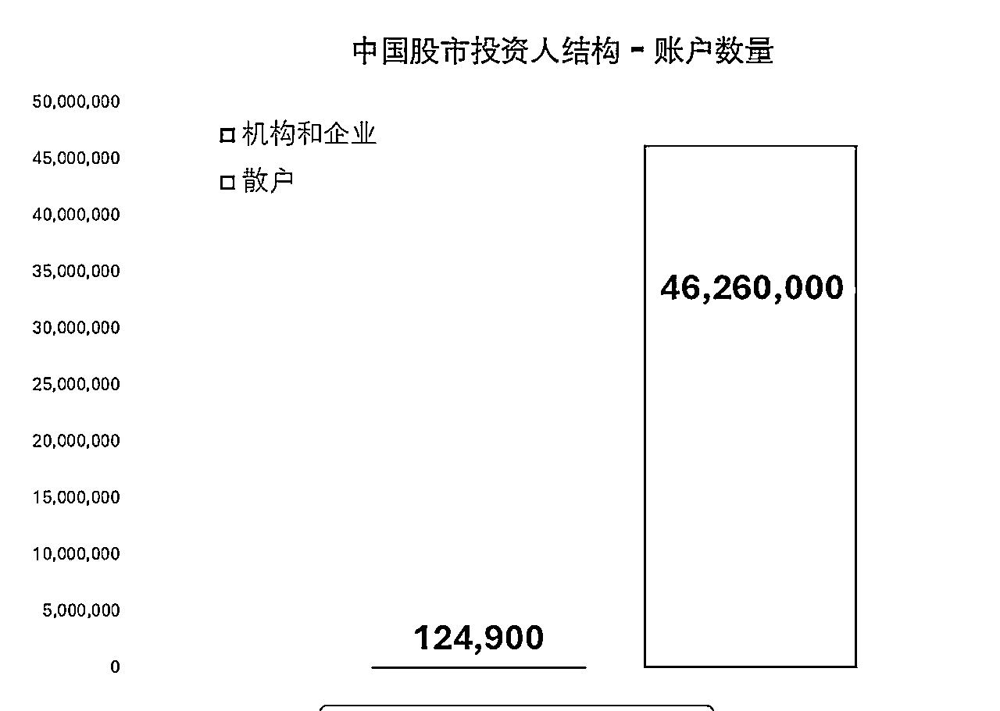 本金低于10万元的账户有2305万，也就是说，A股接近一半的参与者都是超小型散户。而账户资产在300万以上、勉强算得上专业级的个人投资者，一共只有146万户，占股民总数约4%。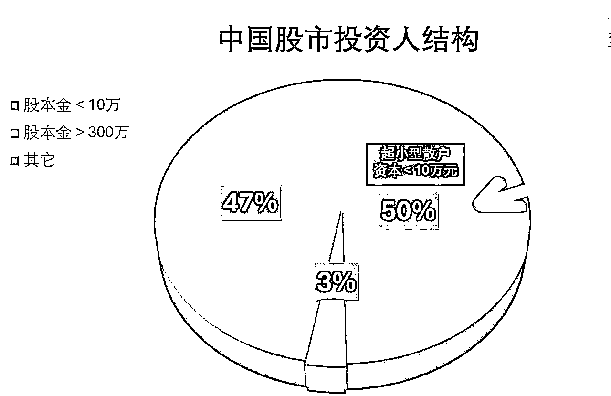

中小散户的共性是什么？本金少，专业知识欠缺，抗风险能力弱。加上急于求成，他们对市场信号过度敏感，买卖频率高得惊人。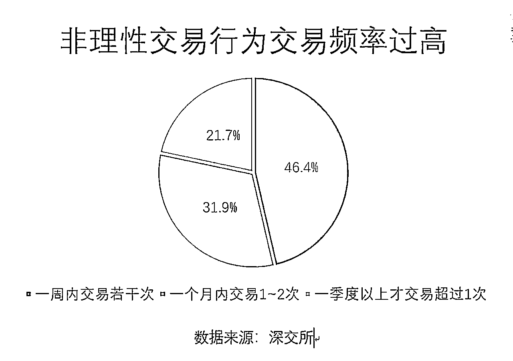 美股散户一年平均交易15次左右，A股散户平均每年要交易60次。另一个毛病是盲目跟风，只要牛市影子出现或政策利好落地，大批人便不顾一切往里冲。

今年国庆前的场景就是样本。长假期间券商加班加点给个人开户，九月下旬以来新增账户超过六百万，尤其90后、00后冲得最猛，因为他们还没被A股烫过手。若不是节后开盘两天就大跌，恐怕还有几百万甚至上千万人在排队进场——这些人真该谢天谢地没能开户成功。资金疯狂涌入，交易额自然井喷，平时A股单日成交约九千多亿，10月8日开盘20分钟就破万亿，下午两点超过3万亿，刷新历史纪录。这种一涨就抢、一跌就逃的换手率，把市场波动推向了极端。

散户虽然贡献了最大交易量，但赚钱能力弱得可怜。以上交所数据为例，2017年算盈利年景，交易额里82.01%是散户贡献的，但盈利部分他们只拿到不足9%。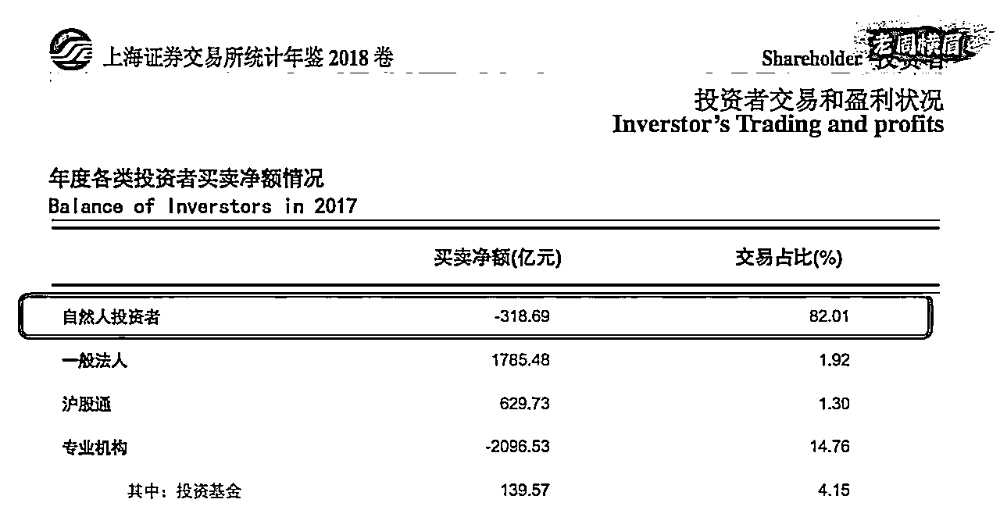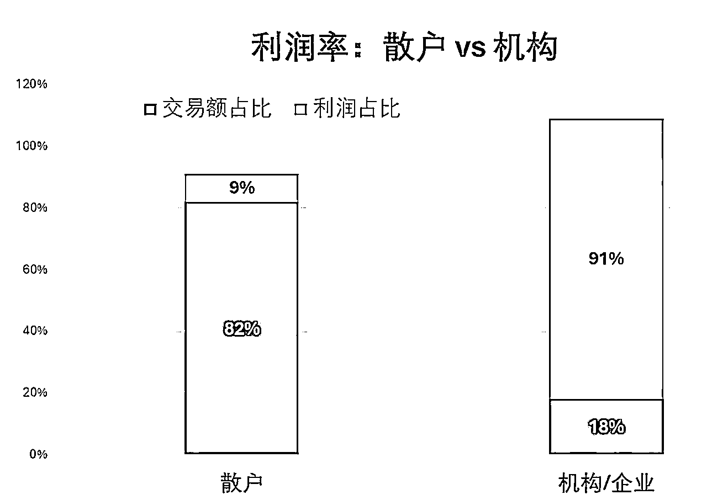 那年A股总盈利3.45万亿，散户仅获3108亿。机构用不到18%的交易额，拿走了91%以上利润，两者利润率差距达46倍。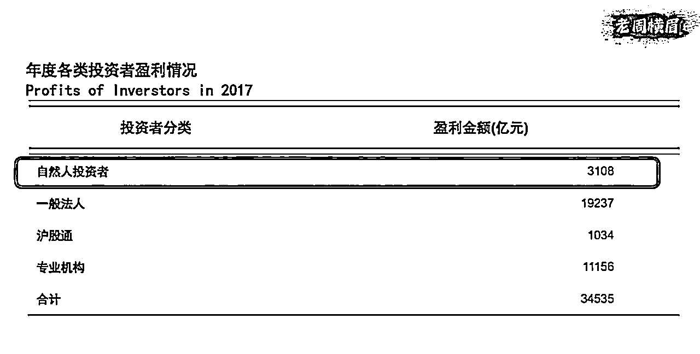

亏损年份则更加残酷。2016年机构持股市值14.34万亿，散户持股市值5.66万亿，约为机构的39.5%，但当年散户亏损约7100亿，接近机构亏损额（9820亿）的72%。换算成亏损率，机构为6.85%，散户达到12.54%——散户的亏损率正好是机构的两倍。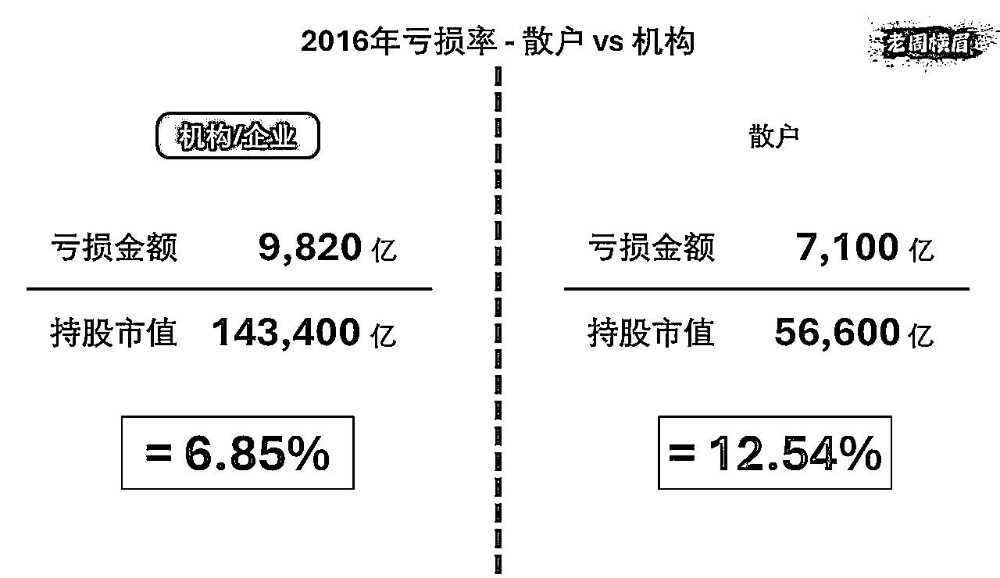

也就是说，大家都在赚的时候，散户赚得极少；大家都在亏的时候，散户亏得极多。不过散户内部也不是铁板一块，上面说的其实是中小散户，与那些资产千万级的顶级大散户无关。想要看清A股如何把穷人的钱搬给富人，得拆解一轮完整的疯牛和股灾。

最典型的就是2015年。牛市从2014年7月启动，2015年6月12日冲到5178点，然后股灾降临，两个月内跌到3500点，半年后跌至2638点，时至今日也没完全恢复。我们把2014年7月至2015年12月这18个月的数据单独拎出来，把投资者分成机构、企业、散户三组，企业组中包含大量国家队。散户按账户资产再分四档：G1小于50万，G2为50万到300万，G3为300万到1000万，G4为1000万以上。

账户数方面，机构和企业加起来不过2%，剩下99.9%都是散户。其中G1人数最多，占总投资者85%，G2占12.6%，G3占1.9%，G4占比极少。但真正要看的是市值和交易量分布。这18个月中，企业平均持有64%市值，交易量却不到2%；机构握有11%市值，贡献12%交易量；散户只有25%市值，却完成近90%的交易。散户内部四档差距倒不大，G1市值占5.9%，G2占7.1%，G3占4.3%，G4占7.8%，成交量均在16%到26%之间。

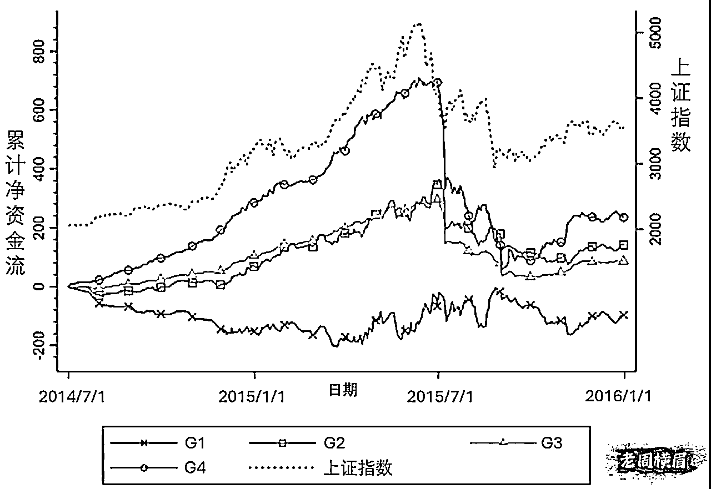

对照指数走势看，2014年7月至2015年3月，股市已缓慢走高。此时有钱人正悄悄进场，G4大散户疯狂加仓，G2和G3也在买入，唯独G1小散户还在净卖出，直到2015年3月仍处于离场状态。到了疯牛最热的第二阶段，所有人都在加仓，但G1依然反复横跳，高频进出。拐点出现在2015年6月中旬，指数见5178点后一回头，G4立刻大幅撤退，阶段内减持超过4000亿，带着巨额利润离场。G1则以为这是黄金坑，继续加码买入，成功接了大户的盘，直到8月指数跌去30%到了3500点才醒悟，可惜为时已晚。国家队企业一直等到8月底指数跌到3000点附近才大举进场，接收中小投资者抛出的筹码。

最终统计，这18个月中专业机构新进场资金仅800亿，散户却投入了1.3万亿，是机构的16倍。企业和国家队不仅没有新钱进场，还趁机套现约1300亿。也就是说，这场疯牛的上半场靠散户1.3万亿硬扛，下半场以散户被收割结束。结果，占股民总数不到5%的顶级大散户和2%的机构、企业，拿走了占总数97.5%的中小散户的钱。G4大散户资产从1.24万亿增至2.2万亿，净增约9531亿，涨幅76%；30万以下小散户总资产从1.3万亿降至8691亿，缩水33%。

A股的大牛市，就是普通人财富蒸发最快的路径，也是中产返贫的高速路。如果你是小散户，最好盼着A股永远没有疯牛。平稳年份里，虽然散户整体依旧亏钱，但亏得少，与大户、机构的差距也小。2014年6月之前的两年半就属于平稳期，没有大起大落。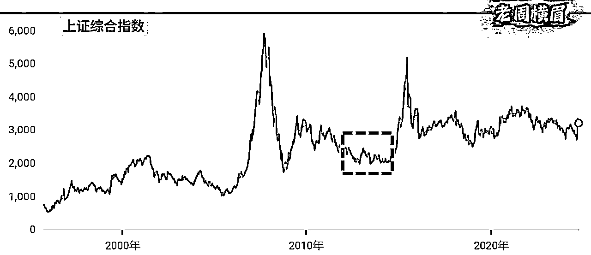 任意18个月中，G4大散户资产增长约31%，小散户资产缩水仅3%左右，对比牛市里缩水33%，简直是小巫见大巫。

拉长到15年看更加残酷。下面这张表统计了2008年到2022年企业、专业机构、千万级大散户和10万级超小型散户的持股市值变化。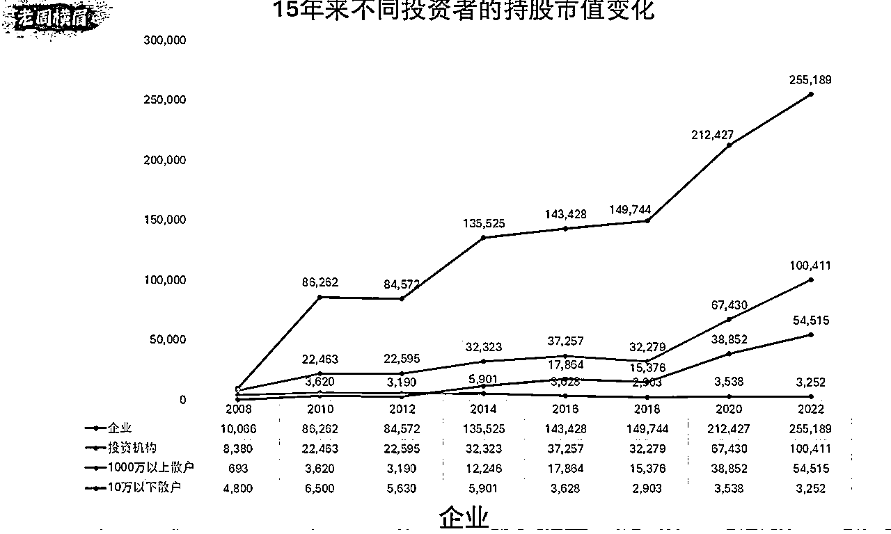 结果一目了然：所有群体的市值都在涨，唯独10万以下小散户在缩水。大散户持股市值从693亿增长到5.4万亿，翻了75倍；企业翻25倍；专业机构翻12倍；小散户却缩水32%。也就是说，机构、企业和大散户都是小跌大涨、整体升值，小散户则是大跌小涨、本金不断被蚕食。

散户资产的蒸发，大多发生在牛市之后的股灾中。2007年上证冲到6124点，一年后跌破1800点，散户合计损失2.19万亿，平均每户亏损超7万。2011年的小牛市，散户亏损8759亿。2015年，30万以下小散户亏损4000亿后，当年有300多万人销户。

再看今年国庆前的开户潮，不由得想起黑格尔那句话：人类从历史中学到的唯一教训，就是人类从不吸取教训。很多股民亏到崩溃时发誓金盆洗手，再碰股市就是狗，可只要下一轮牛市喊一嗓子，看到周围人都赚了，又忍不住手痒冲进去。世卫组织早就把游戏成瘾列为精神疾病，但中国股民对炒股的痴迷程度，比沉迷游戏的青少年有过之而无不及。打游戏至少多数时候能带来快乐，炒股呢？本金亏得裤衩都不剩，换来的只有焦虑和抑郁。

回头看那张行为图，你可能会觉得小散户蠢得离谱。可那是我们用上帝视角回看历史，属于事后诸葛。事实上，我们85%的人都是G1，若真身处那个漩涡，大概率也会做出同样荒唐的选择。2015年不是孤例，同样的戏码在A股反复上演。哪怕你现在看到了数据、明白了道理，下一轮疯牛来临时，你也不一定能逃过同样的错误。

所以，对于小散户来说，面对一个本质上在替富人和国家队从老百姓口袋里掏钱的市场，不进场就是最好的财富保护。放平心态，有些钱注定不属于你。下次牛市再热，哪怕隔壁王大妈眉开眼笑说赚了多少，你也要牢记：进股市，基本就是赌。

最后，分享几个研究股市和投资时好用的工具。这是@渊杰老板在赚钱原贴里提到的，我用AI重新排版了一下，阅读起来更舒服。

国内工具：

1. 中华人民共和国中央人民政府门户网站
功能：政府信息发布与服务平台
简介：国家级官方门户网站，提供最新政策、法规、新闻和公告，支持在线办事、政策解读、政府公开等，覆盖多个政务领域，旨在提升政务透明度，方便公民和企业获取政务服务。
链接：https://www.gov.cn/

2. 中国10年期国债收益率
功能：金融市场数据与分析
简介：提供中国10年期国债收益率的实时数据及历史走势，为投资者提供国债市场分析，包括收益率变动、市场动态及相关经济指标，方便跟踪和分析。
链接：https://cn.investing.com/rates-bonds/china-10-year-bond-yield

3. 经济日历
功能：全球经济事件与数据发布追踪

大概就是这些，愿大家理性投资，少交学费。

做投资，信息就是决策的底气。但面对漫天的数据和碎片化信息，很多人不是不想研究，而是不知道去哪看。今天这篇文章，我整理了一批覆盖A股、港美股、可转债乃至Web3领域的实用工具，分门别类帮你梳理出来，照着用就行。

---

**先看宏观基本面：经济日历与商品价格**

想判断市场风向，第一步得知道什么时候发数据。经济日历是投资者最常用的工具箱之一，它把全球主要经济体的GDP、通胀率、失业率等关键指标发布安排得明明白白，还能按地区、重要程度和时间范围自己筛选。提前知道数据何时落地，就能提前评估其对市场的潜在波动，做决策自然更有底气。入口在这：[https://www.investing.com/economic-calendar/](https://www.investing.com/economic-calendar/)

盯完宏观数据，还得看实体商品的价格脉搏。生意社是一个专业的商品市场信息站，实时发布大宗商品价格指数，覆盖能源、化工、钢铁、有色金属、纺织等多个行业。它不只有价格数字，还会给你市场分析和行情走势，帮你弄清供需关系、预判风险。对有现货或期货业务的人来说，这个平台是很好的决策参考。链接：[https://m1.100ppi.com/](https://m1.100ppi.com/)

---

**看估值与A股市场：从指数到公告**

个股好坏，不能光凭感觉，得有估值数据支撑。理杏仁就是这样一个估值分析工具，专注提供指数、行业与公司的估值指标，用户可以随时查看财务数据、市场实时信息和深度分析报告，把个股表现和市场位置理解得更透彻，投资决策自然更靠谱。地址：[https://www.lixinger.com/](https://www.lixinger.com/)

A股投资者绕不开的，一定是交易所官方渠道。上海证券交易所提供股票、债券、基金等产品的交易行情、市场公告、公司资料和实时数据，让市场透明度更高，也为投资者做分析和判断提供了权威依据。直达链接：[https://www.sse.com.cn/](https://www.sse.com.cn/)

深圳证券交易所同样是核心市场基础设施，涵盖各类金融产品的交易服务与信息发布，实时行情、上市公司公告、交易规则和政策法规解读都能在这里找到。对跟踪市场动态、做投资分析很有帮助。地址：[https://www.szse.cn/index/index.html](https://www.szse.cn/index/index.html)

上市公司的公告信息也是一手的“情报源”。巨潮资讯网的公告中心，集中披露中国上市公司的重要材料，包括财务报告、股东大会信息、重大事项公告等。平台同步推送最新动态，让投资者和市场参与者及时掌握企业变化与潜在机会，减少信息不对称。链接：[http://webchat.cninfo.com.cn/home/notice](http://webchat.cninfo.com.cn/home/notice)

---

**可转债与新股打新**

可转债是很多稳健投资者的心头好。禄得网专攻可转债市场，它的多因子回测工具能对可转债做深度分析和研究，用多种因子模型验证不同策略的有效性，帮你调整持仓组合、追求更高回报。网址：[https://lude.cc/](https://lude.cc/)

新股打新也离不开专门的数据平台。集思录的新股数据模块，覆盖A股和港股的新股发行情况，你可以查到申购信息、发行价格、上市时间和市场表现等关键资料，再结合相关财务数据，评估这只新股值不值得参与。链接在：[https://www.jisilu.cn/data/new_stock/#hkipo](https://www.jisilu.cn/data/new_stock/#hkipo)

---

**放眼港美股：热力、社区与套利策略**

看港美股市场，先从全局热力图开始。TradingView 的热力图用颜色和色块大小，把股票表现直观地画出来。无论按市值、涨跌幅还是行业分类，你都能一眼看到谁在领涨、谁在领跌，快速锁定热门板块和盘中异动股，让投资聚焦更精准。访问：[https://www.tradingview.com/heatmap/stock/](https://www.tradingview.com/heatmap/stock/)

如果想看更宏观的个股分析，Seeking Alpha 是一个集合分析师智慧的投资社区。这里提供股票、ETF、商品和宏观经济的深度报告、市场评论以及估值工具，用户还能借助平台上的财务数据与组合管理功能，系统化地打磨自己的投资策略。地址：[https://seekingalpha.com/](https://seekingalpha.com/)

情绪面同样值得留意。r/WallStreetBets 是Reddit上出名的激进交易讨论区，这里的用户敢于分享高风险高回报的交易心得、期权操作和市场看法，讨论热度甚至能反过来影响市场走势。想观察市场的“躁动情绪”，这里是个独特的窗口：[https://www.reddit.com/r/wallstreetbets/](https://www.reddit.com/r/wallstreetbets/)

除了常规交易，还有一些小众但可量化的策略。Odd Lot Arbitrage 专注奇数手套利，研究股市中的定价偏差，并分享相应的套利机会和操作工具，帮投资者利用这些价格异常来追求相对稳定的回报。网站链接：[https://oddlotarbitrage.com/](https://oddlotarbitrage.com/)

Special Situation Investments 则研究特殊情况下的投资机会，比如并购套利、破产重组、分拆等事件驱动型策略。它不依赖大盘整体涨跌，而是从市场异常中挖掘潜在高收益项目，适合想在复杂环境里找超额收益的投资者：[https://www.specialsituationinvestments.com/](https://www.specialsituationinvestments.com/)

---

**Web3 世界：链上数据与加密分析**

进入加密世界，数据透明是优势，但数据量大也是负担。Dune Analytics 是链上数据分析利器，你可以用自定义查询和外带仪表板把某个项目或生态的实时数据可视化成报表，并和社区共享研究结果，多链数据一目了然。入口：[https://dune.com/browse/dashboards](https://dune.com/browse/dashboards)

Token Terminal 则侧重加密资产的估值和基本面分析，提供财务数据、收益模型和市场指标。想评估一个区块链项目有没有真正的收入、商业模式可不可持续，在这里能拿到关键数据，让投资判断更扎实。链接：[https://tokenterminal.com](https://tokenterminal.com)

DeFi 板块看数据，DeFi Llama 是绕不开的聚合器。它汇总了各类去中心化协议的锁仓量（TVL）、流动性挖矿收益、协议表现和市场趋势，方便用户横向对比不同DeFi项目的运营健康度，从而做出更理性的选择。网址：[https://defillama.com](https://defillama.com)

> 如果你想知道一个Web3项目到底靠不靠谱，不妨先打开上面三个工具：Dune 看链上真实活跃度，Token Terminal 看财务基本面，DeFi Llama 看资金锁仓情况。这也是张秋兴在“WEB3如何看项目”里推荐过的思路。

加密货币的行情和衍生品数据，CoinGlass 做得很全。这里汇聚了交易所行情、期货与衍生品数据、链上指标等，还能查看资金费率、多空力量等情绪信号。无论做短线还是长线，这些数据都能帮你评估风险和成本。综合平台入口：[https://www.coinglass.com/zh/pro/i/ahr999](https://www.coinglass.com/zh/pro/i/ahr999)

其中 CoinGlass 的专门资金费率页面也同样实用，展示不同交易所融资利率的历史趋势和实时变化，对期货玩家来说，是判断市场情绪、优化交易成本的重要帮手。直通车：[https://www.coinglass.com/FundingRate](https://www.coinglass.com/FundingRate)

---

**最后分享**

文章末尾，再分享一个比较有质量的内容：孟岩的一个三十分钟视频，一本五个小时就能读完的书，以及一个用时一小时的测评，都值得花时间看看。

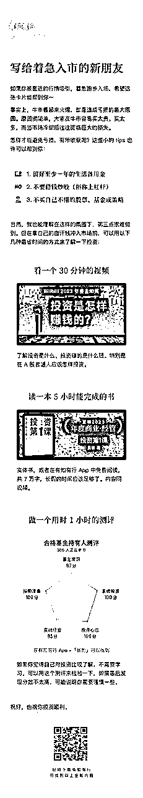

如果文章有什么问题，欢迎指出～