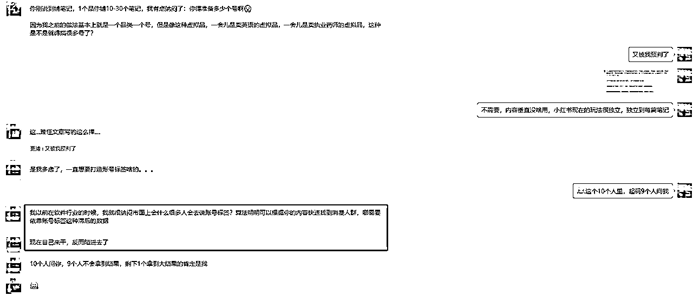
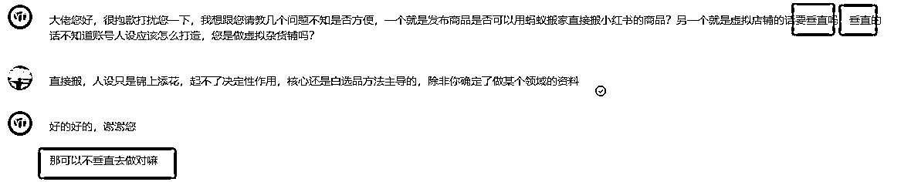
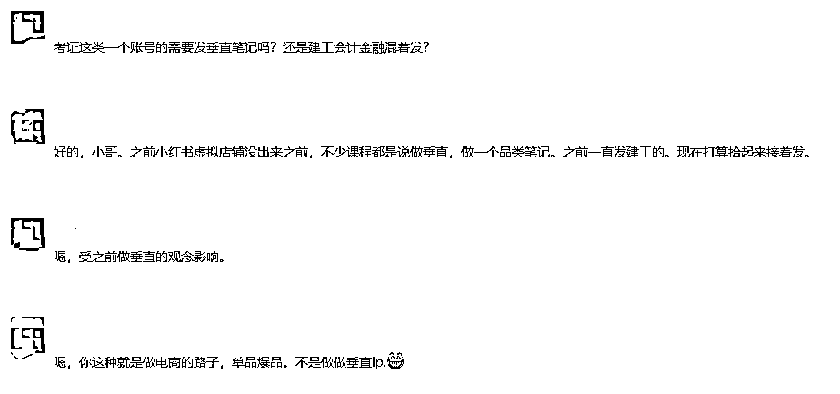
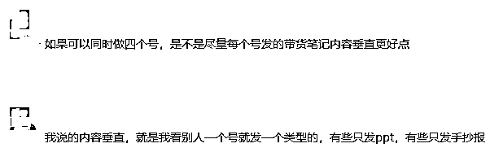

# 小红书十个常见误区合集，承认问题太难了！

> 来源：[https://qxgrvnd4nbk.feishu.cn/docx/RqzhdH0oGoO0pNxGbPCcebwmnoc](https://qxgrvnd4nbk.feishu.cn/docx/RqzhdH0oGoO0pNxGbPCcebwmnoc)

各位圈友好，我是更绪，四川南充人，去年刚毕业，现在在福建武夷山做创业，长期卡在小红书上，主要靠笔记和投放拿线索、卖货。

平时常混不同小红书的交流群，也做一些陪跑，认识了不少同行。结合大家的反馈和我自己走过的弯路，特意整理这篇稿子，把平台上流传最广的十个说法掰开讲清楚。不仅小红书适用，其他内容型平台也基本通用。

细想下来，这些说法背后其实都指向一个人性：遇到不顺就爱找外界的理由，很少往自己身上想。我写这篇也是提醒自己——碰到事先想办法，别总把锅甩给平台。这样才能更接近真相，也更接近结果。

观点偏主观，欢迎在星球评论区一起讨论。

本文涉及的说法如下：

1. 新号要先养？
2. 账号被压制了，平台太恶心！
3. 为啥我抄爆款没火，别人抄我却火了？是不是投了？
4. 内容必须垂直才有推荐？
5. 必须一卡一机一号才安全？
6. 粉丝越多权重越高，新号先吸粉？
7. 投过一次后不投就不给自然流量，是逼氪？
8. 不能天天发，得多刷多互动，不然被判营销？
9. 挂商品链接会让笔记被降权？
10. 素材够好投放就稳赚？

# 一、逐条拆解

## 1.新号要先养

新号根本不用养。所谓的养号就是在浪费时间，拖慢项目节奏。健康的号不需要养，被风控的号养也没用。

“先连续登录若干天，每天滑几十条、点赞评论多少条才能发”这种说法流传很广，却没任何实证。

养号的行为本质上是用户行为。创作者和普通用户走的是两个逻辑，你当用户刷再多，也不会让账号获得更稳的曝光。账号能否出量，只取决于一条：你的内容够不够好。好内容的前提是对用户需求的洞察，内容更好的人获得更多分发，而不是谁养得更久。

每条笔记的分发都是算法在跑，根据点赞、评论、收藏、关注、停留等信号赛马。平台不是傻的，如果内容优质用户喜欢却不推，那平台自己就先垮了。

当然你也可以选择养号，给自己一个心理安慰，排掉一个外部因素，这样没流量也不会怪到“没养”上。

我推测这个说法最早来自微信，新微信在转账等功能上确实比老号受限，但微信和内容平台的机制完全不同。

## 2.账号又被压制了

“我的笔记怎么就几十播放，平台真过分，又压我流量了！”

如果笔记还能投薯条，说明账号状态正常。播放低，只能说明内容本身不行，至少平台判定不值得推。

别总觉得平台针对你。平台不会做亏本买卖，你的内容被用户喜欢，它不推等于自杀。

可以把龙哥盟社群看成一个缩小版小红书。我在里面发高质量内容提升粘性，龙哥会专门针对我一个账号做压制吗？

## 3.抄爆款为啥我抄不爆

接着上条。你可能会说：“我照抄同行的爆款，人家能爆我不能爆，不是压制是什么？”“同行抄我的也能爆，我是不是被针对了？”“是不是人家投了？”

大概率都不是，核心是算法带有随机性。

一篇笔记能拿到多少曝光，取决于算法认为它好不好。算法只能靠数据判断，点赞评论收藏关注停留这些行为就是依据。

为什么有随机性？笔记发出后推送给的第一批人群是随机的。即便两篇内容一模一样，推送对象也无法完全一致。用户不同，喜好不同，行为就不同。所以同样的内容，有的火有的扑街很正常。

退一步讲，就算第一波人群完全相同，观看时间也可能不同。同一个人不同心情下反应完全不一样，心情好会点赞，心情差直接划走。

对抗不确定性只有两条路：增加投放量，用数量对冲随机；或者通过付费投放校准人群画像。

所以抄爆款，别抄两三次没火就归因于压制，抄上百次还不行，再考虑账号问题。

另外补充一点，小红书流量来得极慢，需要耐心，我上篇也提过，感兴趣可回看。

## 4.内容必须垂直才有流量

这个问题被问烂了。

从算法角度讲，垂直有助于更精准的匹配，但它只是加分项，不是必选项。尤其是做杂货电商，核心在选品，需求大竞争小的品就做，这个时候谈垂直反而限制决策。

在我看来，垂直更适用于有人设的IP、品牌号。对做电商百货、卖资料、废号引流这类玩法，意义不大。

## 5.要不要一卡一机一号

和垂直一样，多半是鸡肋，有当然更好，没有也无所谓，主要是心理作用。

我觉得只有一种情况值得严格执行：账号数量多，且里面有高价值账号，另外还有玩废号容易违规的号。这时为了保护核心号，单独设备甚至单独IP是合理的。

好多朋友账号就一两个，还在纠结这个，实在一用行动发内容更实际。

当然你也可以搞一卡一机一号，给自己一个借口，之后没流量也不怪设备。

我猜这个说法来自淘宝，同一电脑多店铺同类目会被风控，但和小红书逻辑不一样。

## 6.粉丝很重要要先涨粉

粉丝价值要看两个维度：粘性和召回。

粘性由账号定位决定，偏IP、偏干货的号粘性通常更高。

召回和平台属性有关，快手召回强，电商GMV很大一部分来自博主的老粉。抖音去中心化明显，掉粉的千万博主若不持续产出好内容，数据照样难看。

所以粉丝重要性因场景而异。

但可以确定的是，在任何UGC场景，内容的重要性都排第一。内容可以脱离其他因素单独评估，内容好算法认可，就一定能获得曝光。

粉丝量有点用，但远没有想象中那么大。

## 7.投过后不投就没有自然流量

这种说法让人无语。

它能流行，本质还是人性，遇到问题先找外部原因。

账号没违规能投薯条的情况下，笔记没曝光，要么内容太差，要么发得太少。

你可能会说：“我以前没投都能爆，投过后不投就只剩几百播放，不是平台故意吗？”

幸存者偏差。爆款本就稀少，偶尔中一个只是运气，不是实力。

平台没有义务给你爆款，你要想被推，就得持续输出优质内容且数量足够。

内容好用户喜欢却不推，平台自己先倒闭。

## 8.不能天天发笔记，要多刷多点赞

这和养号是一个逻辑。

创作者能给平台的价值无非三点：同等流量下带来更高GMV抽佣；付广告费；产出用户喜欢的高质量内容帮助平台留存用户。

满足其一你就是平台的宠儿，流量逻辑和竞价类似。

只要不违规，哪来的营销号判定？

说实话，我一直没搞懂营销号这个词怎么来的，可能只是给内容差、发得少找的借口。

## 9.挂商品链接会降权

在抖音这类成熟电商平台，这个说法是成立的。平台会综合互动数据和商品数据来决定推流，保证每一分流量最大化GMV。

但小红书目前不这样。电商板块还不成熟，没建立起完善的商品数据对笔记分发的联动机制。

这个结论是我基于平台观察和实战总结的，目前没有完美论证，案例也有特殊性，但参考价值还是有的。

## 10.素材好投放就稳赚

这是我踩过的坑。

以前投聚光电商，效果差就怪素材，因为以前一个模板爆过，所以一直纠结素材。

后来才明白，素材好是投放成功的必要条件但不充分。能投出来说明素材过关，投不出来不一定是素材问题。

现阶段小红书电商投放整体环境一般，这是平台层面的问题。

聚光拿客资还是可以的。

# 二、误区背后的底层

说实话，上面这些误区我都信过。

笔记没曝光时，我会想：

“是不是没养号？是不是被风控了？”

“是不是一台手机登了两个号被发现了？”

“是不是没投流，平台想逼我花钱？”

却很少想，是自己内容不行，发得不够多。

最近陪跑一个视频号直播IP，播了几场效果差，她一直在纠结平台用户年龄、开播时间不固定，却不太反思内容本身的问题。

这就是人性，总爱找外部原因。

我现在明白这个道理，但遇到事还是会下意识外归因，所以写下这篇提醒自己，也希望对你有用。