# 职场陷阱：与其更好，不如不同

## (50 赞)职场陷阱：如何在竞争中保持独特优势

作者：兰陵王

日期：2024-11-20

**开场故事：** 前几天，有位读者给我发来私信，言语间满是懊悔。她说，如果早一点读到这几篇内容，也许路就不一样了。工作了好几年，她一直在不同岗位之间跳来跳去，从没在一个方向上扎下根，自然也没能沉淀出谁都无法替代的本事。于是，晋升的机会与她擦肩而过。

我替她觉得遗憾。但这种现象绝不仅限于她一个人。太多人一进入职场，就会不知不觉掉进同一个陷阱，眼睁睁看着希望一点点熄灭，最终活成平庸的模样。

把这个故事放在开头，就是想提醒所有在职场里的人：时刻保持清醒。

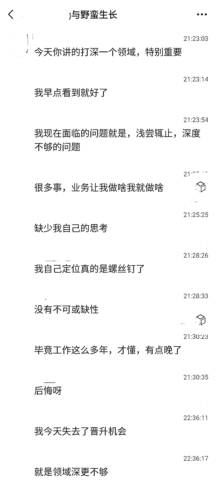

下面进入正题。

**“与其更好，不如不同。”**

这句话曾经改变了我的人生。今天把它写给你，希望它也能帮你打开一条新路。

人身上有个很糟糕的毛病：太爱跟着大部队走，太爱在人多得像下饺子一样的地方拼个你死我活。仿佛只有在最拥挤的赛道上跑进第一名，才算真正证明了自己；要是没跟上人群，就好像被整个世界抛弃了。

你回忆一下大学时代：所有人都觉得学生会特别厉害，最好能当上主席，那才有面子；后来又有人说参加比赛很风光，于是大家一窝蜂去报挑战杯、建模大赛；再后来，考研成了政治正确，大家又挤破头去考，一年不行来两年。

工作以后，风向又变了：公务员是铁饭碗，国企才有保障，进世界500强才算有出路，北上广机会多，某某行业是未来，某某职业很吃香……所有人又像潮水一样涌过去。

可我们偏偏忽略了那个最关键的东西——**个体差异**。用自己的短板去撞别人的长板，怎么想都很难做成第一。而做不成第一，就很容易沦为平庸。

这大概就是为什么今天有这么多人庸庸碌碌。不是你天生没有天赋，而是你亲手把天赋扔了，跑去挤那条快要被踩烂的独木桥。

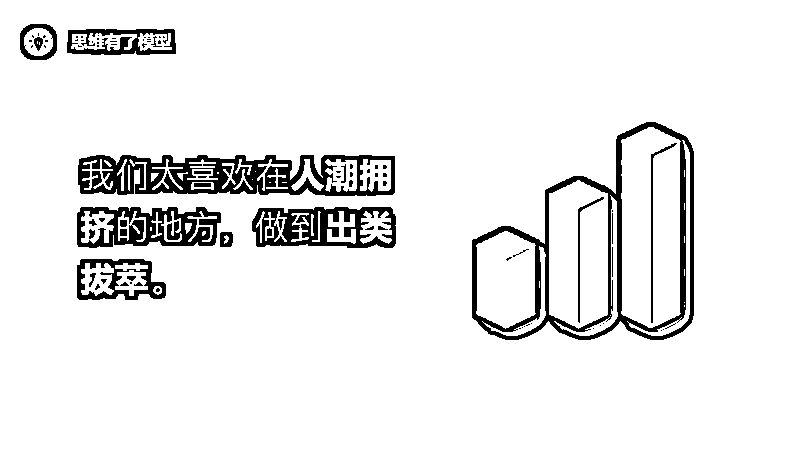

和很多人一样，我年轻时也迷恋那种在人群里拔尖的感觉。大一刚入学，我做梦都想当班长、当学生会主席，想参加比赛，想考研——凡是可以出风头的赛道，我都想插一脚。

幸好，我当时实力太差，班长没选上，学生会主席更是没戏。如果真让我当上了，说不定现在还在为找工作焦头烂额。

到了大二，有一天我无意中看到乔布斯的一句话：「Think different」。

那一瞬间，我好像被电击了一样。我第一次从哲学的高度去看待叛逆、特立独行、格格不入，也第一次理解了什么叫人云亦云，什么叫疯子与天才之间的距离。

从那以后，我果断放弃了考研这条路，把时间都花在啃“闲书”上，专心做输入和输出。

在同学们眼中，我简直是个异类。连我身边的朋友也常常一脸困惑地问我：“你天天捣鼓这些干嘛？真不打算考研？写作能赚到钱吗？”这类问题，我听过无数遍。

我理解他们的疑问，因为曾经我也以为，只有大家挤在一起的方向才是正路。

后来我明白了一个道理：当你做着一件与众不同的事情时，真的不需要费口舌去解释。认知层次不同，解释再多也是对牛弹琴。你唯一要做的，就是把事情固执地做下去，用结果说话。

事实证明，我赌对了。到了大三，我可以拍着胸脯说，我是全学校做自媒体最厉害的那个人。这个“第一”给我带来了什么？人脉、资源、影响力，一样都不少。

而且，就凭这一项成绩，我顺利拿到了北辰青年的实习offer。实习期间，领导很看重我，打算把重要任务交给我。但就在那时候，我隐约觉得自己摸到了自媒体的真正脉搏，于是又果断辞职，跑出来做自己想做的事。再后来，出版社、机构、各路商业人士，居然纷纷主动找上门来，希望能跟我产生连接。

这就是我与别人“不同”的故事。

背后的逻辑其实很简单：我跳出了那个杀成红海的战场，自己另开了一片新战场。因为新战场上没人跟我抢，我轻轻松松就能在一个小圈子里做到第一，也因此能为别人提供价值，自然而然地收获阶段性的成功。

## 为什么要与众不同

自从想通这个法则后，我一直在琢磨：为什么它会这么灵？它背后到底藏着怎样的生存原理？

后来，我在不少牛人那里得到了印证，也慢慢看清了它最底层的逻辑。

在以色列，有一本书被犹太人当成“圣经”一样，一生都在反复研读，叫《塔木德》。书里有这么一句话：「世间的事非常奇怪，越是难做的事，越容易做成」。

起初我没读懂，后来才恍然大悟：因为好走的路上人挤人，竞争激烈到吓人；而难走的路，几乎没人愿意碰，所以难事反而更容易干成。

再后来，我又在《定位》里读到：「不要对市场领导者进行正面攻击。绕过障碍要比穿过它好得多，最好是选择一个别人没有完全占据的定位」。

与此相呼应的，是管理学大师德鲁克说的：「小企业的成功绝对不是去在大企业里面硬分一杯羹，而是它能够找到一个属于它自己的生态位，哪怕这个生态位暂时很小」。

混沌大学把这套思路提炼成一个思维模型，叫“错位竞争”。善友教授也说过：「有一句话直到今天我仍认为是对的，就是‘与其更好，不如不同’，这八个字是我用血与泪的教训换来的，是创业的第一法则」。

我把这些高人的智慧，拆解成下面三个层面的原因。

**一、与众不同，意味着竞争更小**

余华在《兄弟》的封底，引用了耶稣的一段话：「我想无论是写作还是人生，正确的出发都是走进窄门，不要被宽阔的大门所迷惑，那里的路没有多长」。

这段话对我冲击很大。

我们太喜欢在人多的地方证明自己优秀，这种冲动似乎刻在了基因里。可你想过没有，每一条拥挤的赛道，注定只有一个第一名，剩下的人全是陪跑。那么多又聪明又努力的人都挤在里面，你凭什么这么肯定，最后杀出来的那个人一定是你？

画张图你马上就能明白。

 Lk4HqEQJVdgDYyJ2)下面那条路，又直又宽，没有任何障碍，走起来毫不费力。上面那条路，弯弯曲曲，绕来绕去，到处是荆棘，还有豺狼和虎豹。

我们的第一反应，当然是走下面这条路。尤其是当你看到大多数人都往那边走时，心里就开始慌，生怕错过了什么，于是也赶紧跟着人潮涌过去。

我们都觉得豺狼虎豹最难对付，可真正难搞的，其实是人啊。

上面那条路虽然越走越难，但正因为走的人少，竞争压力小，反而更容易让你登顶；下面那条路看着一马平川，可人山人海，你就连迈开步子都费劲，更别提当第一了。

这就是《塔木德》里那句话想告诉我们的：越是难做的事，反而越容易做成功。

道理简单到不能再简单。

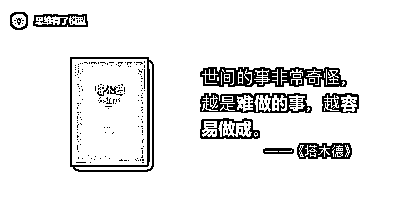

**二、与众不同，才能创造价值**

你一定要记住一句最质朴的话：**一个人能做成事，本质上是因为他能给别人提供价值。**

如果一个领域里早就立着超级巨头，你还去做一模一样的事情，那你的价值到底在哪儿？

这个道理看上去谁都懂，但真正想明白的人少之又少。

我自己在做知乎的时候，就天天感受着这个规律。同一个问题下面，往往挂着上千个回答。这时候你再去写，怎么才能冲进前五？

有两条路。如果排在前面的几个回答都稀烂，你有信心写得比它们好太多，那完全可以直接写你最想写的那个角度。但如果前排已经被几个大V占住了，点赞数都上万了，这时候哪怕你再想跟人家写同一个角度，也得忍着。更聪明的做法，是找一个所有人没提过的新角度切进去。

还有一招更厉害：干脆换一个新问题，去找一个全新的生态位。

因为你需要明白：如果你写的东西和别人一模一样，又没别人写得好，那你的价值在哪里？

你仔细观察知乎上的高赞回答会发现，有些答案虽然文笔平平，但提出了一个别人没想到的角度，照样能排到前面。为什么？因为它给读者提供了新的价值。

做自媒体是这样，做企业也一样。如果那个领域里已经有了超级巨头，先停下来想想：你要做的事情，究竟有什么独特价值？

想通这一点，你自然就能理解为什么叫“错位竞争”，为什么“与其更好，不如不同”了。

因为当你模仿巨人，跟它做一模一样的事情时，很长一段时间里，你根本不可能干赢。巨头有规模优势，你没有；巨头资金雄厚，你可能连工资都发不出；巨头要资源有资源，要渠道有渠道，要人脉有人脉，而你什么都拿不出手……

**所以说，在很长一段时间里，你根本没法给用户提供任何价值。可这段漫长的“没价值”的时间，已经足够让你死上好几回。**

所以，更聪明的战略就是“与其更好，不如不同”。当你去做的是一件和巨头完全不同的事，你在第一秒就能给用户提供价值，这就把握住了成功的钥匙。

《定位》的作者在书中几乎是声嘶力竭地提醒我们：「要想同 IBM 已经确立的地位直接发起挑战，根本没有成功的指望，你只有大胆去做不同的事才能取胜，历史证明这是一个真理」。

理解了这句话，你也就理解了德鲁克说的：「小企业的成功绝对不是去在大企业里面硬分一杯羹，而是它能够找到一个属于它自己生态位，哪怕这个生态位暂时很小，但是它能在这个生态位里边取得某种领先地位」。

“硬分一杯羹”，就是跑去跟巨头硬碰硬，这几乎是必死局。可如果你换个新战场，你就能在那片新土地上很快成为第一，给用户提供别人给不了的价值。

这就是所谓的错位竞争。

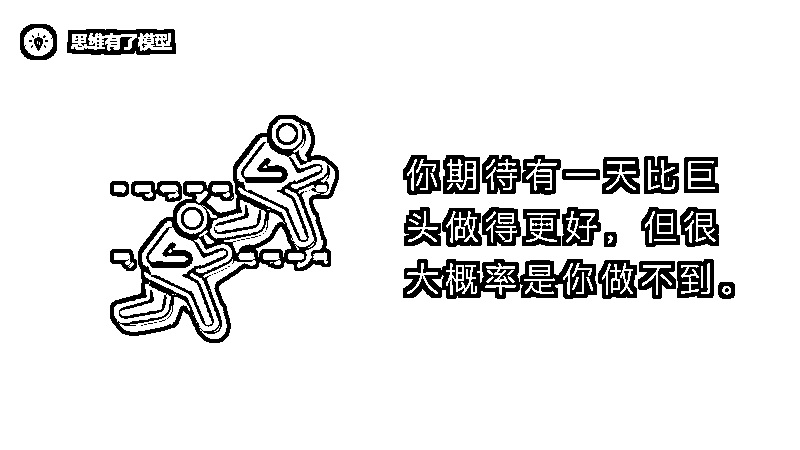

**三、这就是自然界的生存法则**

德鲁克那句话特别厉害的地方，在于他提了一个词——「生态位」。

前几天我看了一个讲生物进化的视频，忽然有种被雷劈中的感觉：生态位，很可能就是这个自然界最底层的生存法则。

PS：这里本来有一段特别精彩的视频，可惜腾讯视频上没有，我先放到读者群里跟大家分享。

下面，请跟我一起思考几个特别宏大、又特别“傻”的问题。

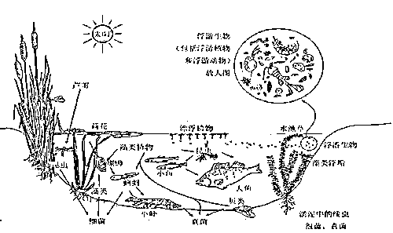

想象一个群落，里面住着好多物种。现在问题来了：

①为什么地球上会进化出这么多不同的物种？如果大家都不变，会怎样？

这个问题听起来傻乎乎的，但正因我们平时从来不问这种傻问题，才看不清事物的本质。你想啊，所有生物最初都是从同一个单细胞演化来的，为什么最后却演变成这么五花八门的世界？如果大家都不变，会发生什么？

②同一个群落里，为什么会有不同的生态位？

植物里，为什么会有乔木、灌木和草本？动物里，为什么会有水里的、陆地上的、天空中的？

③我们的祖先原来全都生活在海里，又是什么力量，逼着它们一步一步爬上了岸？

现在，请带着上面那个思维模型，停下来好好想想这三个问题。

下面是我的思考过程：

1、同一个生态位里，资源是有限的。

2、每个生物想活下去，都必须获得足够的资源。

3、资源有限加上生存刚需，就等于激烈竞争。

4、物种与物种之间，天生有强有弱。

5、强者会霸占更多的资源。弱者想要活下去，唯一的路就是开辟一个新的生态位。

6、这个“新的生态位”，正是“深耕细作”和“与众不同”背后真正的本质。

如果一个种群或物种，和另一个更强的种群待在同一个生态位，那么等待它的，大概率是灭绝。

为了活下去，它必须迁到一个新生态位，和强者拉开距离，实现错位竞争。

这是生物界的基本法则：在稳定的群落里，如果两个种群恰好占据同一个生态位，那么其中一个迟早会灭亡。反过来说，如果各种群在群落里都有自己的位置，彼此之间就能避开正面竞争，整个群落也因此保持稳定。

《生物学思想发展史》是这样描述这条法则的：「在很多情况下，取得成功仅仅是由于变得与众不同或者更加不同，这样就减少了竞争」。

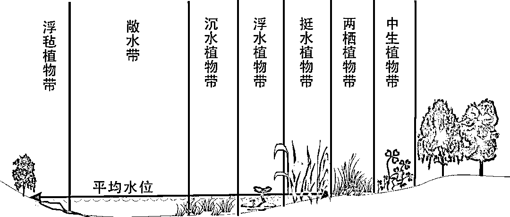

这就是生物学给我们的启示。

大到一家组织，小到一个人，都逃不开这条生存法则。

每一家企业、每一个人，都有属于自己的生态位。如果你现在所处的生态位，已经盘踞着一个巨头，那么最好的出路，就是去找一个新的生态位。在那个新位置上，你说了算，你是绝对的老大。

生存的道理在里面，成功的道理，也在里面。

## 什么是与众不同

用一句话来说：**去开辟一个全新的生态位，然后在新生态位里做到第一。**

这正是美团CEO王兴说的那句话：「互联网领域竞争规律的本质，不是在原有的领域把原来的人挤掉，而是新的战场扩大，新的玩家占住了新的战场」。

你看到关键词了吗？——“新的战场”。这四个字，指的就是新的生态位。

成功的秘密，从来不藏在原有的生态位里，而在新的生态位里。

来，再回味一下德鲁克那句话：「小企业的成功绝对不是去在大企业里面硬分一杯羹，而是它能够找到一个属于它自己的生态位，哪怕这个生态位暂时很小，但是它能在这个生态位里边取得某种领先地位」。

是不是一下子豁然开朗了？

成功之路不在老地方，而在新地方。

要是你还有点犯迷糊，我画张图给你看。

一开始，某个市场完全是空白的。这时候，我们管它叫风口，或者蓝海。

后来，一个目光长远的人发现了它，成了第一个吃螃蟹的人。作为第一个，他当然很开心，几乎可以独占整个市场，什么都做。

例子很多：阿里巴巴、腾讯、百度、亚马逊、IBM，都是。

如果这个行业里已经出现了绝对霸主，那后来者该怎么办？

**第一，深耕细作，在霸主不擅长的细分领域做到第一。**

比如已经有个淘宝了，你完全可以去做当当网。你只卖书，把书这件事做到极致，做成这个领域的第一名。这时候，你对用户当然是有价值的。

**第二，与众不同，开辟一条全新的生态位，在新的生态位上做到第一。**

比如已经有个淘宝了，你要再做一个淘宝，那真的只有死路一条。但如果你换个思路，做一个美团，解决人们吃饭的问题；或者做一个携程，解决人们出行的问题，你就活下来了。

记住，别被那些乌泱乌泱的人群迷惑了。人群聚集的地方，早就有了霸主。你要去的是新战场，那里才是你的主场。

生存之道在其中，成功之道亦在其中。

## 与众不同和深耕细作的关系

我写的文章是连成一个体系的，它们本来就是一整套东西。「与众不同」和「深耕细作」，都是帮你做到第一的方法。

用一张思维导图看，它们的关系大概长这样。

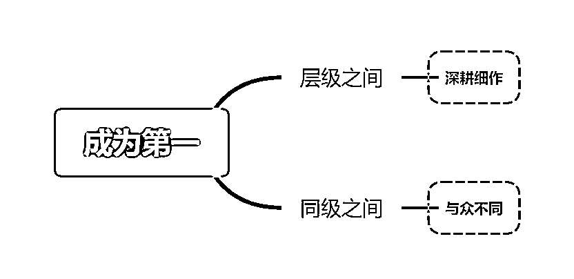

注意！！！

深耕细作和与众不同，不是非此即彼、互相打架的关系。它俩其实是一枚硬币的两面。

**在层级之间，你看到的是深耕细作；在同级之间，你看到的是与众不同。**

举个例子。一个群落里有草本植物、灌木和乔木。对整个群落而言，它们能够共生，靠的是各自层层叠叠、各占其位，这叫深耕细作；但草本、灌木、乔木这三者彼此之间横向对比，又完全是不同的种类，这叫与众不同。

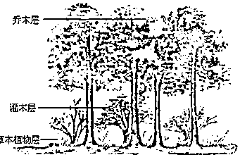

再比如，面对品类齐全的淘宝，当当网只聚焦在图书这一个品类，这就是深耕细作；可如果你拿当当网去和盒马比，那它们之间又成了与众不同。

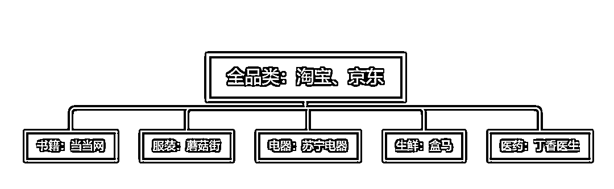

生存之道在其中，成功之道亦在其中。

**怎么做到与众不同**

要想知道该怎么做，得先搞清楚与众不同的本质是什么。

前面已经说过，与众不同的本质，就是开辟新的生态位。

所以，通往与众不同的方法论，就是构建自己的生态位。具体来说是：在层级之间深耕细作，在同级之间与众不同。

而构建生态位的工具，我叫它**框架思维**。

什么是框架思维？说白了，就是利用**MECE原则**，给事物做分类，搭出一个结构清晰的框架。所谓MECE，就是尽量让你的分类做到**不重复、不遗漏**。

比如电商平台，你可以先分成海外和国内。

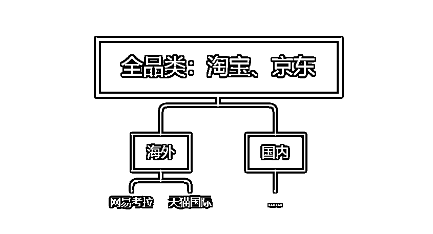

再比如电商平台还可以分成服装和非服装。服装这一支，又能继续分成男性和女性；或者分成母婴和非母婴。

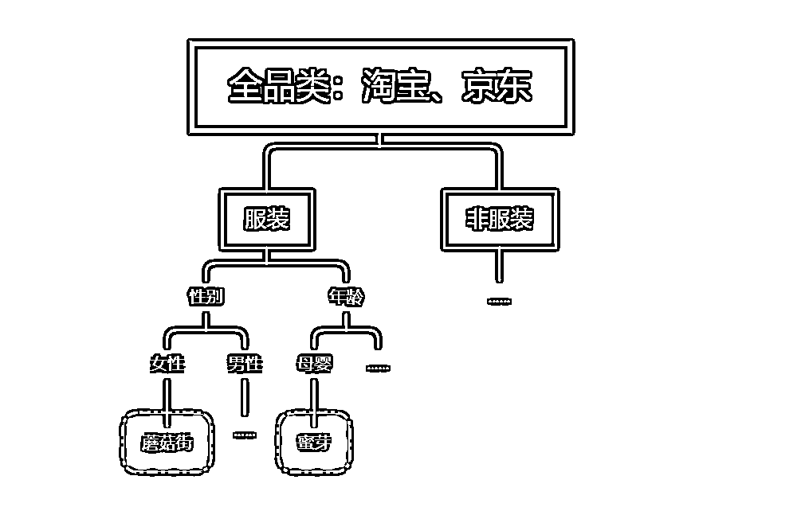

最后，我们来一起思考一个问题：为什么京东，尤其是拼多多，能在淘宝的眼皮子底下，硬生生长成巨头？

答案是：因为它们都找到了新的生态位，躲开了淘宝的势力范围。就算淘宝想打，也根本打不着——人家压根不跟你在同一个生态位里玩。

那好，我们分别来看看京东和拼多多的生态位。

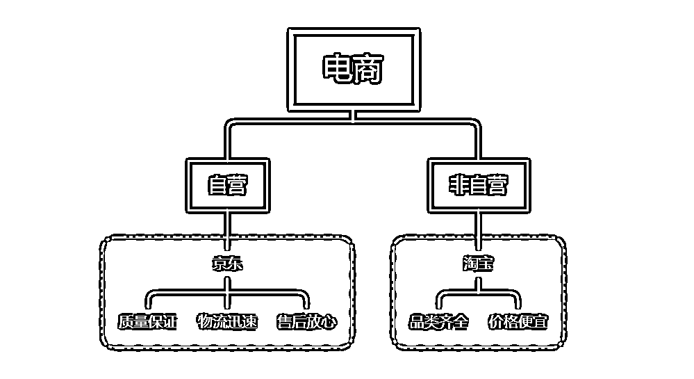

看这张图你就明白了：京东和淘宝，走的是两条完全不同的生态位。京东是自营生态位，核心卖点三个——质量有保证、物流速度快、售后让人放心。淘宝是非自营生态位，核心卖点也是三个——品类足够全、价格足够低、想买什么都有。

从生态位的角度来看，它俩根本没办法正面硬刚。这就是当年京东能在淘宝眼皮底下做大做强的底层逻辑。

拼多多就更绝了。在电商赛道上，淘宝、京东已经把位子占得满满的，它居然还能再挖出一个新生态位——**团购**。

厉害吧？到目前，拼多多的市值已经冲到了876亿美元，超过京东和百度。它的创始人黄峥，身家一度达到300亿美元，成了仅次于马化腾和马云的中国富豪。

同样，我们再从生态位的角度看一看，拼多多是怎么在两大巨头的夹缝中杀出来的？

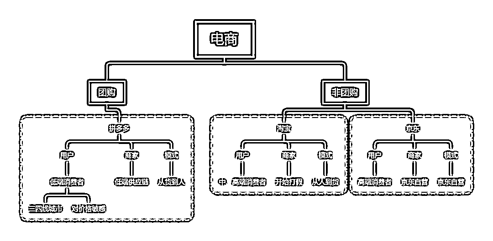

发现没有？拼多多的生态位，和淘宝、京东完全不同。拼多多瞄准的用户，是那些对价格极其敏感、追求性价比的消费者。这些人大多住在三四线城市，不怎么看重品牌，谁便宜就买谁。

我是农村出来的，太懂这群人的购物习惯了。他们买袜子，真的完全不看款式，甚至顾不上好不好穿，只要价格低就行。

另外，拼多多上的商家，很多也是被淘宝、京东“淘汰”掉的。他们大多来自低端供应链，没品牌、质量一般，但价格低到你都不敢相信。

你看，拼多多的生态位，和淘宝、京东完全是另外一路。

所以当拼多多悄悄长起来的时候，那两个巨头只能眼巴巴地看着，一点办法也没有——因为它们根本不在同一个生态位上。

而这也正是地球上生活着千千万万个物种，却还能各自安稳存活的原因。每个物种都有独属于自己的生态位，所以不用和别的物种争得你死我活，各自繁衍，各自精彩。

生存之道在其中，成功之道亦在其中。

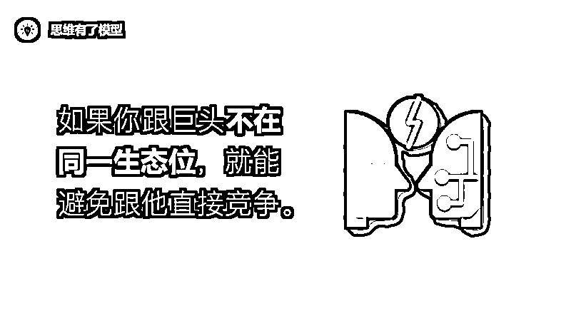

以上，就是“如何做到与众不同”的全部内容。我为你拆了几个真实案例，你可以参考。

其实，找到那个属于自己的生态位，并没有多难。真正难的是，能不能克服心里的那份**贪婪**。

别总想着什么都要做，也别忘了人群拥挤的地方，那条路并不会太长。

最后，送大家一句蔡志忠的哲学小语：

小鸟对长颈鹿说，虽然你长得很高，但是我会飞。我们都太在意很多项目输给很多人，其实我们只需要关心，我们有哪一项赢过全世界？

* * *

评论区：

忧愁小松鼠 : 谢谢，有所启发，与其更好，不如不同，打造差异化，发挥自身优势，我有你没有。

兰陵王 : 💪

知秋 : 头皮发麻

兰陵王 : [嘿哈]

有位朋友在问那条视频究竟去哪看。其实它一直存放在👸号里，这个平台实在传不上去，之前也忘了提前知会大家，实在抱歉。有人听完直言说得太精彩了；也有朋友深有感触，说人这一生，最难得的就是找到属于自己的那片天地，让心中所爱与自身所长融为一体。感谢每一位用心阅读的人，愿我们都能朝着那个方向慢慢靠近。