# 一个搜索型选手的30天：从不敢碰公域，到做出同城获客

我一直靠搜索流量吃饭，看见别人靠内容刷屏涨粉会羡慕，但总觉得自己学不会。直到参加了一个月的线下集训，从完全没碰过短视频和种草社区，到做出一点小成绩，过程踩了不少坑，也总结出一些可复用的思路。先说明：这次同行的伙伴中，至少有两位会输出保姆级操作细节，所以我这篇以复盘感悟为主，想学操作步骤的可以关掉啦。（我习惯把学员叫作“宝贝”，叫了一个多月，改不了……）

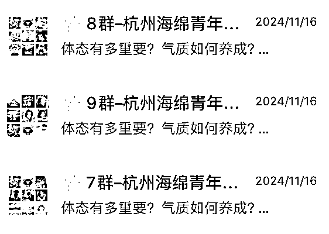

我以前主要做搜索侧的流量，手上管理过两千多个内容号，以及一千多个工具类产品号，一直待在自己的舒适区里。为什么会突然下场？因为某天看到天盈老师发了一条关于夜校项目的帖子，“本地生活”四个字直接戳中我。更巧的是，紧接着就听说要开线下集训。我定了晚上八点的闹钟去抢名额，8点05分左右再看，三十多个位置已经被抢得差不多了。

### 一、为什么我要参加？

报名后先来了个电话筛选。电话里老师问参加原因。我的回答很简单：有被动收入、没有负债，抽一个月出来没压力；人在杭州，本来就对本地私域有兴趣，之前也做过闲置物品交换群，不算完全陌生。几天后才等到录取消息。

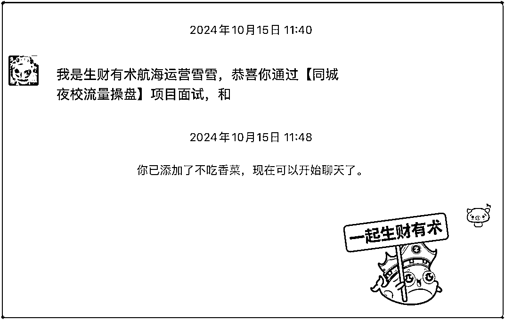

插曲提醒：第二期报名的朋友一定留意电话，漏接就主动回拨，别让机会溜走。

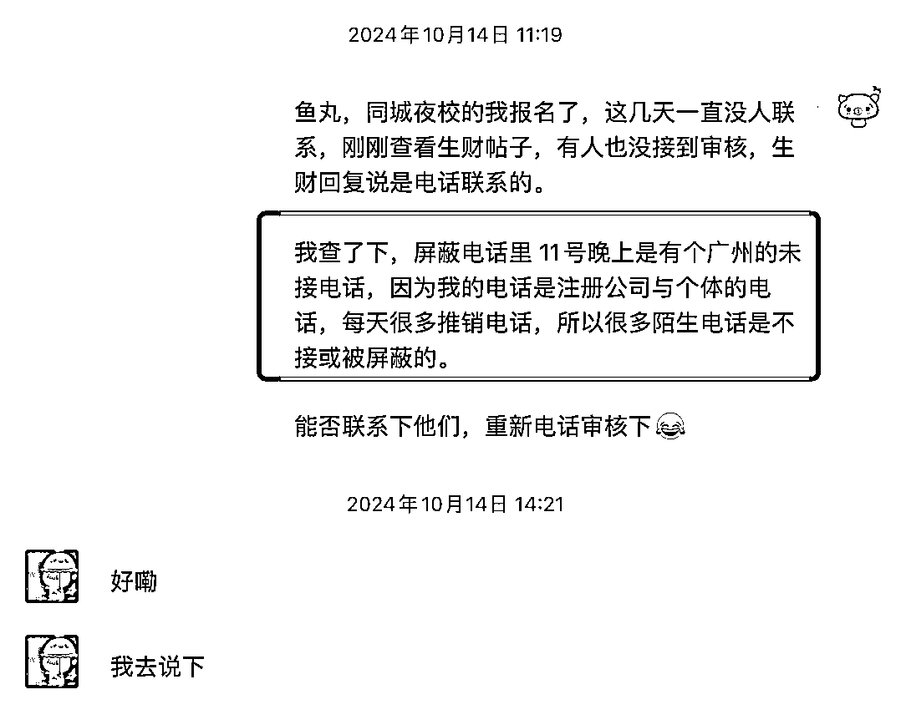

### 二、0起点做流量，坑我都替你踩过了

项目规则是每人至少准备三个账号。我担心杭州卡在广州被系统判为异地，所以落地当天下午就去营业厅办了一张主卡和三张副卡。

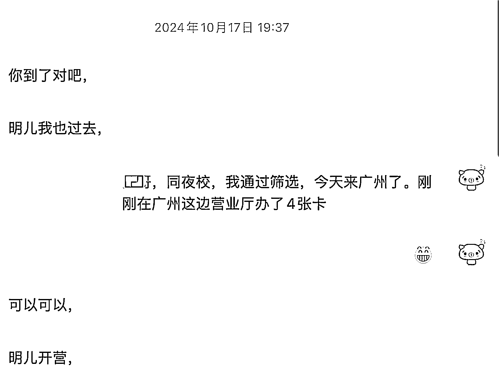

正式开始后，内容矩阵是这样分配的：图文发在种草社区，短视频同步发到🛰️短视频和另一个短视频平台。

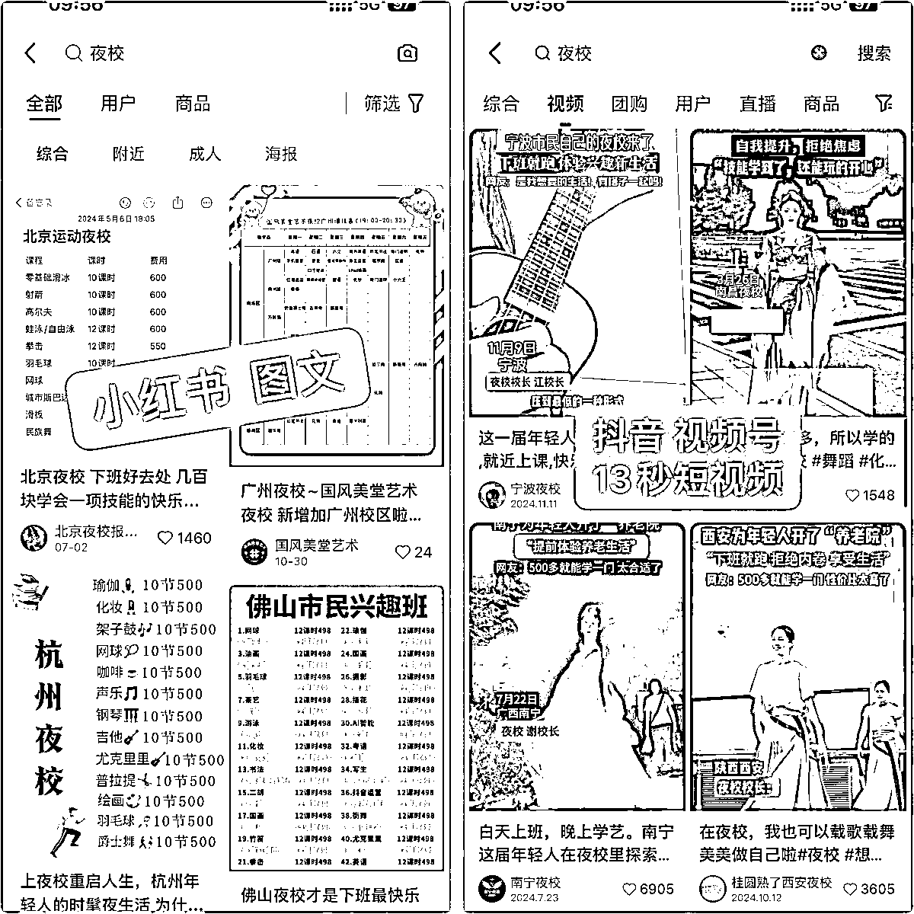

老师提前说过，账号权重需要时间，每天更新三条，数据会慢慢变好。但惊喜来得太突然。正式实操第一天，就有同伴的视频冲到六万播放，消息多到回不完。

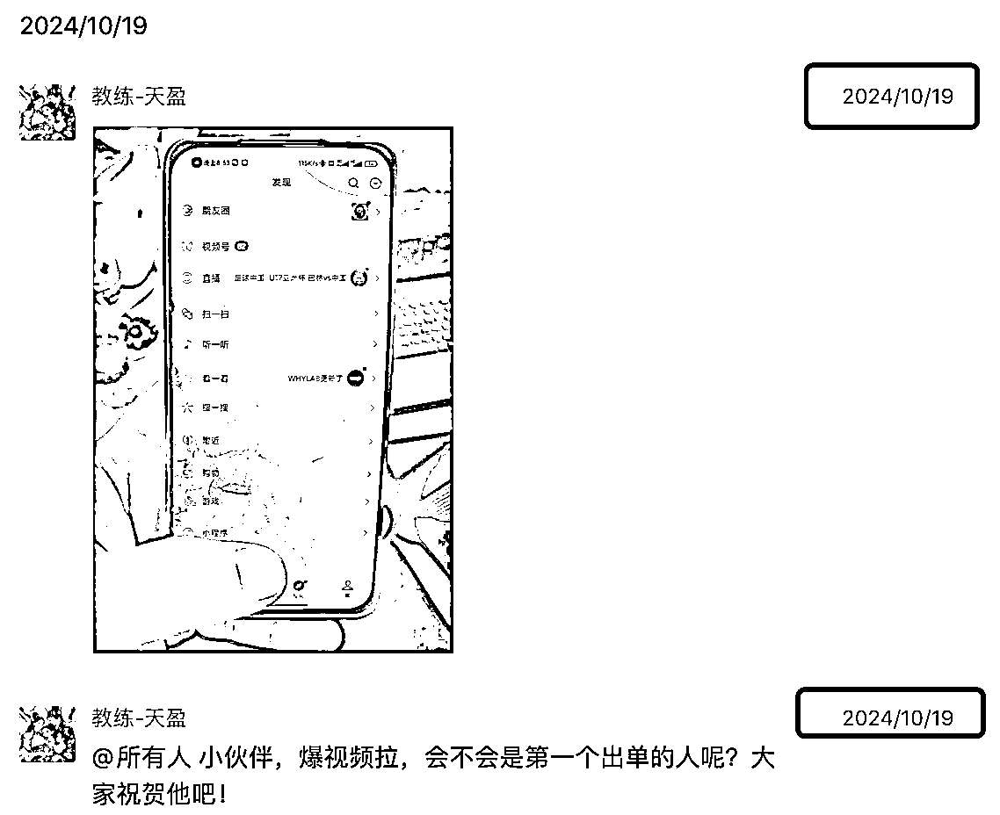

第二天，我的视频也爆了。播放量破十万，私信涌进来几百条，加人的提醒一直显示99+。

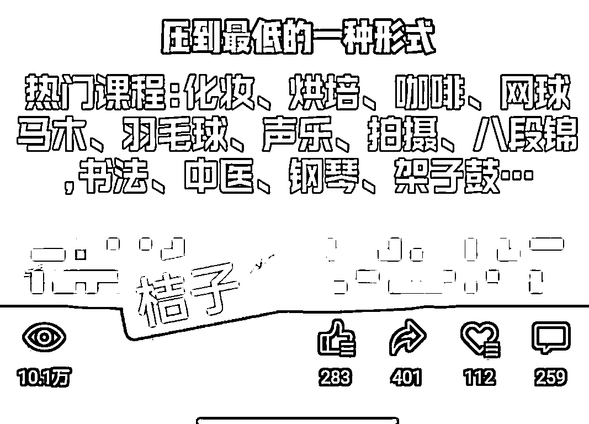

但我当时没意识到，这是一个甜蜜的陷阱。老师一开始提醒过，种草社区的用户更精准、成交率也更高，前期要重点维护。可🛰️短视频连续出爆款，我每天都在通过好友申请和聊天，生怕加太快被限号。结果是头几天完全没认真做图文，每天只是敷衍地发够数量。等🛰️短视频的推送热度过去，播放量回落到几千到几万，每天新增的好友降到个位数，我这才慌了。

几乎是同一时间，厦门来的几位同学让我看到了差距：他们前期同样没数据，但一直认真经营图文社区，流量慢慢起来，已经开始成交。我跑去请教，他们毫无保留地把运营方法讲给我听。我这才真正理解什么叫“对标同行、拆解爆款”，也终于沉下心做图文内容。下面这张图就是当天出单的截图：

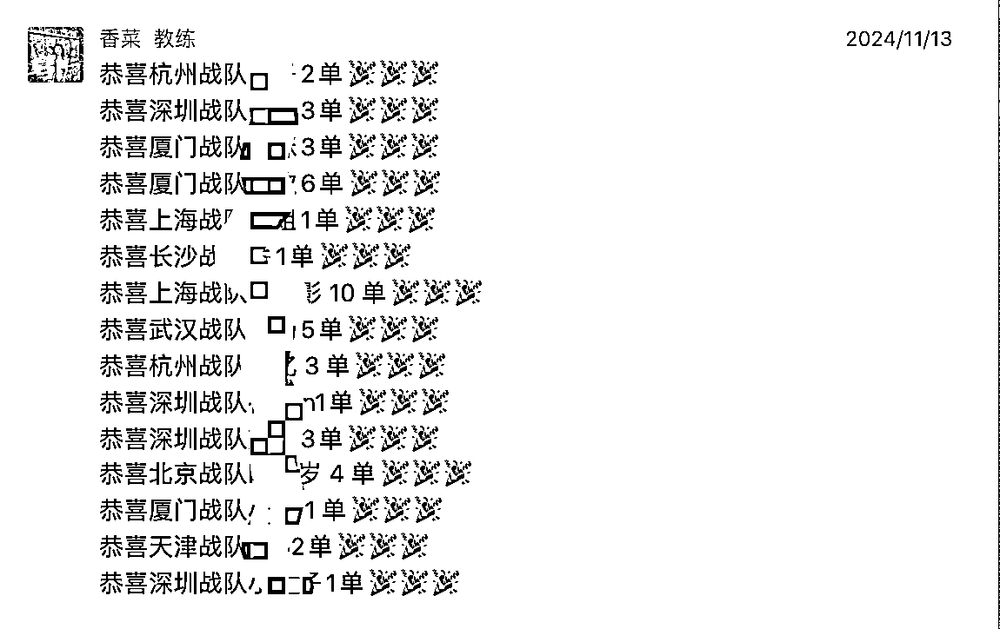

到结营时，我在社区账号的群里积累了163位用户，这些几乎都是最后十多天进来的，平均每天十几人。

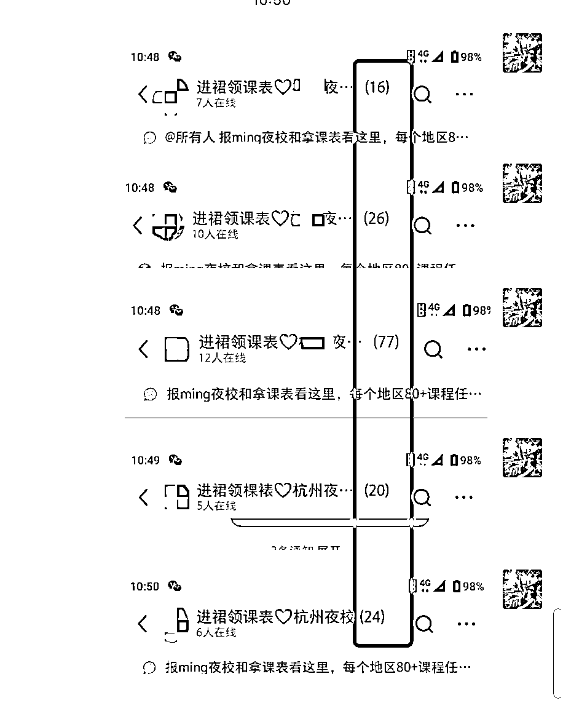

### 三、复盘收获：最重要的不是操作，是思维

回看这三十天，我对自己拿到的结果是很满意的。最开始的期待就是两条：参与本地生活项目，以及从零学公域分发，两个目标都达到了。更重要的是人。K老师帮我补上了流量判断的框架，香菜老师让我看到私域经营该怎么做，天盈老师又展示了更大的视野；还有一群经常一起聊玩法、聊转化、聊创业方向的同学。这些收获可能会一直影响我。

如果你也是从来没做过这类玩法的新手，我最核心的体会有三条：

1. 先照着做。别急着创新，带教老师给的流程是他们跑通了的路。
2. 主动去问。同批里有人早就有经验，多聊几句、请顿饭，少踩很多坑。
3. 卡住了就求助。流量、转化、技术，甚至吃饭问题，都可以找老师，他们是最好的后援团。

我也很羡慕第二期加入的人。第一期跑出来的人里有不少留在公司，你们可以直接拿到更新版本的资料，还有前辈当助教，起跑线比我们当时高多了。

### 四、彩蛋：一个很管用的私域激活方法

下面是彩蛋。实操方法会有同学详细讲，我只说一个我们验证过很有效的私域激活方式。

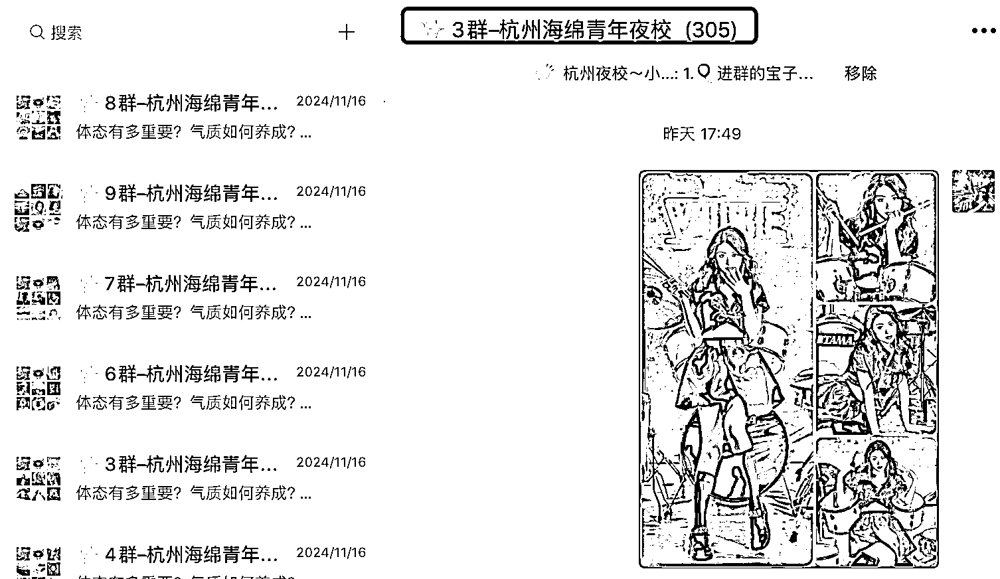

用户触达主要有三个渠道：一对一私信、好友动态、社群。

好友动态很容易被折叠，并不是最优方式，但必须发，因为新加来的人只能通过它快速了解你。

一对一私信在好友增长快的时候根本回不过来，也没办法反复触达。

所以最好的场景是社群。用户积累到一定量，就建群统一触达。

我建第一个群时，直接把群名写成“3群”。用户看到会以为前面还有两个满群，起码有一千人。你要写“9群”“19群”也行。在这个场子里，你的身份可以自己定义。

最开始流量大，大群很快就满了300人。后来流量减少，我不想再往大群拉人，怕突然有人发广告、发垃圾内容。曾有伙伴把群的入口发到朋友圈，结果没加好友的人也混了进来，还发了不合适的图片，群一下子就废了。如果单开一个小群，又怕人数太少显得冷清，所以一直没动。直到看到深圳队的曾丽的做法，我才被点醒。

新群要这样开：先把群名、置顶公告、管理员都布置好，再去拉那些不在大群里的用户。我的公告是参考公司群的样子写的，大意如下：

- 小程序入口放第一行，每周更新课表；
- 覆盖杭州各区；
- 课程包括乐器、运动、副业、手工、自我提升、活动沙龙等；
- 私教和团课同价，除运动类外，498元8-12节课；
- 体验卡目前只有广州总部有，杭州会跟上；
- 有事私聊群主；
- 群里禁广告、禁私加人，违规直接踢。

我们通过好友时会顺手打标签。只有一个群、想开第二群时，我的做法是：

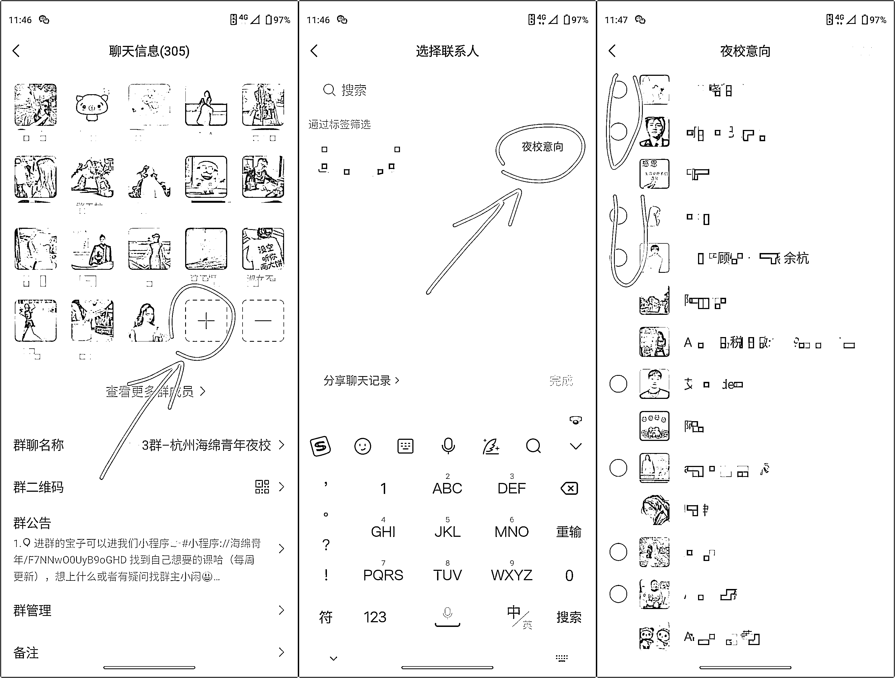

第一步，在旧群邀请列表里勾选已经打标签的人；如果这个号里面全是用户，不打标签也可以；

第二步，截图或拿另一台手机拍下来，空出来的就是不在旧群的人；

第三步，直接建新群，把这些人拉进去。

一次最多拉40人；如果群里有你自己的两个号，最多38人。时间久了有人删你，群人数可能降到三十几，不影响继续拉人，只要40人以内就行。不要给用户发邀请链接，我一般用电脑拉人，比手机省事。

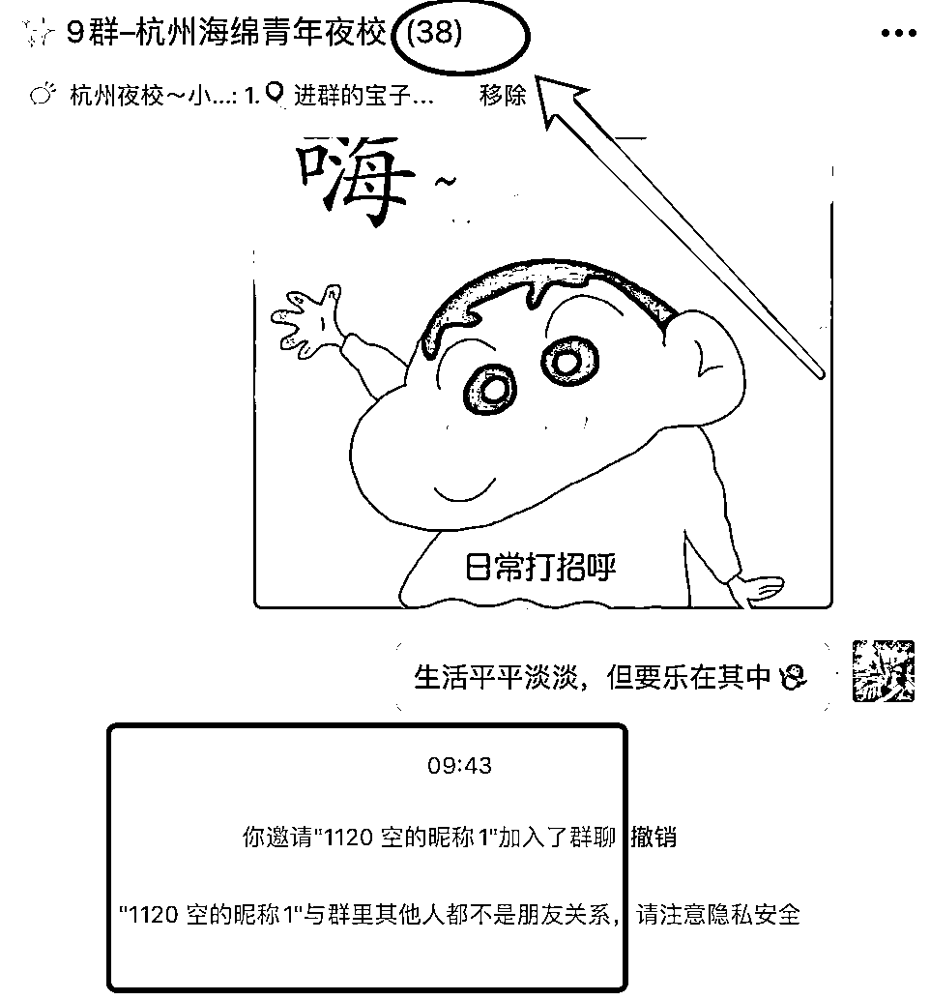

那什么时候该建小群？

两个信号：一是大群到了100-300人，担心失控的时候；二是总有人不进群、退群，需要重建触达渠道的时候。

为什么要建？

第一，防止炸群；

第二，对于很难通过私信再次触达的人，群发是最直接的推广方式。别人不删你，就可以一直发。不成交的人本来也不是铁杆用户，只是好友列表里的一个记录。

以后有了好几个群，怎么判断哪些人需要拉进新群？

看你和对方有没有相同的群。如果没有，基本说明他已经不在你的群里。

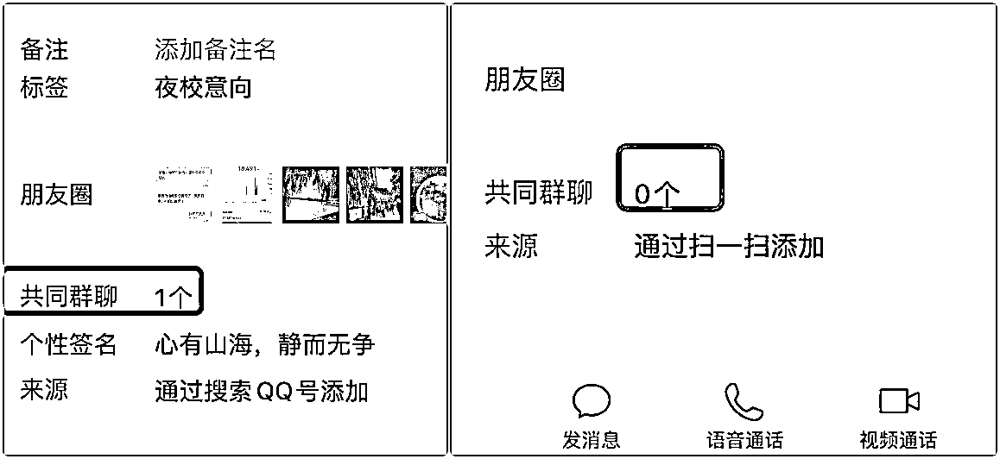

但好友数量到几百、几千的时候，手动一个个查太不现实。我是用RPA来自动处理的，具体逻辑就是模仿手动判断的步骤去设置。刚进来的伙伴不用急，等你的好友量级上来再考虑也来得及。

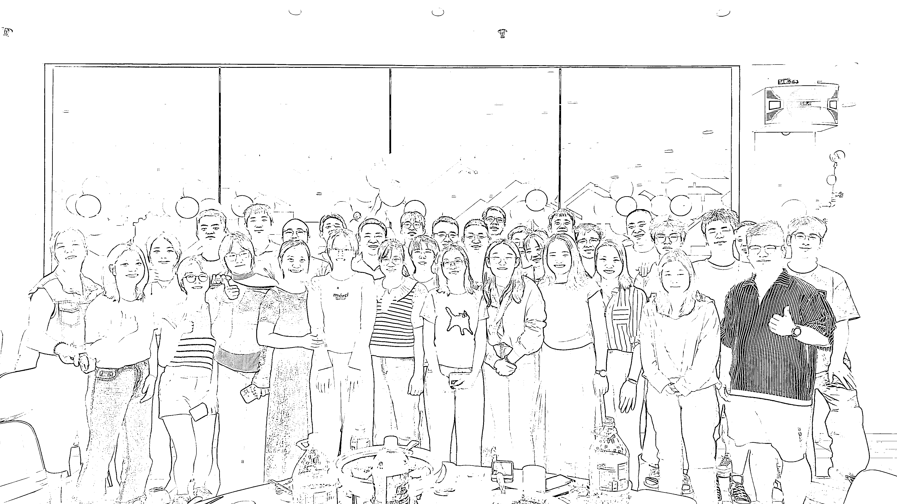

### 写在最后

结营那天我上台说了一段话，是真心的。我们这批人里有三分之一超过三十岁。到这个阶段，想学新东西，去公司不太现实，去外面付费学习又怕不被认真对待。但在这次线下营里，大家从零开始，跟着老师实操，和同学一起从早上九点干到晚上十一点，这种经历真的可能改变后面的路。

当然，每个人的感受不一样。至少对我来说，这一个月没有白花，是一次很值的经历。如果你也和我一样，之前在公域分发上是一片空白，别被“没有经验”四个字吓住，勇敢报名就是胜利。