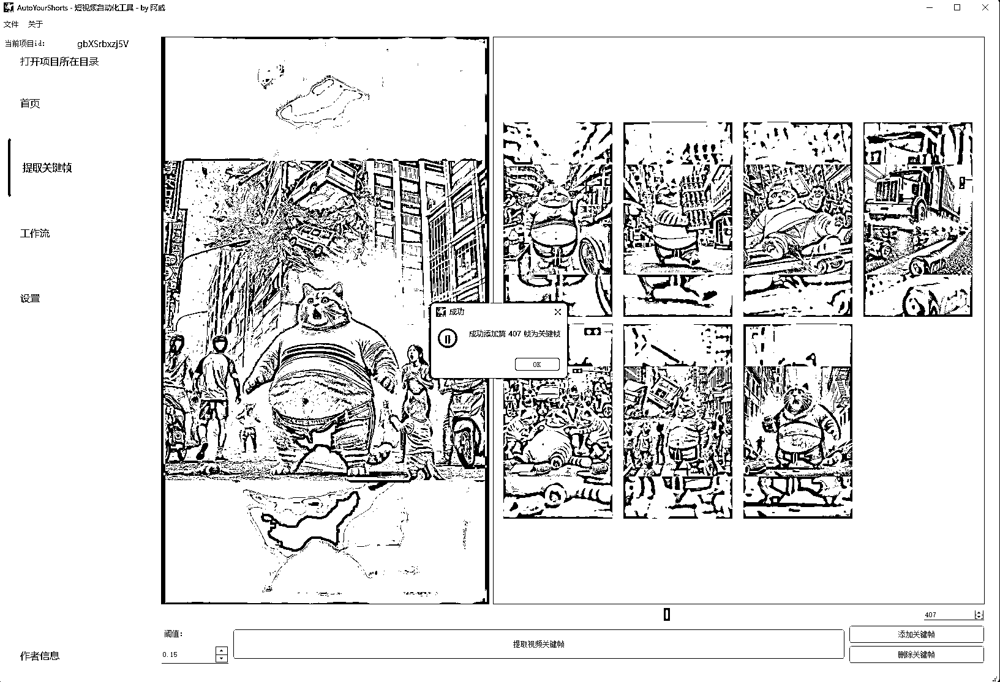
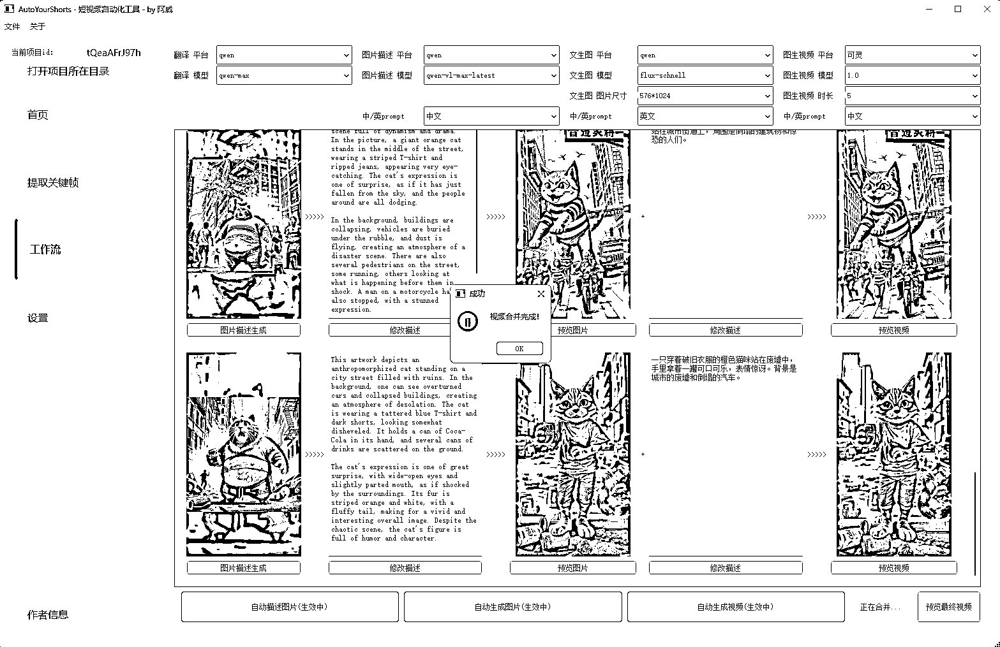
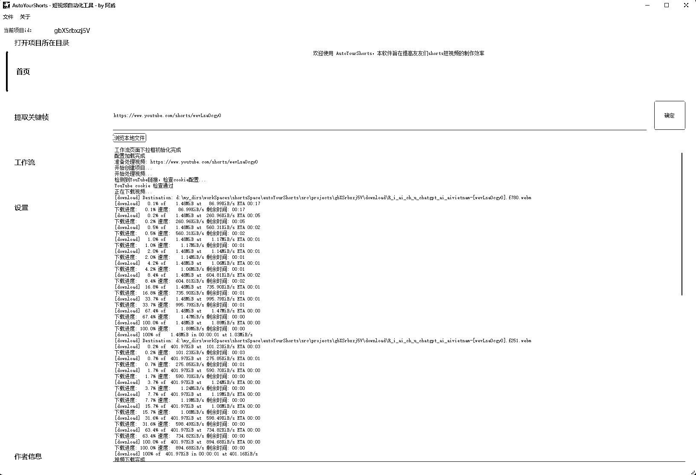

# 利用 cursor 辅助，爆肝 10 天做了款 shorts 自动化制作工具

来赚钱还不到两个月，我最大的感受就是：这里不仅“信息密度大”，更关键的是，看到大家真的都在动手干。受龙哥老大的超级标 shorts 短视频启发，加上圈里超多大佬无私分享，像@叉叉敌、@钱塘江鲤、@老马内容出海、@土豆君、@方妮波、@竹子、@星吟 Singing、@python 大大、@大铭等等（没提名的也感谢），我也决定实操一把。

于是我用 cursor 做辅助，前后熬了 10 天，搞出了一款专门做 shorts 视频“复刻/再创作”的小工具。它能把 YouTube 短视频的素材抓下来，自动抽取关键帧，再按你需要的节奏生成可二次剪辑的内容。这个工具目前主打“自动化 + 手动微调”双模式，既能省下重复劳动，也保证成片不至于千篇一律。

先上飞书文档，里面有完整的使用教程：

老规矩，截图放在下面，大家先睹为快：

#youtube #shorts

帖子发出来后，评论区也很热闹。有圈友说只模仿老马思路做了个批量采集，还没做到后面，看到我的设计后受到很大启发；也有人夸“移动方块抽取关键帧 + 自动设置间隔抽帧”这个点子妙，既能自动化又保留手动选择空间。

我自己的看法是：真正理想的状态是“零人工干预”，但以目前的算法，想每次自动提取都做到 100% 完整且零重复，还不太现实。所以我的做法是：先把自动化提取做到最快，同时留一个手动调整的口子，让人能在特殊素材上做微调。

还有人遇到一个现实问题——下载 YouTube 视频时被人机校验卡住了，折腾一晚上无解。圈友建议：试试官方 API 先把视频 URL 拿下来，再模仿钱塘江鲤的思路，用 cursor 开发一个按 URL 提取视频+音频的小工具，就能把流程全自动化。也有圈友补充：python 有现成的 yt-dlp 库，可以绕开很多坑。相关帖子链接也放出来了：[`t.zsxq.com/eEzZv`](https://t.zsxq.com/eEzZv)

工具还很粗糙，代码也不优雅，但我更想表达的是：在赚钱，想法不值钱，做出来才值钱。后面有空我再把技术细节、避坑指南和迭代过程拆开来讲。想听的话，评论区告诉我“催更”，我就有动力写了[呲牙]