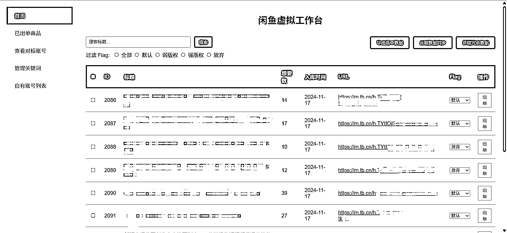
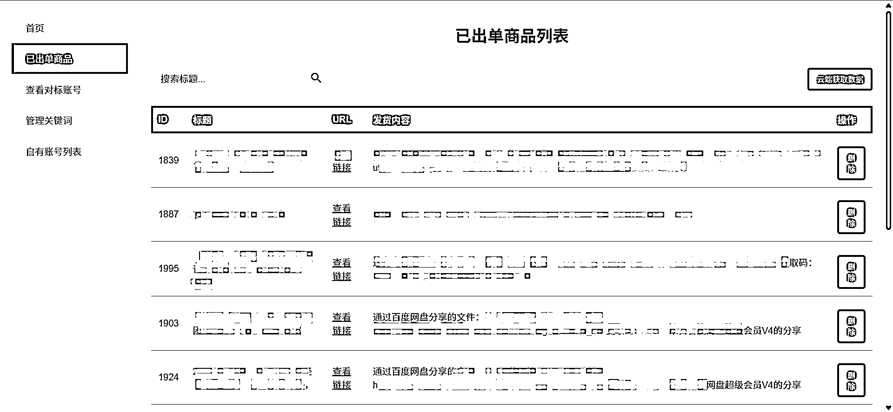
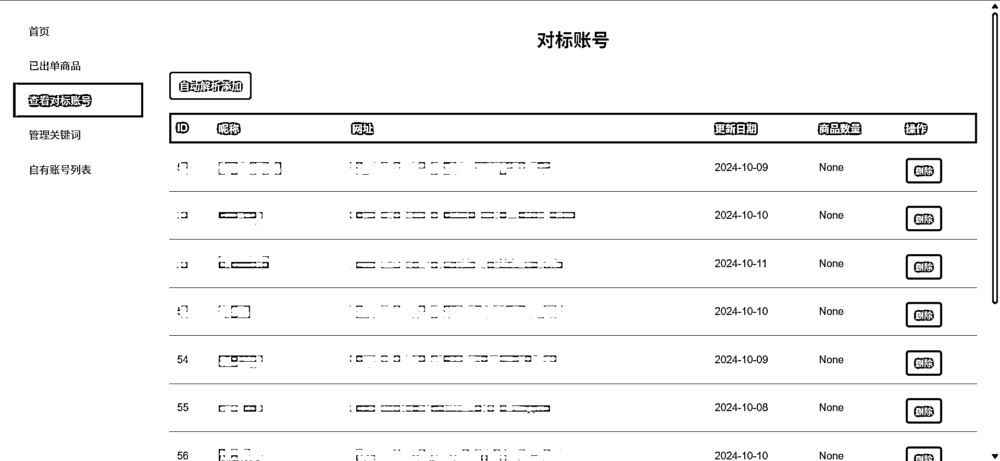

眼看新一期航海就要开启报名了，正好我最近用 Cursor 和影刀搭了一套闲鱼虚拟项目的自动化流程，覆盖选品和上品，趁着这个机会分享出来，希望能给大家一些启发。

这套系统主要拆成三块：

一是管理后台，用 Cursor 搞定，用来维护对标账号、对标商品、选品关键词，还能统一管理多个闲鱼账号。

二是自动筛选商品，基于影刀实现，内部又分两条线：一条是根据关键词去搜索和过滤，挑出满足选品标准的宝贝；另一条则是盯着对标账号，自动把符合条件的商品挑出来。

三是自动上架发布，这部分是 Cursor 写的代码和影刀配合完成，核心调用了阿奇索的能力来批量发布。

先放几张截图给大家看看实际效果：

更完整的细节可以直接看飞书文档：https://fiazd3hbob.feishu.cn/docx/T7uFd8OGQoPH4cxly7LcMxBqnsb

评论区里也有不少朋友问了实战中的问题，其中有两个比较典型。有人问上品前有没有用 RPA 批量处理图片水印、怎么去。作者的回复很详细：水印分两种，一种是平台自动贴的，另一种是卖家自己在上传前用 PS 加的。平台加的那种可以用 RPA 解决，主要逻辑写在 download.py 里；卖家加的那种就得下载图片后手工处理，这块没做自动化。另外也提到，只要不是强版权的资料，带水印其实影响不大，实测对曝光基本没影响，不过既然不好看，通常还是会顺手处理一下。关于接 API 去水印的事，作者没专门去找过，平时自己用亨亨猫，但有些闲鱼链接会解析失败，所以后来干脆自己用 Cursor 写了代码来搞。

还有人问影刀源码怎么导入自己的账号用。作者解释，演示里的 A 账号相当于作者自己，B 账号就相当于你，分享出来的影刀源码其实是从 A 账号里复制出来的，导入时按这个思路替换就行。

这套工具整体思路很清晰，技术栈也不复杂，大家完全可以照着这个框架去复刻或者改造成适合自己的版本。希望这篇分享能帮你在闲鱼虚拟项目上省下重复劳动的时间，把精力放到更值钱的事情上去。