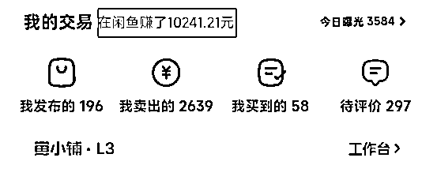
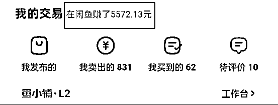

刚毕业的职场新人，两个闲鱼号，两个月时间，靠卖虚拟资料变现1.2w+，甚至连进入生财圈的门票都是这个项目帮他赚来的——这听起来像神话，却是圈友“初阳”的真实经历。

初阳是生财第8期的新圈友，他说自己第一次在生财分享内容，最希望的就是能帮到即将参加闲鱼航海的伙伴们。他是七月初才接触到这个项目，作为刚入职场的菜鸟，他用自己的实战验证了一个判断：闲鱼虚拟资料，对新人来说是一条特别容易跑通的变现路径。

初阳把这次的实操经验整理成了五个方向：店铺类型怎么选、爆品怎么找、收益怎么放大、避坑指南，以及账号运营心得。每个方向他都讲得很细，完整版放在了飞书文档里，链接在文末。

更难得的是，评论区里的问答也藏着不少实用信息。有圈友提问：虚拟资料卖得多了，总有人来咨询内部细节问题，除了在商品介绍图里尽可能写详细，还能怎么应对？初阳的回答很直接：准备一个空白闲鱼号——就是不发布商品、专门用来联系上家的号——这个号不仅能用来找上家进货，当买家把你问住的时候，你也能拿同样的问题去问上家，让上家帮你解答。不过也有圈友表示，这样做有点浪费时间。

还有圈友关心版权边界：能卖的虚拟资料基本都涉及版权，是不是只能卖弱版权相关的品类？另外也有人疑惑：虚拟资料单价大多只有一两块钱，收益是不是主要靠网盘拉新？这两个问题，初阳并没有在评论区直接回应。而针对“上架图从哪里找”的问题，初阳倒是给了明确建议：有位圈友问，是直接抄上家的图，还是自己买一份回来重新编辑？他回答说，初期直接参考上家的图就行，等操作熟练后，最好自己重新做首图，可以参考小红书虚拟资料图片伪原创的思路。

如果你正在筹备闲鱼项目，或者想找个适合新人的副业切口，不妨打开初阳的完整版分享，里面的细节足够你少走很多弯路：[飞书链接](https://q46sa8ckj6.feishu.cn/docx/G3iPdW29LoBnR0xZxwKcpVSXnAb?from=from_copylink)