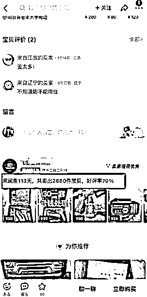

# 从零开始的闲鱼爆款选品方法论：一个做五年老手的实战拆解

## 闲鱼深耕五年，我把团队选品打法整理出来了，给小白的入门指南

作者： 杨小六

日期：2024-11-18

大家好，我是杨小六，2019年入局闲鱼的老玩家，账号矩阵420+，十月份团队销售额突破200万+。

经常有赚钱的伙伴让我把我们团队在闲鱼选品的逻辑写出来，希望能给更多人一些启发。

我第一反应是，这不都是常识吗，卖得动和卖不动一眼就能看出来。

后来听学员反馈才明白，很多东西在我这里已经变成了肌肉记忆和本能。

碰到一个新品或者心动的品类，我的第一反应是去拼多多搜同款，然后在搜索框里看同行的上架情况，截图留存，留意动态是否开启，看销量凭证，隔天再回头对比变化。随后把截图丢到微信运营群，让团队去测这个品。

这一套流程早已自动化，而很多朋友还停留在摸索阶段。所以这篇文章就把路径拆开来讲，帮你找到真正适合自己的品类，并学会按自身条件做正确决策。

选品在闲鱼运营里至少占七成的成败权重。

选品策略不同，直接决定了你的日单量、客服消耗、售后复杂度。

为了阅读更顺畅我整理了要点版在飞书，大家也可以移步查看，喜欢口语化表达的就继续看本文。

[`zf7r28t8wa.feishu.cn/docx/Y3I7dUD5doHJi6xYP6IcsY2snLg?from=from_copylink`](https://zf7r28t8wa.feishu.cn/docx/Y3I7dUD5doHJi6xYP6IcsY2snLg?from=from_copylink)

下面进入正文。

**一、先搞懂闲鱼的平台基因，再决定选什么**

选品之前必须先吃透平台属性。

不用搬数据了，核心就一句话：闲鱼的本质是二手交易市场。

拆成三个关键词：二手、交易、平台。

二手：具备二手流通属性的品类在闲鱼天然更吃香。
交易：能在闲鱼闭环完成买卖。
平台：全品类覆盖。

尽量往二手属性上靠。绝大多数人不会一开始就想到闲鱼来买新的，很多人根本不知道闲鱼也能卖新货。来闲鱼的人，本质是来淘二手好物。什么品类具备二手属性，什么品类就更容易跑起来。你要先问自己，这个东西有没有二手交易的理由。

**二、结合自身条件定策略，选品才能不瞎干**

我们团队目前只做标准品。

什么是标准品？比如图书、计算器、晾衣架，这类东西外观差异不大，核心看使用功能。用户基本不用精挑细选，前几页就能下单。

那非标品呢？比如女装，逛三条街都选不定的那种。决策周期长，还容易退换，因为网图和实物可能差很远。

我们团队全员标准品。

标准品我们会持续深挖。现在主要集中在高客单的标品，因为利润率相对稳定。

除非是极小众类目，利润空间异常大，但通常撑不起团队化抢量。同时非标品属性太多，对员工培训成本很高。

选品要先盘自己。

**先看时间模型。** 学员大致分两类：

第一类是白天碎片时间，晚上相对集中。典型是上班摸鱼族、宝妈带娃。手机能随手看，电脑时间有限，中午基本只够吃饭。

第二类是时间相对完整的全职。孩子上学了、在校大学生、把闲鱼当主业做的人。

第一类怎么做？如果上班能用电脑，可以用指纹浏览器登录闲鱼网页端，直接百度访问。电脑负责回消息，多开几个网页对应多个账号。安卓手机可以双开，操作两个号。苹果就单号，实在不够就添一台二手的摩托罗拉之类的多开机。优质号扫码到网页端统一处理消息。

上班时间不建议囤货和上新，主业副业要分清。

品类上建议选低客单价的标品，咨询少转化高。比如手锯、螺丝电钻、角磨机、小型花架这类。

这类品用户基本清楚用途，描述写清楚了能解决99%的问题。上班时间回复压力小。转化也好，价格只要和同行持平或略高一点，不会明显影响下单。

上新和进货放在晚上，中午有空可以把上午的订单下单，晚上统一填物流单号。

第二类全职玩家，再看资金状况。

全职且资金充足当然更好。如果是学生党，生活费固定，花呗信用卡能不动就别动，很多人卖货的钱刚到手，信用卡就还不上了。我见过极端案例。

建议专款专用，可以动用利润滚动，本金别碰。

这类玩家我建议做大件。大件客单价高，在利润率固定的情况下，赚得更多。

大件的优势是客单高、利润足，但缺点是用户决策慢，几百上千的金额在闲鱼会反复对比。常见的有电动车、山地车、洗衣机、冰箱、运动器材等。

本质上大件更符合二手逻辑，因为贵。

以上是按时间选品，**再来定清晰的目标规划**

想靠兼职月入过万，本质上闲鱼不合适，其他项目更高效。

闲鱼能赚钱吗？能。但说实话，我手下30多个员工，很少有人单人能稳定过万。极个别的时间点能冲到，其他时间做不到。

全职每天8小时，指望靠一点努力是不够的。这个平台拼的是时间投入。我们员工正常8小时，学员基本能干到11小时左右，过万就很自然。

所以先问清自己想要什么：我现在有几个账号、有多少启动资金、想赚多少钱、每天能投入多久。

举个合理的例子：

杨小六目前是打工族，早九晚六，上班能用电脑，月薪5k，有点积蓄，想开3个号做大百货类，中午用手机补货，晚上上新和选品，目标月增3k。这个规划就很清晰。

反面例子：

小雪也是打工族，上班能用电脑不能玩手机，没积蓄，想赚越多越好，晚上能上新但消息回不及时，不知道卖什么。这个就是无规划。

**三、规划定了，怎么判断市场上能不能做**

规划确定后，就要验证这个品能不能支撑你的目标。如果做到头部也达不到预期，就别浪费时间。

首先是同行观察法。同行不会给你看数据，只能靠痕迹判断，分两块：

1、看动态。动态基本能看到账号全貌，上架的可以删，动态和销量删不掉。如果商家没关，销量高了也会展示，最多显示几十条。

**顺带教你找货源，看买家评价里的图片，直接去拼多多图片搜，基本两分钟内锁定。**

 images.zsxq.com/FhSIDPC92CibETtHnhvNO2KEQ7Tc) images.zsxq.com/FvVmn7DjQdHtdNjaMoGuKiup7lo3) images.zsxq.com/Fp7WZrDCv2ZmE2r_jrmXD7UT1E6i)

2、动态被隐藏了怎么办？看销量截图。每天截一次，隔天再截一次，相减就能算日销。也可以看账号注册113天，累计销量2880件，日均大概30单。一单赚4块，一天120块，一个号月入3600，心里就有数了。做到这个体量能不能满足目标，就能快速决策。

第二是看拼多多等平台。拼多多能跑起来的品，搬到闲鱼基本也能活。

建议多逛闲鱼，看到心动的品先去拼多多对比价格，再回来看闲鱼的日销。能过审就直接小批量测试，给自己定每天测几个品的任务。

等所有备选品都打满，后面就是躺赚红利。除了应季品，大部分标品都是长青款。

我每天至少逛闲鱼一小时，觉得可以的直接丢给运营上架。

测试成本很低，错过成本很高。

**应季品要不要做？**

我的建议是有余力再做。季节性品类爆发强，但不可持续，容易出现第一波赚到手，第二波赶不上，然后觉得没钱赚放弃。这样得不偿失。

最好先有几个稳定现金流的品和账号，时间精力还有富余，再多开号做季节款。

应季品爆发快，后端一定要跟上，最好自己先买一件回来测试。万一日出100单，后端没卡号、没发货能力，客诉会直接炸掉。

* * *

评论区：

苏玲 : [鼓掌][鼓掌][鼓掌]

张张 : 感谢分享！发货是自囤发货，还是走代发呢？

杨小六 : 模式稳定后可以少量囤货，代发更省心

苏玲 : 闲鱼真的很适合普通人入局，很容易出成果。[强][强][强]一个月200万+太猛了！

杨小六 : 没错，目前新手期很友好，一般一周左右就能看到收益

百哥 : 感谢分享，有收获，想看评论：想看您分享这420个账号是怎么统一管理的，比如开了多少台设备、多少张手机卡、闲鱼币推广、超级曝光、每天擦亮是手动还是设备等等这些多账号运营管理细节

杨小六 : 回头有空再写写，我之前有篇团队搭建的文章可以先看看

百哥 : 好的，感谢