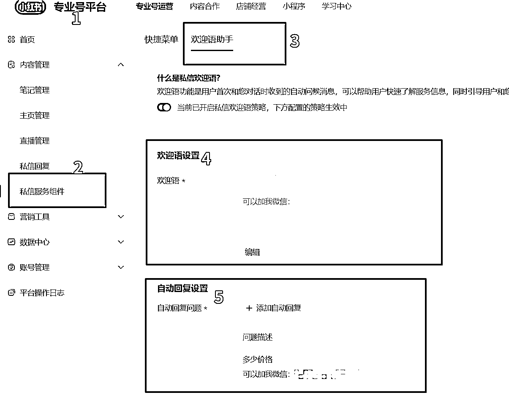
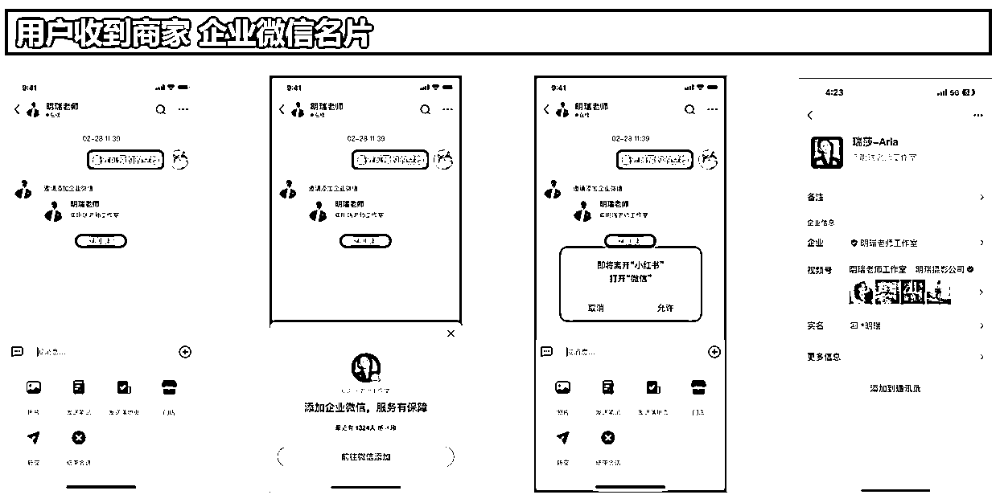
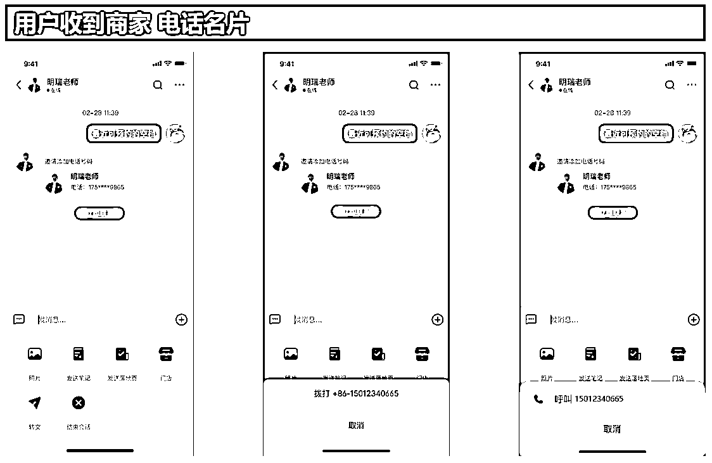
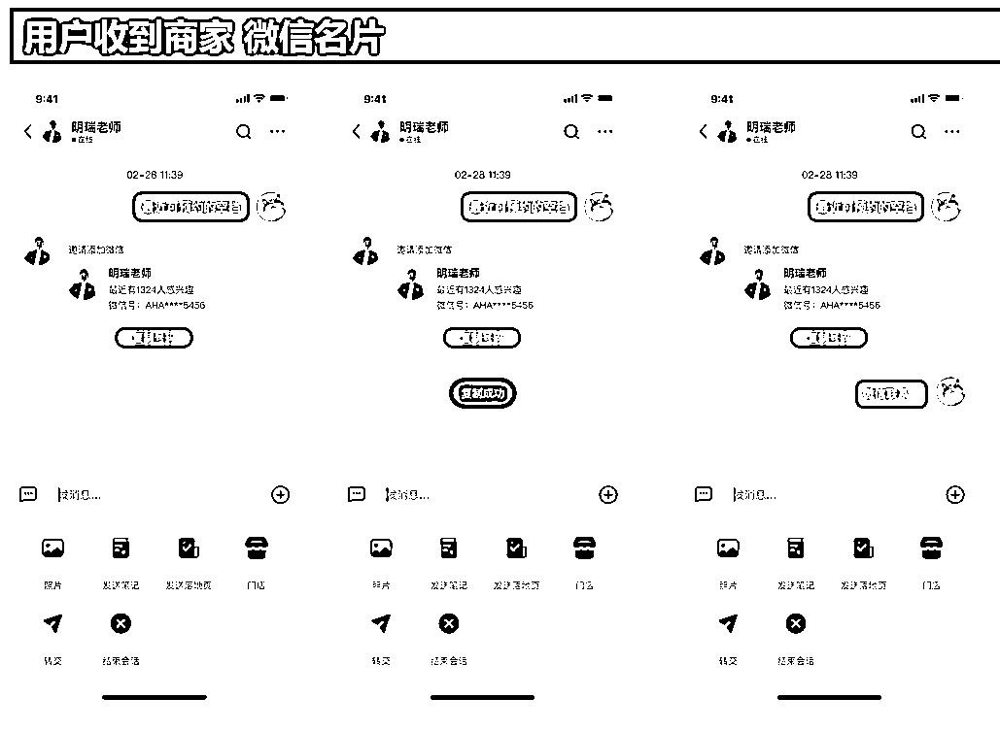
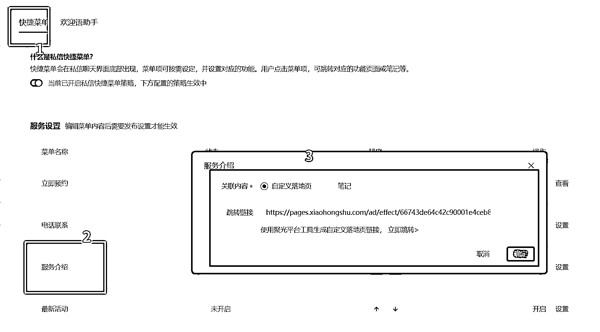
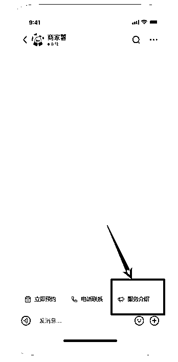
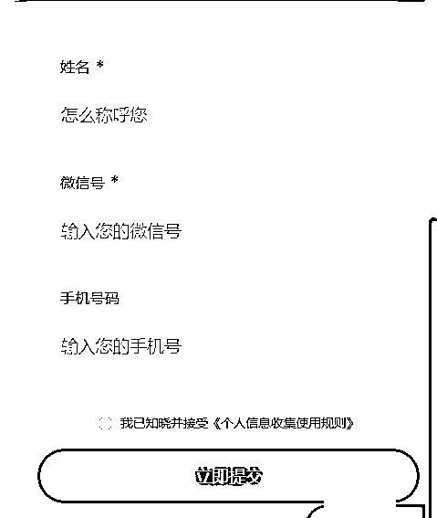
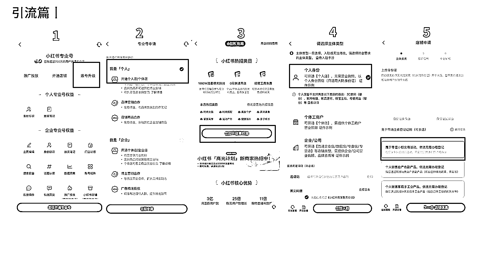
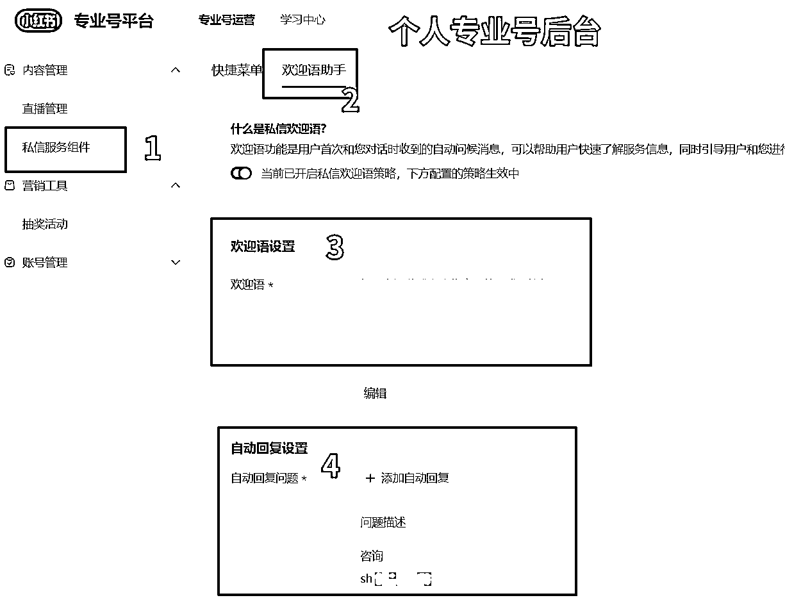

# 小红书引流别再赌运气了！官方这4个安全通道，企业号个人号都能用

最近小红书对“私下导流”的管控越来越严格，说它是全网查得最凶的平台也不夸张。就连企业专业号，只要没按规矩来，照样可能被封。像小号引流、群聊引流、主页挂微信、表情包引流这些老办法，不是说完全不能用，但都是在跟概率赛跑，运气不好就凉凉。

与其每天提心吊胆，不如用官方给的工具走安全路线。今天就把企业版和个人版加起来一共4个合规引流渠道一次性讲清楚，有点门槛，但真不高，比“赌号”踏实多了。

先收藏这两个后台地址：
- 专业号后台：pro.xiaohongshu.com
- 聚光后台：ad.xiaohongshu.com

## 一、企业号渠道：自动回复

操作路径：
1. 先搞定专业号认证（年审费用600元），顺手把聚光开了。
2. 在30天周期内，广告消耗累计达到1000元。
3. 等第二天中午12点以后，再去专业号后台刷一下页面，就能找到“私信服务组件”。
4. 在组件里设置“欢迎语助手”，说白了就是配置自动回复。
5. 图片里标出的两个红框位置，都可以直接把你的微信号填进去：

几个重点提醒：
- 消耗满1000之后，系统会自动加白，不用再找代理或直客手动开通。白名单生效后，私聊中直接发微信一般不会被判定为引流，不过有小概率触发误判，发现后手动捞回来就行。
- 自动回复只对第一次进入对话的用户弹出，但非广告带来的用户同样能触发。
- 后续如果某个自然月聚光消耗不足1000，甚至完全不投了，私聊发微信的白名单会被取消，但自动回复功能依然能用。

## 二、企业号渠道：微信名片

操作流程：
1. 还是先认证专业号，再开通聚光。
2. 广告消耗累计超过1000元。
3. 联系你的直客或代理申请加白名单（在谁那边开的户就找谁处理，而且这个账号之前不能有过违规记录）。
4. 按需配置企业微信、个人微信或电话名片：

注意事项：
- 企业微信名片和电话名片门槛相对友好，每个月保持稳定消耗基本就能加白；个人微信名片的要求会更高一些。
- 这功能目前还在内测阶段，原来说11月放开，现在还没完全开放，暂时只能手动加白。
- 手动加白本身不收钱。要是外面有人让你花钱买加白，基本就是二道贩子，别踩坑。

## 三、企业号渠道：免费表单

操作步骤：
1. 老规矩，认证专业号并开通聚光。
2. 30天内消耗满1000元。
3. 次日中午12点后，去专业号后台刷新，看到“私信服务组件”。
4. 到聚光后台创建一个“橙子表单”。
5. 把表单链接复制出来，挂到私信服务组件的快捷菜单里：

提醒几点：
- 落地页别设计得太过复杂，收集最基础的信息就够了：

- 和自动回复一样，只要私信服务组件已经开通，后续哪怕停止投放，功能也不会消失。用户在聊天时，引导他点菜单就行。
- 如果没有保持每月最低消耗，聊天中千万别出现“微信”“WX”“weixin”这类敏感词。比如“点下面菜单可以加我微信”这种话千万不能讲，要改成“点下面菜单联系我”。
- 还有个更轻量的玩法：直接设置“立即预约”按钮，不用做落地页，用户也能一键填手机号。
- 落地页链接不限于企业专业号使用，个人号在引流时转发这个链接，同样能获取客资，而且不违规。

## 四、个人号渠道：自动回复

不用企业认证，个人号也有安全玩法：
1. 个人账号先完成实名认证。
2. 进入创作中心，找到“专业号中心”并选择升级，把账号变成“个人专业号”，领域挑个自己感兴趣的就行。
3. 回到专业号中心，点击“开店”，开通个人店铺（需要刷脸验证）。
4. 用电脑登录专业号中心，打开“私信服务组件”。
5. 设置自动回复，后续操作参照企业版自动回复的步骤：

这些细节别忽略：
- 认证时千万看清是“个人专业号”，别稀里糊涂升成了企业号。
- 自动回复只对首次私信的用户触发，欢迎语和自动回复问题这两个位置都能填微信号。
- 个人号没有聚光消耗这回事，也就不存在“加白”概念，所以私信聊天中千万不要出现微信相关字眼。
- 如果只用自动回复来加微信，个人店铺不需要上架商品，也不用缴纳保证金。
- 但如果你想把“私信服务组件”里的快捷菜单功能用起来，那店铺里至少要上架一件商品。

## 写在最后

以上4个渠道，只要官方规则没变，就是100%安全的引流方式。有门槛，但不高，总比账号没了强。做矩阵的朋友，可以派一两个账号专门负责安全引流，其他账号专心铺内容搞流量，互相打配合。

小红书用户质量高，现在也还在红利期。但平台商业化跑得太快，规则迭代也快，上半年还能用的免费引流路子，下半年可能就成了违规雷区。方法用对了，项目自然走得更顺。

我是金坐，祝大家天天爆粉，天天爆单！