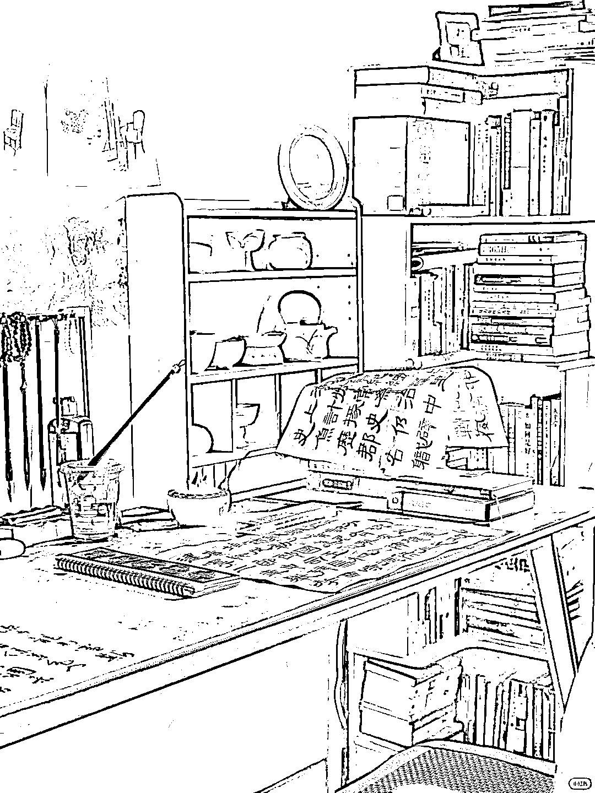

# ('1 个人做 3 个小红书赛道，涨粉 10W+，我的经验分享', (2, 31))

做了三年自媒体，我最大的感悟是：一个人真的可以同时运营好几个方向，而且都能做出成绩。目前我手里有读书号、家居号和带货号，累计粉丝突破了10W。其中读书号“嘿柠檬”有7.3W粉，家居号“阮小阮”也快破万了，几个电商号加起来又有2W多粉。

很多人问我，一个人哪来这么多精力？其实关键在于——把这件事当成一份正经工作来对待。

虽然在外人看来，自由职业很爽，时间自己说了算。但我的真实状态是：周一到周五照常“上班”，不约朋友，不躺平发呆。只有到了周末，才会真正放下账号相关的事，好好放松。如果你只想靠随手发几条笔记就爆火，或者觉得有粉丝就能轻松变现，那基本不现实。想靠自媒体赚钱，得有持续输出的价值内容，更得有清晰的商业化思路。

心态摆正之后，接下来就是起号的节奏。我总结了一套方法，能让过程更顺畅：

第一，选赛道。先看你擅长什么，再看你喜欢什么，两者交叉的地方就是好方向。

第二，找对标。别好高骛远，要选符合自己目前阶段、能参考落地的账号。

第三，拆细节。从头像、简介、封面、标题，到内容选题和关键词，越细越好。

第四，学爆款。研究对标账号的爆文，提炼核心选题和关键词组合，再结合自己的特点做输出。

另外记住：做账号是一个不断用数据反馈来调整的过程。如果你发了一个风格七八篇，数据依然没起色，别死磕，赶紧换风格或者提升内容质量。

自媒体这件事，你投入多少，往往就回报多少。如果暂时没看到结果，也不用着急，把同类型的优秀账号研究透。就像我一直分享的做号方法论，多看多学，你也会有收获。

