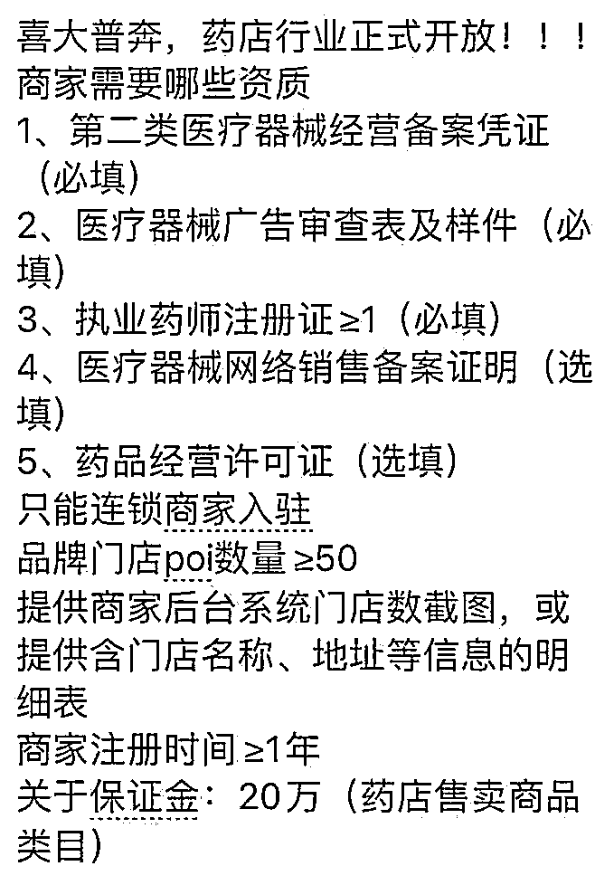
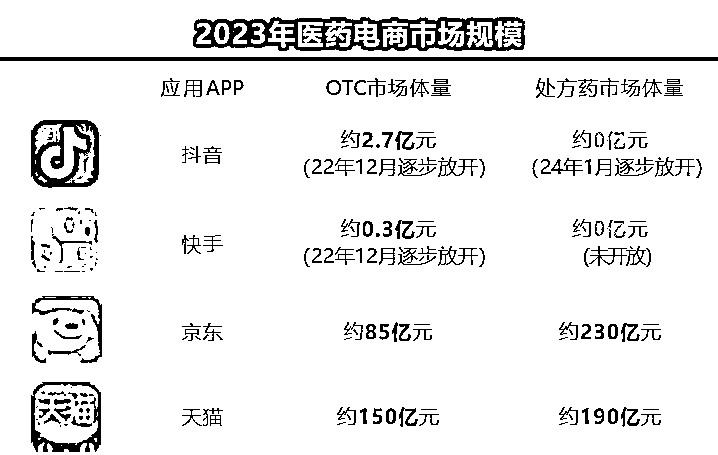

# 抖音本地生活又要引爆一个赛道？医药大健康的红利，谁能接住？
作者：龙哥

这阵子圈子里又炸开了锅：继年初放开处方药后，抖音下一步要给中医馆和药房开准入通道。换句话说，以前那些只能靠线下发传单、打广告，或者在美团这类平台上等客的中医馆和药店，很快就能用短视频把客人“勾”到店，然后线下完成交付。

这大概率又是抖音本地生活一次改写行业玩法的大动作。我判断，医药和大健康品类的本地生活红利，是真的来了。

为什么敢这么讲？先看一组数据。

2023年的医药电商盘子，京东OTC做了85亿，处方药230亿；天猫OTC做了150亿，处方药190亿。而京东和天猫的药品规模，是抖音的200多倍。可要是比日活呢？抖音差不多是京东加天猫的10倍。

再看用户行为，抖音电商里医药健康内容已经吸引了超过5.9亿人关注，医药业务日均搜索涨了3.6倍，月均搜索也有20%的增长。就这么大的一个市场，抖音只要一步步打开品类和营销限制，流量的洪流会有多猛，想想都吓人。

那为什么偏偏是中医馆和药房？其实逻辑很直白。中医馆这一年的数量，从8000家蹿到了12000家；药房呢，更是药品在线下履约的最好载体。一个代表需求正在爆发，一个代表交付场景已经成熟，再加上抖音那套“短视频种草—线上获客—线下核销”的标准链路，中医馆和药房天生就是最契合的体验场。所以抖音选它们开刀，一点都不意外。

真正值得琢磨的，是机会到底从哪儿长出来。

第一，中医馆。过去中医连锁始终做不大，核心就是老中医的IP太强，一个人把品牌流量全吸走了，想复制难上加难，能开10家店就已经是天花板。但最近我跟几个做中医馆的创业者聊，发现思路完全变了。比如朱雀中医的雨泽，他这几年有意压着老中医，专挑青年中医来培养。从选址装修、到体验感、再到售前售后，全部做到比同行高一大截。目前广州开了3家社区中医馆，连美团都没上，更没碰任何本地生活平台，照样跑得很漂亮。青年中医的盘子够大，筛出好苗子的空间自然更多，再赶上抖音开放这波东风，扩店速度肯定会起飞。

另一个是榕树家的刘宇。他拿养生馆当切口，用AI模型把医学硬实力抬高，直接从1家店干到了1600家。

今年他还亲自出来做个人IP，用品牌故事、创始人成长故事去吸同频的加盟商，比起过去三年那套筛选机制，维度直接升了三级。

第二，连锁药房。现在线下到店生意越来越难做，客户主动上门的日子基本过去了，流量和广告通道又窄又贵。内容引流的好处就是，可以主动出击，把用户带到店里。尤其抖音喊出“全域兴趣电商”之后，既打通了货找人、也打通了人找货，内容场和货架场拧成一股绳，医药品牌等于多了一个全新的舞台。

那要接住红利，到底该怎么干？我的建议有这么几条。

一、死磕抖音搜索流量，把SEO做好。生病这事儿是突发的，用户不会天天惦记着买药，所以你只能靠高频触达和自然搜索排名去占据位置，而下单转化，看的还是门店评分和基础建设。

二、引流品要想清楚。中医馆用理疗项目和药膳打头阵，针对人群痛点去击穿；药店就上保健品、健康食品，先把人请进来再说。

三、专业度和长期用户运营才是根。抖音永远只是流量渠渠道，真正决定生死的是你留不留得住人。

四、搭好营销矩阵。先让自然流量帮你筛出精准客户，跑顺了以后再做放大，别一上来就猛烧钱。

五、提前落位。这种窗口期不会一直等着你，谁先准备谁先吃螃蟹。有想法的朋友，也欢迎随时来找我聊聊。

最后，必须泼几盆冷水。

一是赛道被流量轰炸之后，最容易出问题的是加盟模式。门店扩张太快，品牌名气还没立起来，加盟店就要跟周边老店硬碰硬，获客很难。如果品牌方只顾着收高额加盟费、不给实质性帮扶，闭店率一旦在2-3年内冲到40%，反噬会非常严重。

二是用自媒体放大流量时，体系可能失控。有些品牌打着互联网思维的旗号，靠补贴换规模，前期宁可亏钱也要给加盟商喂流量。表面很猛，实际上财务模型脆得一碰就碎，单个客户成本越推越高，等加盟潮一退，增长立刻疲软。真要打，就得把品牌定位钉死——比如专门做睡眠、疼痛、老年人慢病管理的细分中医连锁，或者用AI这些工具提溢价、降人工。

三是政策红线必须绷紧。药店和中医馆都是到店咨询的逻辑，升单环节躲不开，付费通道到底是什么，得提前想明白。有些门店直接刷医保卡，这在宣发推广里极其危险，一个不小心就可能踩到平台的处罚，或者被监管部门盯上。这个雷区，谁碰谁难受。

医药大健康的本地生活红利，确实是块大肉，但能不能吃到嘴里，还得看你是不是够稳、够专业。机会就在眼前，别光看，得动起来。