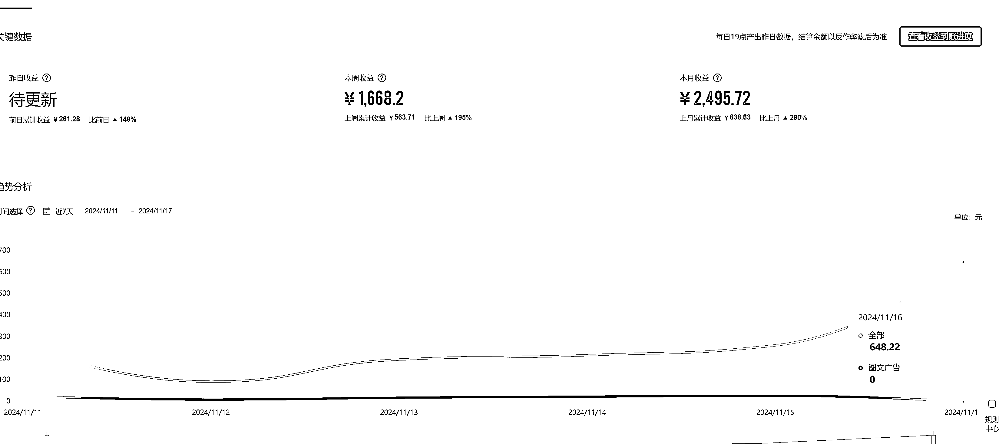
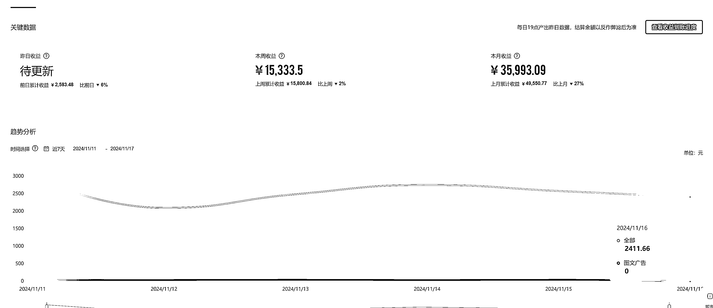
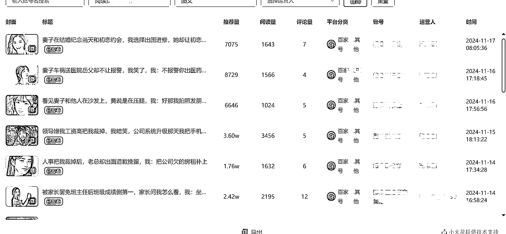
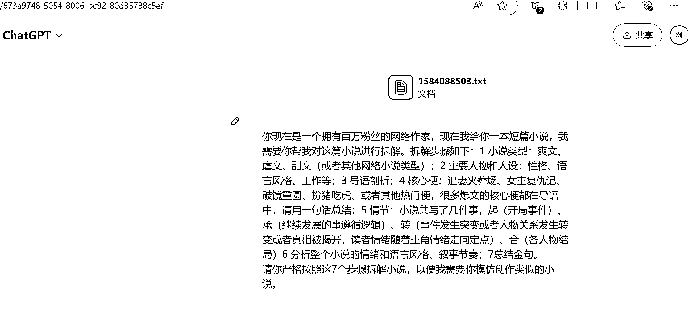
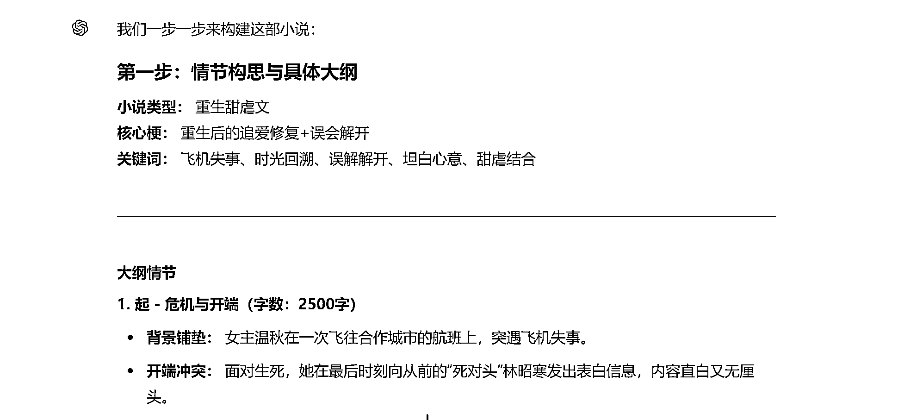
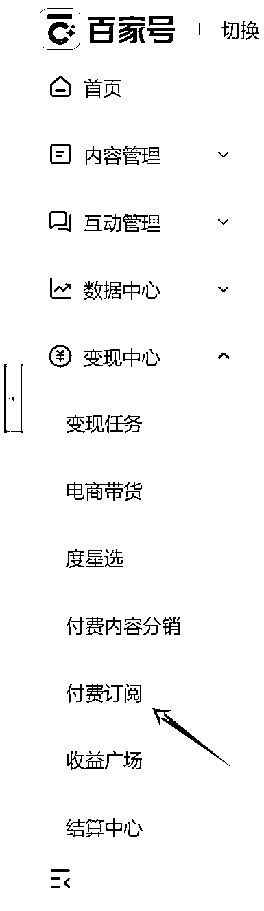
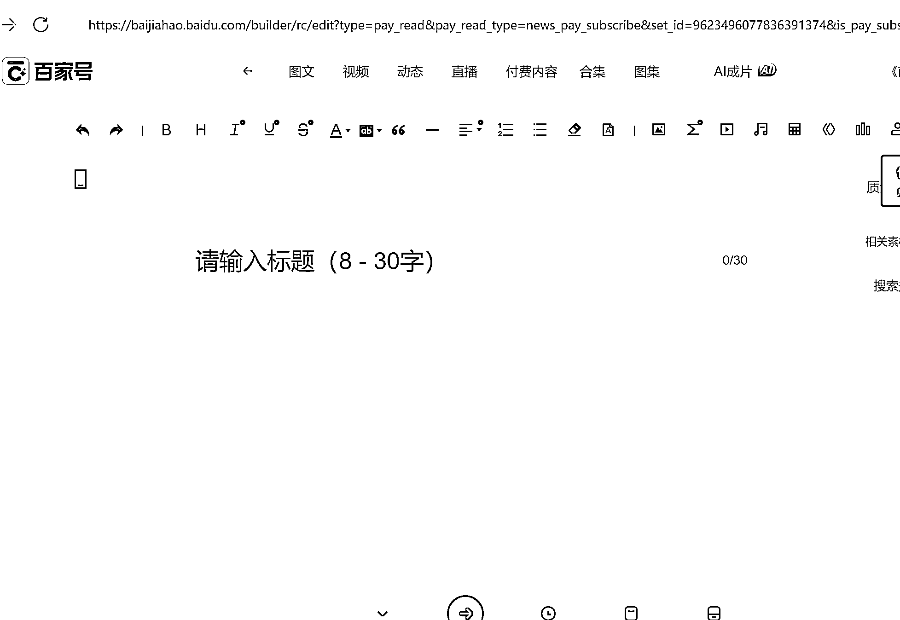
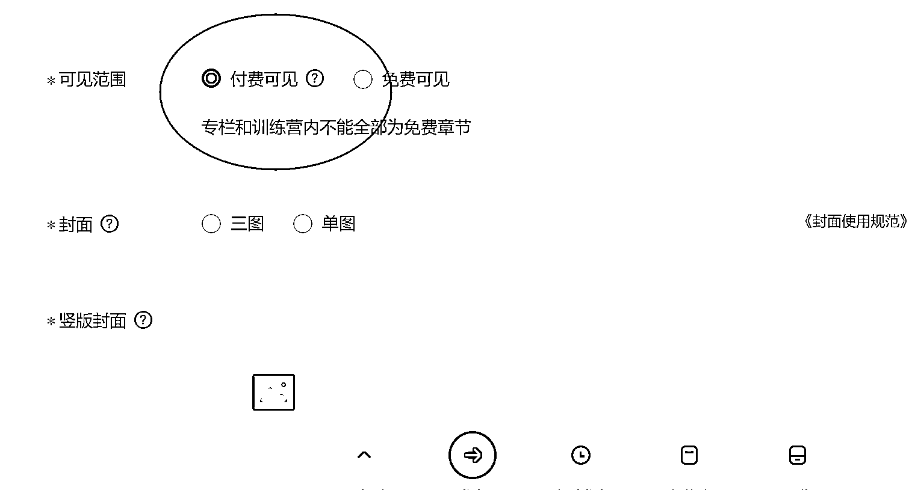

# 别人靠广告吃不饱，我靠百度付费专栏写短篇小说慢慢滚雪球

> 原文：[`www.yuque.com/for_lazy/zhoubao/abeudcfr1il5rmgf`](https://www.yuque.com/for_lazy/zhoubao/abeudcfr1il5rmgf)

## 用百家号付费订阅写短篇小说，普通人也能吃到红利

作者：盟主君

日期：2024-11-18

很久没更新了，上次发帖还停留在五一，过去半年我在忙什么，今天简单复盘一下。

最近主攻一个百家号付费订阅的变现玩法，听上去很专业，其实核心就是在百度上开专栏发短篇小说，读者想看就得先付费订阅。

肯定有人会问，现在免费小说满天飞，还有人愿意花钱看吗？我直接上后台数据说话，这是个新手号的收益情况

再看看头部创作者的数据

我自己算是卡在中间的水平，那要怎么才能靠这个赚钱？我总结的答案只有一条：向做微信爆文那样去做，持续高产出优质短篇，让数量堆出效果。

每一个阅读都有转化为付费读完的可能。更关键的是百度现在的付费机制是默认续费，譬如你花 19.9 付了首次订阅，绝大多数人不会去手动取消，月费就会像滚雪球一样越滚越大。

我之前做过自媒体矩阵，手里攒了差不多上百个百家号。百度一开放付费订阅，我就直接把这些号全部转成了小说付费项目。

现在入局还来得及吗？来得及。今年百度广告分成普遍走低，光靠流量广告很难养活自己。而付费订阅是内容对内容，你做出用户愿意买单的好故事，平台和作者就能双赢。

不会写小说怎么办？完全可以用 AI 辅助，我带你走一遍流程。

第一步，AI 辅助创作一万字短篇
千万别直接让 AI 伪原创搬运，那样很容易被判定违规。我们的做法是让 AI 做编剧：先找一篇优质小说，让 AI拆解它的情节结构和写作技巧，再让它基于拆解结果重新构思一个新大纲，最后按章节逐步扩写成完整小说。

为了避免文章有明显的 AI 感，需要用一套合适的提示词做风格控制。用 Claude 3.5 来写的话，出来的文本几乎看不出是机器写的，你只要把大纲把控好就行。

第二步，把小说上传上架
目前百家号开通付费订阅的条件是粉丝过 100 且发过文章，条件很低，但自己申请通过率比较玄学，也不是没有技巧。

进入百家号后台，找到变现中心里的付费订阅入口

hi

点进图文发布，把小说粘贴进来，做好排版，配一张封面图，起好标题

发布前一定要核对是否勾选了付费文章类型

上传一张足够吸睛的封面就可以发布了。百度的标题审核比较严，建议用三段式标题，把核心冲突讲清楚，最大化点击欲望。

比如：
#### **看到老公下班后急匆匆去见情人，我假装不知情，结果他自己露馅了**
#### **婆婆当众说我不会带娃，我当场摔碗走人，她却半夜来敲门求原谅**

标题就是点击率的开关，关于怎么写标题我后面会单独开一篇细讲。

第三步，日更复盘，形成肌肉记忆
普通人要想在这个赛道赚到钱，就是坚持重复前两步的操作。一篇小说从创作到发布平均 1 小时能搞定，一天发 5 篇，一个月后你会看到账户开始动起来，很神奇。

最后留个问题给你思考
辛苦写出来的一个故事，能不能做到一稿多用，实现收入倍增？

* * *

评论区：

绢绢满愿学堂 : 肯定能啊，确实是个好主意

绢绢满愿学堂 : 怎么申请付费订阅呢

盟主君 : 百家号 100 粉丝以上可以申请

老彭 : 油管音乐号还在运营吗

绢绢满愿学堂 : 我 500 了已经 谢啦

鲸鱼 : 请问新号注册后通过发文章慢慢涨粉，然后开订阅吗？