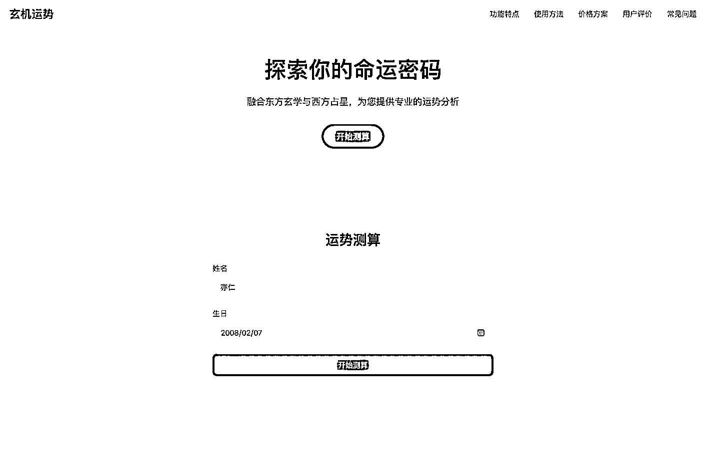
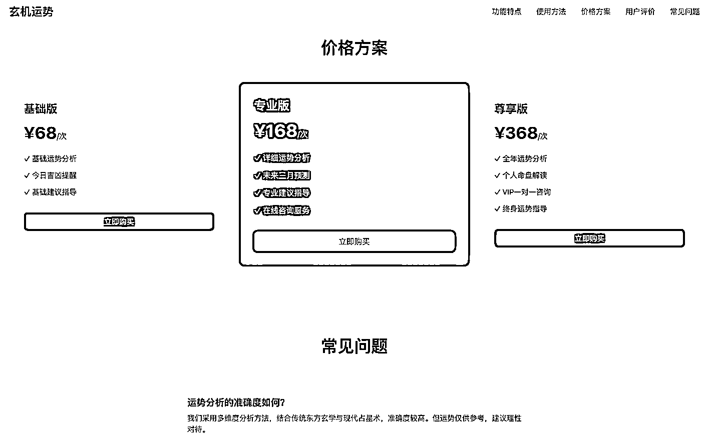
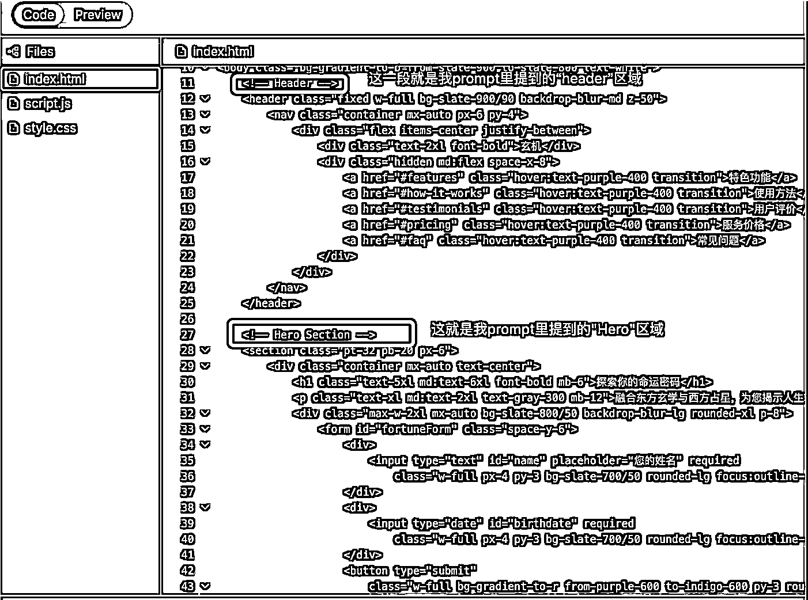
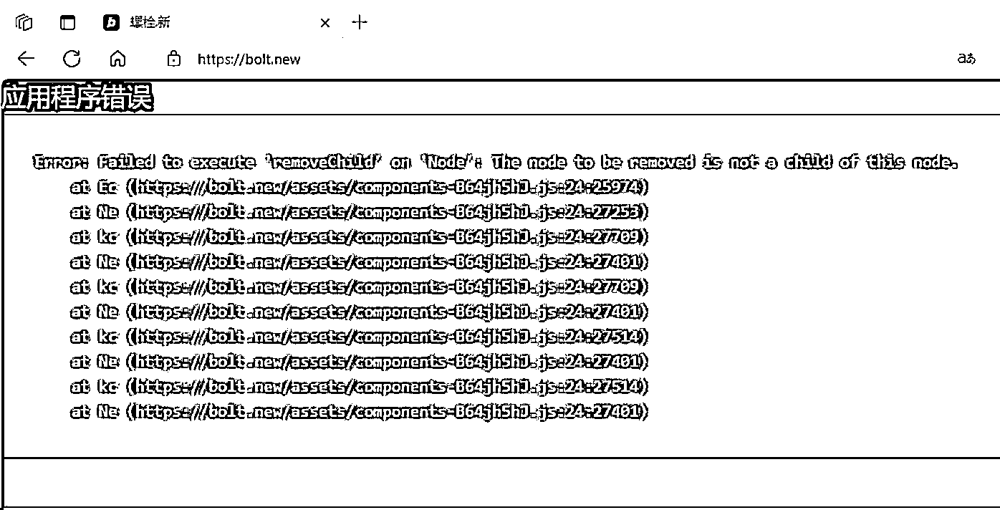
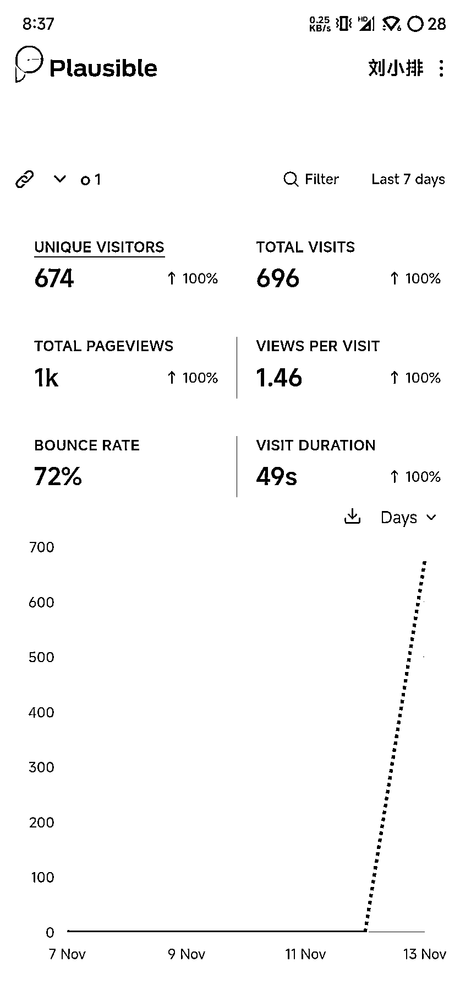
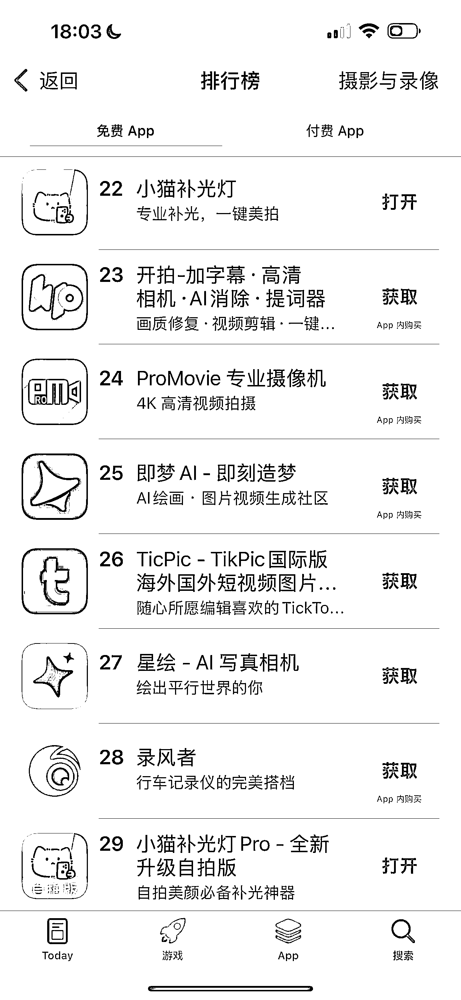
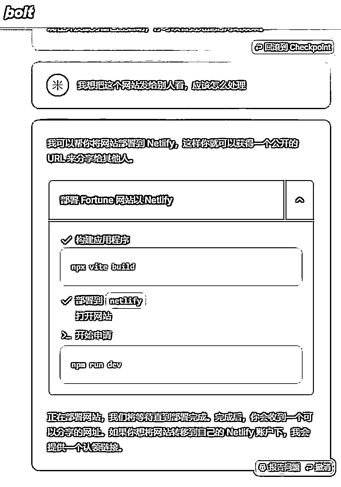

# 5分钟上线一个能用的网站，想法直接变现的时代来了

## 5分钟就能做出一个像样的网站，人人都能上手

作者： 刘小排

日期：2024-11-13

只靠一个念头就能产生收入的时代已经到来。

看到这里别划走，先跟着我做一遍实操，感受一下那种冲击感。

震撼过后再回头看详解也不迟。

# **60秒实操体验**

我们用 AI 快速生成一个**星座运势站点**。流程很简单：

1. 打开 [`bolt.new/`](https://bolt.new/)

2. 把下面这段 Prompt 复制进去，回车执行

> 1. 技术栈：纯 HTML + TailwindCSS 实现

> 

> 2. 核心功能：我要做一个运势网站，用户输入姓名、挑选生日，点击按钮就能得到运势结果。算法细节你来定，只要算出来够专业、看起来有依据、能让人产生付费欲望就行。

> 运势结果至少包含运势等级、分数、宜忌事项、解读理由等。

> 

> 3. 页面结构：要有完整的 header,hero, testinoials, faq, features, pricing, how it works ,footer 区块。网站版权归刘小排所有，联系邮箱 bourneliu66@gmail.com，其余内容请写得专业可信。

> 

> 4. 文案语言：全站使用中文。关于运势计算，请突出东方玄学、紫微斗数、易经与星座的融合，强调东西方结合。

> 

> 5. 视觉风格：现代感强、有质感，参考苹果官网的设计语言。全站响应式，适配各种屏幕。

1. 等待奇迹呈现

2. 这是真能用的。生成的网站里可以直接填姓名和出生日期试算运势，玩起来很有意思。

3. 额外提示：在聊天窗口输入“我想让别人也能访问这个网站，怎么做？”，网站会自动发布并给你一个公开 URL，可以直接分享出去炫耀。

我的演示站点可以打开看看： [`cute-kitten-b88e4d.netlify.app/`](https://cute-kitten-b88e4d.netlify.app/)

感觉如何？有被震到吗？

* * *

做网站其实没有那么神秘。

只要思路清晰，按下面这套方法，你也能在 5 分钟内做出一个拿得出手的产品。

没错，就是 5 分钟。

**两年前的我觉得要两天，去年觉得要一天，现在觉得 5 分钟就够了。**

“我有个好点子，就差个程序员”这种说法已经过时了。现如今，想法本身就能变现！

# **一、用 10 秒钟搞定开发环境**

程序员常说，环境配好工作就完成一半。

但对非技术背景的朋友来说，配环境更是噩梦。

为此我强烈建议使用零配置的 AI 開發工具：bolt.new

[`bolt.new/`](https://bolt.new/)

打开网页就能用，开发全程云端完成，还能一键部署上线。

# **二、用 2 分 50 秒把需求说清楚**

关键点：**表达能力**。

你需要反复思考：怎样用最简洁、无歧义的语言，让任何人、包括 AI 都能完全理解你的意思？

我们回到开头的 Prompt 来拆解。

第 1 条：指定技术栈。因为运势站很简单，我选用纯 HTML + TailwindCSS，这样代码只有一份文件，维护非常轻松。

第 2 条：用一句话概括核心需求。

第 3 条：细化工作范围。这条最重要，请仔细体会。

很多人写的需求模棱两可，导致 AI 理解偏差。感觉“AI 不好用”，根源往往是表达不清。

在我的示例里，我只用了“header, hero, footer, testinoials, faq, features, pricing, how it works”这些词。它们是网站的通用区块命名，AI 一看就懂要做什么。

你可以对照生成的代码去验证含义。

反过来思考，如果你用别的说法，能否比我更简洁、更无歧义？

第 4 条：指定文案内容。这里可以进一步要求产品名、Slogan、SEO 描述、联系方式等细节。

第 5 条：描述视觉风格。我只说“对标苹果官网”，AI 就基本能get到调性。

**三、剩下的 2 分钟干嘛？**

啥也不用干，等 AI 写完编译。

代码写完自动构建，你再告诉它部署上线，大概 2 分钟搞定 ^_

**四、常见疑问**

**bolt.new 报错怎么办？**

> bolt.new 现在很火，服务器偶尔不稳。我也遇到过，如图所示。

> 

> 这种情况下，保持网络正常，刷新页面稍等片刻即可。

> 

> 报错是平台问题，不是你操作的问题。请放心，我展示的这套 Prompt 极其稳定，成功率 100%。

**看起来有点简陋，这真的是这么做的吗？**

> 我特意把例子做得简单易懂。实际上复杂项目也完全可以这样做，通常会用 bolt.net 或 Cursor 持续迭代。

> 

> 为了这篇教程，我做了一个稍复杂点的示范，从买域名到上线全程不到 1 小时。凌晨 3 点上线，到今天为止已有 674 人使用。

> 

**这只是个原型，后续怎么完善？**

> 继续在聊天窗口里追加需求，让它迭代即可。

> 

> 只要原型具备核心功能，就已经是 MVP，可以开始推广引流收集反馈。等有用户反馈再针对性优化。

> 

> 好产品都是迭代出来的。

**这么简单真的能赚钱？**

> 能。

> 

> 网站能不能赚钱，和用什么技术工具无关，只看是否抓住真实需求、能否拿到流量。

> 

> 我办公桌上贴着梁宁老师《真需求》里的那副对联时刻提醒自己。

> 另外，龙哥盟的 @良辰美 完全不懂代码，两个月内靠 AI 做了几十个站，已有可观收入。他没看过我这篇教程，但方法本质一样：全靠 AI 编码，每个站几小时搞定。

> 最近小红书爆火的「小猫补光灯」，一周百万阅读、3万+下载，作者花生也不写代码。见图 3。B站频道：AI 进化论-花生

**代码写完了，怎么让别人用？**

> 最简单就是 bolt.new 一键部署，右上角 Deploy 就能发布。

> 

> 你也可以直接问它：“我想分享给别人访问怎么办？”它会给你一个 URL。

> 

> 当然也可以下载代码、导入 Github，再部署到自己的服务器或 Vercel 等平台。

> 

> 发布涉及部署和域名设置，并不复杂，借助 ChatGPT 稍微学一下就行。

**bolt.new 和 Cursor 用久了要收费，有免费替代吗？**

> 有，但体验很差。

> 

> 不如直接理解为没有。

> 

> 这类生产力工具，付费才省钱。用免费的浪费时间成本更高。要有认知：付费的才是捡钱，免费的最贵。顶级工具月费也就 20 美元左右，别因小失大。

**教程用的是 HTML+TailwindCSS，能换别的吗？**

> 可以。稍微复杂点的项目我会推荐 NextJS。AI 编程工具也能做 Laravel、Python 等主流栈。

> 

> 工具用不顺手，大概率是用法不对，还没踩完坑。修改 Prompt 让 AI 使用其它技术栈即可。

**新手该从什么产品开始？不至于真做运势站吧？**

> 参考我之前的帖子《翻石头》找灵感。

> 

> 本期主题是“AI 产品”，可以聚焦 AI 相关方向。

> 

> 适合练手的项目有：

> 

> 声音克隆

> 

> 图片上传自动换风格，如卡通化

> 

> 文字输入自动生成图片

> 

> 图片上传生成海马体照片

> 

> 录音上传生成文字摘要

> 

> ……

> 

> 一步步问 AI 怎么做都不难，和星座站难度相近。

**只推荐一个方向给赚钱圈友试试，选哪个？**

> 我推荐付费测试类：付费 MBTI、智商测试、盖洛普优势分析等。

> 

> 需求端：真需求才能赚钱。MBTI 付费测试就是真需求，没网站时大家也会线下付费测。

> 

> 供给端：圈内已有很多人做 MBTI、盖洛普分析，资源充足可合作。产品靠 AI 很快做出，难度和星座站差不多。

> 

> 还能用 AI 增强体验：语音解读报告、润色报告、配图配漫画、加原创背景音乐、结合身份信息给出建议等，比传统报告更有吸引力。

> 

> 变现路径：

> 

> - MBTI 测试付费意愿强
> - 可做免费基础解读+广告变现，主打“Free xxxx Test”吸自然流量
> - 再导流私域做付费深度解读收款

> 

> 成功案例：

> 

> - 国外这类站非常赚钱，链路完整

**学会了之后怎么继续进步？**

> 万事开头难，吃透本教程就能起飞。

> 

> 最好的学习方式是实战。多做产品，在用户反馈里迭代。

> 

> 像良辰美那样持续发产品，一个月后你就全会了。

> 

> 另外可以关注 @哥飞 老师的公众号，流量、需求挖掘、SEO、编码提效、变现、海外收款等都有免费干货。

**变现怎么做？**

> 三步走：

> 

> 1.推广获流。日活不到 1000 就别谈变现，要么猛推流量，要么做新需求新产品。
> 2.广告变现。日均 1000+ 访客可接入广告。常见联盟：Google Adsense、Adsterra、MoneyTag。日 PV 1000 约 10 美元。
> 3.付费变现。广告稳定后再接入付费。国人做海外订阅收款门槛较高，精力消耗大，公开场合很少分享收款渠道。因此建议先做广告，时机成熟再做付费。

**怎么搞流量？**

> 流派很多。

> 

> 有人做 SEO，如 @哥飞。

> 

> 有人投放广告，尤其是海外电商背景的圈友。

> 

> 也有人用海外大 V 在 Twitter、IG、Tiktok 推广。

> 

> 我个人偏向相信产品自传播，不一定对。

> 

> 最强的是混合打法，如 @阿彪 彪哥。

> 

> 新手建议从 SEO 开始，上手快，正反馈明显。

**五、总结**

1. 只靠想法就能赚钱的时代已来。
2. 开头最难，花点时间跑通本教程即可破局。
3. 开头后靠实战学习。Ship fast, ship more.
4. 方式简单不妨碍盈利，赚钱看的是是否击中需求。
5. AI 编程工具的真正难点是语文功底。AI 好不好用，关键看你能否用最简单的话表达零歧义的需求。
6. **真需求才能赚到钱，赚到钱才是真需求**。
7. 新手首推：**付费测试类产品**

* * *

评论区晒晒你的作品吧，截图或 URL 都行！

大家加油！

* * *

评论区：

龙哥 : 视频链接 [`t.zsxq.com/FJqVS`](https://t.zsxq.com/FJqVS)

L!N/林林/小林 : 感谢大佬，祝大佬早日上市

不期而遇 : 太牛了小排老师，这篇文章超爱！！！

沉默的大多数人 : 占个位置等以后再来看[呲牙][呲牙][呲牙]

Fam : 刘老板太厉害了，为你点赞👍

明道 : 感谢分享，太牛叉了。

大老朱 : 感谢大佬，真干货，明天开始做一下自己的 AI 网站，太多需要可以实现了

Alisa Y : 醍醐灌顶！

贤雅 : 大佬好！语文功底不好的话，你有什么好的建议吗？