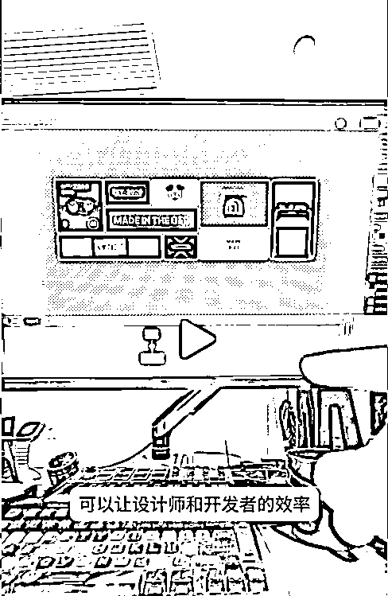
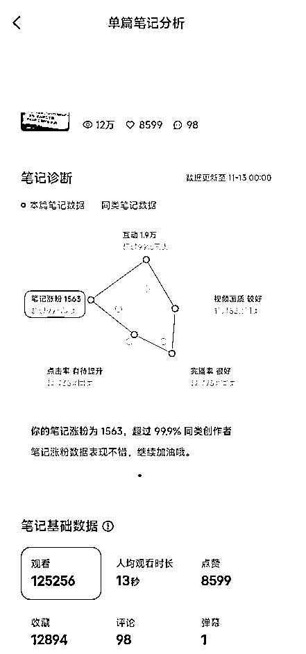
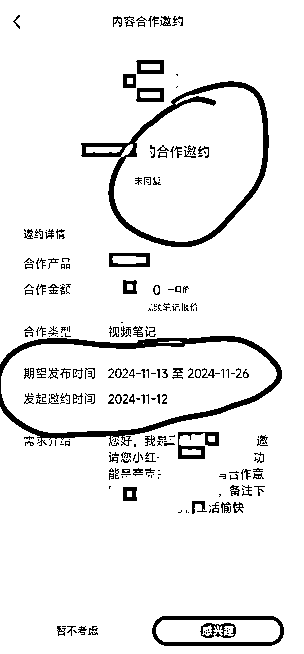
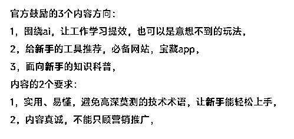

20天，8个视频，2条广告——这是一个全新AI自媒体账号交出的成绩单。没有真人出镜，没有几十万粉，只是把电脑屏幕录屏下来，用真人配音讲AI资讯和AI工具。这种形式，想必大家都不陌生，就像抖音上的“赛文乔伊”那样。

当时他把同样的视频同步扔到了抖音、快手、视频号、B站和小红书。结果呢？抖音5万播放、涨粉70；快手和视频号都是几千播放、涨粉个位数；B站几百播放、几乎不涨粉；唯独小红书，20万播放、直接涨粉2000。同一份内容，平台之间的价值差异高下立判。他分析，可能是因为小红书的流量来自用户主动点击，所以粉丝质量高得多。

就在前几天，小红书上一条视频跑出了几万播放，涨粉1000多，顺势开通了蒲公英。粉丝过1000后，报价按系统推荐填了200。第二天，第一个广告找上门；第三天，第二个广告也来了。变现来得就是这么直接。

下面进入实操。他摸索出一个“捷径”——目前两条2万+赞藏的爆款，选题全靠这个办法。在小红书，选题决定生死，其次是封面和标题。

具体操作：用手机在小红书搜“AI”“AI工具”“AI工具分享”“AI工具合集”这类词。然后在结果里筛：点赞要大于1000，粉丝数要小于1000，发布时间在一个月以内，且必须是图文笔记。这个标准几乎是最严的，但找到的作品，就是近期最容易爆的那批。如果找不到合适的，粉丝数可放宽到5000，最多1万，时间放宽到2个月。如果搜出来的作品太多，就继续收紧到半个月甚至一周。记住：标准越严，爆的几率越大。另外，一定要避开蓝V账号——很多公司号都靠投流堆数据，抄它们没意义。

选好后，把图文笔记的核心内容整理成文案，拍成视频，可以自由发挥。重点来了：封面上的标题和小标题，必须参考爆款，不要自己凭空想。那些关键词是吸引点击的核心，一个都不能丢。如果看不出哪个词是核心，就丢给AI帮你判断。

还有个小提示：小红书官方账号“科技薯”发过一条笔记，基本概括了90%爆款的特征。他翻译成人话就是：官方特别看重“新手”这个词。因为新手是最大的受众群体，内容能让新手看懂、产生兴趣，才有爆的可能。

讲完方法，聊聊心理。整件事最难的不是剪辑或配音，而是心态。前十几天的日子很难熬：蹭热点做了6个小时的视频，发出去没水花；模仿同行讲AI、讲发布会、讲工具、讲开源，全部石沉大海。负面情绪像潮水一样每天涌来，他甚至好几次想放弃，觉得太难了。可转念一想：放弃这个项目，再换一个，不还是从零开始吗？之前放弃的次数还不够多吗？他质问自己：方向是经过验证的“超级标”，如果这个都不行，那什么是行？

于是他重新翻出亦仁老大对“超级标”的分析，回想自己当初选择的原因，一次次给自己打气：方向没错，只是某些环节没做对。下个视频继续优化，继续干。就这样反复否定、反复鼓劲，耐着性子一条条调整，终于跑了出来。哪怕到昨晚，他还在试错一个做了7小时的新方向，发出后没什么正反馈，还被人骂了一句。

回看这段经历，不过才8个视频，在老手眼里根本不值一提。但对长期失败的新手而言，最缺的就是一次靠自己做成的完整闭环。他曾是那种“10件事只成1件”的人，经常觉得自己能力不行、眼光不行，甚至讨厌自己。后来他明白，问题可能出在项目上，而不全在自己。而这次，他跟着“超级标”走，没有镰刀，没有垃圾项目，没有任何客观借口——干不成，就是自己没做到位；没做到位，就继续研究、继续干，直到干成这个AI自媒体，或者第2个、第3个超级标。

最后，他也想对同样处境的人说：如果你发出去没播放量，做什么都错，请相信一定还有什么地方没做到位。再去看看同行的爆款，还能学点什么？逼自己再前进一步。这条路一定是通的，只是你还没走明白。优化一下，再做一个作品，继续走下去。如果这时候放弃，那就真的什么都没了。