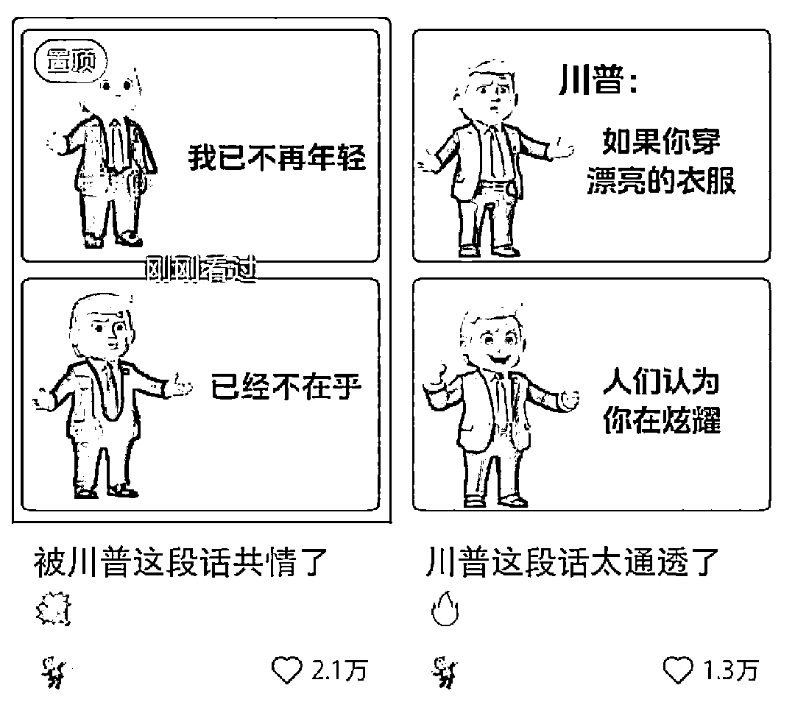
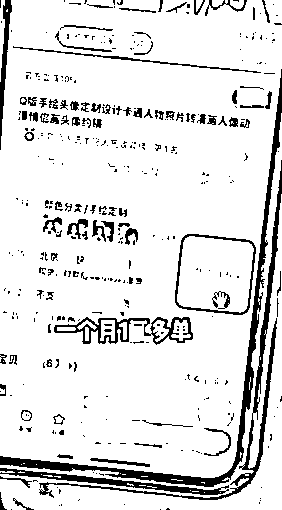
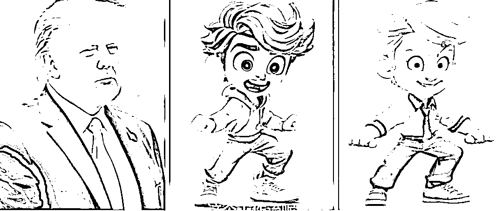
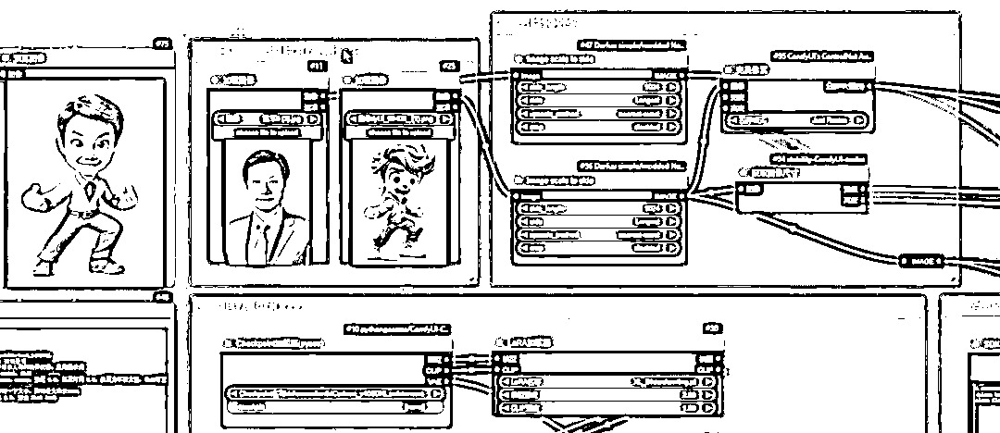
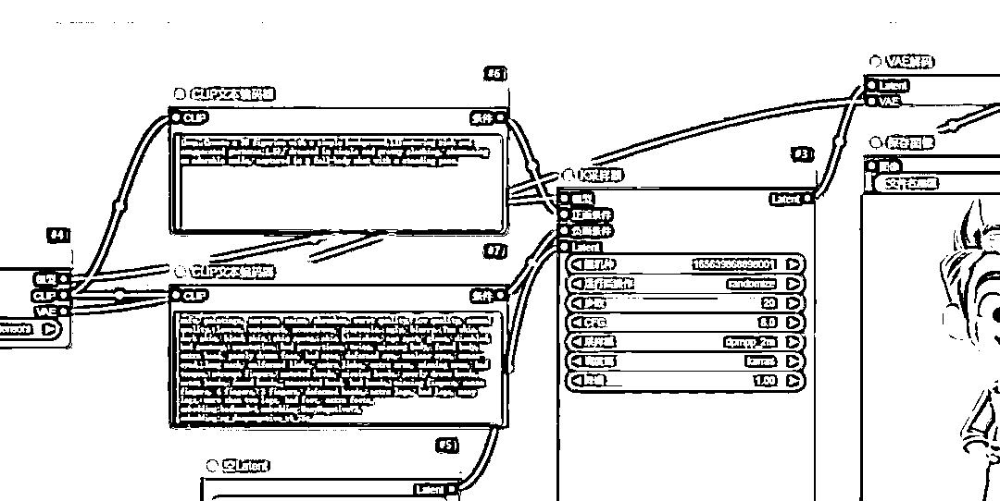
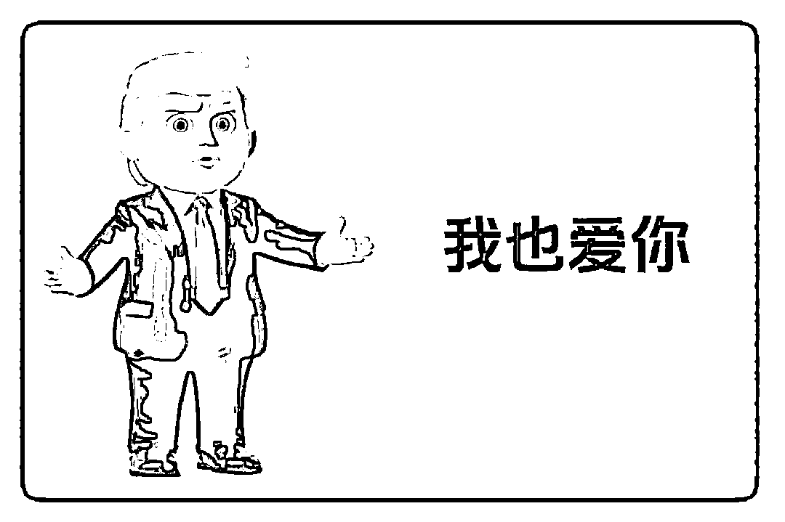

# 用 AI 撬动热点：5 条川普卡通语录把新号冲到 2000 粉，暴力起号拆解来了

最近小红书上冒出来一类账号，头像是 Q 版的特朗普，配文是那种扎心又上头的“人间清醒”金句。账号才刚起步，发了不过 5 条作品，粉丝就直接破 2000，其中两条播放点赞更是飙到了一两万级别，起号效率相当夸张。

这个赛道之所以能这么猛，很大程度上是踩中了当下的热度。川普再次入主白宫，相关话题自带搜索量和讨论度，平台推流非常友好。账号的固定打法也很清晰，用一个辨识度极高的特朗普卡通形象，搭配反内耗、反焦虑、直击人心的语录，情绪价值拉满，观众一看就记住。

更关键的是，这类号变现路径很顺滑，至少有三条可以马上落地。

第一条是接 Q 版头像的定制单。像特朗普这种风格的 Q 版人像在闲鱼、淘宝上已经形成稳定需求，单品销量过万、客单价两位数起，靠账号引流可以直接转化。

第二条是等粉丝积攒到一定量后接常规商单，形象独特好记，品牌方谈判也更有筹码。

第三个方向就更贴内容了。因为整体调性都是认知觉醒类语录，非常适合带知识类的书籍、成长课程、职场心法等品类，图文带货顺理成章。

接下来把整套制作流程拆开讲，核心就是靠 AI 批量生产“川普清醒体”。

第一步：先做出能用的川普 Q 版卡通形象。

思路是用 AI 绘画把真人照一键转成卡通 3D 模型。具体工具是 ComfyUI 的工作流，把川普的高清真人照片作为输入源，让模型学习人脸特征后生成卡通化版本。

这个工作流的优势在于人脸还原度高，生成的 3D 形象一眼就能认出是特朗普，而且支持换动作、换表情，出图效率很高。

操作时要注意两点素材。第一张是源照片，必须清晰、五官轮廓分明，最好是正面光线充足的川普原图。第二张是风格参考图，可以直接扒对标账号里做得好的卡通造型作为目标样本上传，让模型向这个风格靠拢。也可以自己找一套更独特的卡通造型来打造差异化风格。

另外还需要补充一些 3D 模型相关的提示词，流程不复杂，具体写法和参数我整理在了文档里。

人物素材搞定后，最省事的是文案部分。不需要真的去考证川普有没有说过这些话，直接去各平台搜“人间清醒”“醍醐灌顶”“社会性清醒”等关键词，就能批量抓到大量金句。把这些语录和刚生成的卡通形象配在一起，就是一帖完整的爆款内容。

最后一步是排版。常见的做法是放一张特朗普卡通图，加一个圆角黑边框，文字居中排版上去。排版工具很普惠，PPT、稿定设计都能快速做出统一的视觉模板，保证系列感。

整套方法论就是：热点人物 + AI 形象 + 清醒金句 + 统一排版。

今天提到的 ComfyUI 工作流、模型包、参数设置和提示词模板，我都放到一份文档里了：[`svj4gxvm0v3.feishu.cn/docx/DrVEd5bEIoQwj2xq6RRcaXGMnAd?from=from_copylink`](https://svj4gxvm0v3.feishu.cn/docx/DrVEd5bEIoQwj2xq6RRcaXGMnAd?from=from_copylink)

我是高鹏，做网创拆解已经 9 年了，这是我公开的第 689 个实操项目。如果你也想快速抓住下一个热点起号，可以来交流。