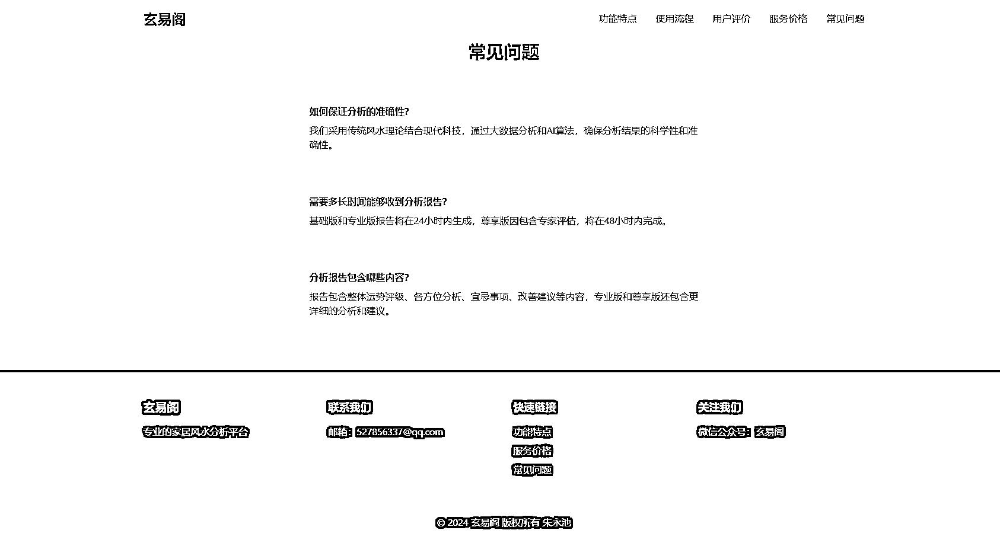

# AI 助力快速搭建家居风水网站
作者：龙哥

你有没有过这样的瞬间：看到别人分享的一个新方法，当时觉得“真有用”，转头就忘了？

我有个朋友老朱，在定制家居行业做了16年产品研发。昨晚他读到刘小排教练的一篇文章，提到用AI就能生成一个网站。换作别人，可能收藏了就结束了。但他没有，第二天直接动手，把一套现成的Prompt拿过来，改掉核心功能模块，还真让他鼓捣出了一个家居风水网站。

链接放这里：https://classy-shortbread-ef5d37.netlify.app/

从想法到落地，前后不到一天。他自己都感叹：太快了。

这让我想到，现在很多人不是缺方法，缺的是“看完就干”的魄力。工具早就摆在那儿了，AI能帮你写文案、做图、搭网站，关键是——你有没有真的把它用起来。

评论区里有人夸他效率高、执行力强，也有不少人被这股行动力感染。其实哪有什么天赋异禀，不过是别人看完文章立刻去试，而大多数人只是看完就划走了。

 images.zsxq.com/FjxLzkOfqQixVSbOU1F_sLjWaz3o) images.zsxq.com/Fk5wqr5HOPAJebMmgxv8V9CDdi40)

以后有什么新想法，别等“准备好了”再动手。先干起来，你就已经跑赢大多数人了。

龙哥盟，也赚钱有“速”。关键是，你愿不愿意迈出那一步。