# 海外 Ins 刷屏的 AI 猫咪乐队，多条作品破千万，AI 出海又开新口子
作者：龙哥

原文：[`www.yuque.com/for_lazy/zhoubao/xq1s191ffhhun6yz`](https://www.yuque.com/for_lazy/zhoubao/xq1s191ffhhun6yz)

## 多条视频 1000 万+播放，AI 猫咪演奏海外爆火，AI 出海新赛道

作者： 高鹏

日期：2024-11-15

大家好，我是龙哥。

今天拆解一个最近在海外很炸的 AI 玩法。

用 AI 生成猫咪演奏乐器的短视频，搬到 Instagram 上分发，数据非常夸张，是目前 AI 出海方向里相当吸睛的新赛道。

比如下面这个账号，几乎清一色都是这种猫咪弹琴的素材，不少作品播放直接飙到几千万，播放量最低的也有几十万，体量相当可观。

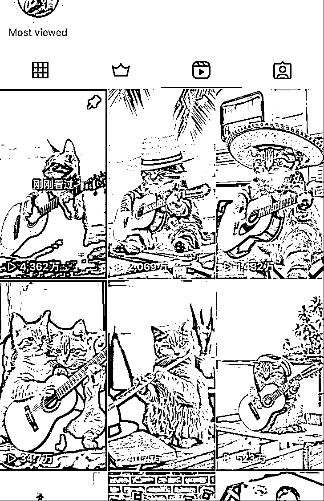

同类 AI 猫咪内容的国内早已卷成一片，但放眼 Ins 等海外社媒，入局的人仍属少数。老规矩，国内验证过的爆款形态，拿到海外基本还能复制一波红利。

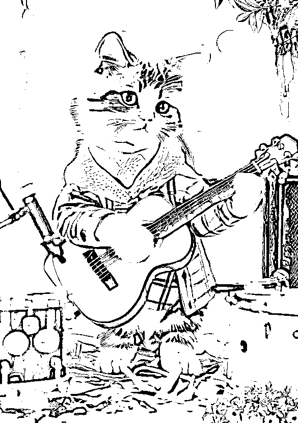

这个垂类在 Ins 上变现的路径很清晰。最直接的是接宠物相关品牌的广告植入，比如宠物用品、主粮、玩具等业配。

第二条路是挂商品链接，走自己的带货，自营宠物周边也能带起来。

第三条是把粉丝沉淀到私域，手把手教同行如何用 AI 制作猫咪演奏视频，开课卖教程。

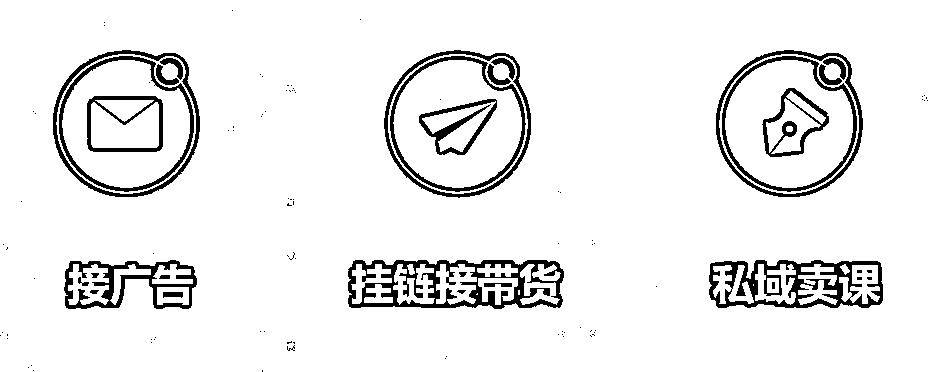

把一张静态猫咪图变成会弹琴的短视频，流程其实就三步：AI 文生图 → AI 图生视频 → 配乐剪辑。

第一步是靠 AI 把文字描述变成画面。我用的是近期被不少人评价为比 MJ 更好用、画面更鲜活的绘画工具。

打开首页点绿色加号新建画布。

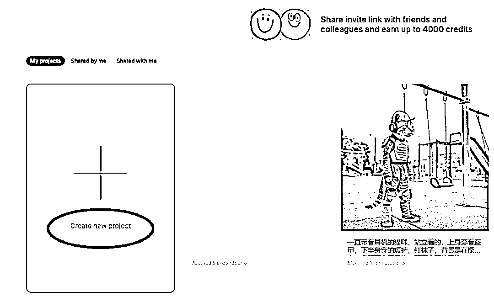

左上角一共有四个功能区，最左边 Image 就是图片生成的入口。

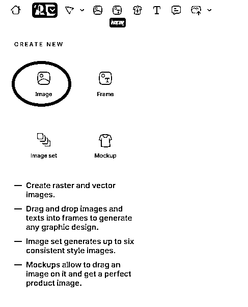

进入后需要填提示词，支持直接用中文输入。

我这条的描述是：戴草帽的猫咪坐在海滩上弹吉他，上身是盔甲，下身是短裤配红袜，背景是海洋，前景有椰子树。并特别强调要真实照片质感，非卡通。

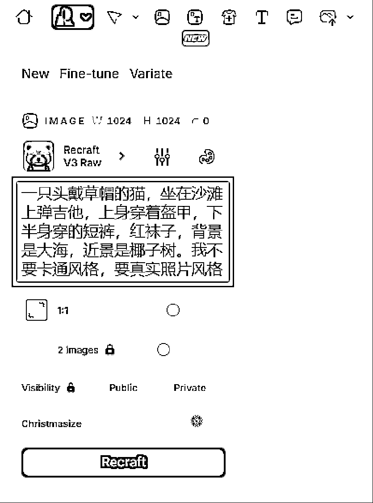

出图后贴合度很高，细节也足够饱满。

在成片上右键，选择底部 Export 导出 JPG 格式保存备用。

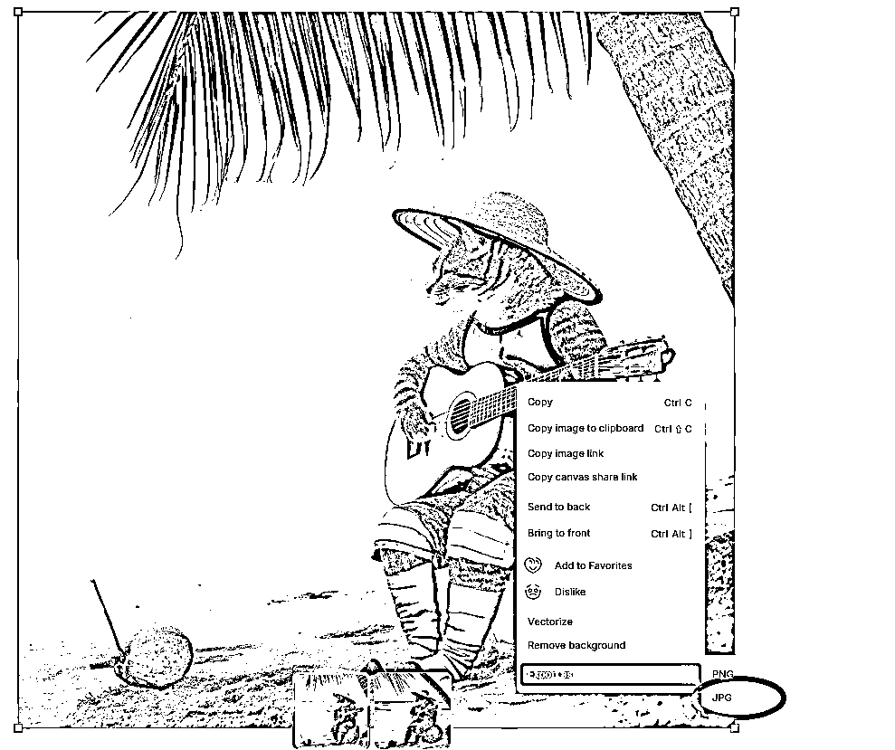

第二步把静图动起来，常用的是可灵或即梦。进入首页切换到 AI 视频板块。

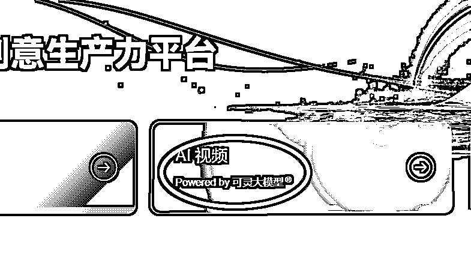

里面分文生视频和图生视频，我们需要的是图生视频。先把刚才导出的图片上传到第一个框，第二个框再补一句动作描述。

我写的提示是：猫坐在沙滩上弹吉他，头部时不时抬起又低下去。确认后点立即生成。

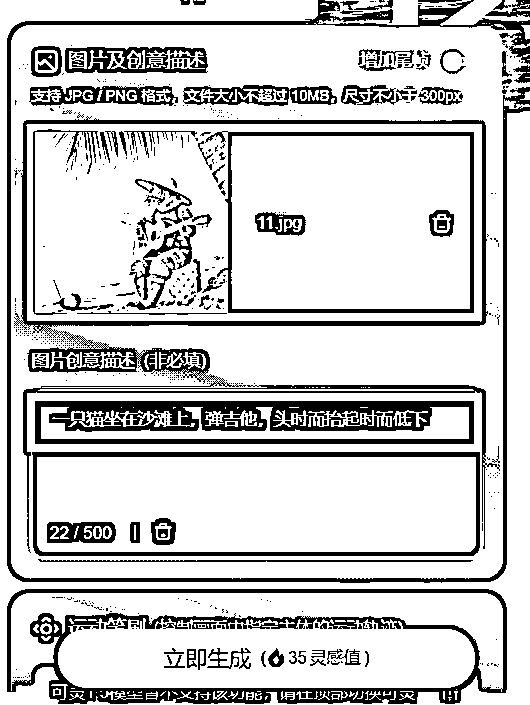

普通账号大概等几分钟就能拿到成品，画面流畅且和描述基本一致。右下角点下载即可导出视频素材。

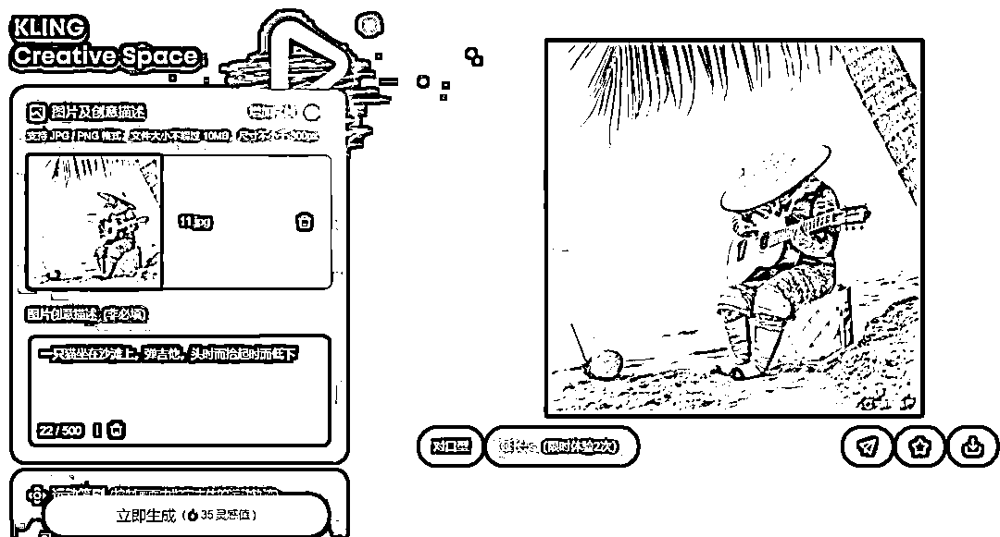

第三步是配乐与剪辑。原视频是静音的，得在剪映里配上吉他声。

打开音频库搜索“吉他”，有很多纯音乐可用，拖到轨道上，再复制一段让时长更贴合，控制在十几秒左右，节奏感会更舒服。

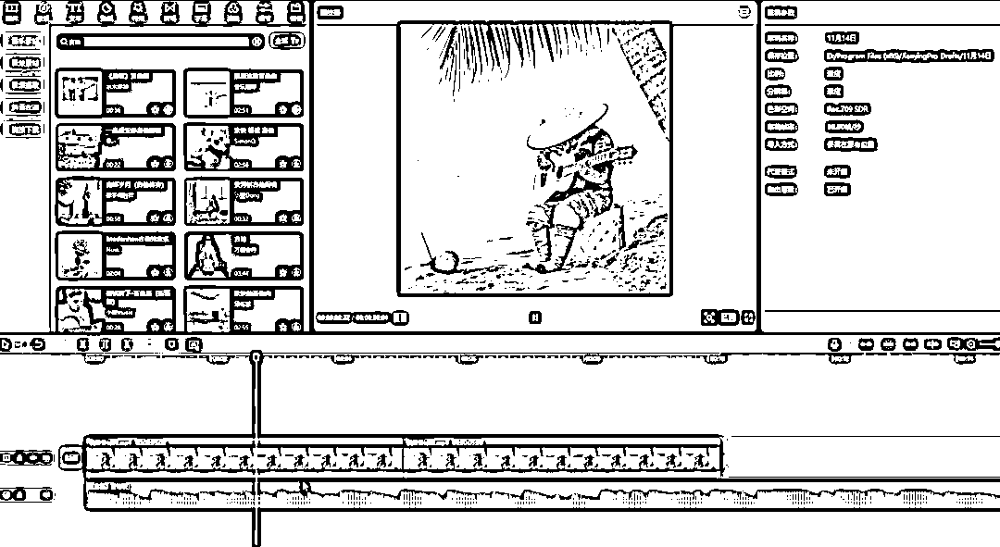

整条制作链路并不复杂，关键是现在做 AI 出海的人还不多，比在国内内卷要容易很多。

今天的拆解就到这儿。我在文档里汇总了上面提到的两款工具的详细资料：

我是高鹏，从事网络创业 9 年了，这是我拆解的第 691 个可落地项目。想了解更多玩法，随时来聊。

* * *

评论区：

桔子 : 新人报告，点赞👍

浪子 : Ins 是哪个平台呢