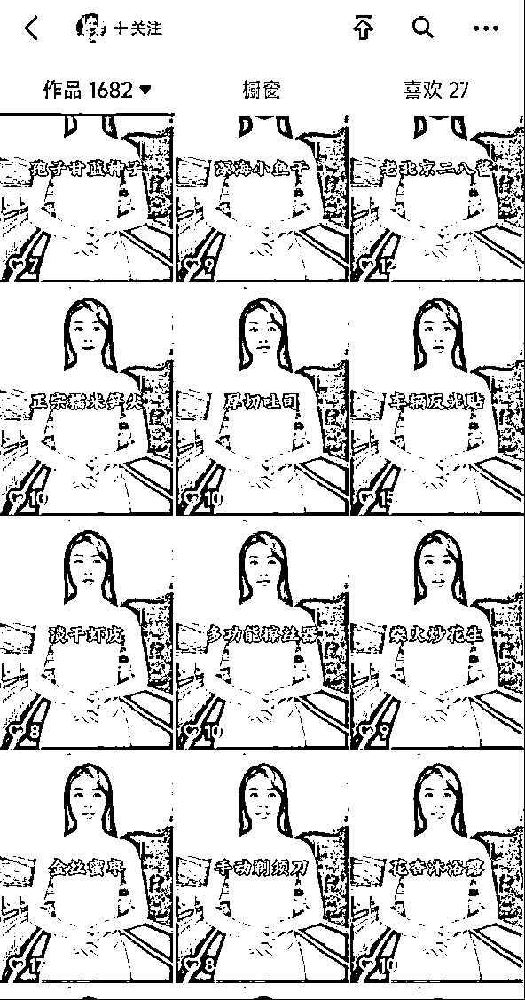
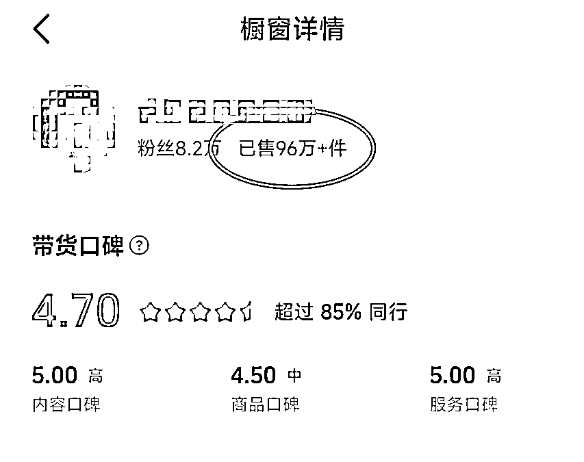
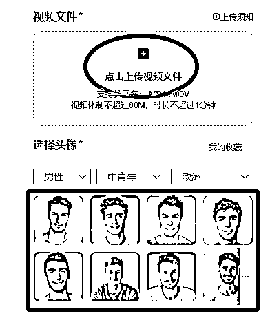
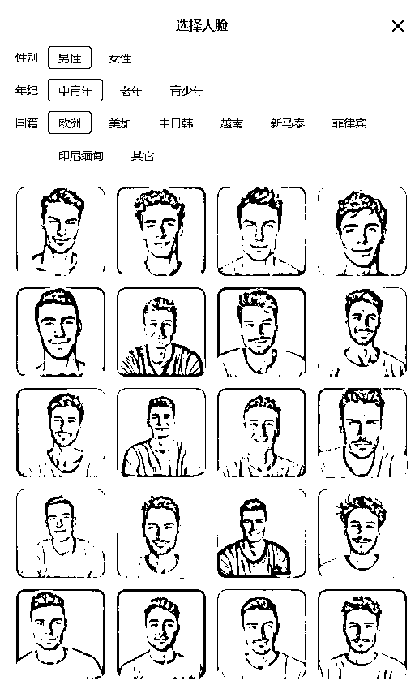
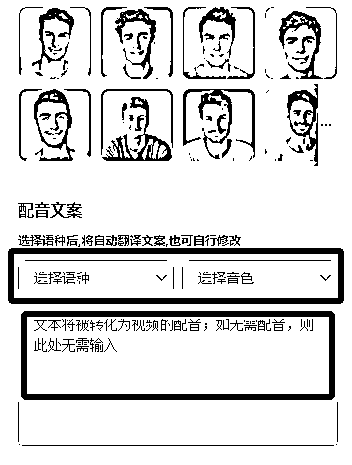

# 出海掘金新打法：用 AI 矩阵把国内带货视频批量变成海外爆款

> 原文：[`www.yuque.com/for_lazy/zhoubao/uc4cpn8w69c3i3op`](https://www.yuque.com/for_lazy/zhoubao/uc4cpn8w69c3i3op)

## 海外短视频带货的 AI 矩阵量产模式，摆脱内卷直接怼量

大家好，我是高鹏。

今天拆解一个正在跑通的蓝海方向。

别再盯着国内同质化的赛道了，把 AI 用在 Tik 上的跨境带货矩阵上，把流量盘到海外去。

核心就靠一个黑科技工具。你只需丢进去一条国内主播的带货讲解视频，指定一个外国人的人设，系统就能把视频里的人整个替换掉。人物、神态、动作、口型全都对齐了，连原声里的中文都能一键转成地道的英文。

意思就是说，以后做跨境内容不用再去找海外模特，也不用自己啃英语。照样能产出专业的海外带货短视频，效率拉满。

之前我也聊过国内抖音端的数字人批量玩法，靠工具疯狂堆量。有一个账号光靠堆视频就做了将近 2000 条，累计带走九十多万件商品。

现在有了上面这个换脸换声的神器，就能把国内那些现成的带货讲解素材，全部做量产化改造成出海版本。国内卷到透明的脚本和画面，放到海外市场换个洋脸孔就能重新吃红利。

工具的用法非常直观。打开页面后，右边就能上传本地视频文件，把你提前准备好的国内带货讲解原片传上去。

接着在下方挑选你想要的人设库。这里的人设非常丰富，男性女性都可以选，年龄段从中青年到老年都有，地域也支持欧美、日韩等不同风格。

人设确定后，还能自定义配音。不用沿用原视频文案，你可以直接输入新的英文文案，选择目标语种和喜欢的音色，AI 就会自动对口型播报出来。

整个流程并不复杂。国内短视频带货已经进入红海内卷期，而海外市场依然留有很大的操作空间。今天分享的就是这个思路的落地方式。

我手上整理过不止这一款能做同类操作的工具，门槛都不算低，我都汇总到一份文档里了：

[`svj4gxvm0v3.feishu.cn/docx/IFdMdGzpso8W5LxtlBocaF8mnNf?from=from_copylink`](https://svj4gxvm0v3.feishu.cn/docx/IFdMdGzpso8W5LxtlBocaF8mnNf?from=from_copylink)

我是高鹏，网创行业深耕九年，这已经是我拆解的第 690 个可落地的项目玩法。想看更多实操拆解，欢迎来找我聊聊。