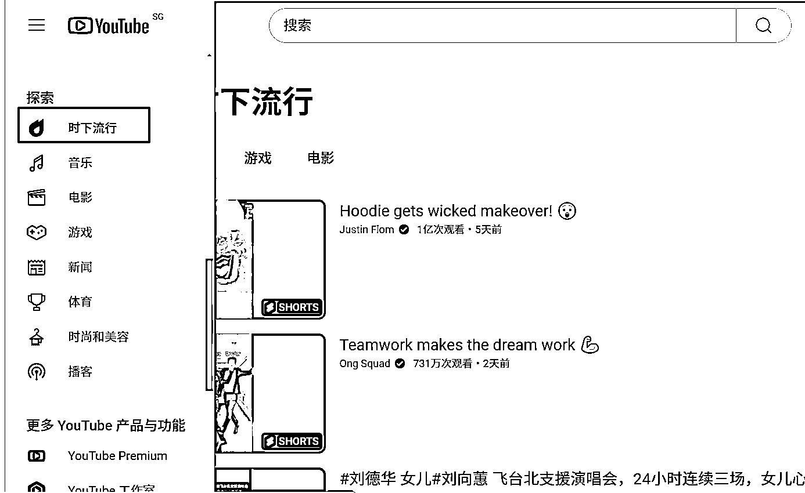
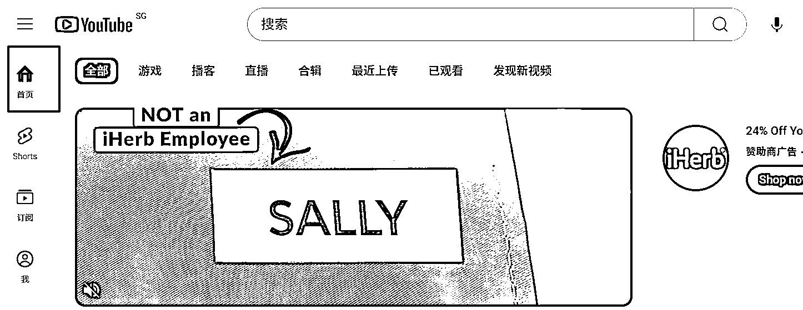
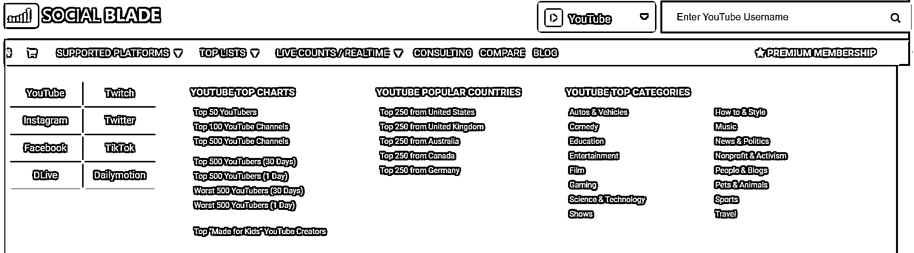
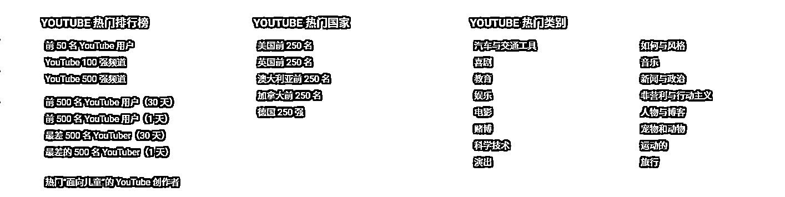
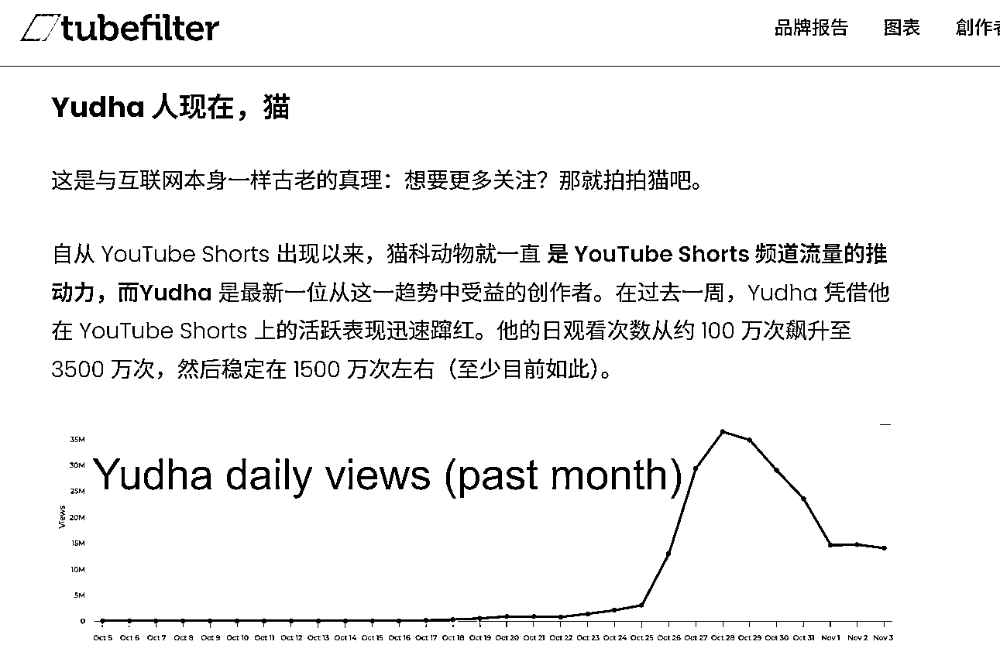
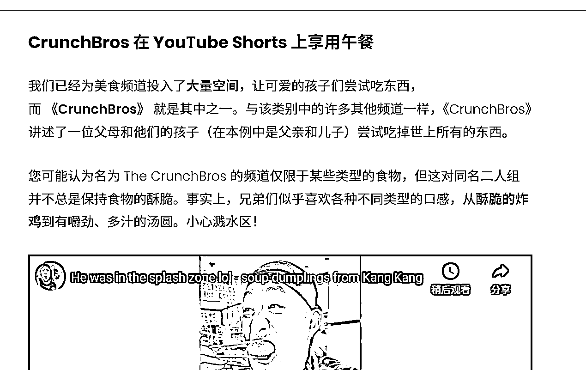
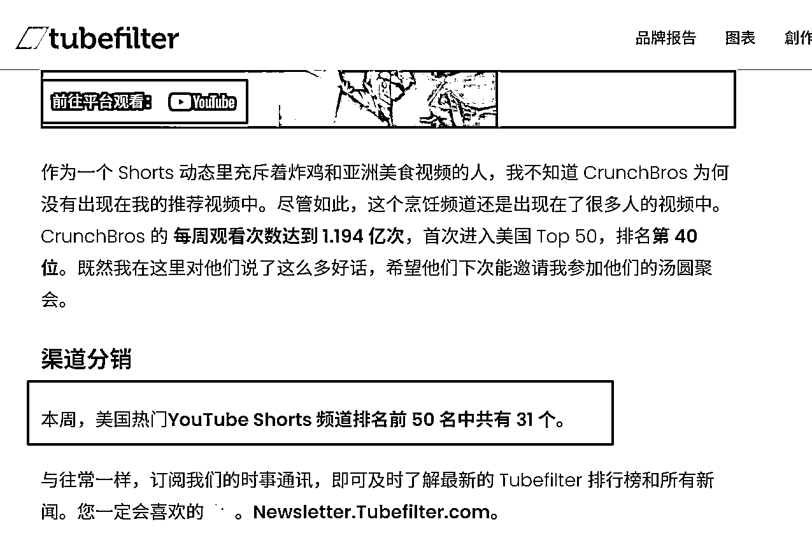
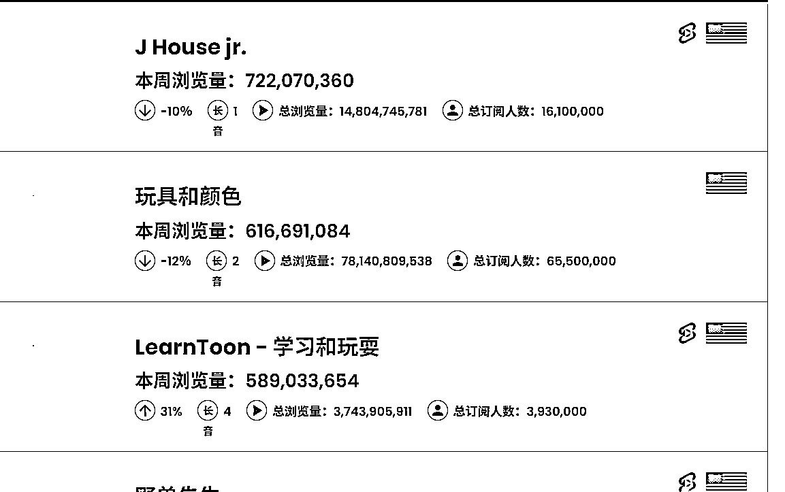
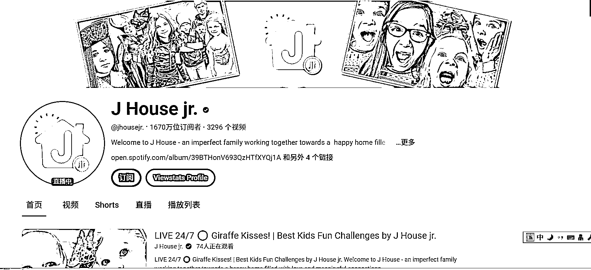
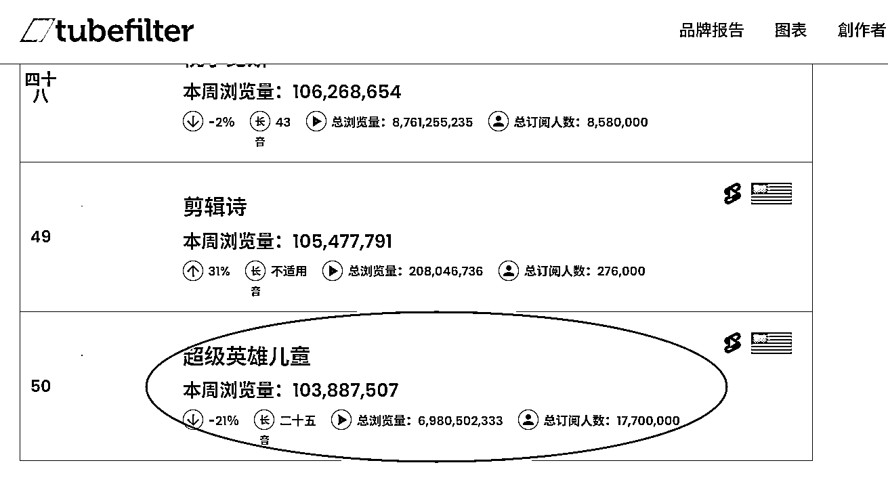

# 想在 YouTube 上赚钱，先学会抄作业：追爆款才是捷径

做 YouTube，方向比努力更重要。想变现，别闷头原创，先看平台现在在推什么。说白了，就是去看 YouTube 首页现在最吃香的内容是什么，摸清它的口味再入场。

这个帖子的思路跟之前讲过的找对标是通的。[`wx.zsxq.com/mweb/views/topicdetail/topicdetail.html?topic_id=1525414128554252，这里的首页，指的是针对于你的偏好`](https://wx.zsxq.com/mweb/views/topicdetail/topicdetail.html?topic_id=1525414128554252，这里的首页，指的是针对于你的偏好)

查数据的话，先从专业的站点 [`socialblade.com/`](https://socialblade.com) 开始，这个地址之前好像提过。

翻译下

想要更即时的风向，[`www.tubefilter.com/`](https://www.tubefilter.com) 这个网址会更灵敏。

 images.zsxq.com/Fvcn7t2FomkLTGmQ9EZUxmcv4R8Z) images.zsxq.com/FtJFpwnnLMcuHzF3xCPwS7jTxynU)

翻开榜单，结论非常直白：做短片，做短片，再做短片。

下面就是具体的头部频道样本

儿童向的频道现在流量极其夸张

在最近统计的 50 个头部频道里，有 31 个是靠 Shorts 起来的，而且其中一大波都是做儿童内容的。

所以如果你也想吃到爆款红利，建议每周都去 [`www.tubefilter.com/`](https://www.tubefilter.com) 看一下它的周榜。看看当周最火的是哪类视频，最近上线的是什么，每条的播放表现如何，整体趋势是怎么变的。

挑一两个跟你定位接近的对标账号，拆解他们的选题、节奏、发布时间，照着学、照着做，成功率会高很多。

* * *

评论区：

书情小跟班 : 做 YouTube 的一些常识[`rlwxa0zgke.feishu.cn/docx/P2DYduGbkoW0nqxcRZgcL6xKn7I?from=from_copylink`](https://rlwxa0zgke.feishu.cn/docx/P2DYduGbkoW0nqxcRZgcL6xKn7I?from=from_copylink)

老彭 : 书情很厉害，连续分享一年多 YouTube 相关知识[强][强][强]

火焰女孩 : 一般在什么点发布会比较好呀！多账号的话一定要多 ip 吗？

苗苗 : 请问可以链接您吗？

书情小跟班 : 通过鱼丸联系我

书情小跟班 : 看我发的帖子

火焰女孩 : 好多都打不开了[流泪]