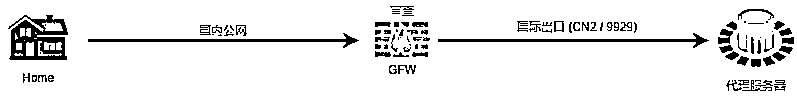
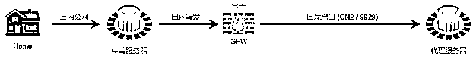
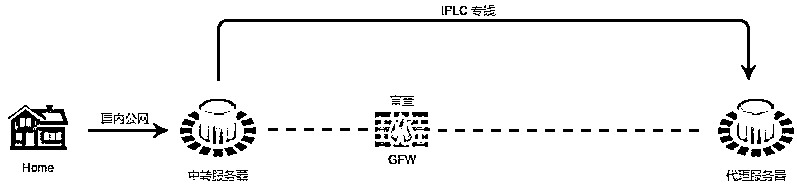

# 想靠 YouTube 稳定变现？别只盯着免费节点，细节才是分水岭

## 成为一个专业在 YouTube 上赚钱的人要注意的点——海外住宅 IP

作者： 书情小跟班

日期：2024-11-11

很多人一开始都想走捷径，用免费的机场节点去运营 YouTube，低成本试错的想法没问题。可等真要做起来赚钱时，往往卡在各种细节上才发现亏大了。

先把概念理清楚：海外住宅 IP 及其代理服务。

目前做多账号的普遍共识是，**专线+海外住宅 IP** 的组合体验更稳妥，**指纹浏览器是标配** 。

**专线到底指什么？** 这里顺带科普一下。

## 几种常见线路的区别

因为 Shadowsocks 的图标是一个纸飞机，所以市面上自建 SS 服务的公共代理商也被大家习惯叫“机场”。

技术原理相近，但不同机场的实战感受差异很大，关键就看线路的实现方式。常见的有下面几类。

### 直连节点

直连的思路最简单，就是找一台境外主机做中转，客户端直连过去，全程走公网。

搭建成本低，但不稳定。带宽被用爆、机房被重点关注时很容易被干扰。即使没被干扰，公网路由绕路、骨干网高峰拥堵也会让延迟和丢包变差。

在此基础上略好一点的是 CN2 线路。CN2 是电信的精品骨干网，超售程度比电信 163 要轻不少，日常体验更顺畅，但高峰期仍会拥堵，这是公网的通病。

商家宣传的「CN2 GIA 全程」和「CN2 GT 半程」，说白了就是链路针对大陆做了优化的机器/机房。

### 中转节点

中转是在直连之上再加一跳国内机器。访问路径变成：本地 -> 国内骨干网 -> 国内中转节点 -> 公网出口 -> 境外代理服务器。

多了一跳反而更可控。因为直连的效果受地域影响极大，先落到国内中转，再由中转挑出口走电信 CN2 / 联通 9929 出境，服务商能对质量进行一定把控。

中转接入分单线接入和 BGP 接入。单线接入是用一台或多台单线服务器转发至电信 CN2 / 联通 9929 出境，成本低但对中转到出口的链路质量控制有限，体验看机器选得好不好。

BGP 接入则是用户先连国内 BGP 服务器，BGP 服务器通过隧道接上 CN2 / 9929 等优质链路，出境后再隧道中转到代理服务器。BGP 通常对三网都友好，隧道中转也能针对性优化。

### 专线节点

专线一般指 IPLC 内网专线。比如深港 IPLC，就是深圳到香港的点对点私有线路，不走公网，**完全不存在审查** ，也没有运营商 QoS 限速。带宽独享，高峰也不抢资源，全天表现稳定。

此类线路价格很高。电信 IPLC 约 500CNY/Mbps，私人提供商也要 300CNY/Mbps 起步。三大运营商的线路稳定性最好。

### AIA 专线节点

Anycast 公网加速，简称 AIA，是一张覆盖全球的动态加速网络，能明显优化公网访问体验。和传统应用层加速不同，AIA 能做 IP 传输质量优化和就近接入，减少抖动和丢包。

AIA 本质也是专线，但它解决了普通专线“入口单一”的问题。普通专线用户到入口仍需走一段公网，而 AIA 依托腾讯云的全球节点，让用户从最近的接入点直入内网，基本告别公网拥堵与时延。

使用感受大致排序：AIA 专线 > 普通专线 > BGP 中继 > 普通中继 > 直连

普遍认为专线是节点里的天花板，专线本身也有高低等级之分，但一般的水准就已经够用。

海外住宅 IP，简单说就是**IP 地址来自真实的家庭宽带网络**。市场上卖的其实是别人搭建好的海外住宅 IP 代理服务，你买的是服务，核心是能拿到一个海外住宅 IP。

**海外住宅 IP 代理是什么？**

它是一种让你通过海外真实家庭宽带网络访问互联网的服务。IP 来自海外普通家庭用户分配的住宅宽带。

因其源自真实住宅网络，可信度高，被封或被标记为异常流量的概率远低于数据中心 IP。

**和普通 IP 代理有什么区别？**

区别在 IP 来源。普通 IP 代理，比如数据中心 IP，IP 段集中在机房，容易被识别拦截。

海外住宅 IP 的 IP 来自真实住宅，行为模式和普通用户高度一致，更难被判定为代理流量。

做数据采集、跨区内容访问时，住宅 IP 的识别率低，抗封锁能力更强。

**海外住宅 IP 代理的定义与优势**

住宅 IP 的核心优势是真实度高，由真实 ISP 分配给家庭用户，地理位置和行为特征都贴近自然用户，请求更难被判定为代理。

数据中心 IP 虽快且便宜，但 IP 段集中，容易被网站识别和屏蔽。

住宅 IP 在需要精确定位、强匿名、低检测的场景是首选，比如市场调研、社媒矩阵管理、内容聚合等模拟真实用户行为的业务。

在电商、广告投放、版权内容访问等对 IP 来源敏感的场景，使用住宅 IP 能有效降低风险，提升成功率和数据质量。

总的来说，海外住宅 IP 代理正在成为互联网操作中不可或缺的一环。它不仅提供更隐蔽安全的访问方式，还能提升效率。

无论是跨区内容获取，还是需要高匿名低检测的专业任务，住宅 IP 都有独特价值。对需要稳定可靠网络操作的用户而言，它既是技术手段，也是保障业务顺畅的关键。

同时，住宅 IP 在隐私保护上也有意义。因为 IP 来自真实家庭用户，常规的网络监控和分析手段更难追踪。浏览习惯、购物记录等活动不易被关联，这对重隐私的用户尤其重要。

以上仅供参考。其实并非一定要上专线，也不是必须用海外住宅 IP。只是每一环节比别人多做到 1%，你的胜算就更高。

海外住宅 IP 代理服务怎么选购？自己 Google 一下，对谁都好。

* * *

评论区：

红烧电饭煲 : 感谢书情老师分享！

Sugar 张 : 希望老师能直接分享一下您在用的海外住宅 IP，避免踩坑，谢谢[可怜]

老彭 : 希望老师能直接分享一下您在用的海外住宅 IP，避免踩坑，谢谢[可怜]

浅浅 : 希望老师能直接分享一下您在用的海外住宅 IP，避免踩坑，谢谢[可怜]

silver : 请问可以麻烦您分享一下您在用的海外住宅 IP 吗？谢谢～