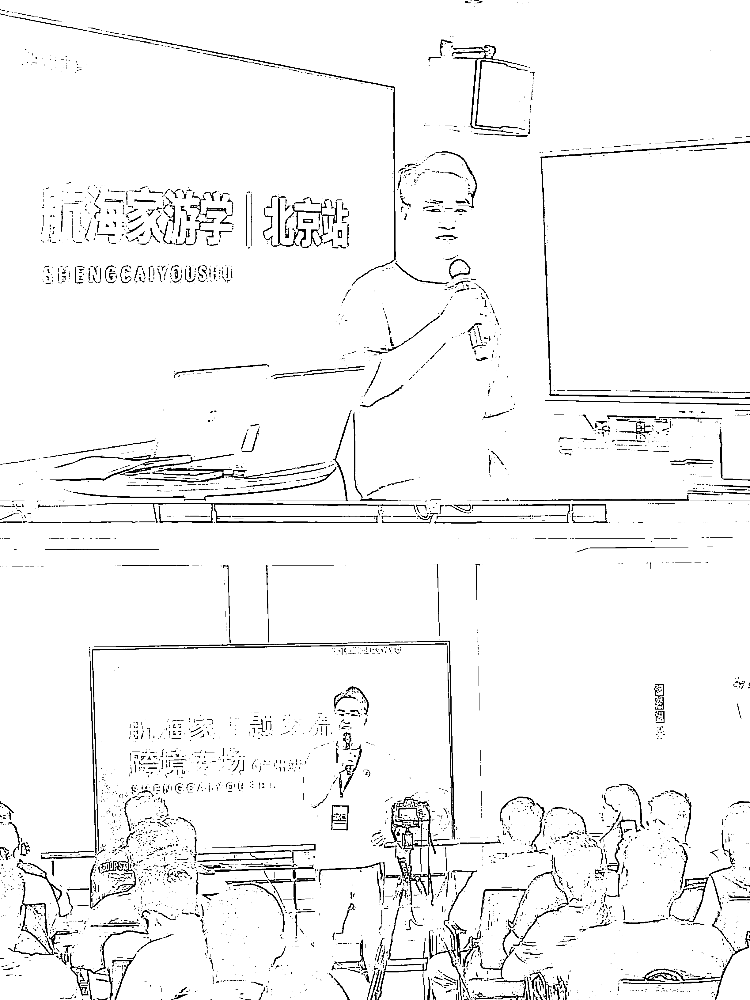
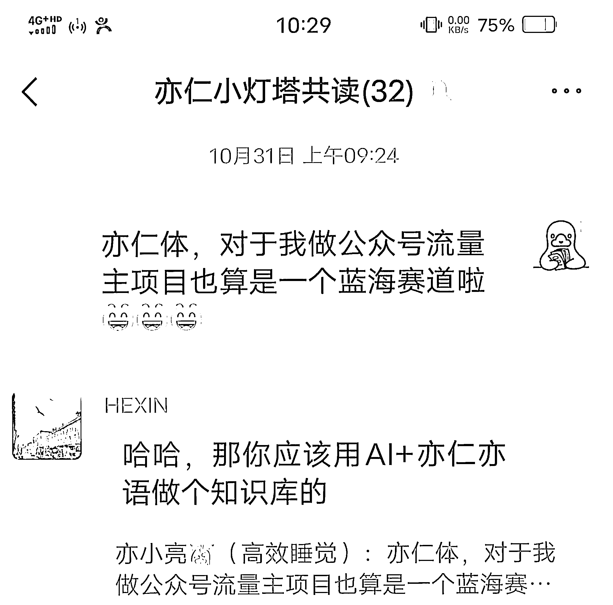
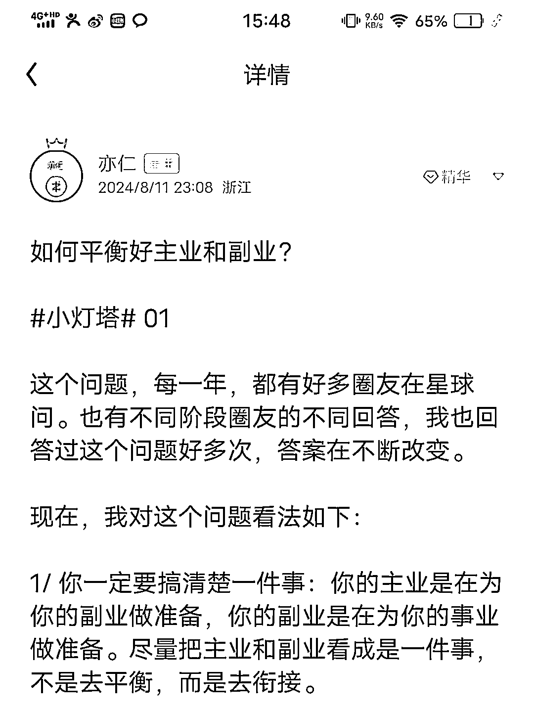
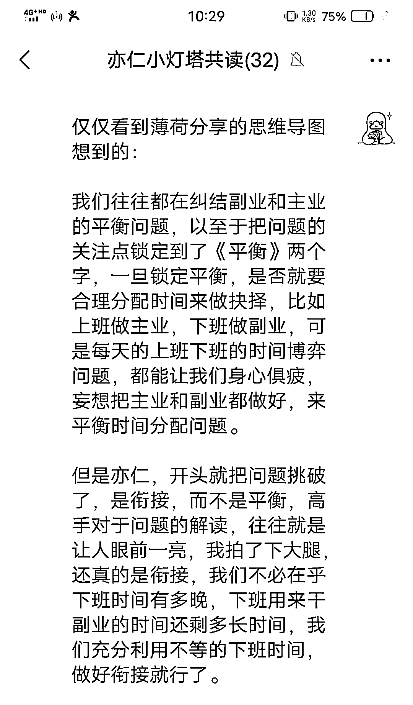

# 我挖到一个被低估的冷门赛道：做亦仁解读号

> 原文：[`www.yuque.com/for_lazy/zhoubao/fc0ky3nfpp7k4y2k`](https://www.yuque.com/for_lazy/zhoubao/fc0ky3nfpp7k4y2k)

## 我发现了一个小众蓝海赛道-亦仁说

作者：亦小亮

日期：2024-11-12

大家好，我是亦小亮，一个做了五年生财的老玩家，最近很久没更新了。

今天聊一个我最近盯上的冷门赛道，就是围绕亦仁的内容。我先把思路拆开，如果你感兴趣可以直接照着试试。

咱们先用“名人金句号”来类比，这个赛道大概能看懂，但光这样玩很难长久。因为围绕亦仁堆金句，撑死写到一两百篇就枯竭了，等他热度一掉，推荐池就凉了，你也很难再扛下去。你可能会问，为什么我一直强调100篇，不是50也不是200。原因我放在文末一起讲。

那不是摘抄名人名言，内容还能怎么做？

别急，我们慢慢拆。

拿到这个人设赛道的第一反应，大概率是去疯狂扒亦仁公众号、书籍、演讲稿，薅出一堆金句当标题，然后直接丢给工具一键生成。这条路我见过无数人走。能不能爆10万+？说不准。也许就出几篇爆款。抛开收益先不说，**你疯了，我做公众号不就为了流量主那点钱吗**，这种玩法本质上是极限增产，省时省力，成长却几乎为零。

如果由我来做这个蓝海，我会换个打法。

先暂停两分钟，我们先看看亦仁的照片。按你刚才那种速成思路，你会怎么操作？

想清楚了再往下看，和我的方案重合度高不高？不一样的话，欢迎评论区或者私信我交流，我也想学习。

两分钟到。思路一样的话，咱们击个掌，英雄所见略同。

# 内容怎么排期？

我的做法是先给自己定一个100篇的写作清单。为什么又是100篇？50篇不够用，200篇坚持不下去，后面会解释。

如果是日更，100篇正好100天。我没精力去全网搜集亦仁所有过往，那就偷个懒，直接以他公众号“亦仁亦语”和近期系列文章作为切入点。

比如就用他正在连载的《小灯塔》作为第一个月的内容池。你可能会问，这是洗稿还是读后感？

洗稿绝对不要，我很反感这种做法。读后感是有的，但我走的不是普通的读后感，是高成长型的拆解。

第一步，先看标题。看到标题的瞬间，我就先闭着眼把自己的理解写出来，哪怕是战略、框架、思路层面的东西都行，不用强求5000字。**当时脑子里第一反应是什么就写什么，别停笔。**这篇文章就是我逼自己写出来的，灵感就来自@HEXIN 的亦仁小灯塔共读。我写完后不急着对照原文，可以隔几天再回来补充。

第二步，实在写不出来了，再去看亦仁原文。边看边问自己：他的切入点在哪？这个思考的价值点在哪？我为什么没想到？标题里的问题他到底怎么定义？我的理解深度在哪？偏差在哪？这篇文章又抛出了哪些新问题？

从文中挑出高热度的关键词，比如微信指数能查到的词，继续延展。光这一篇文章，就能帮我孵化出后面10篇的选题。光是《小灯塔》系列，我就能拆出60篇左右。关键词有重复也没关系。

把我自己先写的部分和亦仁原文做对比，列出差异点。

第三步，基于同一个问题的不同理解做差异化分析。找差异不一定对，但要找到。拆解问题的第一步，是先问清问题到底在问什么。

**1小时=55分钟+5分钟。**

爱因斯坦的说法是：如果给我1小时来解一道决定生死的问题，我会花55分钟先搞清楚这道题到底在问什么。搞明白了，剩下的5分钟就够了。

通过这个过程，你自己也在练拆解能力。

第四步，把写好的一整套文章做标签归类，打乱顺序再发。甚至标题、开头、结尾修一修就能复用。

说到100篇的逻辑。50篇太少了，可能发一年，后期就没有流量了。200篇太多了，虽然原创占比能很高，但几乎没人能坚持写完。我的经验是，一个赛道扎扎实实写出100篇，三个月就够了。之后就不造新轮子了，把这100篇重新包装、微调，就能再发一轮。既省时间，又能更快拿到第一波推荐。我公众号爆款项目里的娱乐号，就是照着这个法子做的，找100个喜欢和讨厌的明星写完，素材就能用两三年。

怎么落到实处？还是以《小灯塔》第一篇为例。这个选题在副业刚需的当下，关注度很高。

我第一次看到标题时，文章几乎都在讲“平衡”。而亦仁给出的答案是“衔接”。这就是对同一个问题完全不同的解读角度。

文章里能拆出的关键词有：平衡、摸鱼、时间管理、线上助理、和老婆商量、熬夜、三年干100万，以及我们能联想到的正负反馈、精力管理等。

再往下拆标题本身的问题。如果衔接不上，为什么会衔接不上？这又是一个新问题的诞生：副业是否要和主业相关？是为了走出舒适区才做不同赛道导致衔接断层？是项目间的衔接问题，还是时间上的衔接问题？不是所有人都是双休，有996、通勤长这些现实限制，还有自身优势的衔接问题，即从优势出发选副业。

一套分析下来，不说100篇，至少能拆出20篇。一篇能发3次，20篇就能日更2个月。

# 怎么变现？

内容聊完了，说变现，这才是大家最关心的。

第一，基础的流量主收益。

第二，文章里植入书籍带货。比如最近火的梁宁《真需求》，也可以用金句做小红书笔记带货。

第三，用《小灯塔》引流私域，做共读陪跑群，或者卖虚拟资料包。

第四，推荐生财有术赚佣金。最有效的方式是用亦仁的金句做小红书内容引流导购，不限于微信生态。

第五，如果被亦仁本人、得到等平台转发点赞，加精华，那是一笔意外之财。

第六，运营半年后，账号就能沉淀成个人成长IP，这正是当前公众号爆文的趋势，你的人设也起来了。

第七，后面还能怎么玩，就交给你们发挥了。

市场上类似的成功案例很多，生财女孩、生财王子等等。他们都玩得很溜，但光接流量不行，还得真干事，因为流量波峰来得快去得也快。

举一反三的逻辑不只是亦仁，**成甲老师、刘润老师、刘思毅、V先生、杨涛**都能做。每选定一个人，就是一个细分赛道，变现方式也各有不同。比如有的老师没有付费社群，就没法带社群。

* * *

评论区：

秋秋桂 : 好牛的想法

世宾 : 我在公众号里面就写过关于亦仁文章的读后感😁

亦小亮 : 写了几篇

sunyue : 疯狂思维扩散[偷笑]100 篇文章就这么水灵灵出来了。不只是学习思考，提升认知，顺便变现赚钱，谢谢教练分享，有启发～

岳嘉 : 一点愚见。我们经常看公众号，视频号，小红书，各种各样的，巴菲特说，查理芒格说，段永平说，等等。来吸引高质量的财经粉丝，其实是类似的，财经粉，创业粉，许多都是高质量的男粉呀

亦小亮 : 有相似的

苏玲 : 好文，我震惊了。这篇文章我要反复阅读，改改自己的小毛病。