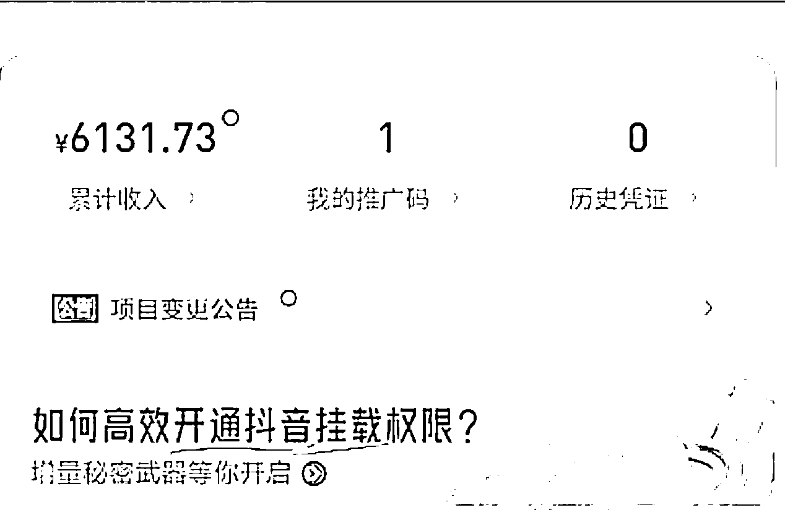
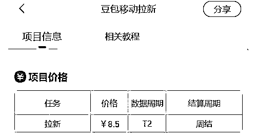
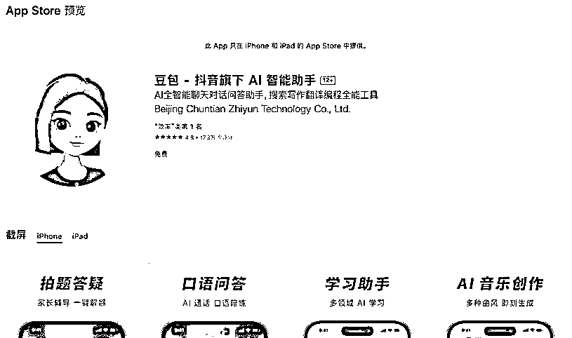
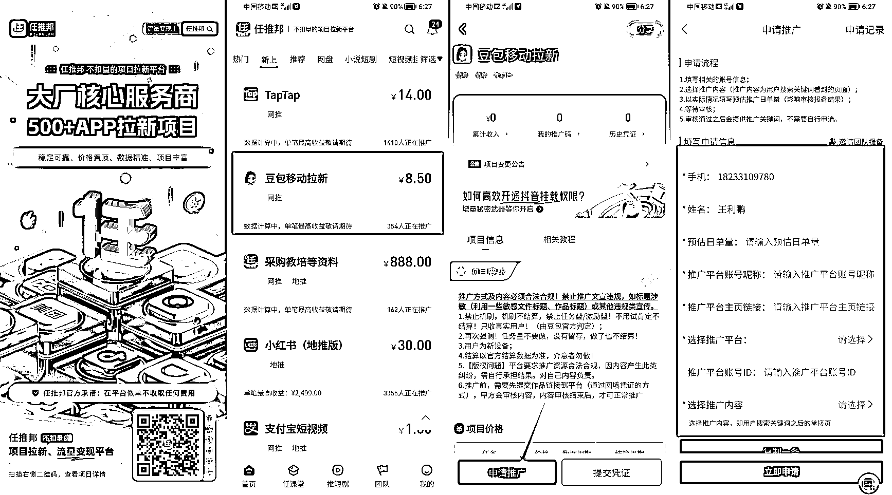
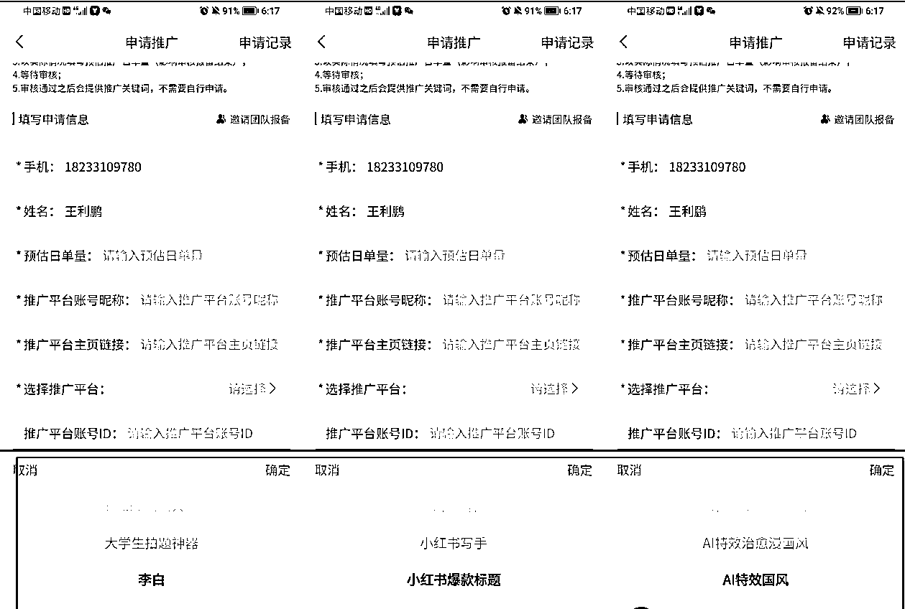
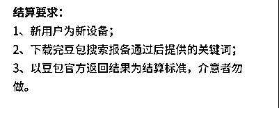
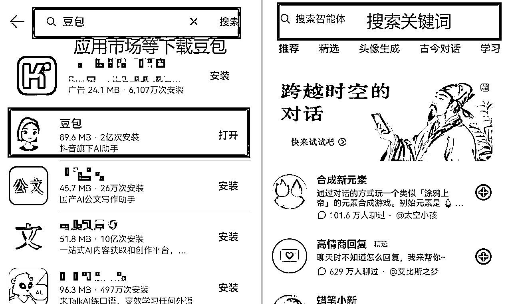
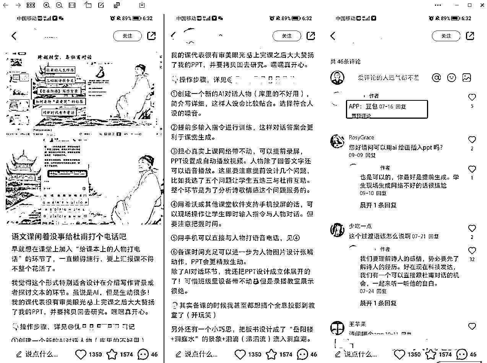

# 一篇笔记撬动几千收益，豆包客户端拉新单价8.5元的机会

## 豆包客户端推广拉新，单笔8.5元，一条图文笔记就能实现过千收入

作者：大鹏  
时间：2024-11-14

各位好，我是龙哥。

前天刚拿到一条最新的变现信息差：

有同行在📕做**豆包客户端的用户增长**，一篇图文笔记爆掉之后，两三天就到账数千元。

对豆包这个名字应该不陌生，对拉新逻辑也应该有所了解。

那豆包客户端的拉新到底是怎么玩的？

跟一位已经在操作的伙伴聊完才明白，本质上是**豆包官方为了快速扩量，推出的用户邀约奖励计划**。

每带来一个有效新客，佣金可达8.5元/个，这个报价比市面上绝大多数应用推广的单价都要高。

应用拉新的套路圈内人基本都熟，和过去的夸克网盘、迅雷网盘那波操作思路差不多：新客通过你的专属路径完成下载与激活，你就能拿到对应的推广分成。

不过豆包这波与网盘不一样的地方在于时机。

网盘拉新已经卷了很久，存量都被反复触达，转化率越来越低。而豆包作为一款相对后发的AI工具，渗透率还很低。

我自己手机上就没有装，相信你的通讯录里大部分人也并未接触过。换句话说，潜在人群几乎都是未触达的增量，市场体量相当可观。

这算不算一波窗口期，自己判断吧。

**✅ 豆包客户端是什么？**

豆包是字节系旗下的AI应用，定位和ChatGPT类似，能力矩阵很全，涵盖文案生成、图像创作、音频制作等多个场景。具体体验建议直接装一个感受。

**✅ 具体怎么跑？**

**1、完成资质报备**  
通过🛰️扫码进入任推邦平台，定位到豆包移动拉新任务，进入任务详情完成审核登记。

**2、选择推广素材**  
填写推广方向时要注意，系统后台内置了一批官方智能体供选用。不同智能体的能力不同，有负责国风绘画的，有擅长辅助写稿的，也有可以合成AI配乐的。

选定推广方向后通过审核，官方会下发一个绑定你账号的专属检索词。用户只要在豆包客户端内检索这个检索词，就会自动进入你对应的智能体页面。

**3、用户完成路径**  
新客的操作门槛很低，整体两步走：

先在手机应用商店安装豆包客户端，随后打开客户端内搜索你的专属检索词。若判定为首次使用用户，就计为一次有效拉新，你可拿到8.5元/笔的奖励。

**4、投放渠道**  
推广方式可分为私域、公域和线下地推。

私域就是利用朋友圈、👸号推文做内容分发。

公域则更适合放量，可以做图文笔记，也可以做短视频，将智能体的使用效果完整演示，把应用场景讲透，然后在评论区把客户端名称和专属检索词留好，实现被动吸量。

现在知道这个玩法的人还很少，信息差非常明显。估计这篇文章发出后没多久，就会有一大批人跟进。

有执行力的可以立刻动手，年底冲一下额外收益。但如果只是刷刷信息不动手，那再好的机会也与你无关，毕竟没有人会把钱平白送人。