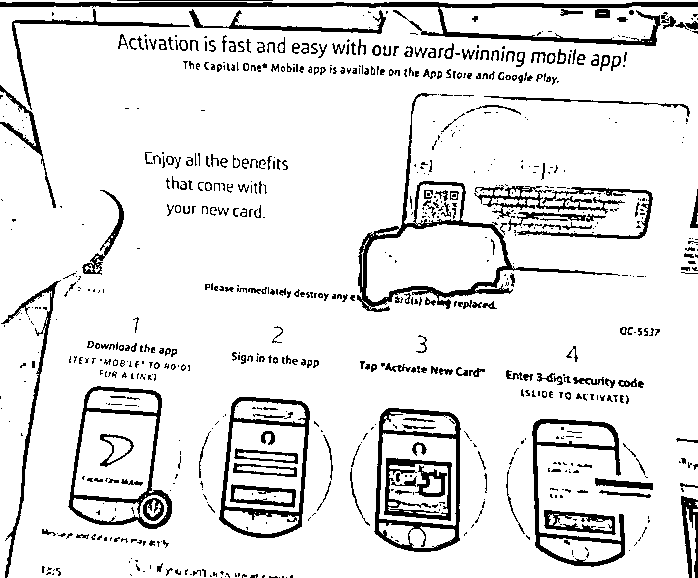
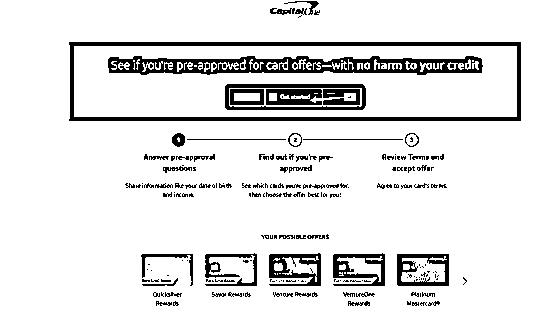
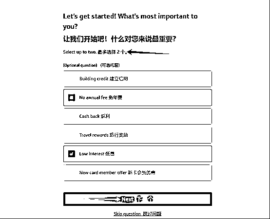
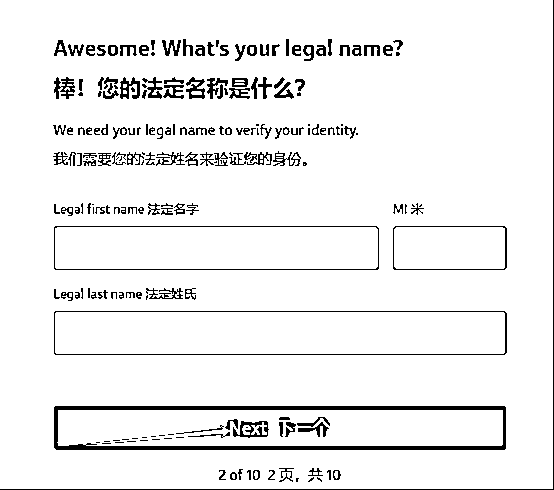
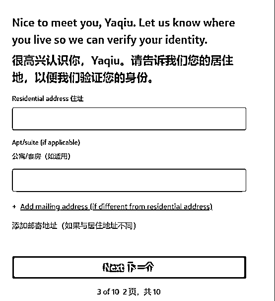
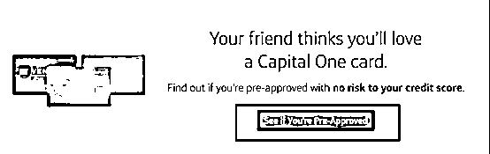
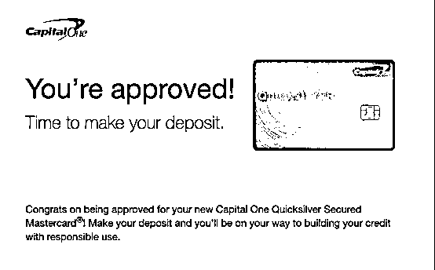
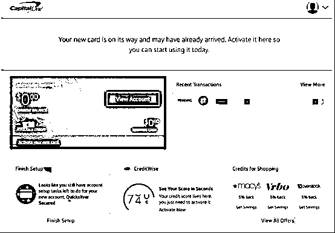
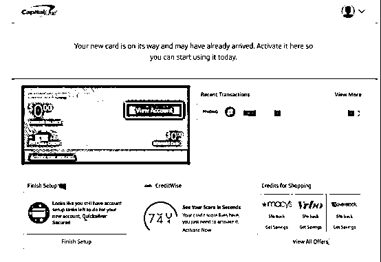
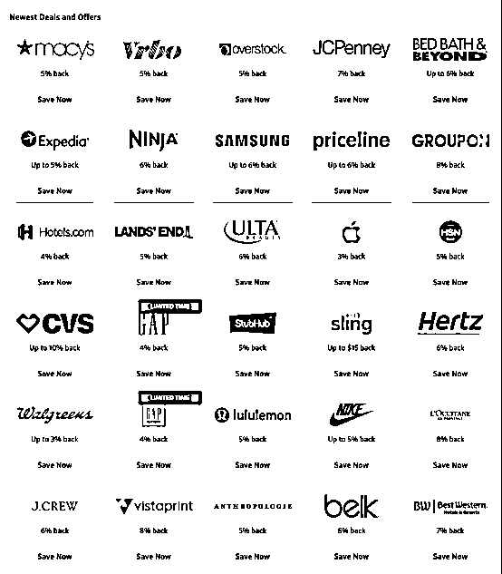

# 没有美国身份也能办！Quicksilver 美卡申办全攻略（Capital One 出品）

## 非美籍也能顺利拿下 Quicksilver（Capital One 出品）申卡指南

作者：国民弟弟的跨境十年

发布于：2024-11-11

做跨境电商久了，相信很多人遇到过这样的局面：美国不少电商平台和线上服务只收本地卡。手上有一张美卡，付款时会顺利很多，也不会因为支付方式不被认可而白白丢单。所以这张卡的意义绝对不只是“能花”而已。

想在美国场景里畅快消费，又不想研究那些绕来绕去的条款？那不妨看看 Capital One 旗下的 Quicksilver，申办简单，返现也大方。

下面我会把完整流程一步步拆开，非美籍人士也可以照着操作。

# 为何选 Quicksilver？

Quicksilver 是 Capital One 旗下一张很受关注的返现卡，对没有美国身份的人特别友好，网上口碑不错，我也亲自办过。

**它的几个亮点：**

1. 所有消费统一返 1.5%，不挑商户类型，日常买菜、聚餐、休闲都算。
2. 新户开卡礼：开卡后 3 个月内消费满 <card type="inline" name="math" value="data:%7B%22code%22%3A%22500%EF%BC%8C%E5%8F%AF%E4%BB%A5%E8%8E%B7%E5%BE%97%E4%B8%80%E6%AC%A1%E6%80%A7%22%2C%22id%22%3A%22xXf8L%22%7D">200 的现金奖励。</card>
3. 没有年费，长期持有也不会有额外支出。
4. 境外刷卡不收外汇转换费，经常出国的人会很喜欢。
5. 前 15 个月购物、余额代偿都享受 0% 年利率，之后恢复为 19.99%-29.99%。
6. 返现兑换没下限，随时抵账单或转到储蓄账户都可以。
7. 还搭配旅游意外险、购物保障之类的小福利，聊胜于无。

关键是申卡不折腾，五步就能走完。

### 申请前把材料备齐

1. 一个位于美国的有效收件地址，用来收卡和收账单。
2. ITIN（美国税号）：没有它不行。
3. 谷歌邮箱：用来接收申请通知。
4. 一个可以接打电话的美国号码：开卡时要验证，我用的是 ultra mobile，某宝上可以买到。
5. 美国 IP：保证网络环境没问题。

### Quicksilver 官网办卡流程

**第一步：** 前往 Capital One 官网，进入 Quicksilver 的申请页面。

**第二步：** 根据实际情况选择身份信息，然后点继续。

**第三步：** 填资料，把个人信息如实写清楚。

· ① 英文名

· ② 位于美国的收件地址

接着再填税号、邮箱和电话号码，确认后提交等消息。

**第四步：** 等邮件通知，卡片会寄到你的美国地址。

**第五步：** 收到卡后，按卡片上的提示自己拨号完成启用。

卡片启用后，有几件事需要留意

① Credit Wise 是什么？

这是 Capital One 自带的查分工具，但它读取的是征信局的数据，目前只支持 SSN。只有 ITIN 的话，无法用它查看分值。

② 信用分怎么涨？

美国那边的代理、朋友和银行客户经理给我的建议是：每月刷掉的金额尽量控制在授信额度的 30% 以内。比如额度 3000 美元，每个月的账单别超过 900 美元。银行忌讳持卡人把额度用满，那会被认为经济压力大、风险高。

③ 银行会把用卡记录送给谁？

它会把数据同步给全美三家主流征信机构：Equifax、Transunion、Experian。

另外，用卡几个月后，征信记录有一定基础了，可以再申一张他家的免年费卡，对信用积累更有利。

**最后说下 OA 返利这个重点：**

OA 渠道通常能带来 5%-6% 的返利，这笔钱本身就是纯利润。按 3500 美元刷满来算，5% 就是 175 美元。如果再搭配返现平台，整体利润不少时候能多出 10%。

我也试着申过别家卡，但没有征信记录的情况下成功率极低，所以不建议去碰运气浪费时间。

以上！

**国民弟弟的更多创业内容：**

[`articles.zsxq.com/id_8n2o7gax71fr.html`](https://articles.zsxq.com/id_8n2o7gax71fr.html)

* * *

留言区：

@静水流深：ITIN 也有办理成本，怎么不写清楚？

@shirley：说得没错，光 ITIN 就劝退了一批人。