# 成功学别再当鸡汤喝：普通人也能落地的成事逻辑

成功真有套路吗？

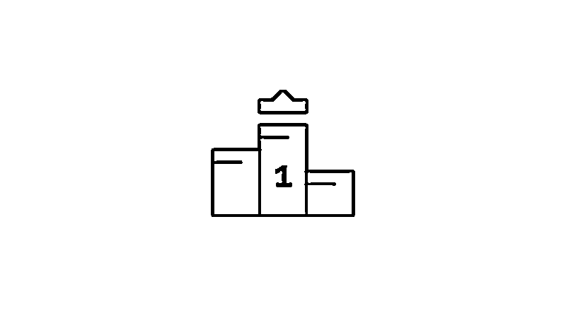

书架上摆满了成功学、传记故事，看完一本又一本，生活却依旧没起色。于是很多人心里默认了一个结论：成功学就是用来安抚人的，是胜利者写给跟随者的骗局，信了就是自找麻烦。

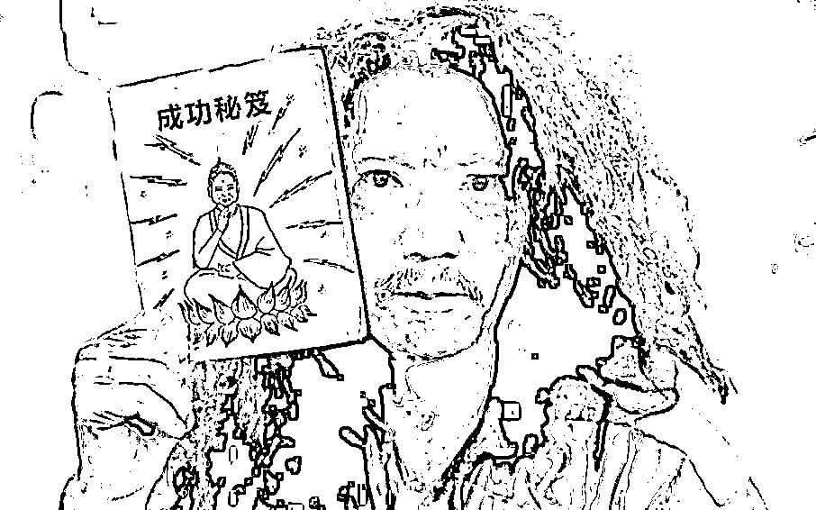

说实话，我自己也不太碰成功学，甚至带着怀疑。所以我想用两条硬指标重新判断什么才算合格的成功学。

其一，跨周期可复制。

如果一条道理高度依赖运气，必须凑齐天时地利人和才凑效，那它就很难被复刻。学了等于白学。我要的是那种在不同环境下都通用的做法，不求百分百照搬，但只要多数人照做，就能逐步显现效果。就像一套靠谱的菜谱，照方做，练熟了就能端出像样的成品。

这是我对成功法则的第一个要求。

其二，低门槛可复制。

如果一条法则要求超高天赋或认知，普通人根本玩不转，那也不在我考虑范围内。比如某些投机型天才，从小脑子灵活，玩法高明，你若也能达到那层认知，确实能搞出动静。可门槛太高，大多数人模仿不来。好比飞行员能挣脱困境，可你得先考上飞行员，绝大多数人连入场券都没有。

所以我更看重的是，天赋平平、资源普通的人也能照着走的路径。两条都满足，才算得上真正有用的成功法则。

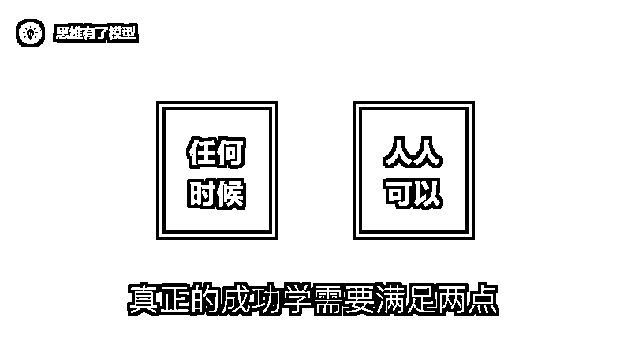

符合这两点的法则是否存在？

过去一年，我通过学习、思考和实操，确实摸到一条简明且能执行的方法。它源自营销与网络科学，不仅是经验堆砌，更贴合世界运转的底层规律。我自从实践后一直坚持，效果出乎意料：半年内，一个濒临沉寂的👸号从两千五百粉涨到三万，知乎、头条、简书也都给了正向反馈。

这个模型我称之为**“成为第一”**，目前看来是性价比最高的成事法则。

**为什么要争第一**

“成为第一”听起来空泛，似乎很难落地，它真的有这么大威力吗？具体操作我会另起篇章细讲，这里先说它的神奇之处、背后的规律以及本质。

**①强者越来越强，赢家通吃**

强者越来越强不是口号，它符合事物发展的客观逻辑。有一门交叉学科叫**网络科学**。

我们都活在一张巨大的关系网里，在这张网中，强者的资源和机会会随着网络扩张而加速放大。

美国物理学家巴拉巴西曾做过模拟，把人际连接抽象成大小不一的小球网络。他先让计算机随机生成一批小球，随后模拟连接，核心机制可以简化为“择优连接”——新球出现时，会随机连向网络中的任意节点，但连向大球的概率显著更高。这很像现实：我们或许会遇到任何人，但在需要帮助、合作或结盟时，天然倾向于去找更厉害的人。

随着不断加入新球，最终会出现一个现象：最大的球持续吸纳连接，差距越拉越大，最终形成一家独大的结构。这就是“强者越来越强，赢家通吃”的核心机理。

当然这是理想模型，类似经济学假设，用于解释现象。现实中强者也可能衰落，原因包括臃肿、保守、缺乏创新、时代变迁等。但底层逻辑可以借鉴：当你成为第一，认知你的人越多，你越强；你越强，认知你的人就越多，形成正反馈，最终形成马太效应。

举例来说，我在知乎发的那篇《费曼学习法》，因写得更透获得点赞，排到搜索首位。排在首位又带来更多曝光和点赞，循环往复。腾讯和阿里今天的格局也是如此，在没有大波动的前提下，优势只会累积。

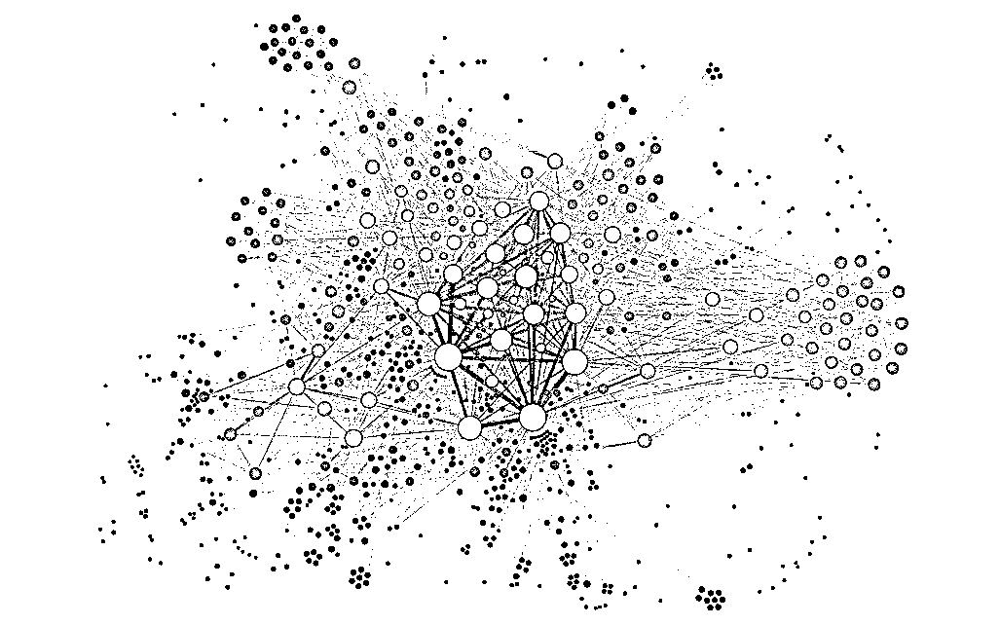

**②权威效应**

成为第一后还有一个好处，跟人性有关。

一旦你成为领域标杆，就更容易获得信任。我们的大脑并不喜欢每次都从零思考，当有公认的权威给出指引时，人们会天然松一口气。

比如一群人结束工作准备聚餐，常见对话是“随便”“都行”“别去X就行”。如果这时一位资深吃货说：“我知道一家店，他们的XX特别出名，很多外地富豪专程飞来吃，还不贵，走，我带你们去。”除了特殊情况，大多数人会放弃自行判断，跟随这位领路人。

我们天生需要一个可信的坐标，只要他足够强、能带我们走向结果，我们就愿意跟随。作为内容表达者，我深知权威效应的力量：无人知晓时，再对的观点也无人采纳；成为专家后，随口一句话也能被反复研读、视若珍宝。所以想让人听你的、信你，成为第一是必要条件。

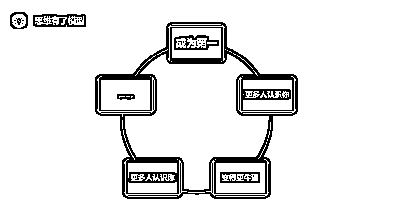

**③心智带宽有限，人们只记第一**

第三个理由来自营销学，很难反驳。华与华有一句名言：“在某个赛道，消费者通常只记住一到两个名字，第一吃掉大部分心智，第二勉强分一点，第三基本持平，其余都是陪跑。”

为什么会这样？因为心智容量有限。有本被业界奉为圭臬的书《定位》，被称作美国营销史上的里程碑、CEO最怕对手读到的商业经典。顺带一提，这串评价本身也在利用权威效应——因为它是第一，所以引用它更有说服力。

《定位》提出的核心理念是**心智**：每个人对同一品类只留很少的记忆位，第一名占据绝大部分名额，其余瓜分残余。比如电商，大家先想到淘宝，再想到京东，第三名基本想不起来；登月第一人阿姆斯特朗人尽皆知，第二人几乎无人提及；世界第一高峰珠穆朗玛峰家喻户晓，第二高峰没人记得。

心智有限，第一名占据主导。想被记住，就要努力让自己的名字占领用户心智的第一位。

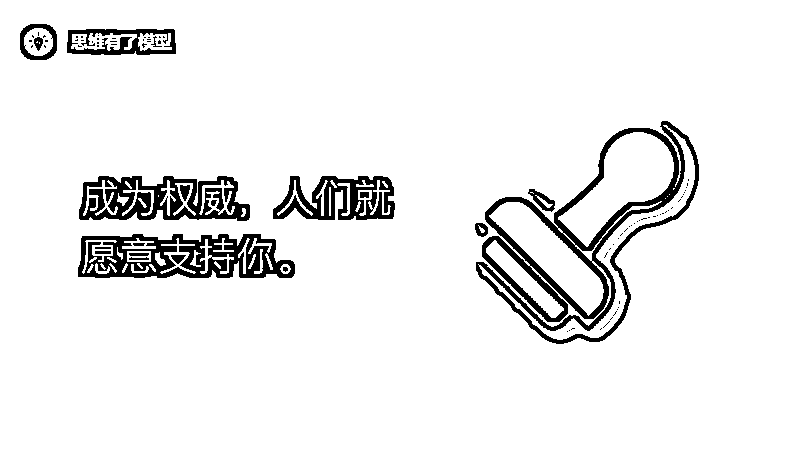

**④成为第一，你创造的价值会碾压对手**

我上周的文章里提到，成功的本质是你为他人提供的价值总量。投机可以赚一时，但要走得长久，必须持续输出价值。简单说，成功是你比对手给用户提供的价值更大。他能给10，你给100，用户自然选你。

如何提供更大价值？经济学里有**规模效应**：成为行业头部后，你的成本更低、质量更好、效率更高，竞争对手难以撼动。再加上强者效应，优势会自我强化。

可惜很多人不懂。我观察到大量人对人生方向模糊，频繁换赛道，一年换四五份工作。听人说这行好就冲进去，听说那份钱多又跳槽，干不下去再换。没有一个领域深耕到第一，就无法形成规模效应，没有规模效应价值就被稀释，人人可替代。

所以不成功才是常态，成功反而反常。

再举个自媒体的例子。很多人问我为什么做不起来，核心问题往往是定位散乱。什么都写，热点、日记、感悟、书评、职场、情感混在一起。结果是什么？每个赛道都成不了头名。写热点，你比不过专业团队；写情感，你比不过咪蒙；写感悟，你比不过一本经典著作。

读者为什么选你？看情感，我为什么不看王泽鹏而看你？看职场，我为什么不看插座学院而看你？看认知，我为什么不看原著而看你？当对方处处占优，你的存在感就被抹平。

道理很直白：只要有人做得比你好，用户就不会选你。除非在用户心智里你是唯一选项，也即第一名。

所以想成功，就必须提供比对手更大的价值。什么时候能做到？当你通过持续深耕，让成本降到最低、质量提到最高、效益达到峰值，成为第一时，你就再无对手。

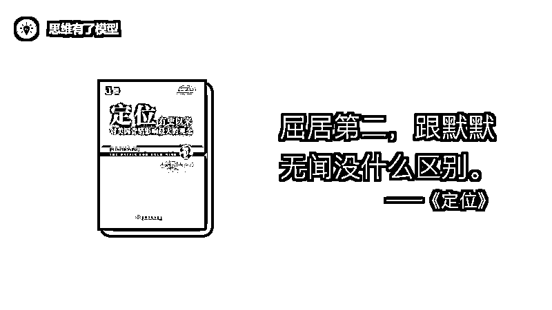

**什么是成为第一**

到这里你可能有点晕。没关系，我们再拆解一下。

**①心智层面的第一**

第一不是自封的，是用户决定的。当用户心里认定你是第一，你就是第一。比如你的文章水平一般，但读者没接触过更好的，那在他的认知里你就是标杆。

所以别气馁，任何时间点你都能成为第一。区别只是起初是少数人的第一，随着深耕，变成更多人的第一。

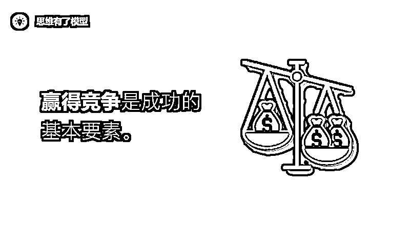

**②价值层面的第一**

你能交付的价值高于同行，成本更低、质量更高、效率更快。达到这个水位，你就站在了不可替代的位置。当然还要做传播，让更多人知道你的价值——否则好酒也怕巷子深。

有人跟我说过一个有趣的类比：恋爱也是价值选择，我们总倾向于选择价值更高的对象。所以你要做两件事：提升自身价值，成为对方心智里的首选；同时扩大曝光，让更多人看见你。

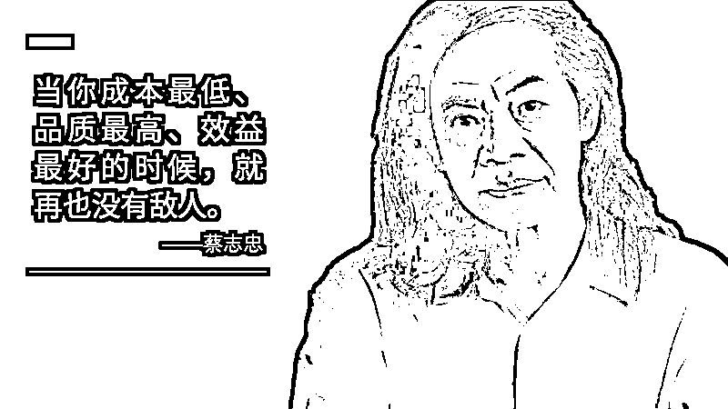

**如何成为第一**

我总结三条路径：**持续深耕、差异化表达、阶梯上升**。具体会另文展开，其中深耕和差异化是两个关键思维模型，值得单独讨论。

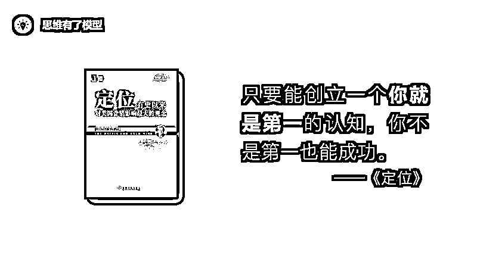

**经典案例**

最后分享一个我敬佩的践行者——蔡志忠。

能理解这个法则，很感谢他。他就是“成为第一”的活例子。

蔡志忠四岁半就确定要画画，十五岁成为职业漫画家，第一本《庄子说》连续十个月占据金石堂畅销榜首，是首位用漫画形式把庄子、老子、孔子思想推向世界的创作者。2011年荣获金漫奖终身成就奖，他一生都在同一赛道深耕。

借他的一句话作为收尾：

老师说“努力就会成功”，其实是善意的谎言，没有人是不努力的。努力并不能保证抵达成功，更关键的是选择——选自己擅长且热爱的，把它做到极致，几乎没有不成功的可能。
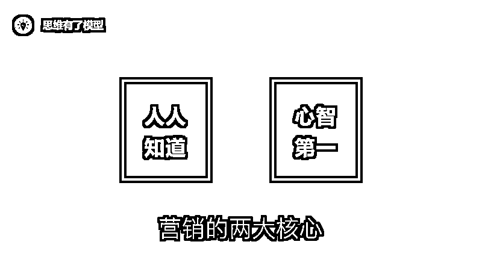

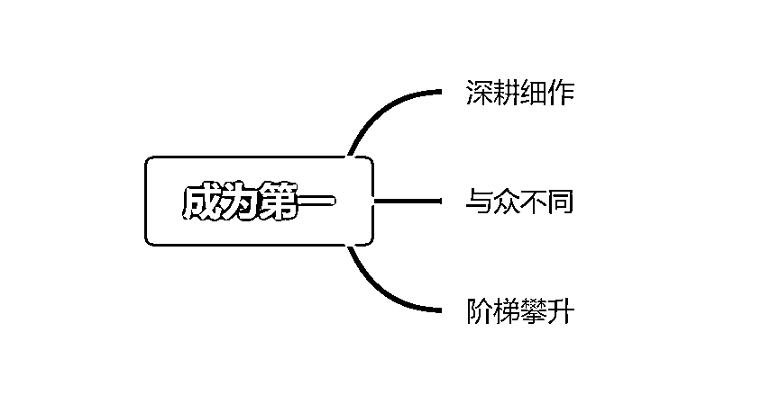

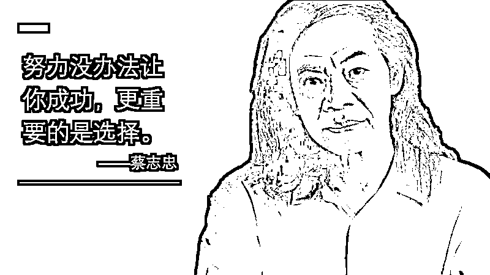

* * *

评论区：

暂无评论