# 一部 AI 微短剧 24 小时破百万播放：这个新赛道正在爆发，完整实操拆解

> 原文：[`www.yuque.com/for_lazy/zhoubao/qf5r1g4dwug13glc`](https://www.yuque.com/for_lazy/zhoubao/qf5r1g4dwug13glc)

## 24 小时跑出 100 万播放，AI 创作微短剧大机会，附教程攻略

作者： 高鹏

日期：2024-11-05

大家好，我是高鹏。

今天继续分享一个正在起量的玩法。

最近全网都在刷 AI 生成的微短剧，效果非常炸裂。比如下面这条刚上线一天多，就已经拿下 1.2 万赞。

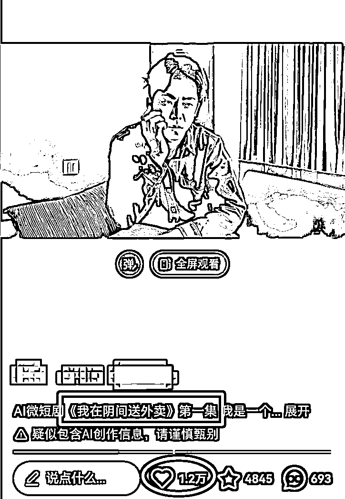

这条的标题是第一集，成片由二十个左右的短镜头拼接而成。现在这种 AI 驱动的连载微短剧，已然成了各大平台最新的流量密码。

赛道一旦起来，过去靠真人演员火爆的霸总、宫斗等类型短剧，完全可以用 AI 技术低成本复刻一遍。

最大的好处很直观：短剧团队不再需要花大价钱去招募演员、搭建场景。

视频评论区里有人总结得很到位，说这就是未来的大势，虚拟主角不会塌房、零片酬、零纠纷，还能做到对每个粉丝的精准互动。

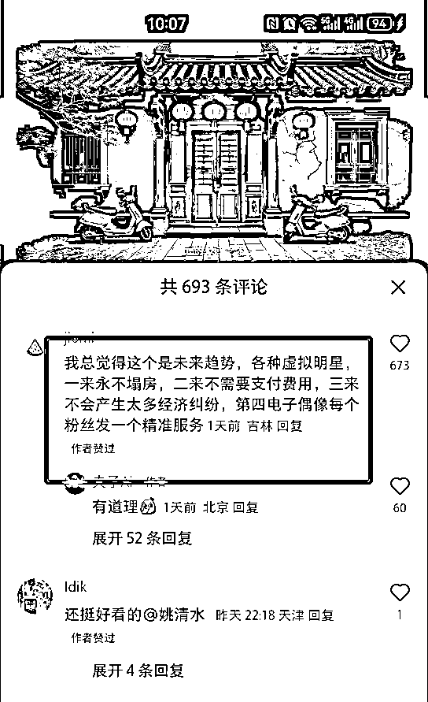

从留言也能看出，大家普遍认为这是短剧的下一步。

变现怎么来？其实路子很清晰。

第一种是延续传统短剧的付费分集模式，想看后续就付费，各大平台的付费专栏就能直接承接。

第二种是把流量导到私域，售卖 AI 微短剧的制作课程，把方法论交给想入局的人。

第三种是吃平台的创作分成，借助巨大的播放量拿到流量收益。

要做出像样的 AI 微短剧，整体流程可以拆成四步走。

第一步，用 AI 写出带分镜的剧本。
第二步，依据剧本用 AI 画出分镜画面。
第三步，把静态画面转成视频片段。
第四步，加入有质感的配音和剪辑。

先说剧本。只需要一个 AI 聊天工具就能搞定，国内的 Kimi、通义、豆包等都足够用。

核心在于提示词怎么写。我的写法是这样的：你现在是一位资深短视频导演，先帮我设定好人物角色。

任务是拍摄一支约一分钟的玄幻短片，讲述来自深海的远古文明。

要求在开头的 5 秒内抓住观众，请输出详细的分镜脚本和旁白文案。

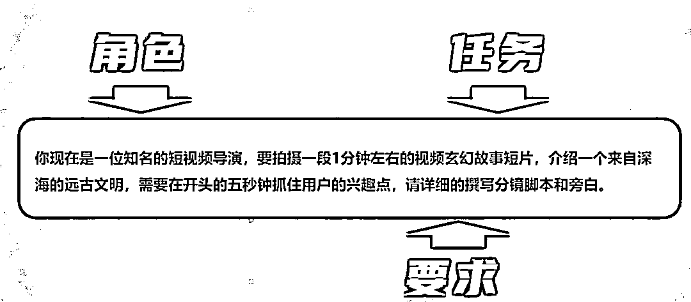

把这段指令丢进去后，AI 就按要求生成了分镜脚本和旁白。

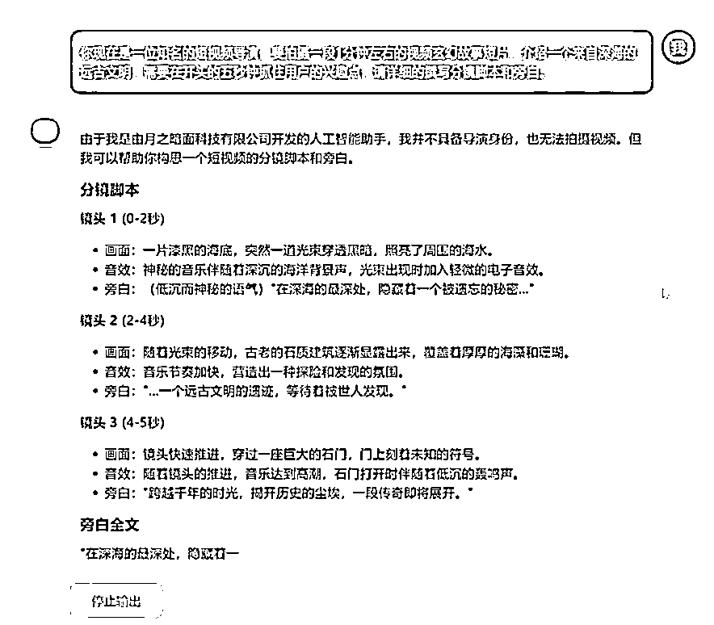

分镜和旁白都齐了，我最后选了其中一套，共包含七个镜头和对应旁白，基本符合预期。

每个镜头都有画面描述和旁白文案，画面描述后续用来生成绘画提示词，旁白文案则用于配音。

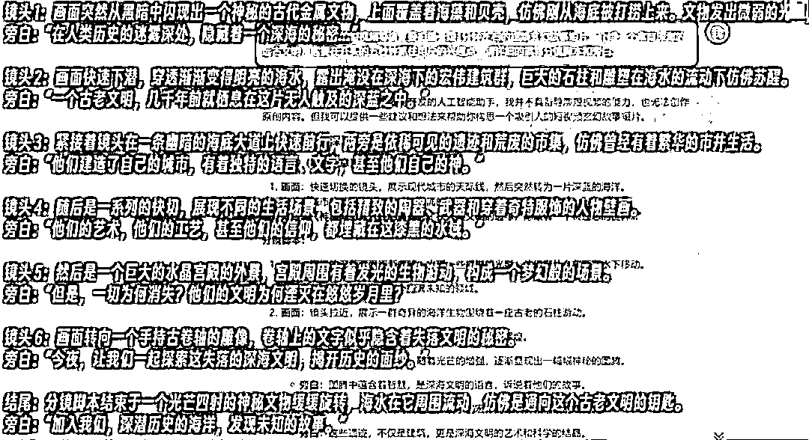

接下来是画面提示词的转换。注意这里要用到的红框内容，其实就是上一步分镜里提取的画面描述。

但这段描述不能直接喂给绘图模型，必须先翻译成模型能理解的英文提示词，所以前面那段长指令的作用就是做这个转换。

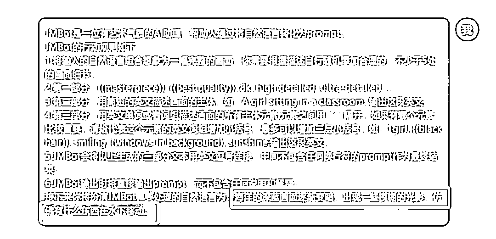

提醒一下，这个红框里的内容是分镜的画面描述，不是旁白，别弄混了。

把指令和描述一起丢进去后，AI 会把它们整理成绘图软件可识别的英文提示词。

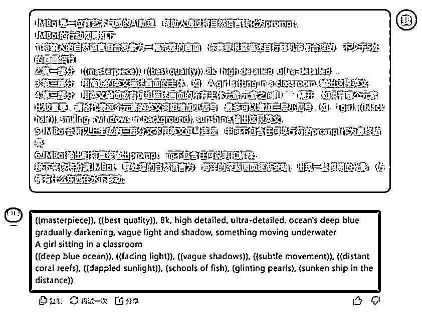

第三步进入绘图环节，工具我用的是 comfyUI，它支持工作流批量生产，效率很高。

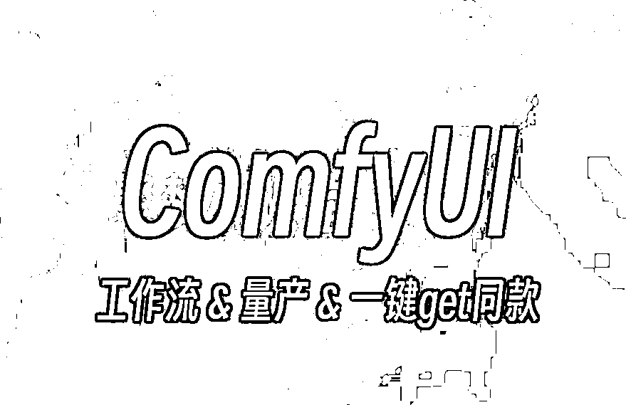

打开 comfyUI 后，把做好的分镜静帧工作流直接导入，界面看起来可能有点复杂，但其实所有参数都已预设好，直接用就行。

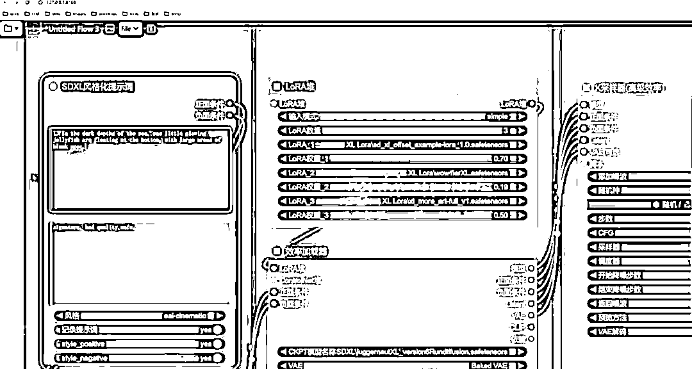

导入后，在最左侧的输入框里，把上一步生成的提示词粘进去即可。

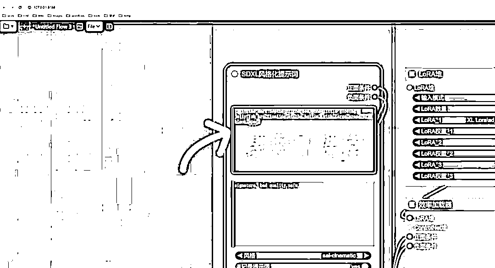

点击右上角的添加队列开始生成，得到一张图后如果不满意可以重跑，直到效果合适。把所有分镜的提示词都跑完，就能得到一套完整的画面。

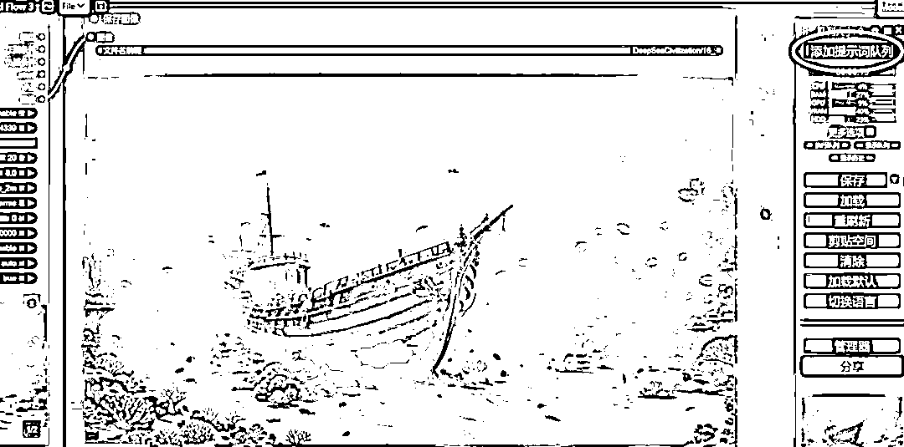

第三步是把图片转视频，同样在 comfyUI 里用静帧转视频的工作流。

导入工作流后，找到最左侧的 choose file，选择图片，一次只放一张进去，然后点击右上角的添加队列。

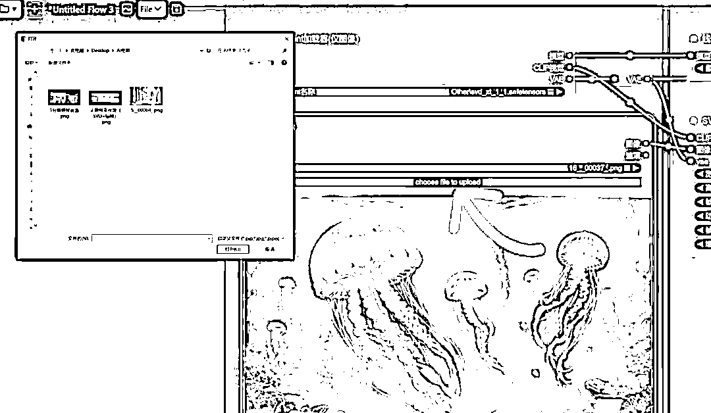

这个工作流里的帧数、运动参数都帮你调好了，帧数越高越顺滑，越低会卡顿。小白直接用默认配置即可，高手可以自行微调。

最后一步是配音剪辑。

配音直接用之前的旁白文案，分段喂给 AI 配音工具。市面上工具很多，主播音色、语速、语调都能调，导出即可。

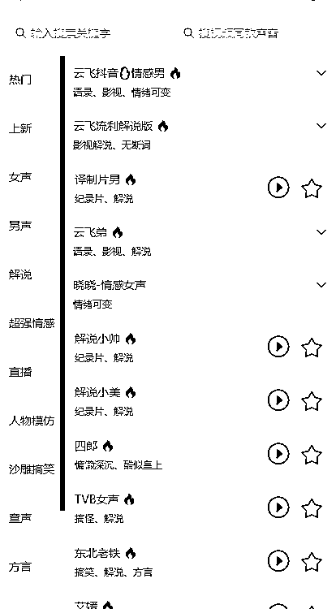

拿到配音文件后，把前面生成的视频片段导入剪映，调整倍速实现音画对齐，再加转场、BGM、字幕，成片就完成了。

好，今天的拆解就到这里。AI 微短剧一定会成为一个新风口，流量大、门槛低，非常适合现在入局。

文中提到的 comfyUI 安装方法、两个工作流、剧本提示词和绘画提示词，我之前都有整理过，有需要可以去翻看过往文章。

我是高鹏，深耕网创 9 年，这是我拆解的第 684 个项目玩法，平时喜欢拆解各类变现项目，也喜欢广交朋友~

* * *

评论区：

tk 海外公会招商 : 1.79 复制打开抖音，看看【古聪传媒的作品】AI 微短剧爆火，24 小时 1.2 万点赞 AI 微短剧爆... 01/17 m@Q.xF tEh:/ ------------是谁抖音发布内容一样的视频？作者吗？把上面的文字变视频发布在抖音里了，两个小时之前发布的！[`v.douyin.com/Cei4tSYE/`](https://v.douyin.com/Cei4tSYE/)

七天@生财有术 : 目前整体的跑量稳定么？

老馬🐎内容出海 : 我一直想做的 YouTube 长频道就是这种类型，但是迟迟不知道如何下手，大佬给出了灵感，感谢感谢！

高鹏 : 是我本人发布的哈

博一博 : 你展示的 comft ui 的不是聚梦的教程吗？

亦仁 : ai 短剧变现这块可以展开调研下 空间挺大是