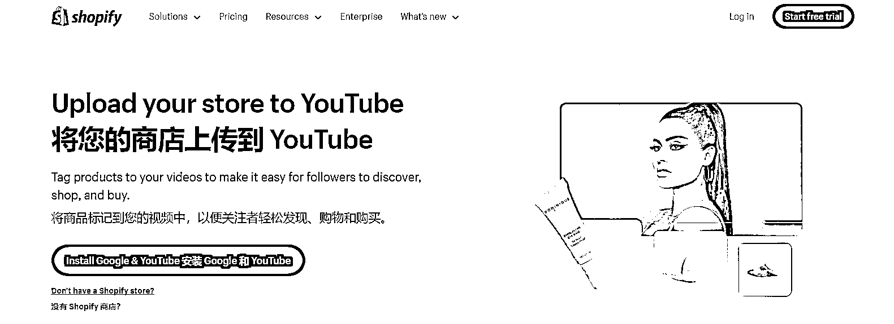
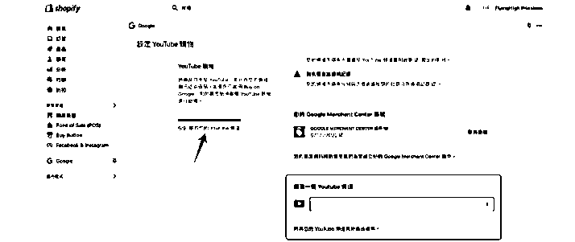
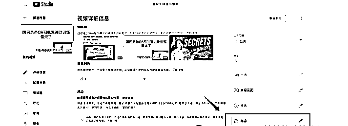

# YouTube 要玩真的电商了，跨境卖家的新流量入口来了

> 原文：[`www.yuque.com/for_lazy/zhoubao/rypzwovp7umv6u22`](https://www.yuque.com/for_lazy/zhoubao/rypzwovp7umv6u22)

在 TikTok 和 Instagram 抢先布局之后，YouTube 也正式加速入局电商赛道。

最近不少美区用户已经能明显感知到变化：视频下方出现商品展区，部分频道甚至直接上线了“商店”和“购物车”入口。**对于做跨境业务的卖家而言，这无疑是一条值得立刻关注的新增量渠道！** YouTube Shopping 在玩法上与 TikTok 的半闭环电商逻辑颇为相似。想提前卡位这波红利的关键，就是先把入驻规则和操作路径吃透。下面就把整理好的要点分享给大家。

### YouTube Shopping 到底是什么？

通俗讲，就是让 YouTube 创作者在频道、视频和直播里直接展示并带货商品，本质上和国内的短视频直播带货是一回事。主要能力包括：**视频内嵌购物车、直播带货购物车、商品橱窗展示、个人店铺展示以及联盟营销等。**

YouTube Shopping 为品牌方和内容创作者打造了一个兼具多功能和全球覆盖的变现平台，增长空间相当可观。凭借全球顶级的视频生态，YouTube 拥有庞大的用户体量和极高的用户留存。数据显示，高达 89% 的用户会信任 YouTube 上的产品推荐。对商家和创作者来说，这意味着巨大的商业潜力。它把视频内容和购物功能打通，用户在看视频的同时就能直接看到商品橱窗、加入购物车，无需跳转。短视频和直播中植入商品标签，让观看与下单实现无缝衔接，转化效率明显提升。用户体验更顺畅，商家与创作者的流量变现也更高效。

### YouTube Shopping 入驻全流程

### 1. 先确认基础资质

入驻前需要先满足以下门槛：

.已加入 YouTube 合作伙伴计划
.频道订阅量达到平台最低要求，或属于官方音乐人频道
.频道受众不以儿童为主，也不能大量发布面向儿童的内容
.频道历史清白，未因仇恨言论或违规行为收到处罚

达标后即可申请 Google 提供的免费开户权益，开启 YouTube 自助投放，为跨境业务提前锁定流量。

**2. 把自有店铺与 YouTube 打通**

目前主流的 Shopify、Shopline 等建站平台都可对接，下面以 Shopify 为例说明：

**第一步：把 Shopify 商店连上 YouTube**
.进入 YouTube Studio，点击 **商业化 > Shopping**
.在“从商店导入商品”模块中，点击“连接商店”，选择 Shopify 并继续
.跳转至 Shopify 后按引导完成授权关联

**第二步：完成账号同步**
.在 Shopify 后台进入 **销售渠道 > Google & YouTube**，用与 YouTube 相同的 Google 账号登录，并确保拥有管理员权限
.选择对应的 Google Merchant Center 账号和 YouTube 频道，完成店铺绑定

### 3. 在视频内容里上架商品

关联成功后，就能在视频或直播中挂品了：

.登录 YouTube Studio，上传视频或 Shorts
.进入“视频元素”设置页，找到“关联商品”并点击“添加”
.搜索商品名称，选择目标商品后拖拽至画面指定位置。单条视频最多可挂 60 个链接，还能自定义商品的展示时长

到这里，YouTube Shopping 的基础入驻就完成了。

目前已有超过 16 万名创作者、品牌和艺人加入该功能，市场接受度很高。创作者靠商品推广获得额外收入，有助于孵化更多优质内容；品牌则能借助 KOL 和 KOC 的影响力打开全球市场。

尤其是对于面向欧美的跨境商家，YouTube Shopping 提供了一条直达终端消费者的新路径。通过与当地频道或网红合作，能实现更精准的触达和转化。YouTube 的电商化落地意味着新的流量红利期，商家可借此打造全球化品牌形象并拓展新的销售通路。可以说，这是一次不容错过的机会。

以上！

**国民弟弟相关创业的故事文章推荐：**

[`articles.zsxq.com/id_8n2o7gax71fr.html`](https://articles.zsxq.com/id_8n2o7gax71fr.html)

* * *

评论区：

亦仁 : 有没有圈友可以切入 YouTube 电商的案例拆解呢