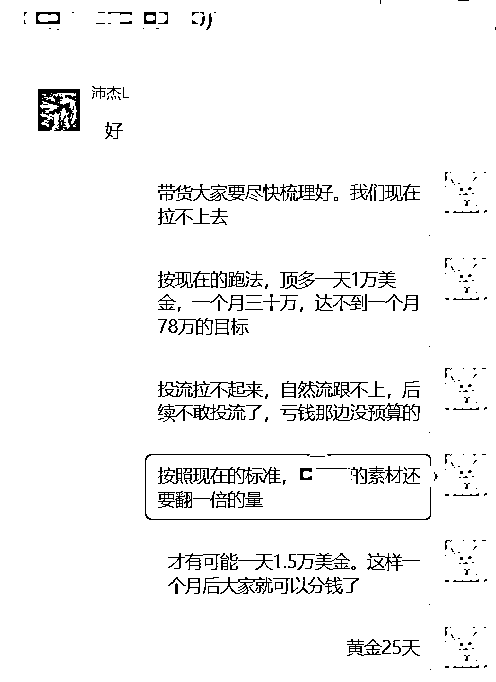
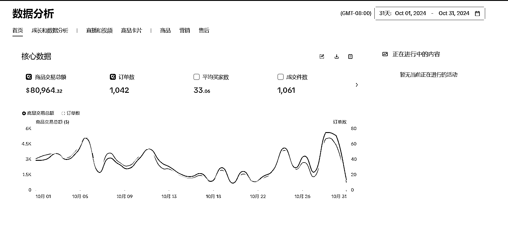
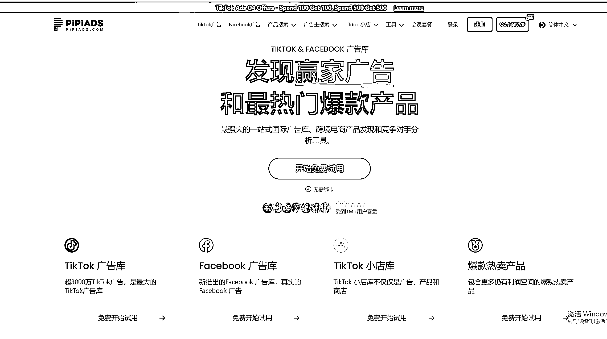
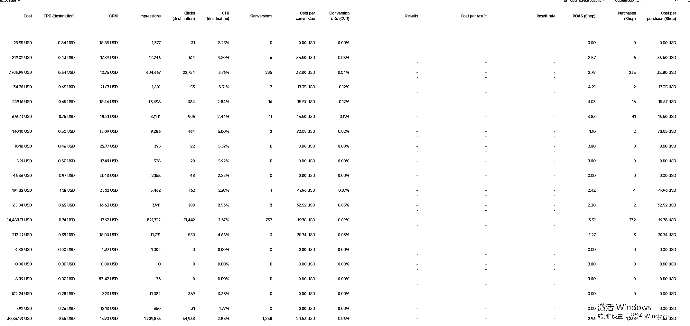
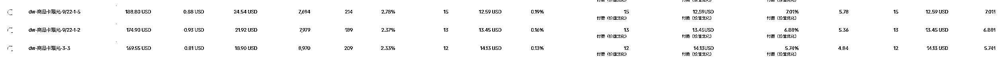
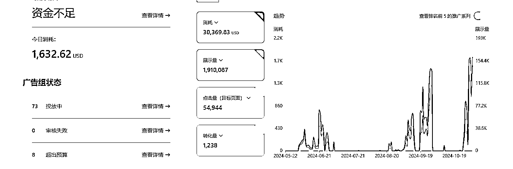
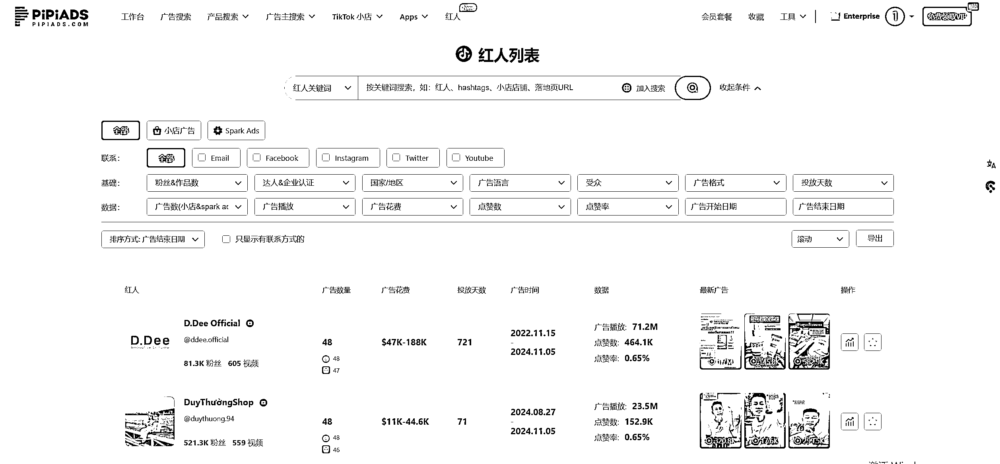
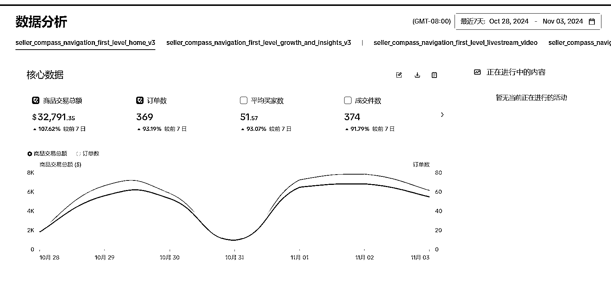

# 挑战 TikTok 两个月带货 GMV 目标 90 万美金，光宗耀祖？
作者：龙哥

### 5人团队两个月冲100万美金GMV，光宗耀祖还是痴人说梦？

在TikTok上摸爬滚打了三年，一直没混出什么名堂。最近我不想再温水煮青蛙了，决定搞波大的：代剪辑、自营、联盟纯佣带货、广告代投，凡是能挣钱的业务一律不挑。

自营团队一共5个人，最初定的带货目标是48万美金。我看到这个数字直接笑了：48万也太保守了，要玩就玩点刺激的。于是10月到12月，我当场给团队拍板，GMV目标直接干到100万美金，一个字：冲。

团队听完大概都是一脸问号：10月才做了8万美金，现在要翻五六倍，谁给我们的勇气？

先把账掰开算：我们的产品客单价在60到85美元之间，想完成目标，大概要跑出11764到15384单。三个SKU都在备大货。8万美金已经拿下了，剩余92万美金的缺口，接下来两个月每天要出166到233单。压力不用说，确实有。

回头看10月：国庆放了8天假，新办公室装修又耗了两周，团队基本没正经运营，视频也断更了。仅靠账号里之前存的几千条素材，小店还是自然跑出了8万美金的成绩——换句话说，有差不多20天是空转状态，这个底子其实没那么差。

11月赶上年终大促，整体购物氛围比平时旺，保守估计GMV做到两倍问题不大。但没有精细的排兵布阵和稳定的供应链，大促流量跟我们也没关系。

落到执行层面，我做了这样的拆解。

**自然流短视频：**
人手是5人，2个熟手加3个新手；账号配了10个橱窗号、4个白号；节奏上每个号每天早晚各3条、合计6条，14个账号一天就是84条。

此外，团队还有中视频和AI项目要推进，每个人手头还有20条这类素材。再加上拍摄和发布的时间，平均每个人光带货视频就要剪16.8条；算上其他任务，一天总剪辑量得奔着40到50条去，确实吓人。

但难不代表做不到。团队最忌讳吃大锅饭，按能力分工就好：熟手每人至少25条，两个熟手就贡献50条；新手每人12条，三个人刚好补足缺口。

短视频带货的核心动作不外乎三个：拍摄、剪辑、发布。

拍摄上，我让团队走模板化路线，把场景和机位划分成A、B、C、D模块。

第一波：找一处临时场地，手机打开，对着产品一镜到底，配好台词和音乐直接挂车发布，这种素材叫A。每10分钟发一条，轻松简单，人还在外景拍摄，账号就已经完成了更新任务。

第二波：团队跑不同的场景，用景别来区分——B近景拍10分钟，C远景拍10分钟，D换个位置再拍10分钟。半小时就能带回15个场景、30分钟素材。回到电脑前开始按模块拼：B+C组合、B+C+D组合、B+D组合，一天的剪辑任务量就这样硬生生拼出来了。

至于脚本，核心就三件事：对标、总结、模仿。

对标：新人写脚本最痛苦，与其绞尽脑汁憋分镜，不如直接抄作业。我让他们打开pipiads.com，把站内所有同类广告素材扒下来，全部丢给GPT学一遍，再用AI批量生成脚本，拿来就拍。

总结：纯展示的、讲故事的、做噱头的、玩开箱的，全部先跑一轮测试。然后翻店铺后台数据做复盘，把最容易拍摄、最出单的素材类型提炼出来，统一批量复制。

模仿：平台上的热梗、神曲、爆款转场、花哨特效，出来一个就抄一个，不纠结不内耗，干了再说。

但纯自然流撑不起100万美金，广告必须跟上。

广告投放上，我重新做了分组：商品卡广告、视频广告、GMV Max广告。

配额怎么定？广告账户3个，日消耗预算5000到10000美金；每天上新10到30条出单素材去测。

商品卡广告：优势是稳，缺点是放量难，消耗大了成本必然升高。常规操作是每天20组全店投放，日耗约500到1000美金。

视频广告：主力选手，每天新建200组，手动+自动出价混合来，日耗约2000到3000美金。

GMV Max广告：暂时不动，等11月中旬再全域放量。原因是它算ROI时会把自然流出单也混进来，我得先验证自然流本身的产出能力。

按ROI 3到3.5来算，20万美金的广告花费能换回60万美金广告回报。这么看，100万的目标反而没那么虚无缥缈了。

达人端是我们此前的短板：建联节奏很慢，几天才找一个，一个月也推不了几个人，偶尔投几十美金做测试。而且试下来的结果很尴尬——达人挂车卖不动，内容转化率也低，自家自营账号反而猛一些，所以一直没上心。现在旺季来了，这块开始补强。pipiads新出的红人数据分析功能挺好用，谁家达人出单稳定、投流效果如何，大致都能看出一些门道。

眼下两个品还没入仓，我已让大家抓紧囤素材；目前单品一天能出60到70单。

总有人唱衰大盘，说平台没机会，我不认可。假设市场真的处处繁荣，那这场盛宴多半轮不到我这种小团队。红海里淘蓝海，蓝海里挖更深的蓝海，只要肯下功夫，就有出路。

当初为了养活团队，我踩过不少坑，连续几个月没有进账，什么业务都碰，核心逻辑就是先活下来。我一直认为，做得久才有机会，机会来了才接得住。

这份方案不只是内部计划，也写出来让大家评一评。我是皮皮，这期就聊到这，下期见。要是你有优质供应链，又想找纯佣达人团队试试，可以联系我们；不过美妆和服装不在我们的能力范围内，暂时接不了。