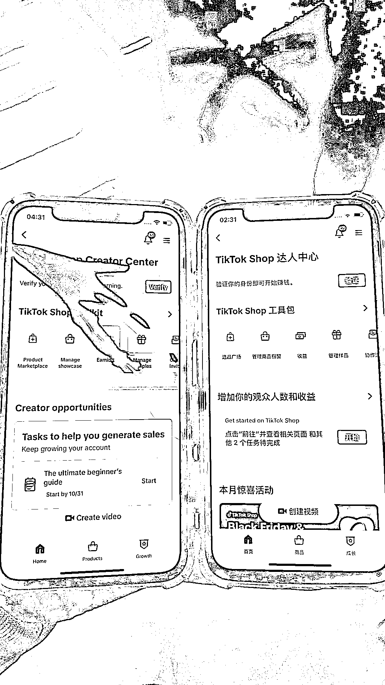
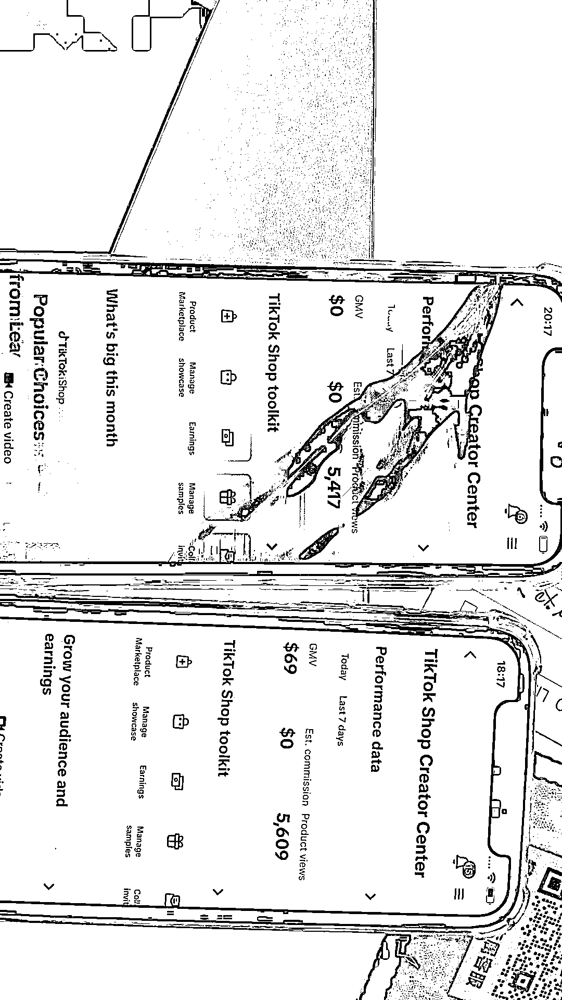
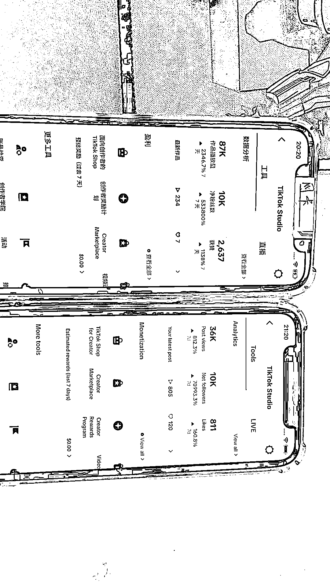
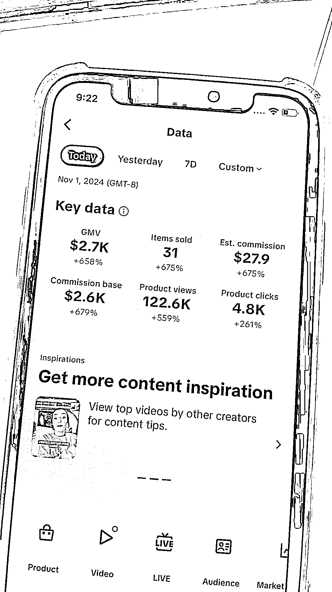
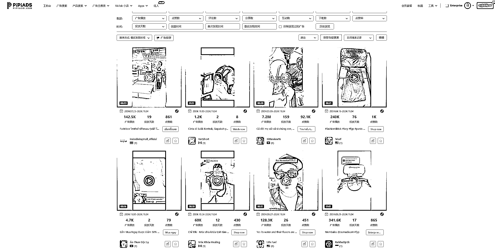
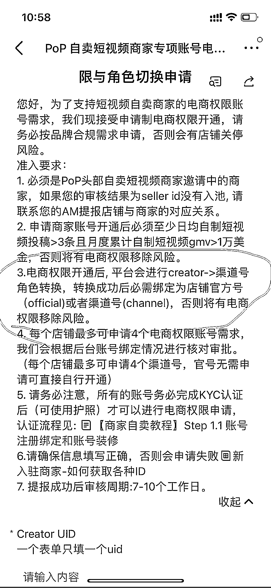

# 批量打 TikTok 橱窗号的经验分享

闷声跑通：批量搞定 TikTok 带货号的完整路径

最近一直在忙一个挺特别的盘，总算把 TikTok 带货号的批量供应路径跑通了。团队已经拿这套方法加足马力在跑，今天把全过程从头到尾展开说透。

先讲门槛。想拿到商品展示位，目前要么关注量累积到五千，要么收到官方邀请并持有千粉号。还有几项潜在条件：内容自然分发下得有不错的表现，观看量至少到数万级别；内容本身要能让人愿意 Follow；实名信息或历史记录不能有任何异常，不然可能直接封禁。

再说三种常见坑：资格失效但入口还在；被永久拉黑再也没机会；以及最迷惑的——连入口都看不到。

如果按老思路靠商品类短片逐步积累粉丝，尤其是廉价感比较强的产品，你会发现播放和关注都上不去。这时候更聪明的选择是直接收购一批已开通带货能力的号来批量操作。怎么快速产出能开号的号？平台上有巨量娱乐向的素材空间，找到容易火的类型，账号热度自然就来了。比如 AI 制作的图片视频，又如小情侣每天的生活记录配上表情包。这类内容制作门槛低，批量化极其顺手，几千到数十万观看的成绩都能稳定跑出来。

有了方向，核心动作就是海量筛号。只拿三五只号、十几二十只号都难以破局，必须靠走量去撞机会。有个挺奇妙的规律：同一条脚本，换个画面底子，发到不同号上，结果从几百到数十万之间天差地别。想要团队心态不被拖垮，号池就得够厚。例如手上有十部手机，每部上传三支片子，一天合计三十支。哪怕内容都没毛病，大概率只有一两只能冲到千级或万级观看，这跟号的初始权重关系极大。

如果成天只守着少数号，我反而建议到市场上去收号，别自己辛苦养。极少数的号来回打磨好些时日，很可能一个资格都开不出来。成本浪费之余，团队还被折腾得没有心气。尤其当团队战斗力本身就偏弱时——脚本憋不出来，剪辑也剪不动，单个成员每天撑死做五到六支，传上去后每支观看只有两百上下，每天只能覆盖两三个号，又亏钱又打击士气。

更实际的做法是找到极简脚本模板，出片只要十几分钟，零基础也能上手。让新人照模板批量产出、大规模分发，用数量堆出概率。我们这边新同事的最低要求，就是每人每天产出三十支，刚好配上十部手机。筛出观看数据不错的号后，再交给资深同事转产高质量内容去引爆。

再分享一个我们验证过的技巧。部分号连续几天出了好几条大爆款，可隔一段时间粉丝还是停留在百来个，增长苗头几乎看不到，属于鸡肋号。这种我一般直接做数据，每只号花 10 美金补到上万关注量。原本担心开通后马上会被处理，结果一直没有任何问题，甚至还顺利出了单。

买量当然不是零风险，但跟死磕好几个月都等不来一个合格号相比，这是效率最高的路径。而且按我的测试，号原来是什么体质，补完数据后还是那样。我在这个站点买的真人关注[`ada.fansf.net/`](https://ada.fansf.net)，下单 47 号套餐。

再说一个贴近现实的案例。按常规思路，得有大几万观看才值得去申请。但上星期六我拿四只仅养过三天、只有少数内容破千的号直接提交申请，配合买量操作，发现能不能过纯属随机。四只号最后的结果是：一只完全找不到入口，一只开通后权限蒸发，另外两只入口还在，但始终审核不过。

碰到这种僵局，我一般是这么处理的：一，持续更新让号保持活跃；二，隔三差五去点申请；三，换别的网络环境再试；四，扔到一边等上若干周再回头操作。当你手握四十甚至四百只号，开出来的概率自然被放大。说白了这是一场概率博弈。这一批没中也正常，养号时间不够，命中率自然偏低；等号养得更成熟，或者有过数十万次观看的爆款履历，再下手会稳得多。

赚钱部分点到为止：无论是给自己店铺挂货、做联盟分销，还是直接把号卖掉变现，都有操作空间。号本身就是最值钱的生产资产。想尽早拿下资格，核心还是拼命卷内容，专挑那些流量来得极容易的类型下手。

流程我一步步拆开讲。

选题期：先备一两部手机专门刷同行的视频，每天雷打不动刷两小时。刷到有感觉的题材就点赞、关注，直到推荐页全是同类内容。然后细看它到底怎么做的，并调查近 7 日新注册的号能跑出什么数据。拆解时直接把脚本喂给 GPT，让模型照着学、照着写，快速复制。

对接期：不管是做样品对接还是带自家产品，去 pipiads 扒一批拍摄脚本。pipiads 上的内容都是付费投放验证过的，拆解他们投过钱的素材，改造成自己的批量内容。输入品类词就能精准铺开。不少做内容的同行都借助皮皮拿下了一波观看红利，我本人也是受益者，这类工具就得榨干用透。

关于团队运作，我后面打算单独写一篇 TikTok 团队怎么带的文章。再提醒一句，做大客户生意的朋友，眼下正好是 11 月黑五，可以找官方 AM 申请白名单机制，0 粉就能开通资格，上限 20 个号。不过对方会看此前累计的成交额，大概 65K 上下，并约定黑五周期的销售指标。例如每只号每天上传内容不少于三条，月的短片成交额超过一万美元。

这篇就先到这里。顺着我过去分享的起盘流程和开通带货资格的实战攒下的心得一起读，收获会更大。纯干货，觉得有用的话给个赞就行。