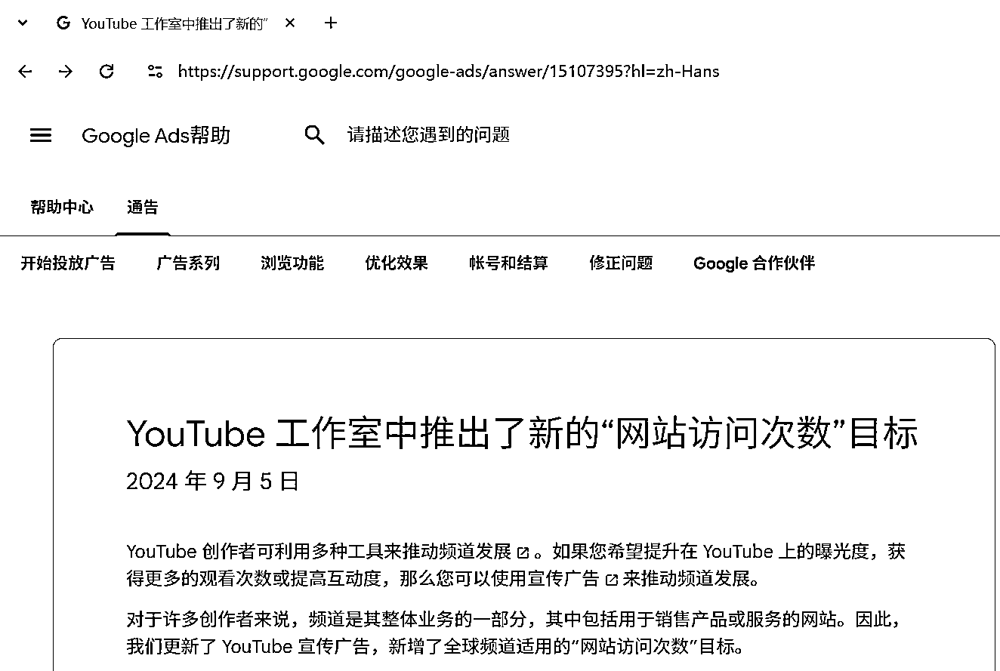
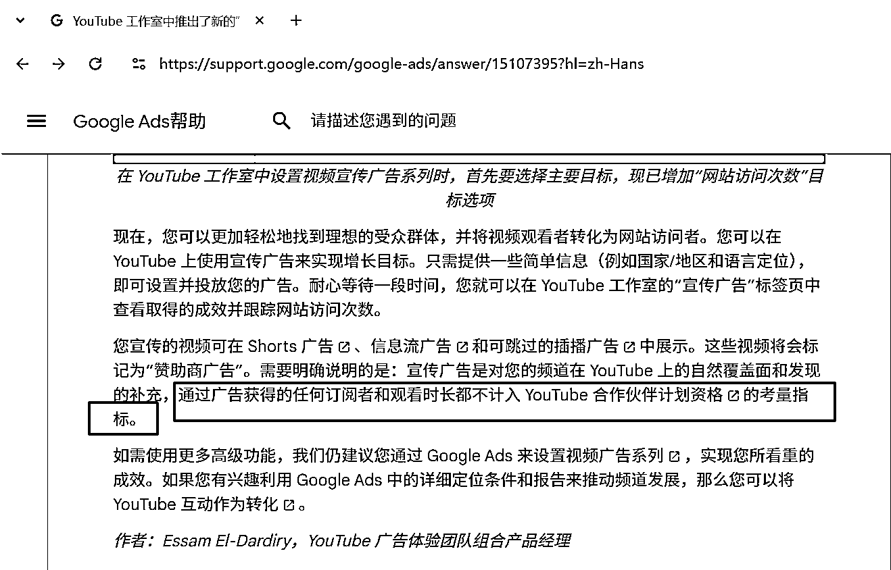

想不想知道，从0起步做YouTube，怎么用最少的时间跨过YPP那道门槛？说实话，这个门槛不算高，但也卡住了不少人——1000个订阅，外加4000小时观看时长。注意，这是长视频的考核标准。真要从零开始，你会发现自己很容易栽进下面两个坑里。

第一个坑：订阅早就够了，观看时长却差得远。

这种情况说明你的内容很有吸引力，观众愿意关注你，但视频基本偏短。比如搞笑类短视频，看着爽、涨粉快，可单支视频的时长摆在那里，播放量再高也攒不够小时数。怎么办？先用短视频把粉丝拉起来，后面再用长视频把时长补上；如果片子本来就少，那就提高更新频率、多出内容；还有就是开直播，直播时间也算观看时长，是个很不错的补充。

第二个坑：观看时长攒够了，订阅却迟迟不涨。

这种情况通常意味着内容选题没问题，看的人也多，但观众就是没关注你。说白了，你的内容有价值，但你的个人IP不够显眼。想改变，就得在作品里加入自己独特的观点和性格标签，让人看完不仅记得内容，更记得你这个人。

如果你恰好卡在第二种情况，那么恭喜，有一个花小钱就能提速的路子——YouTube官方付费推广。

官方对“宣传广告”的解释很明确：它只是对频道自然覆盖面的一个补充，通过广告得到的任何订阅和观看时长，都不会算进YPP资格考核里。

但实际操作后你会发现一个有意思的破绽：广告带来的那部分播放时长会被系统自动过滤掉，但由广告引来的订阅，却会在粉丝总数里一个不落地被算进去。也就是说，时长只能靠内容一秒钟一秒钟地攒，而订阅数量完全可以用付费来“催熟”。

这个漏洞给我们的最大启发是——前期眼睛要盯在播放时长上，别总为粉丝数焦虑，因为时长才是未来赚钱的核心。如果你已经有了足够的观看时长，只差订阅数达标，那就可以花点小成本投官方广告，把订阅数补上去，提前解锁赚钱模式。等于是用一点点钱，换更早的收益窗口。

作者还分享过两个真实案例：一个视频记录了购买1000个真实订阅后到底发生了什么；另一个则算了笔账——花35.25美元买1000个真粉，到底值不值。两个实验在YouTube上都能直接搜到。

这操作熟悉吗？其实就是公众号开通流量主之前的套路：内容有爆款潜力，订阅不够500，那就先凑够500，先把广告收益打开。YPP里也是这个逻辑，用付费来加速跨过门槛。

当然，这些付费带来的订阅未必都是精准用户，但眼前的目的是先够到门槛，后面再靠内容慢慢沉淀真正认可你的人。

最后提个醒：千万不要去找第三方刷粉，风险太大了。同样是花钱，为什么不直接花给官方？安全、合规，还能算作推广费用。

对了，评论区有伙伴补充说，现在YPP的部分权益（比如会员、Super功能）已经放宽到500订阅+3000小时就能开通，但AdSense广告分成还是要1000订阅+4000小时。大家可以根据自己的情况，灵活安排下一步。