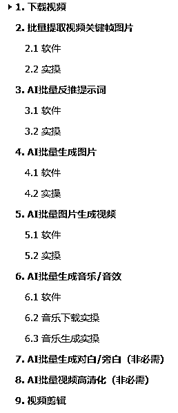

# 深度使用 ComfyUI 免费批量制作 AI 短视频工作流（附带教程+工作流+开源免费模型下载）

你是不是经常在 YouTube 上刷到那些数据好到爆的 Shorts 短视频？与其眼馋，不如用工具把它们批量“复刻”出来，而且可以免费实现。最近看到“来来”在 11 月 8 日分享的一套 ComfyUI 实战工作流，已经收获了 72 个赞，内容非常扎实。

这套流程围绕 ComfyUI 展开，把“免费批量制作 AI 短视频”拆解成了 9 个可执行的步骤，几乎全部能在 ComfyUI 里完成：

1. 先从视频网站把样片下载下来；
2. 用老马特供软件批量抽取视频的关键帧，留下最有代表性的画面；
3. 把关键帧丢给 ComfyUI，AI 会自动批量反推提示词；
4. 再让 ComfyUI 根据提示词批量生成新的图片；
5. 然后继续用 ComfyUI 把图片批量转成动态视频片段；
6. 音乐和音效也能在 ComfyUI 里批量合成；
7. 对白、旁白同样可以在 ComfyUI 里批量生成；
8. 最后视频高清化也交给 ComfyUI 批量处理；
9. 全部素材准备好之后，用剪映剪辑成一条完整的 Shorts 视频。

可以说，从下载到成片，整个链路都打通了。作者还准备了非常详细的目录，方便大家快速定位内容。下面就是  部分。

完整图文教程可以看飞书文档：https://duuxkmjwsy.feishu.cn/wiki/TCsNwCkDQiwL23ksmmYc63p4nvg
文中提到的软件、工作流和开源免费模型也打包好了，直接下载：https://pan.baidu.com/s/1iI7riEn8jZ8XvVkLs9A4GQ?pwd=rr35 （提取码：rr35）

标签：#龙珠悬赏

评论区里已经有不少人开始动手了，比如有 AI 绘图小白在反推提示词时找不到对应模型，也有人夸这套内容“可以当手册了”，还有朋友提醒：ComfyUI 虽然免费，但对显卡的要求并不低。不管怎样，收藏起来，慢慢练手，总是没错的。