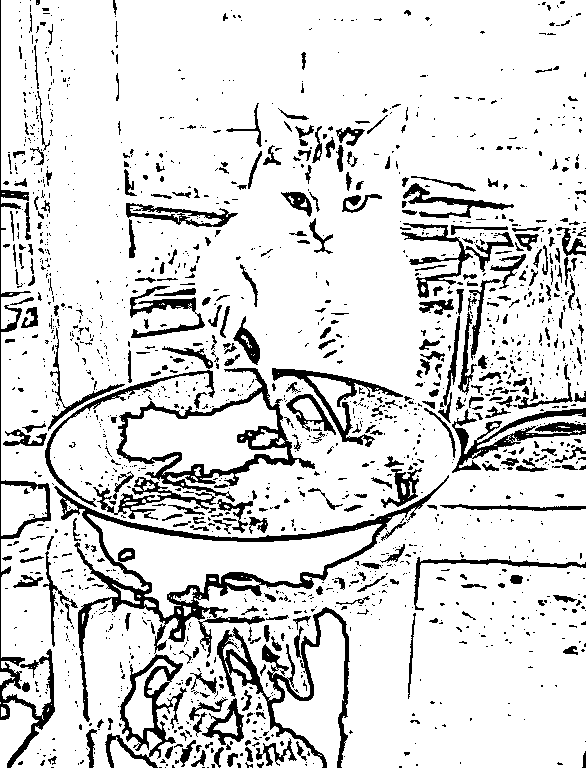
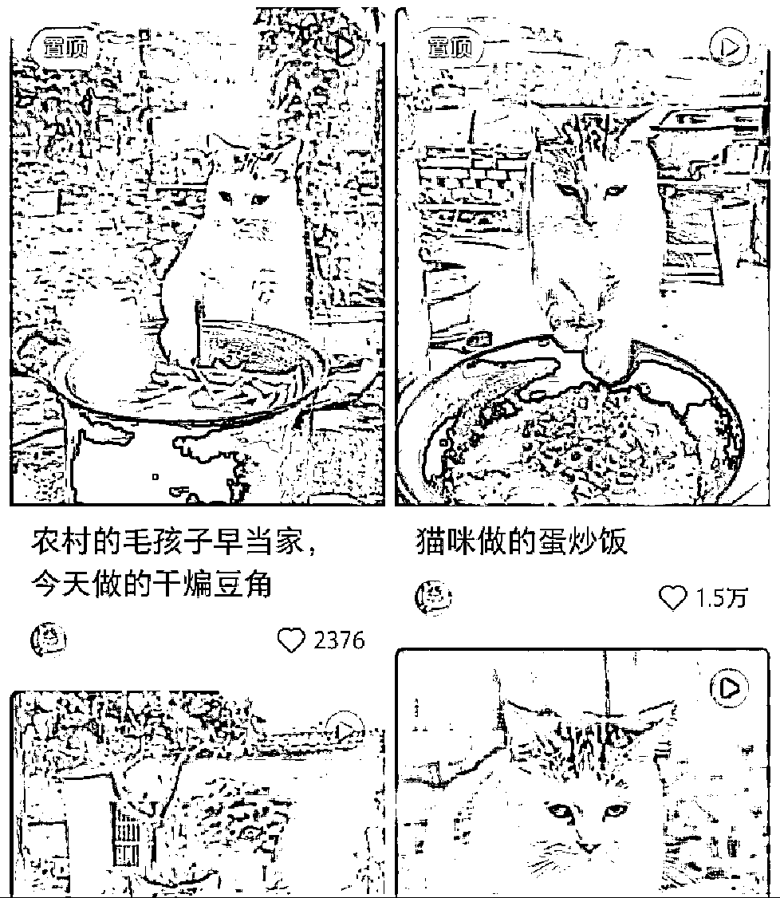
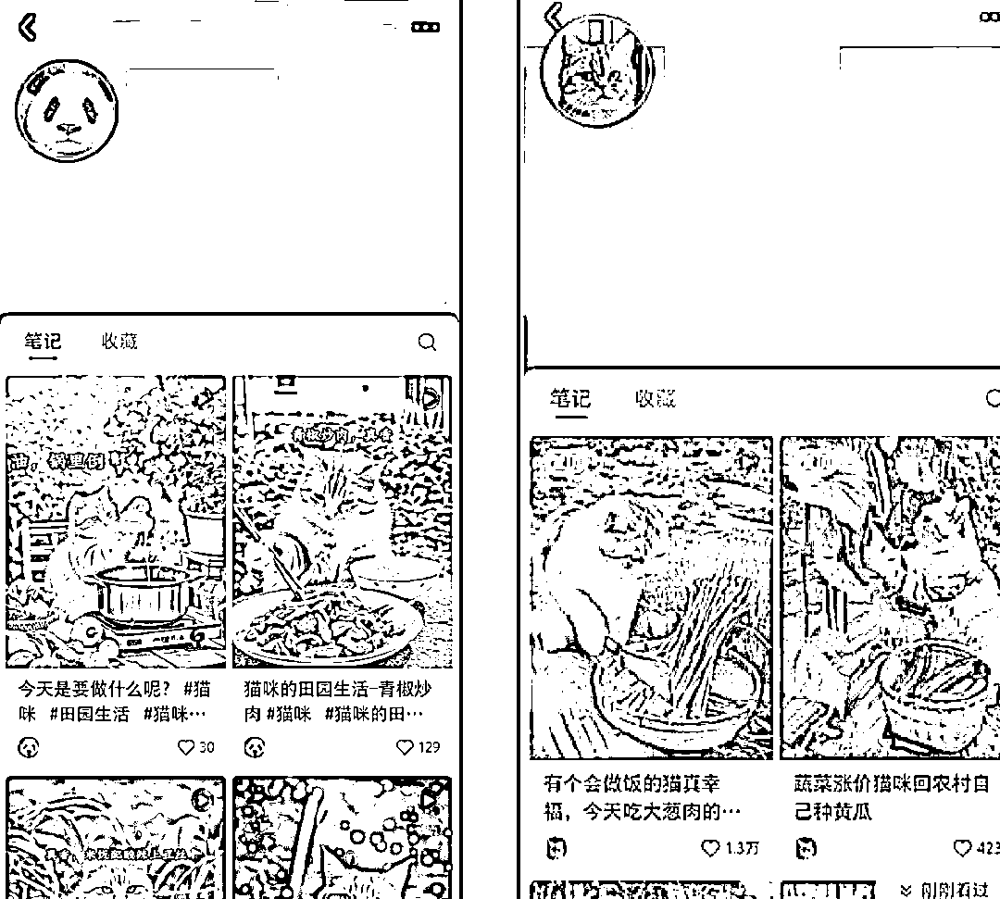
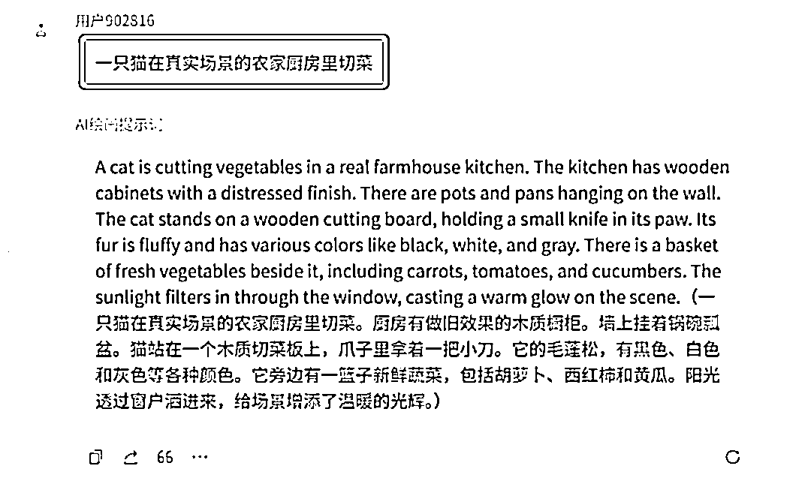
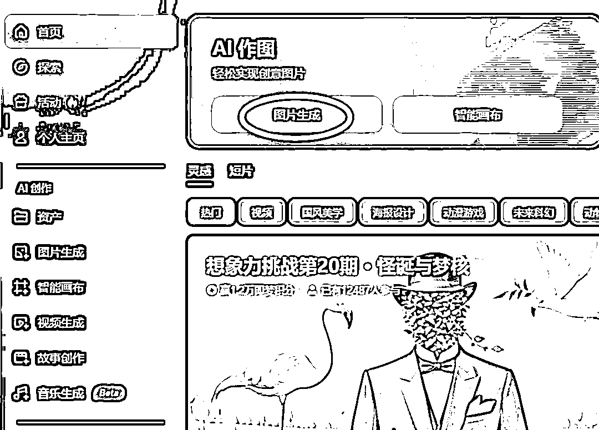
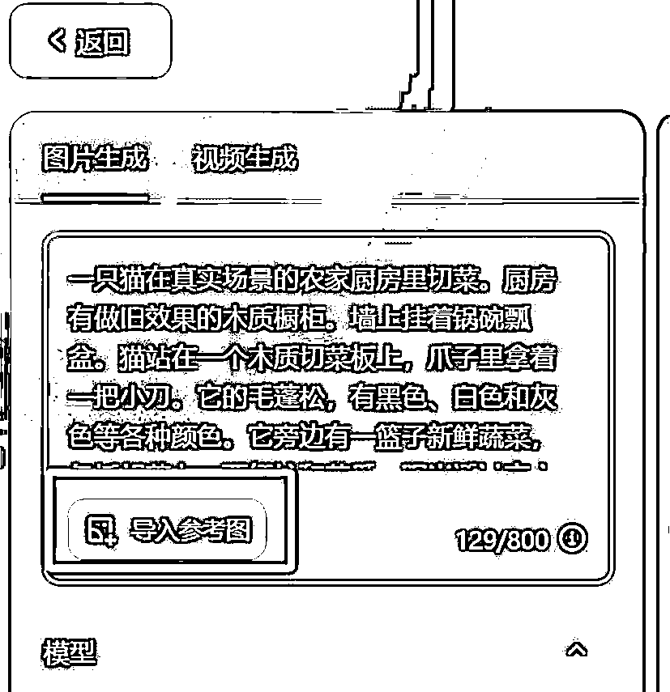
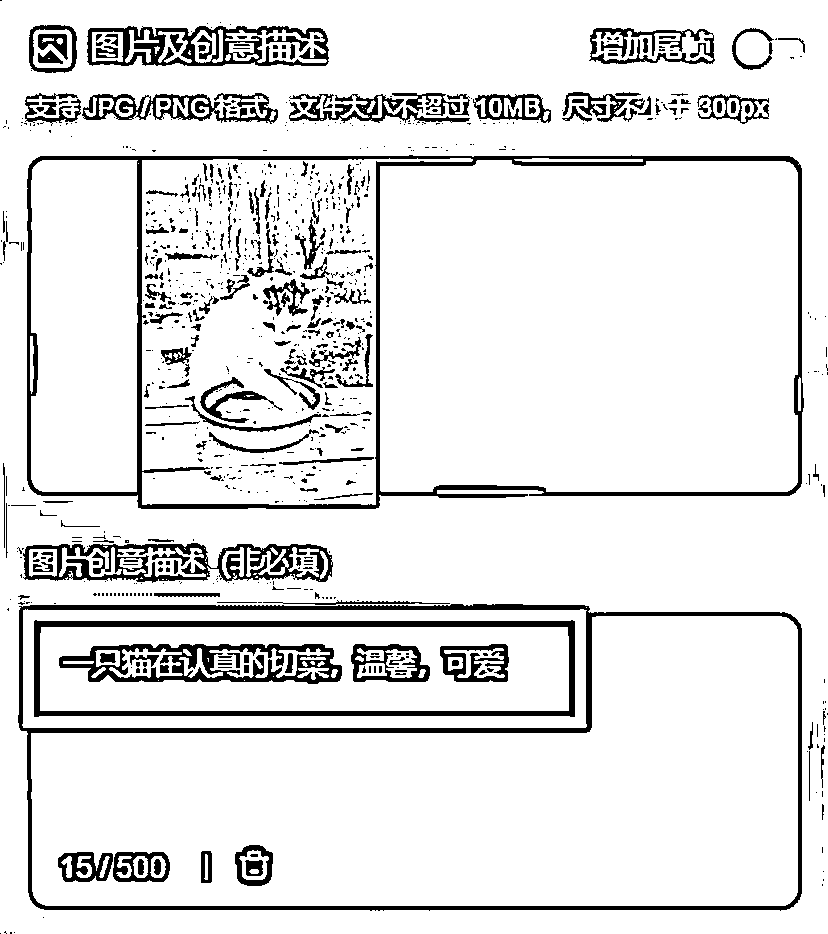
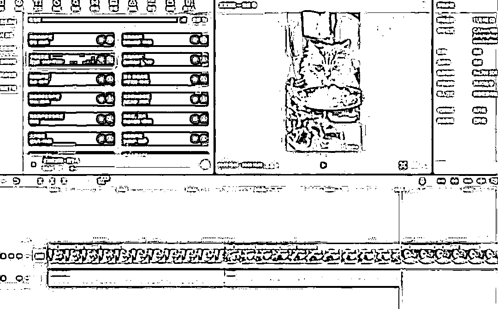

# 用 AI 让猫咪进厨房做饭，10 条视频直接吸粉 2 万，整个套路我给你拆开了

## AI 猫咪下厨做饭，几条作品就爆，变现方法也来了

作者：高鹏

日期：2024-11-08

大家好，我是龙哥。

今天继续跟大家聊一个正在起量的赛道。

最近在各平台上疯传的 AI 猫咪在乡下厨房做饭的短视频，播放和互动都非常夸张，单条能轻松破万赞。

内容其实很固定，账号里全是这类片段，只是换菜品、换做法在重复做。

这类号发十几条就能冲到两万粉，明显已经成了当下的流量密码。

更关键的是，这并非个例。我截的那几张图里，十几个新号都是靠同一个逻辑快速起来的。

目前能看到的变现方向主要有两条。

一条是接广告，作品里会穿插品牌植入信息；另一条是做带货，通过橱窗或挂车卖宠物周边用品。

想要复刻这种效果，整体流程可以拆成四步走。

第一步，规划分镜并写好提示词。因为猫咪做饭涉及多个动作，每个镜头都需要独立的提示词去生成。

第二步，用提示词做文字生图。

第三步，把静态图转成动态视频。

第四步，汇总剪辑成完整视频。

先说第一步，分镜提示词怎么来。核心是做动作拆解。

比如做一道青椒炒肉，我们可以先想好猫咪会做什么动作，大致包含这四段：猫咪在洗肉、猫咪去菜园摘青椒、猫咪切肉切菜、猫咪在锅里翻炒。

确定好场景后，用一段简短的描述喂给 AI 绘画提示词生成的智能体，它就能把简单的描述扩写成可以直接用的细节满分的提示词。

我只输入了“真实农家厨房里一只猫在切菜”，它就自动补全了厨房陈设、光线氛围、阳光质感等细节。

按照同样的方式，把每个分镜的场景都生成对应的提示词。

提示词有了，就进入第二步，分场景做文字生成图片。我用的是一个 AI 作图工具里的图片生成功能。

打开后把提示词粘进去，关键一步要上传参考图做垫图。这样才能保证整组画面风格统一，人物和猫咪的形象保持一致。

图片出来后，就该把它动起来了。用的是同一个套件里的 AI 转视频功能。

里面有文字直接生成视频和图片生成视频两个入口，我们需要的是图片生成视频。

把刚生成的图上传，底部再补一个简单的动作描述，比如“猫咪认真切菜，温馨可爱”，就能得到一段生动的动态片段。

这些片段都是零散的，最后统一导入剪辑软件，配上背景音乐，成片就完成了。

整体流程并不难，只是中间的细节处理是分水岭。很多新号就是靠这个打法，几天内就完成了冷启动，效率确实很高。

今天的拆解就到这里。我用到的 AI 提示词智能体、AI 绘画工具、AI 图转视频工具，都整理在同一份文档里了：

我是高鹏，网创圈深耕 9 年，这是本号第 687 个项目拆解，平时专注拆解可变现的玩法，也欢迎交流。

* * *

评论区：

狼牙 : 怎么联系，红包咨询操作细节[调皮]

叮咚姐 : 高老师，怎么联系你呢？

高鹏 : 可以联系鱼丸对接哈

高鹏 : 现在应该是只能联系鱼丸对接