# 用 AI 画素描讲育儿故事，一个号轻松破千万播放，我把完整流程拆给你

## 借助 AI 做素描画育儿视频，爆 1000 万播放量，附教程攻略

大家好，我是高鹏，今天再跟大家复盘一个现在正火的内容玩法。

近期有一类用 AI 制作的家庭教育、育儿主题短视频，播放数据非常炸裂。比如下面这个账号，多条作品稳定在千万级播放。

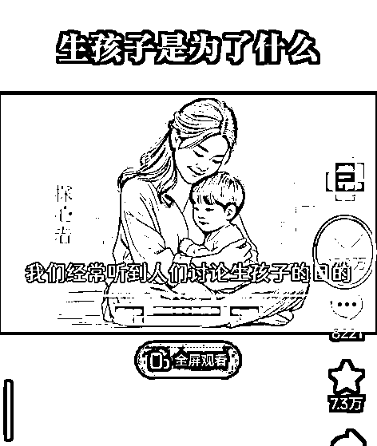

这两条也是千万播放的案例，发布账号一致。

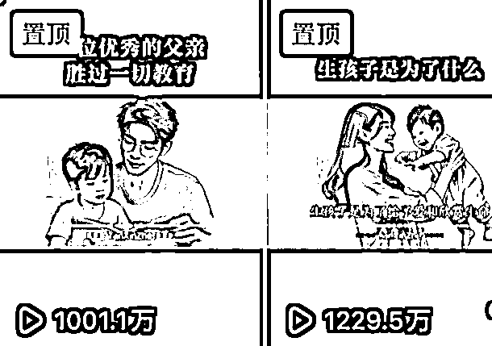

育儿赛道不仅流量大，商业化也非常顺滑。目前常见的变现路数主要有三条。

第一条是账号起量后直接做橱窗带货，挂上育儿书籍、早教玩具、亲子用品等相关商品。

第二条是把粉丝沉淀到私域，推出高客单价的育儿指导课、亲子沟通课程等。

第三条是吃平台的流量红利，参与创作者分成计划，通过播放量直接变现。育儿内容的搜索量和完播率都很高，是个很容易吃到分成的垂类。

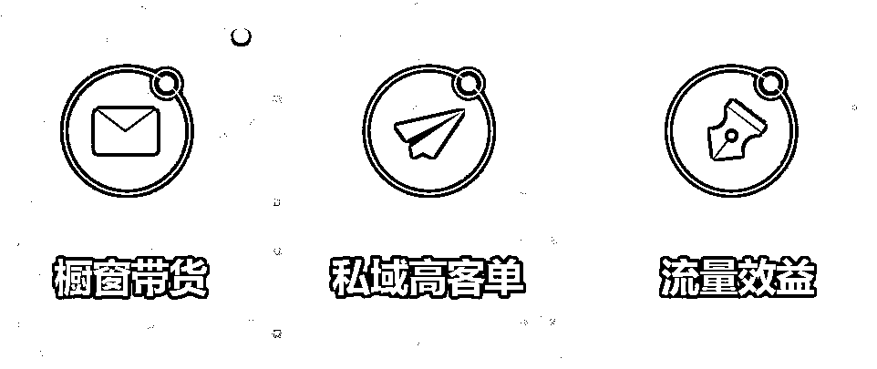

这种素描风格的育儿视频，制作逻辑其实很清晰，核心就三步。

第一步是拿到一篇能戳心的育儿文案。
第二步是用文案生成 AI 素描图。
第三步是配音剪辑成片。

文案这块千万别自己硬写。育儿内容能不能爆，关键看文案是否够走心、能否引发共鸣和情绪裂变。所以文案要精挑细选。

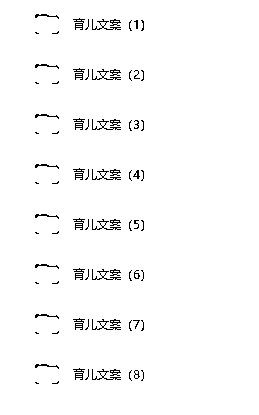

确定文案后，就要把它变成画面。最终呈现其实就是一幅幅素描图的轮播，画面和文案的场景要高度契合。

图片生成的实操分几层。先要把文案里的故事拆解并扩写成具体的分镜情节，这里我用的是 AI 聊天智能体。

下面看到的第一个红框就是原始文案，把它丢给智能体后，它会自动把情节补全、丰富。

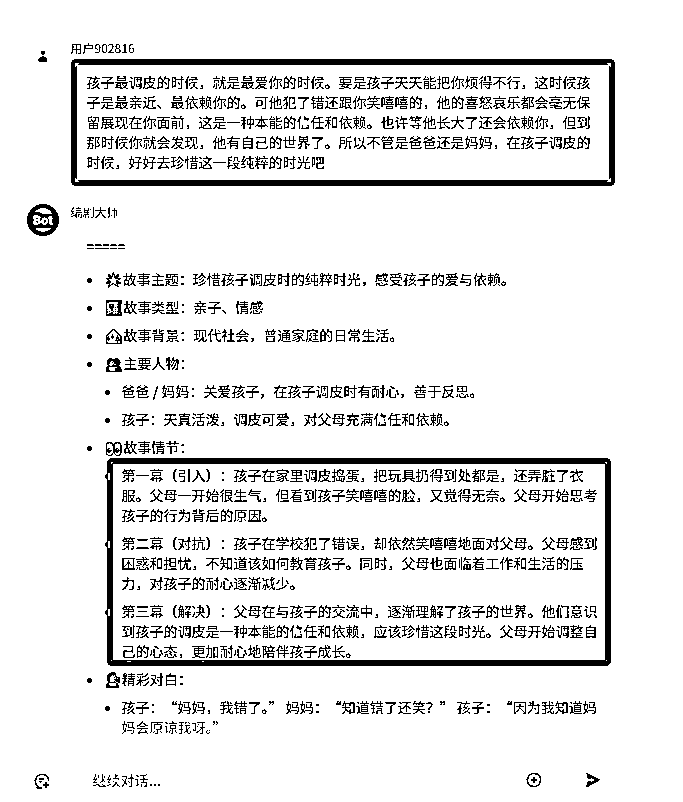

情节补全后，会得到一系列细化的微场景。需要你从中挑选出需要呈现的关键画面。

举个例子，第一幕可以是孩子在家搞破坏，玩具撒满地，衣服弄脏了。这个就是一个固定的画面点。

但这个描述直接给绘画模型用是太粗糙的，还需要把它升级成专业的绘画提示词。

因此还需要第二层智能体来做。下图第一个红框是提取出来的微场景，喂给智能体后，它会把它扩充成一段饱满、专业的描述，正是下大框里那一大段内容。

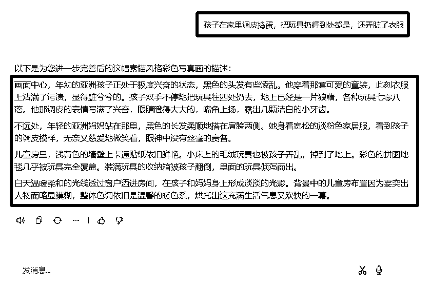

这段描述就可以直接拿去给 AI 绘画工具使用了。这里我用的即梦的 AI 绘图功能。

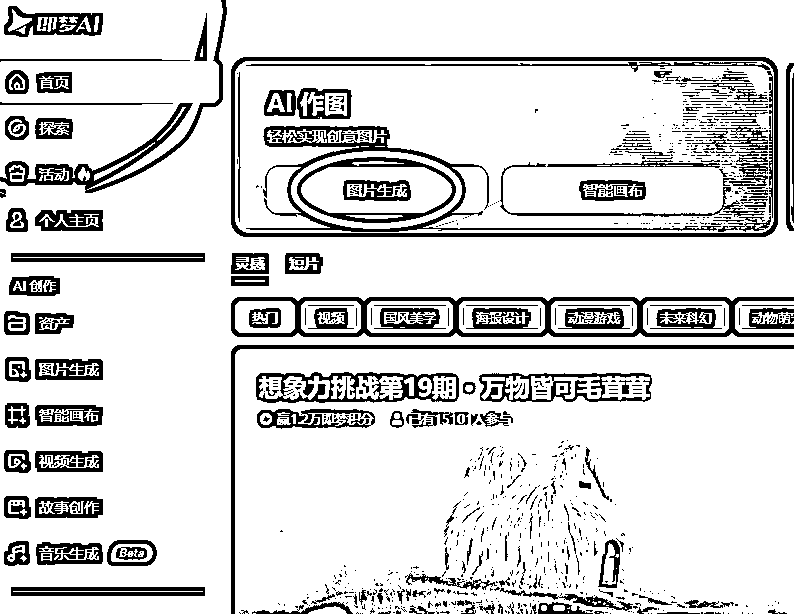

把刚才整理的描述词粘贴进去后，最关键的一步是导入参考图。

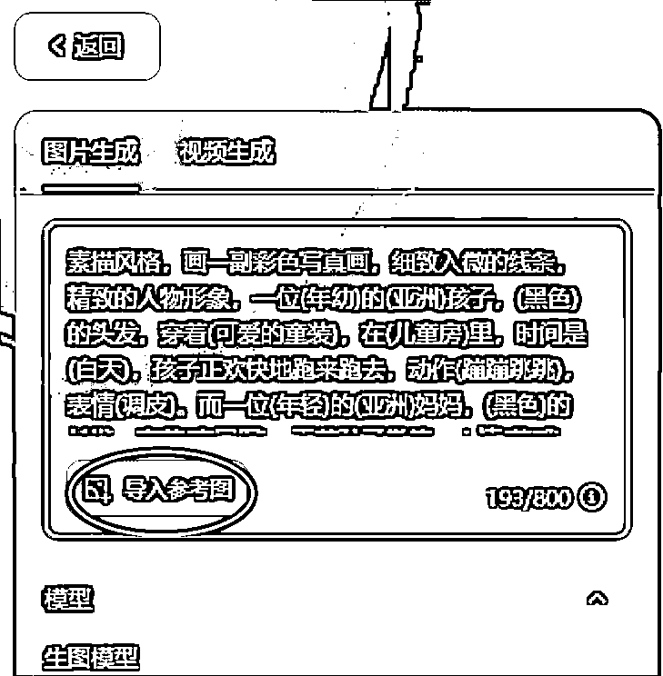

参考图导入后，要重点勾选“风格参考”，而不是内容参考，然后保存。

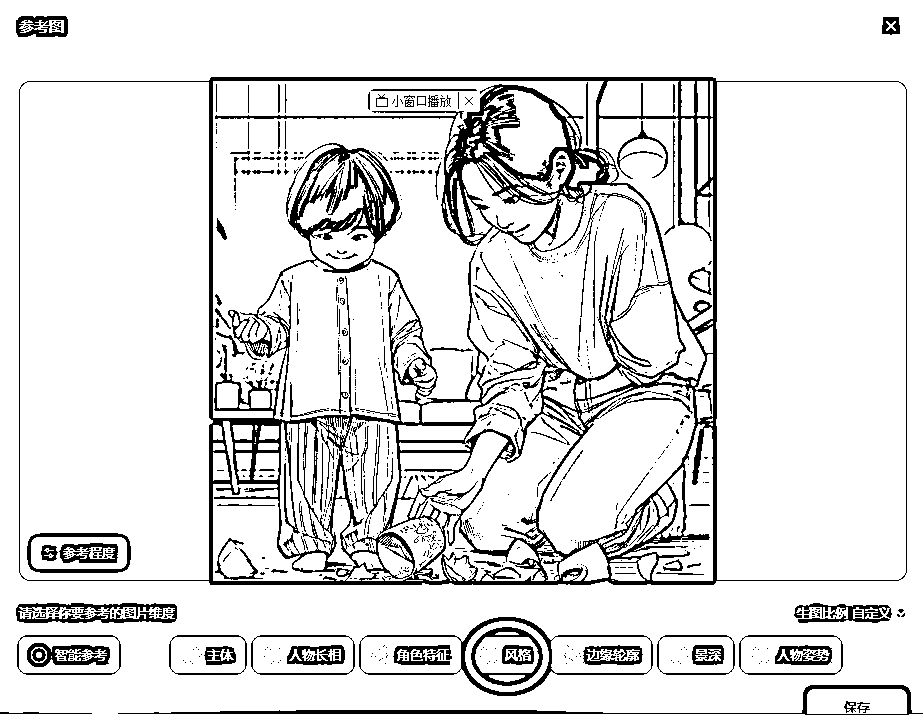

这样模型就能按统一的素描风格出图。把文案里其他场景都按同样流程逐个生成，素材就齐了。

接下来就是第三步，配音和剪辑。

配音很简单，用现在市面上的配音工具就能搞定。

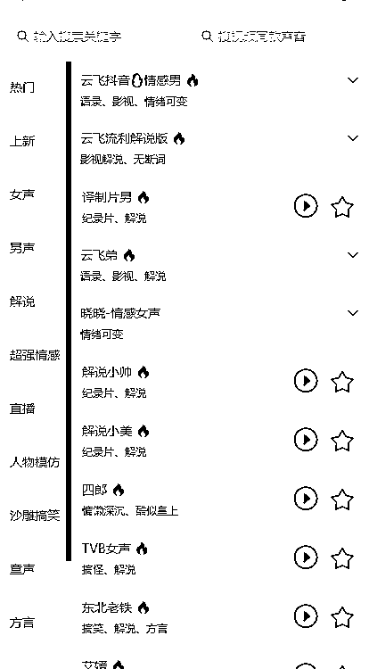

风格上建议选“超强情感”类的主播音色，读出来更有情绪、有代入感。将文案完整配音后，再把音轨和之前生成的图片一起导入剪辑软件，调一下每张图的停留时长，加上转场和背景音乐，一条视频就成型了。

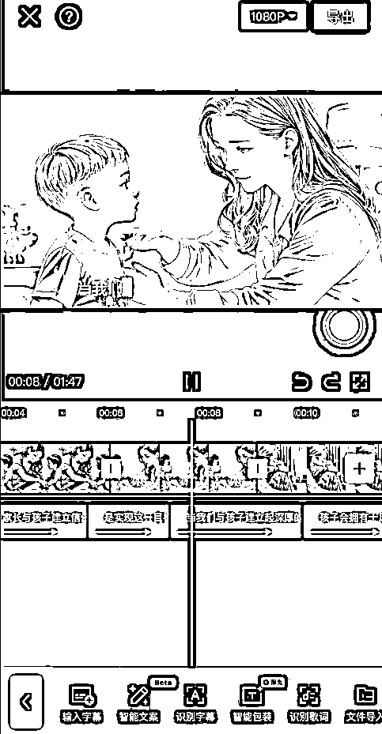

今天的拆解就到这儿。文案合集、绘画提示词智能体、参考图这些资源，我在之前的笔记里都放过，有需要可以去翻看。

我是高鹏，深耕网络创业 9 年，这是我拆解的第 685 个项目玩法，平时专注拆解变现模式，也欢迎大家交流。