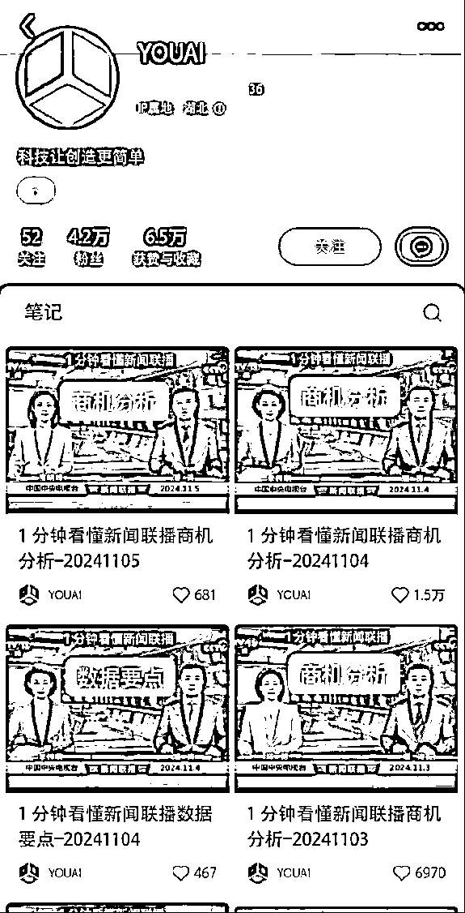
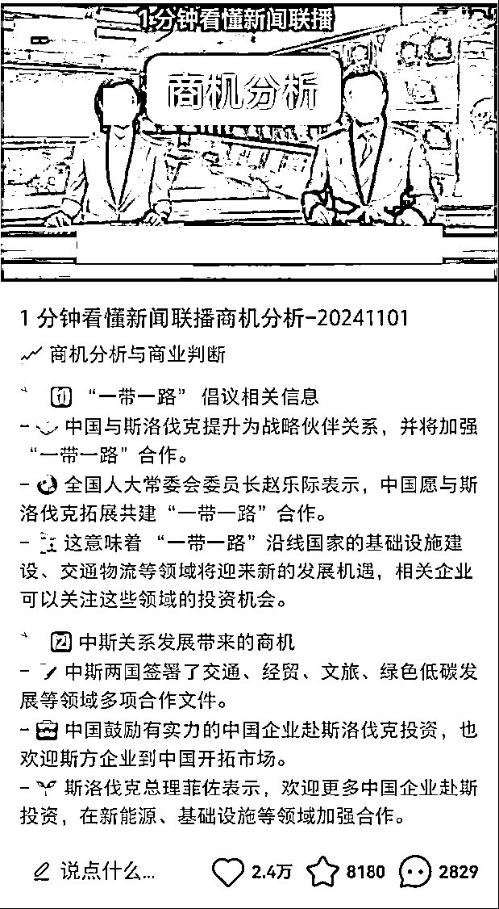
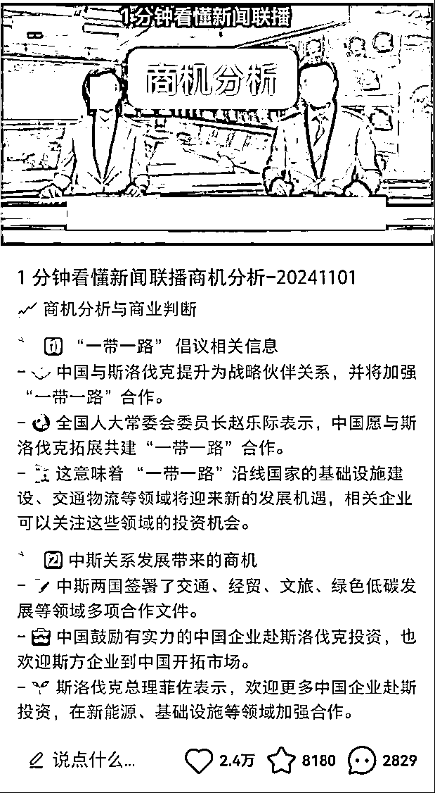
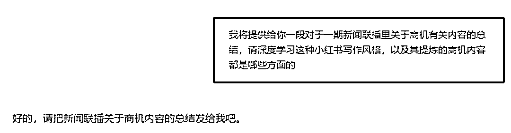
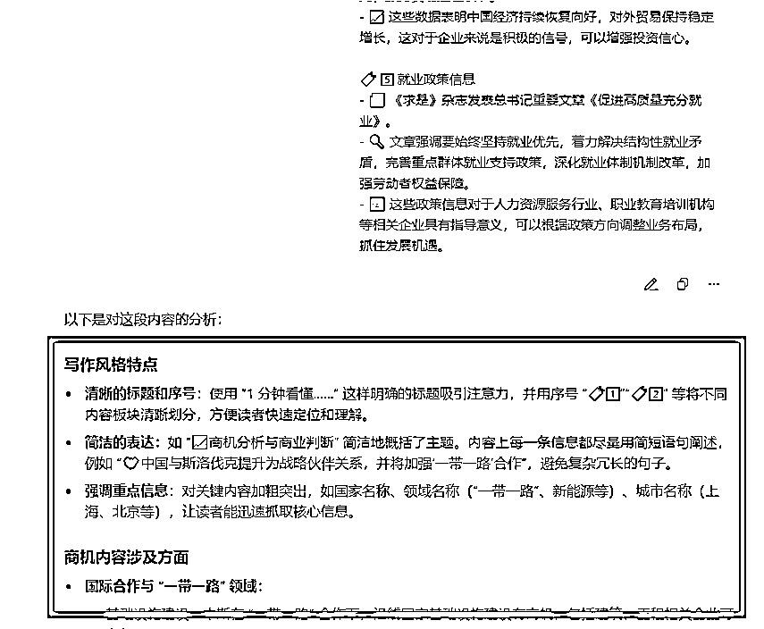
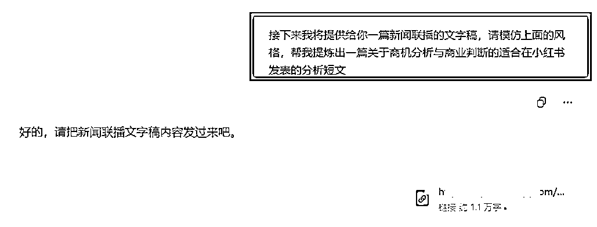
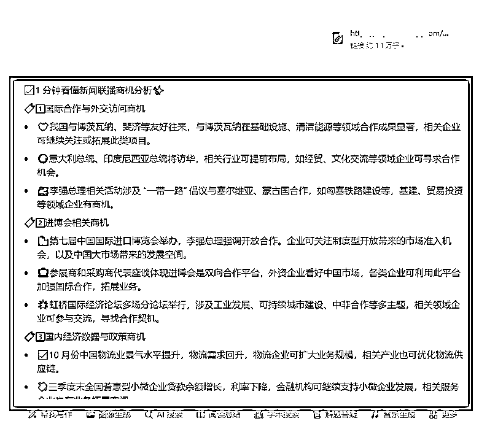
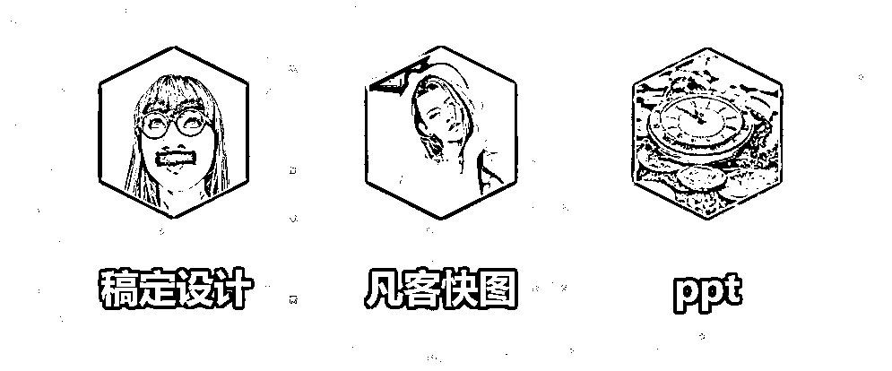

# 9 天 4 万粉！📕用 AI 拆解新闻联播起号，完整实操拆解来了
作者：龙哥

## 新号 9 天暴涨 4 万粉，📕 AI 新闻解读快速起号玩法，附教程攻略

作者： 高鹏

日期：2024-11-07

各位朋友，我是龙哥。

今天给到大家一个正在爆的冷门起号模型。

把每天的新闻联播拿去做 AI 商业解读，直接发在📕上，吸粉速度惊人。下方这个账号是注册才 9 天的新号，发了十几篇笔记就已经涨到 4 万多粉。

在📕上能这么快起来的号不多见，最关键的是人家全程 AI 自动化在跑，内容统一做成《一分钟看懂新闻联播》。

作品的呈现方式很固定，封面雷同，基本是一张配图加下方商业总结的文字。这种图文笔记里，有一条点赞冲到 2.4 万，播放和互动都非常夸张。

等号做起来后怎么变现？我帮你梳理了 4 条路子。

第一条是把公域流量导入私域，做商机人脉类社群，里面持续投放资源对接和合作机会。

第二条是做趋势判断类付费群，提供行业前瞻和机会点分析。

第三条是挂带商业类书籍，笔记天然自带知识属性，转化很顺。

第四条是做赛道探路。📕有个机制，账号一旦起量，后续即使换赛道发内容依然容易有推荐。所以先用新闻解读把账号权重打上来，再承接目标垂类内容，性价比极高。

下面讲具体怎么复刻这个 AI 新闻解读号。

核心形式就是一张头图 + 下方商业判断的提炼总结。

头图的制作非常简单，截新闻联播的画面叠两行标题就能用。

最难的点在于如何把新闻联播里跟商业相关的部分，用 AI 快速提炼成适合📕的干货。这是整个玩法的技术核心。

第一步是 AI 投喂训练。先给 AI 一段引导语：我将提供一些关于新闻联播中商机内容的总结，请你深度学习这种📕的表达方式，并且总结这类商机内容主要覆盖哪些方向。

AI 会回复让你把样本文本发过去。

这时把对标账号的实操笔记直接丢进去，让它学习排版符号、用词风格和商机点提炼逻辑。

第二步是正式指令投喂。接着在同一个对话里输入：接下来我会给你一篇新闻联播的文字稿，请你模仿刚才学习的风格，帮我输出一篇关于商机分析与商业判断的📕短文。

模型就会给出高度接近对标笔记的内容，干货密度高，符号格式、排版样式基本都对齐了，稍微润色一下就能直接发布。

那新闻联播的文字稿从哪里来？不用自己扒。网上已有大量站点整理好了每天新闻联播的视频配文字稿，直接复制链接给 AI 喂就行。具体的稿源链接我放在文末文档里。

最后是封面图，做法很直观：截一张联播画面，加两行大字。稿定设计、凡客快图、甚至 PPT 都能一分钟搞定。

很多工具都可以搞定，比如说网页版的稿定设计，凡客快图，包括用 PPT 都可以。

今天的分享就到这里了。

我是高鹏，专注网创 9 年，这是我拆解的第 686 个项目。平时爱拆解变现模型，也爱交朋友，有问题评论区聊。

* * *

评论区：

东兴 : 你好 有张图片不显示呢

更绪 : 牛逼

傻傻的 : 你好，我按你的提示词操作，豆包分析新闻联播新闻稿的时候说他无法回答，请问您有遇到这个问题吗？这个得怎么解决呢

黄篁(huáng) : 太牛了

元启 : 怎么链接下

龙哥 : 这种涉政 容易死号 别碰