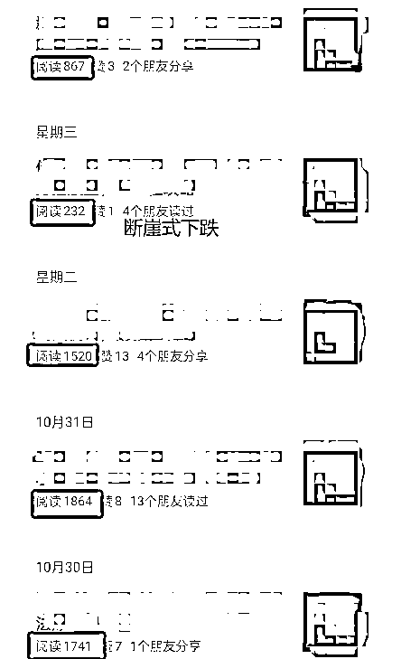
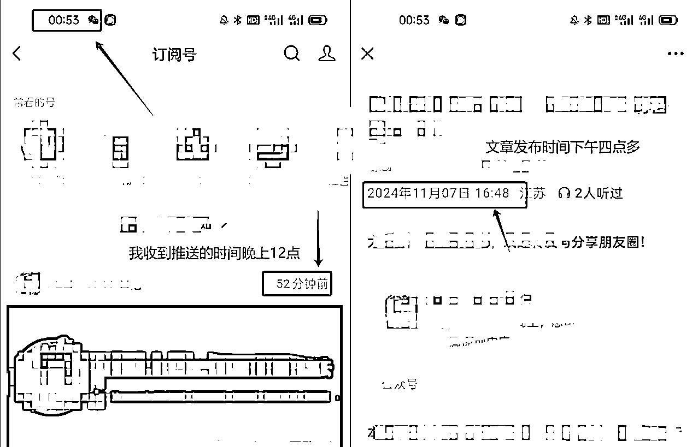
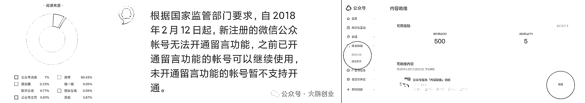
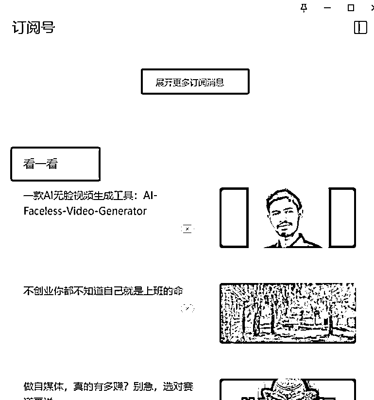

# ('公众号流量断崖式下跌，怕不是也出“铁粉机制”了！', (2, 26))

公号曝光骤降，莫非在偷学抖音式粉丝分层？

大鹏在这里跟各位聊个最近圈内都在传的现象。

本人运营的公号，关注数差不多四万五千上下。早先每次发完稿子，打开量轻轻松松破千，作品稍微有点意思，冲到三千也不稀奇。就算偶尔表现差一些，波动也不至于太离谱。

但最近这段时间，明显感觉到异常。稿件发出去，过不了多久就停在二百上下，偶尔一百出头就停滞。

起初我还琢磨是否账号违规被系统盯上了，翻遍后台也没看到任何惩罚提示。后来串门看了不少同行的近况，发现大家都差不多，哪怕是粉丝量达到数十万的大号，最新一篇的打开数也只有五百上下，跟账号体量完全不成比例。

到这儿我基本确认，这不是个人运气的问题，是站方在整体调整推荐的方向。

具体细节如何，外人难以获知。毕竟推荐规则算是站方的核心机密，不对外公开。但凭着多年混迹互联网的直觉，我摸出了一些头绪。

**✅ 公号似乎开始按“忠实读者”分层推送**

昨晚近十二点，我刷手机看到一条推送通知，来源是一个公号作者。点进去才发现，对方是下午五点左右发的文章。换句话说，稿子没像过去那样发出后立即到达所有订户，而是有明显的间隔。

看到这里，我马上联想到了一个在短视频圈很出名的运行方式——粉丝分层推荐。

这个玩法，做过短视频的人想必都不陌生。发布新作品后，系统会优先展示给互动频繁、经常驻留的忠实观众。这批人的数据反馈好，才把作品扩散到更大的池子；如果这批人反响平庸，作品通常就此打住。

公号会不会也在悄悄模仿这一套？当作者更新后，系统不急着全员推送，而是先让习惯性阅读的忠实订户看到；然后依据这批人的读完比例、点赞评论等互动指标，来决定是否继续向外圈分发。

这样也就能解释，我为什么迟了数小时才看到那位作者的更新提醒。

当然了，以上全是我个人的推测和推演，算不上定论，各位只当听个段子就好。

回顾这两年的变化，其实这种转向早有端倪。

2023年年中，公号开放了推荐流量，迈出了从封闭订阅走向公共分发的一步。那时候起，站方就在不断调整分发的逻辑。

今年年初，沉寂已久的评论功能重新上线，明显是想增强读者与作者的互动。

到了今年7月，粉丝量不足一万的小账号开始灰度测试一项面向新作者的扶持工具，用来鼓励更多新人加入创作。

这几步操作，本质上是在原有的订阅体系之上加装一些新模块，对存量老号的冲击不算大。老账号发东西，照样能触达全部关注者，基础打开率还有保障。

但进入今年后程，动作变得越发激进。机构号被折叠，关注列表里的消息也开始大规模收缩，取而代之的是大片推荐信息流。

这意味着，即使作者更新了，如果订户长期不点开他的文章，系统不再像过往那样把新消息显眼地摆在页面上。它可能被压进折叠区，甚至悄然消失，读者要主动翻找才能看到。

用户的精力总额有限，你的更新若是没能进入他的视野，他自然会划到推荐流里去刷别人的作品。这相当于把原本属于你的曝光拨给了其他作者，老牌大号坐享高触达的美好时代由此松动，新人反而拥有了更多冒头机会。

这样一路演化下来，公号的分发机制已经从私密订阅转向半公共，再到眼下的近乎全公共。

所有公共分发体系，要持续运转，起决定作用的还是作品质量。没有足够好的作品，用户就会离开，平台也活不下去。公号显然明白这个道理，所以才会逐步引入类似分层推荐的策略。

那些靠耸动标题、机器拼贴刷点击率的做法，在这种规则下几乎寸步难行。空有点击量，很难留住用户，没有读完率和互动数据，系统照样不再扩散。

真正扎实、有见地的作品，才能不断得到曝光，让更多素不相识的人看见。你的历史粉丝体量再大，如果新作质量跟不上，系统同样不会追加推荐。除非读者主动进入你的主页，否则对你发没发新作毫无感知。

放在过去，攒到几万关注者，只要稳定产出，就能收获一批读完率很高的忠实读者——这是站方给垂直领域老作者的生存红利。

而现在，存量账号的曝光被一点一点稀释，流向新面孔，整个分发规则完全变样。

对刚开始做号的人，这是出头的好时机；对拥有大量历史粉丝的作者，则是一场严峻考验。

我的应对思路大致如此：

如果主营业务放在私域，建议尽快把核心读者迁移到个人通讯工具里，比如直接加联系方式。私域的关键在于能否准确触达；如果人留在公号里，系统不给你展示机会，关注者再多，缺乏触达也等于零。转移到个人联系方式后，至少你的社交动态能稳定出现在对方眼前。

另一方面，作为公号作者，唯一长久的路就是持续产出对读者真正有用的、有见地的作品，这也是站方最愿意扶持的方向。

别再拿灌水稿敷衍了，水来水去，只会彻底丢掉读者。