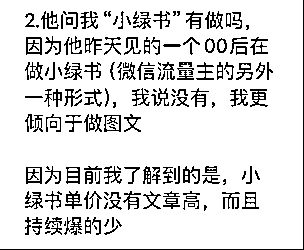
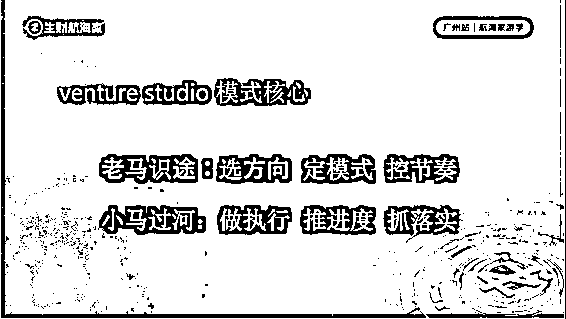
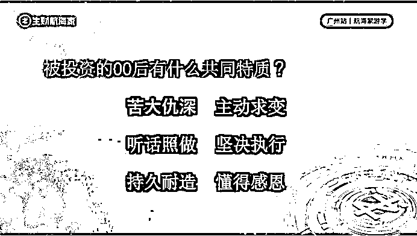
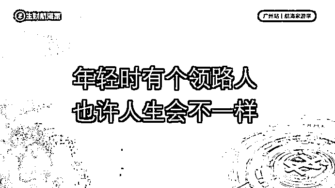

# 从赚钱到生才——我的创投手记开篇

## 从下场操盘到当制片人

作者：张昭
日期：2024-11-06

# 一、我是谁

我是一个摸爬滚打二十年的创业人。

辉煌过，把黄焖鸡米饭做成国民单品，单品多品牌矩阵门店数量冲破一万家，是国内少数真正操盘过万店连锁的实践者；也跌倒过，被合伙人捅一刀，个人损失过亿；价值观也经历过剧烈震荡，怀疑过是不是只有变坏才有钱；最终从谷底爬出来，从零起步做到了百亿级产业基金的创始人。

2018年之前，我最爱“连续创业者”这个标签。自己下场、亲自掌控，看着进度条一环扣一环，里程碑一个个被点亮，那种掌控感很上头。

现在我更喜欢“创业制片人”。这个角色让我能同时横跨十几个赛道，和各行各业的顶尖创业者碰撞。既能保持创业的刺激，又能把二十年一线实战经验持续输出，还能被年轻人的新想法反向激活。双向的不确定性，反而更燃。

# 二、为什么要写这一系列

创业制片人本是硅谷这几年流行的新玩法。投资人不只掏钱，而是像电影制片人一样深度介入项目从0到1的诞生与运营。实践证明，这种方式能放大创业者的能量，并显著提升成活率。

我从2018年起在全国各平台与创业者磨合，到了龙哥盟才把这种模式做成了本土化的落地样本。

创业者的终局大致分四种：上瘾型连续创业；失败后不认输要翻盘；失败后彻底退出；创而优则投。我属于第四种。

经历过高强度创业和聚光灯后，身体的阈值被拉高了。俞敏洪、王健林这类人不会有退休的概念，江湖传言依然在。

我算不上家喻户晓的成功者，但从赤脚起步走到现在，也有自己的积淀。2018年决定从创业者转投，2022年接触到制片人模式并开始实操，2024年10月完成了慧基创投第一个完整的制片人案例，被投对象就来自龙哥盟。所以把这份手记的首篇献给赚钱。

# 三、与赚钱的关系：从观望到深度依赖

“一千个读者一千个哈姆雷特”，赚钱也一样。

圈友加入的动机千差万别，有找项目的，有补信息差的，有来找人脉的。赚钱因此欣欣向荣。对我而言，意义在两个阶段后发生了转变。

起初我是带着资深创业者和初级投资人的滤镜看待平台的。

用创业者视角看，上面大部分商机偏短平快，壁垒薄、生命周期短，很难长成稳健的生意。

用投资人视角看，大多数圈友商业认知有限，靠热情在暗网里乱撞；项目多半不具备资本市场价值，天花板低。

所以我当时参与度极低。

转折来自我的合伙人。她没有硬灌输，而是持续分享她觉得有价值的点子，用赚钱日历慢慢影响我。后来一次偶然，我找到了打开赚钱的新姿势。

创业始终围绕三件事：找人、找钱、找方向。

赚钱聚集了大量充满战斗欲的“生粉”，他们有想法、有冲劲、有行动力，缺的是方向校准、商业认知和资源赋能。配上一个靠谱的领路人，后爆发的化学反应非常强。

换个角度看，赚钱就像一个巨大的造血池。付费机制自动筛掉了没有冒险精神和不愿投资自己的人。圈友大多可塑性强，更容易沿着航线图重塑规划，更容易接受商业伦理的灌输，更容易被阶段性小目标驱动。

简单说，**赚钱是一个优质的商业育苗基地，筛选好基因，再用袁隆平式的精细培育，价值会呈倍数释放。**

# 四、首个项目的实战结果

想法一转，天就开。误打误撞开启了赚钱创投的第一个项目。

耗时20个月，从2023年3月到2024年10月，我以创业制片人身份全程在场赋能。尊重被投主体的主观能动性和执行力，同时在战略、节奏、方向上及时纠偏。

最终达成：应届生一年实现双百万。

项目已进入下一阶段。被投的00后双非小女生，从大四时兼职月入2000+的迷茫状态，蜕变为佳文玉成AI写作项目负责人、慧基创投AIGC项目投资经理。下一步她将主攻AI自媒体，并以自身为样本挖掘和投资圈内的潜力圈友。

# 五、安七变形记

# 缘起

2023年3月，安七和男友凳子在人生低谷，去广东丰顺散心。她突发奇想想开黄焖鸡米饭店。因为她爱吃鸡。

很多创业就是这样，先喜欢后算账。正确的顺序是：先算能不能赚钱，能赚钱再慢慢爱上它。有了资本再去做又爱又赚的事。**创业第一性是赚钱，喜好往后排。**

低谷有时是好事。他们通过赚钱找到我，彻底换了跑道。

后来她说已联系了济南几家公司准备考察，但不放心，在赚钱搜了黄焖鸡相关内容，恰好看到我的精华帖，于是联系我。

**赚钱的第一用途是避坑省钱，其次才是赚钱。省钱见效快，赚钱需要投入和概率。**

我听完直接判断：不适合做黄焖鸡，不要轻易试，否则高概率赔光。我觉得她这人不错，敢求助。在中国，懂得求助的人很少，很多人怕麻烦别人，反而走弯路。**过来人一句话，能省大量时间成本和失败后的自信损耗。**

我建议他们来广州面聊，或许能给方向。执行力还行，很快买票过来。我当时也有疑虑：如果在东北那么远，还会不会来？出行成本会不会让他们放弃？不得而知。

也再次印证机会常有伪装，需要判断。**下行风险小、上行空间大就冲；下行风险大、上行收益小就别碰。**

# 波折

安七和凳子不懂人情世故，第一次见面就暴露了。没毕业，社会规则不熟。迟到还找借口撒谎。这种小聪明让我很反感。我当时跟合伙人说这两人人品存疑，不想浪费时间。但合伙人劝我给机会。

**走在正确路上，你不知道哪个变量会改变命运。所以确保方向对，剩下的交给命运，坚持的人会收到盲盒。**

# 面谈

第二次见面聊了三个小时。安七是双非本科马哲专业大四，不考研不从教，之前给博主当小助理月入2000+。当时很迷茫，出路只有考研教书或当牛马，都不喜欢，原计划开黄焖鸡或继续搬砖。

深挖后发现她的优势在文字。我建议她可以在文字赛道试试，看能否跑出结果。

**我对每个被投对象的打法都是先深挖优势再重构商业模式。** 有时方向是他们没听过的，但把原有能力迁移到正确赛道，会更顺手、更快拿到正反馈，形成飞轮。

# 抉择

沟通后方向比较清晰，但她从未创业，对牛马惯了，恐惧很正常。为了检验战斗意志，我提了四个条件：

1. 必须搬到广州，近距离辅导；
2. 必须注册公司，不能做个体户草台班子；
3. 必须交费，没有免费；
4. 必须听话照做，按规划节奏走。

目的是增加沉没成本，让他们更难轻易放弃。他们答应了，立刻开始准备来广州的事，执行力超过很多人。

# 前期准备

合适的人比好项目重要。人对了方向可以调，人错了项目再好也白搭。

我每次沟通都在找闪光点。多年训练下来识人准确率很高，00后半小时内判断，90-80后一小时内，资历更深的也不超两小时。

方向上，基于她有文字底子和社群运营经验，第一个创业方向定为公众号爆文。模式很简单：用优质内容获取流量主收益。两种分润：自己写或提供账号供稿，学员排版上传后分成。

模式不难，难的是为零基础新人设计一个零前期投入、收益可增长、不超能力边界的业务。要能1-3个月内拿到正反馈，建立创业自信。

**创业是内耗战，心力像筛子在漏。靠不断胜利沉淀内核，让恢复速度大于消耗速度，心力账户才为正。**

**创业不是谁先投降，而是谁先失去战斗意志。**

# 项目启动

启动分有钱打法和没钱打法。关键不是钱多钱少，而是根据资金情况选择最合适的启动方式。

白手起家的人懂得没钱办事的能力，有钱时能力指数放大。安七的启动极其粗暴：在朋友圈发招募海报，用之前写的、数据还不错的公众号文章和收益截图做背书，慢慢滚动起来。

**别忽略任何过往积累，它可能是破局点。** 安七之前写的文章若只是求职，只能换2000+月薪；作为能力证明，就是百万级价值。价值不是没有，是需要被识别和放大。

# 挑战初现

小白最大的坎是定价。

安七起初很胆怯，怕定高没人买。她自己才2000+/月，收几百上千不自信。反复沟通后总结：

1. **坚决不免费，哪怕一块钱也要收。** 免费用户和付费用户是两个物种。免费用户习惯索取，交易不对等。付费用户认一分钱一分货，更值得服务。

2. **价格不取决于产品成本，而取决于供需。** 供给不足需求旺盛时，即使有瑕疵也能卖高价；供给过剩时，再好产品也难溢价。

你有没有想过，一个产品定价之后，就永远不变了？太天真了。

价格这个东西，天生就是动态的。品牌声量在变，用户的体感在变，后端履约的投入在变，价格怎么可能纹丝不动地钉在那里？

如果一个产品，多年如一日地守着同一个价格，通常只有三种结局：

第一种，你做到了行业头部，靠着极致的成本控制，把利润一点点抠出来，价格不涨，用户还觉得你良心，大家双赢，皆大欢喜。

第二种，你的盘子一直做不大，对上下游的成本结构没有话语权，价格就被焊死了。这时候用户的体验是：花钱买你的东西，既没有品牌光环加持，也没有情绪价值回馈，凭什么？他们不满意，你也没辙。

第三种，也是最微妙的——成本全线在涨，你却硬挺着不涨价。用户会怎么想？他们会怀疑你偷偷换料了，或者服务缩水了，否则你怎么扛得住？就算你没变，用户也会觉得这个品牌没什么进取心，不值得长期跟随，然后转身走人。

所以，涨价这件事，很多时候根本不是因为成本撑不住了，而是涨价本身就是一种策略性动作，是一种销售手段。

当然，价格也不可能永无止境地涨上去。每个产品在用户心里都有一杆秤，秤砣到顶了，你再往上加码，用户就直接弃了。定价的底层逻辑就是：早期看供求，后期看心智。任何时候，定价都不只是看用户钱包有多厚。

就拿我们自己操盘的公众号爆文项目来说，从最初定价 499 元，一路涨到 1999 元。从头到尾，既没有做过一次免费，也没有打过一次折。

项目能走到今天，踩过的坑远比收获的成绩更值得说。

后面合作的深入，带来的挑战越来越多，暴露出来的问题也越来越多。就拿我们正在推进的小绿书项目来复盘。

9 月 25 日，赚钱负责投资孵化的许老师去广州，和我们投资孵化的几个 00 后小伙伴做了一次交流，期间聊到了小绿书项目。

当时安七的重心一直在公众号爆文项目上，流量主收益相当稳定，而且那时候小绿书还没真正发力，带货收益明显跑不过流量主收益，所以她没太当回事，只是在跟我沟通时顺嘴提了一嘴，也没深究小绿书到底是什么，直接就下了个“不怎么样”的结论。

但我看到这个信息之后，第一反应就是：微信要有大动作了。

第二天我就安排安七开始测试小绿书的玩法。

第三天，第一笔订单就出来了。这个反馈速度让所有人都没想到，我立刻让全团队跟上节奏。

为了让大家足够重视这个项目，我史无前例地开始强行推进。国庆期间，我保持每天至少四通电话，反复强调这个机会的分量。原因很简单：微信生态太稳定了，张小龙太克制了，这么多年才出现这么大的机会窗口，错过这一次，大概率不会再有了。

因为是全新项目，谁都没碰过，人对未知天然有恐惧感。我能做的，就是不停地给大家鼓劲、打鸡血，反复强调它的重要性，然后安排大家放手去试错。

项目一开始，最难的是让团队对“这个项目足够重要”达成共识。安七起初甚至没意识到，这可能是她打开流量缺口的最好机会。从最早写小绿书只有几千阅读，到 10 月 23 日一篇文章被微信官方强推，不到四天破了 10w+，到今天还在继续涨。正是靠着团队在公众号爆文和电商领域前期的积累，我们精准接住了这波流量。截止目前，用时一个月，私域新增 4000+，小绿书出单 1500+，第一阶段的目标已经顺利完成。

整个过程中，团队从“无意识”到“慢慢认可”，再到“全身心投入”，中间反复出现各种问题——对方向的怀疑、执行不彻底、内心摇摆、对自己不够狠……说实话，我一度也很头大。

因为机会不等人，我破天荒地要求整个团队不放假、减少休息、强行爆肝超车。从一开始就强力介入和干预，避免团队陷入自我怀疑和内耗。最终在大家的配合下，拿下了还算不错的成绩。安七目前虽然不是航海家，但因为在小绿书上的表现突出，已经被邀请去赚钱的线下航海家活动做主题分享了。

这个项目从起盘到现在，陆陆续续跑了 20 个月，中间暴露出来的问题，被我整理成了“创业十宗罪”。以下这些问题，在安七身上体现得比较典型，其他被投对象身上也有，以后慢慢补充。

**第一宗罪：对战略方向的质疑。**

选择方向这件事，是最高级的战略决策。方向错了，越努力死得越惨。

安七找到我之前，她原来的计划是开一家黄焖鸡米饭小店。理由也很有画面感：既能满足自己爱吃鸡的愿望，又能赚钱，多好。但他们忽略了一点：两个还没毕业的学生，没做过一天餐饮，凭着一腔热爱就想砸进去将近十万块，这事儿真的能成吗？

我当时直接把他们这个方向否了。他们的第一反应是懵的——在他们当时的认知里，这就是他们能想到的、唯一能够摸到的方案。否掉，等于把他们的救命稻草拿走了。

人就是这样的，对自己的选择有一种执念，哪怕是错的也会固执地说服自己走下去。但好的一点是，他们最后还是听进去了我的建议：不要凭喜好，要围绕自己的优势和过往积累重新选方向。

问题是，新方向不是他们自己的选择，所以新的质疑随之而来：这条路真的走得通吗？就算走通了，我能行吗？能干多久？能做大吗？我驾驭得了吗？

我见过太多人：做选择的时候马马虎虎，选完了之后拼命找理由合理化自己的决定。而不是从一开始就认真琢磨这个选择本身对不对。如果源头就是错的，你论证得再华丽，也只是在一遍遍证明自己的错误。

因为新方向不是他们最初想要的，所以他们接受起来需要时间。而在这个过程中，他们往往不甘心全力投入，而是犹豫、试探、磨蹭，结果反而更差。他们没意识到，当下的条件摆在那里，这个选择对他们来说，已经是最优解：

黄焖鸡米饭是什么生意？是勤行。起早贪黑只是标配，天天进菜、洗菜、加工，全是重复劳动，夏天蒸桑拿，冬天站冰窖，能扛下来的都是狠人。前期背后还要压上不小的资金。再加上 2023 年餐饮业卷到飞起，一个从来没有干过餐饮的小白想赚钱，差不多是玄学。

反观公众号爆文项目：不需要前期投入，见效快，安七自己又有文字功底和私域积累，上手就能做商业变现，拿到正反馈的速度极快。这就是典型的下行风险极小、上行空间极大的选择。

后来的事也证明了我的判断。根据相关媒体报道，2023-2024 年黄焖鸡米饭品类的闭店率高达 26.3%。如果当初安七投了这笔钱，门店亏损、时间沉没、机会成本全部加起来，大概要承受近 40 万的损失。对一个还没毕业的学生来说，绝对是暴击。

所以我说：听劝，也是一种硬能力，关键时候真的能帮你省钱。

不过，哪怕新方向再正确，从接受到拿到结果，始终是需要时间的过程。而这段等待期里，各种自我怀疑就会不断冒出来——不相信这个方向是对的，也不相信自己能在这个方向上拿回结果。越不信，就越不会火力全开，结果就越晚来，然后就进入了恶性循环。

最正确的姿势只有一个：一旦战略方向被验证是对的，那就全力以赴，不死不休。

**第二宗罪：因不自信导致的执行变形。**

项目冷启动之后，开始有精准用户来咨询、想要买单。这时候问题又来了：因为担心交付不了，安七迟迟不敢成交。原本顺畅的变现路径，因为一些莫名其妙的担忧，让整个执行变了形。

创业小白最容易犯一个致命错误：完美主义。总想着“我的产品还不够好，我不能卖；等它足够完美了，我再拿出去见人。”

如果你也是这么想的，那我劝你：别创业了。因为这个世界上压根就不存在完美的产品。

我常跟被投对象说：你自己觉得自己很完美吗？那你哪来的底气敢跟对象开高价彩礼？敢在对象面前提一堆要求？你也没觉得自己这个产品有瑕疵啊，你那股莫名其妙的自信哪儿去了？你要是把这种自信用在创业上，早就成了。

世界本来就是残缺不全的。你的产品打磨得再好，也不可能让所有人满意。你要做的不是做一个完美的产品，而是找到那些欣赏和接受它的用户，然后在交付过程中不断完善。

还有一点：你只是产品制造者，你不是真正的用户，你怎么就断定你的东西不行？你以为的完美主义，对用户而言可能反而是种负担。你看看以前的遥控器，密密麻麻一排按钮，再看看现在的遥控器，就那么几个键——到底哪种才是用户真正需要的？你知道吗？

你要做的是把产品扔到市场上去，让用户来体验，再根据真实的反馈去调整。而不是把自己锁在小黑屋里，自我感动式地打磨。

哪怕是乔布斯那样的产品狂人，嘴上说着不在乎用户意见，但当他听到更优的方案时，照样会改进。你凭什么那么把自己当回事？

**第三宗罪：因盲目自信导致的战略偏移。**

人这种动物真的很复杂。一无所有的时候，自卑到尘埃里；一旦手里有了点东西，就开始膨胀、自负，然后做出一些脱离实际的决策来给自己撑门面——而这种时刻，往往离死期最近。

自卑和自负是一对共生体。自卑的人，取得一点成绩之后容易走向膨胀，最后目中无人；自负的人表面张扬，内核却极其不稳，一旦外界不买账，马上陷入自我怀疑。

项目顺利推进了一段时间，在拿到了单月营收突破 12w+ 的成绩之后，安七提出了一个想法：涨价。

我一下子就懵了。这才过了两个月的好日子，就忘了前两个月那个畏畏缩缩的自己了？现在敢收高溢价了？我真不知道她这份底气从哪儿来的，就因为作出了点成绩？

我仔细考虑之后，把她的涨价要求否了。我认为以她当时的段位，根本撑不起更高的客单价。

我跟她说：我是你的投资人，你涨价对我也是有利的。我完全可以顺着你的想法，让你盲目涨价，收割完用户，我拿到回报就结束，剩下的烂摊子你自己处理。但是你有没有想过一个问题：涨价之后，你面对的是用户更高的要求。单纯的交付升级，这个好办，花钱请人就是了。但是客诉会不会变多？你的心力还够不够用？

我把问题摊到她面前，她才真正冷静下来去想：如果涨价，新客户从哪来？用户的需求会发生什么变化？后端能不能交付？流程要不要重造？客诉变多了自己扛不扛得住？

这些问题想完一遍，她主动放弃了涨价的想法，老老实实回到原来的路线上。

**第四宗罪：因不及时沟通导致的盲目试错。**

我们的家庭教育，导致很多人在该开口的时候选择闭嘴。无论是在家里还是在职场，总习惯被动等。合作过程中也出现过很多次：因为不好意思，或者怕挨骂，她不愿意主动汇报情况，结果路线走偏、白忙一场——浪费的不只是时间，更是宝贵的创业心力。

在整个创业过程中，最难的从来不是执行，而是无处不在的决策与选择。

做完最大的战略选择之后，业务推进中依然会不断出现岔路口。每个岔路口都是一道选择题，选得好不好，直接决定你能不能走最快的路径拿到结果。有些选错无非绕个路，多花点时间和钱；但有些选择一旦选错，前面所有努力都可能清零。

而及时沟通，就是避免致命选错的最优解。

当你走到一个选择面前时，你已经在自己的认知范围内做了最优判断。但如果你有导师或者商业教练，最好的策略就是主动去问他们的意见——他们会带来不同的视角和人生经验，甚至告诉你选择之外还有别的方案。但前提是：你得先说。你不说，他们根本不知道你站在哪个路口，更不可能主动伸手拉你。

所以，克服掉“不想麻烦别人”的心理障碍，主动求助，能让你事半功倍。

当然，如果你想心安理得，最好给对方对等的回报。等价交换的关系才能走得远。

因为知道安七身上有这个毛病，后来我们建立了一个写日报的机制，团队成员每天同步当天的重要事项，我再根据日报里的信息帮他们调整优先级。这个方法的好处是：他们汇报的时候没有心理负担，我能及时掌握动态。平时我就看看，不去指指点点；只有遇到特别重要的节点或者战略级机会，我才主动出手干预——比如小绿书这个项目。后面我会详细复盘整个团队是怎么抓住这波风口的。

**第五宗罪：因个人心力不够导致的团队内耗。**

我对创业者没有任何性别偏见，但现实是，女性创业者的确会面临一些比男性更大的挑战，其中一个绕不开的坎，就是心力不足引发的内耗。

创业本来就是高强度的挑战，很多男性都扛不住。对女性而言，身体机能、激素波动、生理周期等等因素，会让情绪更容易失衡，压力也更容易放大身体的不适感，从而没法以最佳状态去应对各种挑战。而且创业路上随时可能遇到战略调整、团队离职、竞对使绊子这些突发状况，没有强大的心力做底子，根本扛不住。

合作过程中，每当遇到一个新的机会点或窗口期，我对安七提要求时，她的第一反应永远是抵抗。因为任何一次改变都意味着要走出舒适区，意味着重新打造系统。她恐惧未知。

于是出现了一套固定循环：我告诉她一个机会，她排斥；我施压，她抵触；我批评她，她 emo；我强行推着走，她被迫执行；拿到结果，她慢慢认可方向；直到这件事走上正轨，这轮拉扯才终于结束。

合作这么久了，她的每一次质疑到最后都会被我验证是对的，她也反复验证过很多次。但到了下一次，遇到新的东西，她的应激反应还是那套——对抗。搞得所有人都很受伤，内耗极其严重。

我真的很希望她能痛痛快快回我一句：我不会，但我可以学。

如果有了这个态度，再少一点拉扯，我相信我们的合作效率会高出一大截。

**第六宗罪：因遇到困难导致的战略摇摆。**

随着业务推进，安七前期积累的私域用户被开发得差不多了，流量渐渐跟不上了。这时候她的判断是：这个方向是不是不行了？要不要换个产品试试？

我又懵了。我问她：你是怎么得出这个结论的？她说：最近业务推进变难了，客户成交变少了。

客户变少，就一定是产品的问题吗？难道不是因为你没有打开流量口子，把之前积累的客户都消化完了，才造成的吗？

你有真正站在平台方、站在微信生态和张小龙的角度想过这个问题吗？微信作为国民级应用，张小龙那么克制，公众号这个产品这么稳定，凭什么会被取消？微信会消失吗？公众号扮演的是什么角色？它有什么理由被关掉？

我最终的判断是：微信公众号承载着重大的历史使命，不会因为一部分用户不痛不痒的评价就被动摇。只要这个产品不变，那么围绕这个生态去做优质内容，就一定是成立的。

我们不该放弃产品，而应该集中精力去打开公域流量缺口，把获取流量的基数做大，才能创造新的增长。如果贸然换产品，之前的积累就全部清零，得不偿失。

后来证明我是对的。

**第七宗罪：因不愿打破舒适圈导致的业务停滞。**

人的天赋，就是人的桎梏。换句话说，人的优点，往往就是他的缺点。

这句话放到创业者身上特别精准。当你的某个优势越突出，你越用得顺手，就越容易依赖路径，而不会主动改变。这也是为什么创业者的主动学习能力如此重要。

当安七遇到流量瓶颈后，我让她尝试多种手段去突破。结果毫无意外，又回到了老问题：她没做过，所以第一反应就是“我做不了”。虽然之后也做过视频号直播、还专门去济南学了不露脸直播，但因为心里早就给自己贴上了“不擅长这个”的标签，最后统统不了了之。

因为合作时间够长，我对她的能力边界和心力承受阈值非常清楚。所以在设计商业模式、获客方式和变现路径的时候，我一直在往下调下限。对一个真正合格的创业者来说，遇到困难接住挑战、不会的东西主动去学，这是基本功。但对没有主动学习能力的人，要继续推进，就只能不断砍掉选择的多样性，找到更适配她的路。这个过程非常难。

经过多轮试探和取舍，最终砍掉大部分选项，还是回到安七最擅长、也最有积累的写作方向。最近小绿书项目跑出了不错的势能，通过公众号分享搞钱项目这个思路，安七找到了新的流量通路：抓热点创业项目，实操分享，平台推流，从公域导流到私域，再做深度变现——一个新的闭环跑通了。

但说实话，这套打法是退而求其次的解法。因为缺乏主动学习的能力，她放弃了更大的公域流量池，这本身就是一种巨大的损失。

**第八宗罪：对战略机会的把握不够坚决。**

创业过程中，机会接连不断地冒出来，有大的有小的。有些小机会错过了，无伤大雅，错过就错过了。但有一种机会是战略级的——一旦错过，你这辈子可能都不会再遇到第二次。

合作初期，安七只是赚钱的一位普通圈友，在里面基本没什么存在感。而合作之后，我其实一直在有意把她打磨成赚钱平台上“纯小白创业者商业进阶”的标准样本。龙哥盟这个平台，就是我们最重要的战略机会。

为了实现这个目标，我在她做业务的过程中不断提醒她：去参与平台的活动，把业务进展和心得同步更新出来，让更多圈友看到她的成长。就这样一步一步，她从小白到航海教练，到精华帖作者，再到优秀 00 后创业者。

615 航海家广州游学活动之后，我们在内部成立了一个“赚钱航海家见证群”，目的就是把我广州孵化器的所有被投对象全部培养成合格的航海家。

但整个进阶过程中，安七并不能很好地理解自己所在的位置是一步大棋。她对我布置的某些事情会有迟疑，或者因为业务太忙，把这类事模糊成低优先级。尤其是一些文章，是我强力推动下她才写的，却恰恰成了她拿到平台认可的关键节点。这就是对战略机会缺乏足够坚决的把握。

在反复磨合和提点之后，现在基本上形成了正循环：自己实操拿结果，第一时间分享出去，既回馈了平台也帮到了圈友。这条路，终于走顺了。

**第九宗罪：因商业认知薄弱导致的伪善。**

很多创业者有一种朴素的愿望：我要对我的用户无限好。

我不说这是错的，但我要说，这违反客观规律。

凡事不可绝对，凡事也不可过度。

创业者的本分，是提供对等的、可兑现的服务。无限度这三个字，会让你为了追求用户的认可而彻底迷失自我。

商业的客观规律是什么？一定有人赚钱，一定有人亏钱，而且亏钱的占大多数。你要是抱着“我要让所有用户都赚钱”的执念，那本身就脱离现实。

就像医院，宗旨是救死扶伤，每个医生都希望病人康复出院。但客观现实是：医疗事故率是真实存在的，也是被制度允许的。甚至越有名的医生，争议越大——干得多，错得就多。

创业者如果执着于这种“过度良知”，大概率会等来一个结局：本分的创业者不好好做事，反被肆无忌惮的人趁虚而入，一顿割韭菜，最终劣币驱逐良币。原本健康的市场环境，就这样被你那无谓的道德感毁掉了——这才是真正意义上助纣为虐。

这也是我常说的：你为了守住自己那点可怜的自尊心，不愿意去对抗恶势力。你收获了一份心安理得，却让更多人无法享受更好的商业服务。这不叫善良，这叫伪善。

**第十宗罪：创业的时候对自己太好。**

撑过完整创投周期的人很少，所以许多人难以理解：真正的关键窗口并不常见，那种能够改变全局的战略级机会，差不多要等上十年才露一次面。错过一次，大概率再等不到第二次。于是，当它出现时，上了车就万万不可中途跳车，无论风浪多大，都要咬住牙关留在车上。

也有些人压根把方向搞反了——以为自主创业就等于时间自由，想几点干就几点干，干累了就给自己放假。这份误会让他们始终舍不得向自己开刀。上班时习惯了摸鱼，真轮到自己撑场面，哪里懂什么自律和自驱？偶尔踩中一个小热点，赚了点钱，便进入休假模式，还自我安慰：赚钱不就是为了舒服吗？

追求舒适当然是终极目的，但你的底牌真能撑得起这种任性吗？好不容易赶上一波浪潮，做一阵歇一阵，等到幡然醒悟想冲刺，风口早已转到别人家门口。

** __*******厉害的人，始终清楚在什么阶段干什么事**

把玩和干活分得明明白白：该玩时尽情玩，心里不挂任何工作；该拼时往死里拼，把能吃的红利一口不剩全吞掉。否则等你回过神，肉早被别人叼走，汤都剩不下一口。

# 七、相互成全的共生关系

前面列的创业大忌，随便挑一条，都足以让合作分崩离析。庆幸的是，我们逐一绕过了这些坑。磕碰偶尔有，结局还算完满。要说原因，不得不聊到安七的个体状态，以及我们之间的相处逻辑。

## 她有哪些短板

严格说，安七不是天生做生意的料。她没想过自主创业，只是被形势推上了牌桌。她的心理能量储备常常告急，容易内耗，抗压指数不高，时不时为一些莫名的小障碍感到挫败，本质上并不愿离开舒适圈。

她也不热衷动脑，还会有些搞不清来历的倔强，固执起来简直让人上火。我甚至不止一次在头脑里喊停。即便成果已经好过多数同龄人，她依旧会莫名质疑我的安排。我反复和她讲：你可以缺信心，可以怀疑自己，那是你的选择，但别用自己的那套标准来猜测我的安排。你以为是自我否定，实际上是在轻视我的眼光、我的判断，以及我对你的定调。你凭什么看低这一切？我最怕的，是脑子不够用还胡思乱想，最后弄出个烂摊子，大家都跟着累。

这段合作能走到现在，靠的是双向适应和彼此成全。

## 她有哪些闪光点

安七并非全无优势。写作是她的一张牌，私域经验与知识付费的底子都实打实，执行力也在线，外加湖南女子那种天生的倔强。许多时候她根本搞不清我安排背后的逻辑，但会选择先接下来，再尽全力落实。这一点极其稀缺。

不少人在职场或创业中都执着于“想通再干”。我对这套逻辑非常不耐烦。认知到位，当然可以理解；认知不到位，难道要我停下来等你补课？等你想明白，战机早就飞走了，赚钱这件事也轮不到你。

外面流传商机四部曲：看不见、看不起、看不懂、跟不上。其实所谓四步，多数人只经历两步：看不见、看不起。不论哪一种，都代表认知有缺口。人一旦认知掉队，又不肯听劝，或听了也听不进，这个机会就注定不属于自己。这是赤裸裸的真相。

安七还有个难得的长处：摆得正位置，装得下建议。她清楚自己不擅长谋略，便把动脑的部分交给我，自己负责埋头执行。所以哪怕她算是非典型选手，有人指方向，她照样把结果做得很好看。

## 我的收获

我对安七充满感激。正因为她的另类，逼着我把许多老手视为常识的内容重新咀嚼，再变换成新手听得懂的说法。带她的过程，实质是对我的一次系统复盘与再学习，是彼此互为老师的成长历程。我们收获的不只是经济回报，更重要的，是双方思维层次的提升和能力的补全。这个价值远高于金钱。

这就是《安七变形记》：一位尚未走出校园的本科四年级女生，用20个月时间，在社群里跑出了十倍速于同龄人的成长曲线。

# 八、老炮带新手：一套经过验证的打法

安七的孵化让我确认了这套模式：老手搭新手，比老手单独下场更有商业想象空间，也比新手独自乱撞更容易活下来。老手能把自己的经验一遍遍复用，新手也能在早期少交学费，真正实现“传帮带”。

双方的协作，可以借用赛车来理解：主驾握着方向盘、油门与刹车，副驾则盯住路况、念着路书，提醒他何时提速、何时收油、何时转弯，确保赛车既能避开风险，又能以最快速度冲线。也可以理解成老马陪小马，老马认路，小马敢蹚。

合作初期，为了尽快磨合并通过正反馈建立信任，副驾会更强势，主驾只需要配合执行、减少动脑，避免双方在战略层面产生对峙。此刻最忌讳的就是反复说服和教育，那纯属内耗。所以规则要在一开始就讲透，这是降低内部消耗、提升战斗效率的基石。不认同规则，就不必共事。

等到阶段性结果陆续出现，双方的能力边界被验证清楚，副驾就会慢慢放权，让主驾完全掌握方向盘与节奏。副驾只负责观察与提醒，告诉对方当前的速度、进展以及未来的风向和潜在风险。最后形成理想的平衡态：平时互不打扰，主驾安稳驾驶；一旦副驾发出警告，主驾立刻调整到作战状态，集结一切力量集中突击，直到达成目标，再恢复日常巡航，静候下一轮契机。

# 九、筛选标准：六种底色

到目前为止，我已陆续在社群里发现二十几位有潜质的伙伴，尝试用这套搭伙模式去合作，反馈数据普遍好过他们单打独斗。配合到位时，几乎都能交出成绩。因此我立下flag：三年孵化一千个项目。

之前参加一次游学活动时，我分享过自己的选人逻辑：

## 苦大仇深

这是指出身和起点不必光鲜，甚至越是底层越能长出改命的冲动。起点低，往往意味着更耐磨、更想赢，机会真出现时，会用命去抢，不需要外力加油。家境太好的人，选择多、退路多，专注和韧性容易打折。不过我现在也找到了适合这类人的路径，所以并不关上合作的门：例如让他们从事海外研学、二手奢侈品买卖——这些领域恰好需要当事人有生活历练和审美。

## 主动求变

想变的是自己，不是被别人推到赛道上。自己不想往前走，任何人都没有理由拽你。指望别人拉一把的，我劝你别开始。我最常对合作对象讲：这是你的项目，你说了算。不要等我挽留，你要继续就继续，要散场就散场，我绝不挽留。没有强烈内生欲望的人，更适合老老实实上班。

## 听话照做

这一条放在今天依然关键。太多人嘴上一套，做起来全是另一套。嘴上说配合，遇事却用自己那套错觉来否定我的安排，让人心力交瘁。我常问：若你的思路真的靠谱，账户里为什么没有你想要的数字？更荒谬的，是拿自己的问题到处问人。你不信对方，就别开口；你问了，就要认。问A得到一个意见，问B又得到一个意见，那你听谁的？可能A和B都对，因为他们都有结果。唯独你自己，揣着预设立场，专挑合意的听。与其这样，不如直接按自己的想法上路，酿成苦果也知道是自己蠢，而不是怨别人。

## 坚决执行

这是我最看重的交换筹码。执行力一旦打折，你就失去了在合作中的位置。好比用行动力参股，行动力缩水等于抽逃资金，性质上是违约。总有人说自己执行力很强，领导布置的任务都会拼命完成。那不是执行力，是怕扣工资。真正的执行力，是无人看守时依然死磕到底；是为了一个阶段性的结果可以连续直播一百小时、睡办公室、放弃爱情。因为这是你的事业，所有付出都理应甘愿。没有这种狠劲，根本接不住一闪而过的机遇。

## 持久耐造

这考验的是心理韧性。做事业不会一马平川，它可能反复把人按到谷底，再丢来一丝转机。可要是你先泄了气，光明就永远留在别人那头。战场上的机会常常以秒计算，所以副驾必须不时强力介入。我常对伙伴说：我最擅长的本事是训人，你们受得了吗？我训话不针对人格，只针对事态，目的是让大家重视问题、加快节奏。我欣赏苹果传奇人物的话：A类人才不需要情感安慰。我能带你赚钱，但不提供情绪供应。等你有钱了，到处都有人愿意哄你。即便我能点石成金，你也得先是块石头，而不是一捏就碎的泥巴，否则什么都做不成。

## 懂得感恩

我没有要求谁感恩戴德，但必须明白：不懂感恩的人走不远。我倾注心血，不想最终养出一个反目成仇的人。有那精力，我宁可去休息。你可以拿安七来对照，看看自己具备哪几条。符合的话，欢迎来聊。最后送所有圈友一句话：

# 十、从赚钱到生才

在这个社区待了快两年，我愈发察觉到平台正在往“生才”的方向进化：用轻量级项目和活动筛选好苗子，再系统性孵化，让他们长成某个领域的领军人，再反哺社区，带动更多人赚到第一笔钱。这条路正逐渐清晰，未来的商业空间与想象力不可限量。随着社区版本不断更新，相信会有更多人加入，一起把蛋糕做大。

* * *

评论区：

大仙：文里那句关于心力消耗的比喻特别真实。创业就是内在动力与外在消耗的拉锯，从第一天起，心力就像破了的筛子，四处漏气。人只能靠一次次拿到结果来加固内核，让修复速度跑赢损耗，否则心力账户迟早透支。

忧愁小松鼠：读完像是被戳中了。回想这些年，考试失利、读不喜欢的专业、拼命升本、找一份勉强糊口的工作，从来不知道自己的热情在哪。在上海领着微薄工资，加入赚钱后更加迷茫，天天看别人晒收益，觉得自己过去一团糟。可我真的不想按写好的剧本过完一生，我想换条路走，想多赚点钱，想离自由近一点。

♻️李拜五：这篇值得加精。

张昭：你的优势往往自己看不见，身旁的人却看得一清二楚。前几天重温一部抗美援朝老片，最深的感触是：胜负只比谁能多撑一口气。如今大国间的竞争亦是如此。

周无限：老师这篇确实漂亮！

拾一：精彩！

希行：领路人！受益良多，准备打印成册，反复阅读。