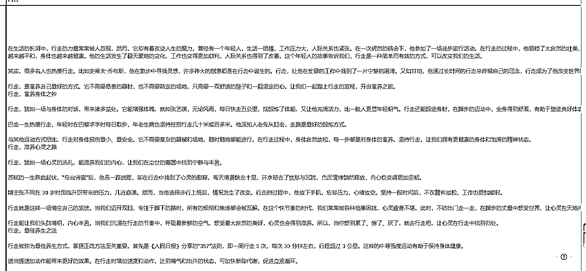
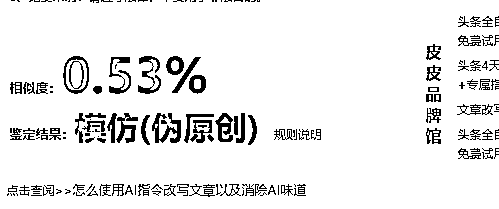
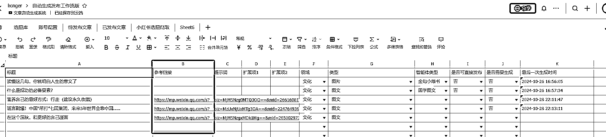
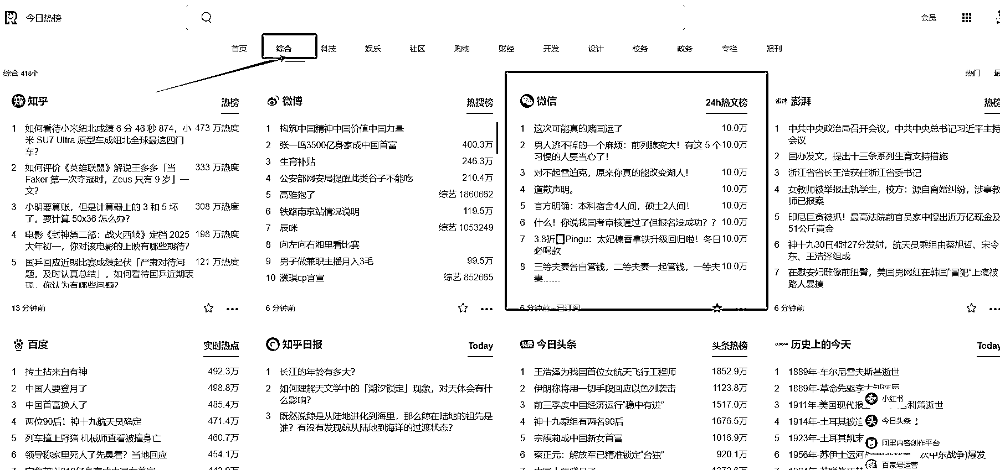
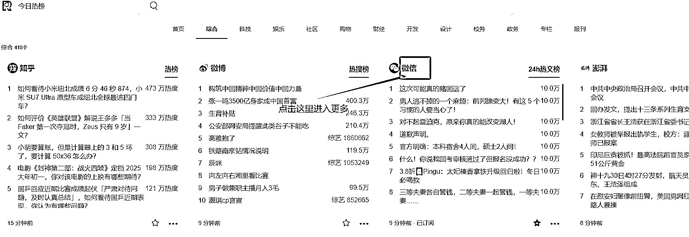
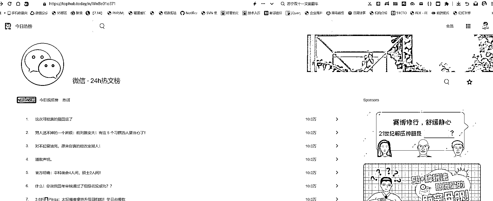
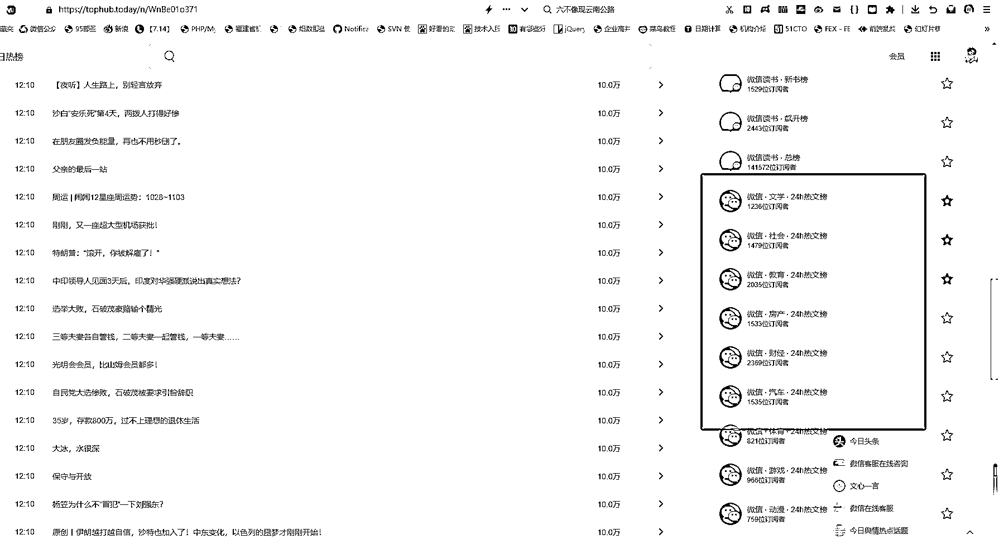
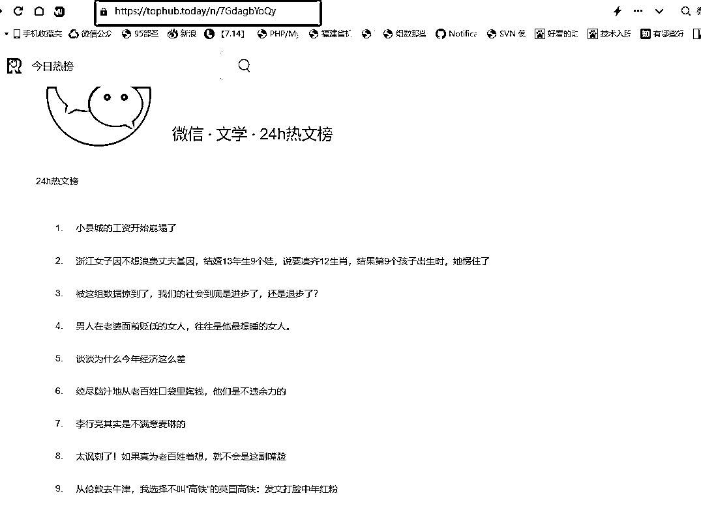
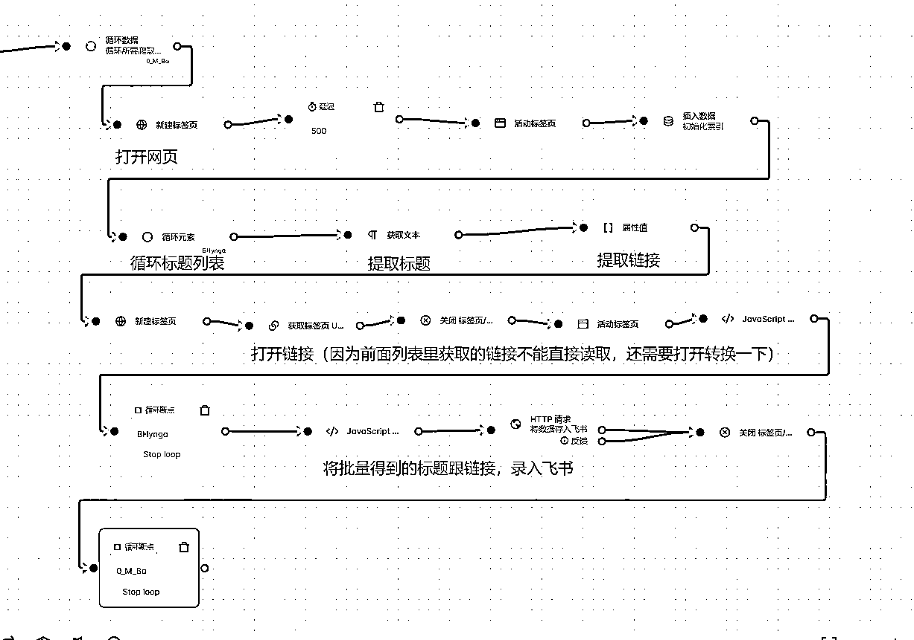
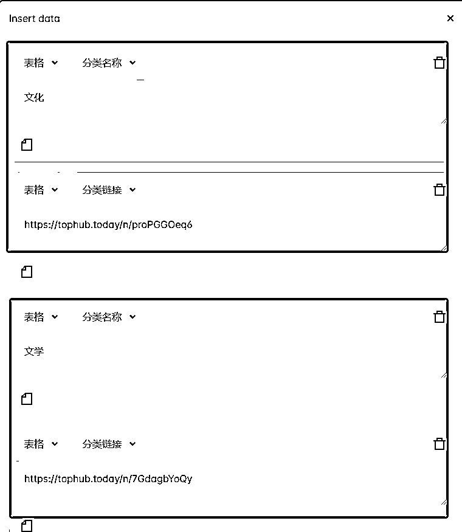

# 告别重复劳动！热点采集、内容仿写、配图发布全流程一键搞定

## 解放双手！从选题到发布实现全自动流水线

作者：陈序员大康

日期：2024-10-30

上一篇我把公众号文章和运营小绿书的自动化流程整合在了一起，实现了从生成到配图排版再到自动上线的闭环。但当时只局限于国学类文章和金句型小绿书，适用面还是太窄。

所以这几天硬是肝出了仿写工作流，**现在一套完整的批量内容生产机器终于成型了**。下面是仿写工作流实际跑出来的效果：

我用查重工具验过，相似度仅 0.53%，重复风险很低，而且读起来流畅自然，AI痕迹并不明显

下面就把这个仿写功能怎么用说清楚。

想看飞书文档的伙伴可以直接去：[`b121w2zgwyx.feishu.cn/docx/XtXedp3Kto7MUpx5xl7cX6JYnhh`](https://b121w2zgwyx.feishu.cn/docx/XtXedp3Kto7MUpx5xl7cX6JYnhh)

# 一、先把 RPA 脚本部署好

在开启仿写之前，请先按上一篇教程
[终于实现了，同时支持公众号文章、小绿书的一键生成+自动配图+自动排版+自动发布（附：最新 RPA 脚本）](https://b121w2zgwyx.feishu.cn/docx/ZRROd7bhBoYoYUxlUbOcAYMBnRh)
把基础脚本跑通部署好。

# 二、仿写功能怎么用

在飞书多维表格里，有一列叫做参考链接。

你在填写标题后，如果想做仿写，就把要参考的原文链接填进去。目前实测公众号链接兼容最好，其他来源没大规模验证。只要这列有内容，工作流就会自动识别为仿写任务，拉取链接内容进行改写生成。

另外，**领域和类型这两个字段是必填项**，没有它们就匹配不到对应的发布账号，后续流程会中断。

# 三、用 RPA 自动抓取热点，直接填表选题

手动找参考链接确实费劲。

为了省掉选题环节，我额外写了个 RPA 爬虫，可以自动抓取热点标题和链接并写入选题表，**从此连题目都不用你手工输入了，只要脚本一直在线，内容就能源源不断产出。**

整个思路我拆开讲：

## 1、数据源用今日热榜

网址：[`tophub.today/c/news`](https://tophub.today/c/news)

点进页面后切换到“综合”标签，就能看到微信24小时热榜入口

## 2、进入微信热榜，找细分领域版块

点“微信”两个字进入详情页，就能看到更多榜单

往下滚动右侧区域，就能找到按领域细分的热榜，这正是我们需要的抓取目标。

## 3、进入目标细分榜单，复制链接

把这个细分榜单的网址保存下来，后续脚本就爬这个页面。

## 4、RPA 爬取的大致逻辑

原理不复杂，按图索骥就能复用到你自己的数据源。

拿到标题和链接后丢给 AI 仿写即可。

# 四、脚本参数配置

拿到脚本的社群成员，打开“插入数据”节点，把自己想要抓取的领域类型配置进去。

**重点注意：分类名称和分类链接必须成对填写，名称要与飞书表格里的领域字段完全一致。**

如果要抓更多领域，就照这个格式继续往下加就行。与之前不同的是，这里用的是表格结构，不是单个变量，扩展起来更方便。

去试试看吧！

* * *

评论区：

夏开心支棱起来 : 你好，可以发下这个自动爬取脚本吗？