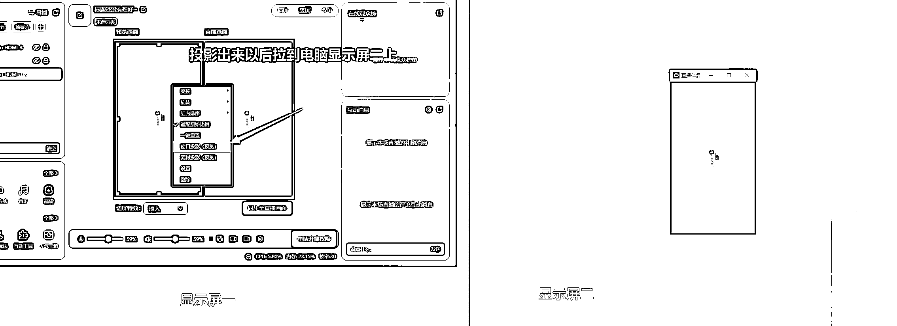
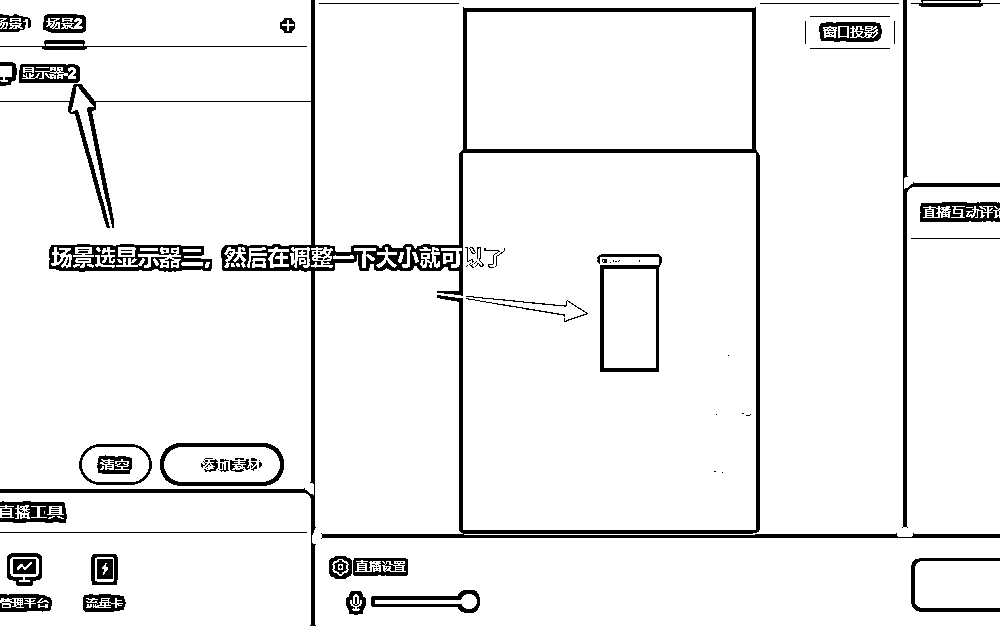
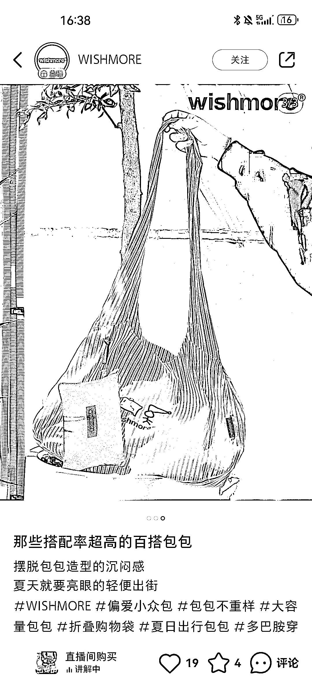
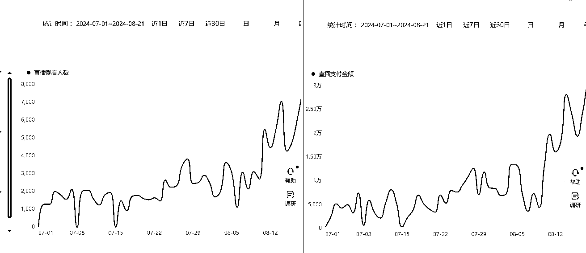
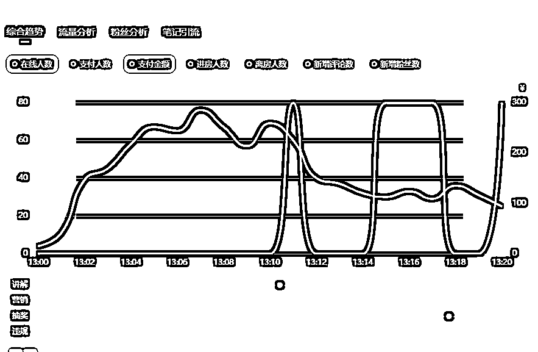

# 📕店播从零到投流：设备、流量、玩法与避坑全复盘

作者：李谢谢  
日期：2024-10-29

我是龙哥，一直在做品牌自播。六月初和一位同行碰面，对方提到他们团队正在做📕和抖音双平台直播，结果📕的业绩跑得比抖音还好，退货率也低不少，最近准备把📕单独拎出来重点做。听到这个消息我确实心动，一边觉得自己也能复刻这条路，一边也意识到之前严重低估了📕直播的体量。

我们其实去年11月就在📕上有布局，但一直在做图文带货和对接达人，直播这个板块完全没碰过。当时一方面觉得开播太麻烦，另一方面也不相信📕能有多少量。聊完之后机缘巧合就试了起来，到现在差不多跑了90来天。最深的感受是：跟抖音比起来，这边真的是省力太多了。底层逻辑几乎一致，做过抖音直播的人过来几乎没有学习成本。现在回头想想，确实后悔没有早点进场，白白浪费了不少本该拿到的流量。直播在电商链路里转化效率极高，做起来以后增量非常明显。

我们卖的是品牌高客单女鞋，品类不同打法肯定会有差异。这篇文章我就从硬件搭建、流量来源、主流玩法到乘风付费投放，完完整整讲一遍，希望能帮到圈友。

---

## 一、直播间硬件怎么配

先列一份可以直接照抄的设备清单：

- 灯光：主灯+辅灯都用 Amaran 200XS，配一大一小两个柔光罩；环境球形灯用金贝 EF160，再加一盏 Amaran 100dS；另外准备一个环形补光灯。
- 相机：主机位索尼 A7M3，镜头适马 24-70。
- 大屏：小米电视。
- 麦克风：罗德无线一拖二，体验很好，值得推荐。
- 采集卡：GC553。
- 背景：根据品牌调性做定制装修，找专业设计团队完成即可。

灯光是最值得花钱的地方。最好请专业灯光师上门调一次，或者让自己的摄影同事调好，之后固定参数不动就行。相机和采集卡这套组合，在📕这种审美门槛很高的平台上，画面质感直接决定用户第一印象。特别是卖衣服鞋子的商家，细节呈现度差之毫厘，转化就失之千里。直播本质上是做减法，画面到位了，以后转化不好你至少不用怀疑设备。我之前图便宜买过海康的一款摄像头，后来转化不佳时我总觉得是画面拖了后腿。

另外得吐槽一下📕的直播软件，是真的难用：美颜效果一言难尽，上传码率感觉不够，我第一次下载官方App时甚至找不到入口在哪。

[`www.xiaohongshu.com/zhibo/robs`](https://www.xiaohongshu.com/zhibo/robs)

关于美颜，因为我们本身就是抖音和📕双开，所以想到了一个取巧的办法：电脑上把抖音直播伴侣的美颜画面投到第二块显示屏上，📕采集的是第二块屏的内容，等于借用了抖音的美颜效果。具体原理和操作步骤看下面的图：

如果你能接受📕自带的美颜效果，又不需要双开，那直接用官方软件就行。

---

## 二、直播间流量从哪里来

### 2.1 笔记

进入方式：呼吸灯 / 购物车  
人群属性：A3

从笔记点进来的人，可以类比抖音千川短视频带来的流量，精准度相当高，付费投放也主要是跑笔记笔记。入口有上方的呼吸灯和下方的购物车两种，如果你投的是买手合作笔记，大多情况都是购物车入口。不过它的精准度还是比千川视频略逊一筹，因为千川视频通常是强营销属性的垂类内容，而📕笔记偏种草，营销感不强。所以这类用户进来之后需要二次转化，不少人看完有想法还是习惯去淘宝下单。

很多人谈“直播撬动自然流”，其实笔记和直播是双向联动的：笔记进来的人在直播间做了数据、产生了成交，反过来也会推动笔记流量上涨，给笔记持续供流。

笔记这个渠道非常重要，我建议大家开播之前先把笔记流量跑起来，再考虑开播。

### 2.2 发现页

进入方式：直播卡 / 呼吸灯  
人群属性：A1 / A2

 images.zsxq.com/FgTKk_lnzXRgp0GQKunznPUsozqn) images.zsxq.com/Fpi1LxSdM3vrC3qtSAy9GIm1xdHH)

这个渠道最重要的核心指标就是**封面图点击率**，在直播大屏上可以直接看到。举个例子：如果你的曝光是1万次，点击率只有1%，那么进入直播间才100人；可如果点击率升到4%，就是400人进来。同样曝光下，进来的流量差了4倍，转化空间完全不同——而且这只是换一张图就能解决的事，非常直接。

📕的好处在封面随时能改，用电脑直播助手就能操作，不像抖音要等下了播才能换。

但点击率也不是越高越好。你一个卖鞋子的直播间，放美食或宠物封面，人倒是点进来了，可全是非目标人群，看一眼就走，转化做不起来不说，还会把直播间的标签带歪。

再说封面是动态的，会根据直播实时画面生成预览，所以场景、主播状态、妆造都得在线。

**测试方案：**

1. 直播过程中分场次换封面，下播以后对比数据。一开始没方向的话，直接拿自己爆款笔记的封面顶上，然后边看同品类优秀直播边优化。
2. 用付费来测。我最早想用直投测封面，结果根本跑不出去，数据太少没法参考。后来问了小二，他说📕用户对直播的接受度没有抖音那么高，直投确实难跑。之后我改成在搭笔记计划时挂上不同封面去测，比如20个计划就对应20个直播封面，跑一周看数据再决定换哪些。

### 2.3 直播间上下滑

进入方式：直接刷到进入  
人群属性：A1 / A2

这是自然流量的主要来源之一。用户本来在漫无目的地上下滑动刷直播，突然刷到你的画面，没有预告也没有铺垫。能不能留住人，全看主播的个人能力、货品吸引力和整体场景感。初始阶段这个渠道的人群相当泛，要通过直播间的互动和成交数据慢慢修正推送，让系统逐渐递给你更精准的人。但前提是主播能力要扛得住，人货场要立得住。

### 2.4 群聊

进入方式：群内推送  
人群属性：A4 / A5

群聊更像一个需要长期自己维护的私域池，天花板不高，属于附加价值。很多商家非常看重笔记、直播、群三者的联动，把群聊玩得很飞。但我们客单价比较高，一双鞋几百块，不可能指望用户天天买，所以我个人在群聊上投入不多，更看重拉新这块，这一点也是我反思的地方。

群聊的玩法其实很多：购买前有犹豫的用户进群后看到售后反馈好，会促进转化；可以在群里发专属券、做群内购、测新款、做直播预告。而且用户进群这个动作本身就是在做数据。

---

## 三、直播间的三种玩法

📕直播跑的还是赛马机制。想破层级就要把数据做好，想把数据做好就离不开节奏设计。

不少商家对憋单很抵触，觉得那是套路客户。他们觉得📕是种草平台，平台为了保证用户体验不会允许这种玩法，用户也不吃这一套。可问题在于，赛马机制的核心就是数据要比别人好才能拿到流量。如果你不用套路也能靠真诚和内容跑赢别人，自然没问题；但事实是大多数商家都做不到。

你可以留意一下：很多人嘴上抵制憋单，手上却照样用秒杀。秒杀本质上也是塑品+开价的组合，只是换了个工具，换汤不换药。九月份有人靠憋单起号，中秋节当天卖了37万；不少做抖音打法的商家迁移过来以后也卖得很好。当然这些都不绝对，适合自己的才是最好的。

### 3.1 纯自然流

纯自然流分两种打法。

第一种靠内容。你笔记很能爆，像很多买手一样靠优质内容引流，然后进直播间做转化。这种打法不少新手在用：笔记爆了就随便拉个人开播，把时长拉满，当在线客服。但这样没法持久，你没法保证每天都有爆文，主播话术没有逻辑、节奏混乱、开播时间不固定，流量会越做越少，最后不了了之。

第二种靠主播和货盘。主播功力很强，能纯粹靠直播间的数据表现拉动增长。你会发现有些商家笔记随便发发，甚至双开时在📕这边都不怎么运营，照样在线人数很高。这种路线对主播要求极高——憋单演不好就成了小丑，所以必须是强主播才能驾驭。

憋单逻辑可以直接套抖音那套：10分钟憋单+5分钟开价，每场做好数据递增就行。

这里我要说一个实操细节：我以前用秒杀工具，后来去掉了，改成憋单时手动上下架。因为秒杀有固定的生效时间，倒计时结束就自动恢复原价，但有时候客户还没下完单，我想再拖一会儿不行，改成手动上下架就非常灵活，主播还能根据当前流速决定什么时候放单。至于秒杀能带来的关注数据，在主播话术里加入引导关注来弥补就好。

纯自然流的两条路都有点极端，对主播和货盘的要求特别高，我不太推荐普通玩家尝试。不过利润确实可观。这个模式最大的问题是不够稳定——主播状态和笔记爆款都没法持续保证。我的想法是：在这个基础上加一点付费托底，让流量稳定下来，操作难度也不会高太多。

### 3.2 纯付费

算清楚投产比，直接付费拉满跑就行了。但前提依然是你的笔记/视频内容得过关，内容不好你连投放的素材都没有，或者反过来讲，内容不行也投不出去。

纯付费的节奏不需要憋单，每分钟都在花钱，所以主要做好塑品和促单就够了。

那有些商家说我真的不会做内容，怎么办？我提供一个思路：买手+直播联动。📕通过蒲公英平台合作的内容笔记，在发布之后是可以直接拿来投放的。本质就是借买手的内容能力，弥补自己不会做内容的短板。买手的内容质量普遍很高，付费投产一般不会太差。我这边实际操作下来，买手素材的投产确实比自己团队产出的内容要好。

当然，合作费用、买手引入的人群是否精准、内容会不会跑偏，这些也都是需要评估的变量。如果准备大规模铺开，我建议你配一个淘宝店做承接和引导，避免流量白白流失。

### 3.3 微付费

纯自然流和纯付费各有利弊：纯自然流依赖直投，但📕直投的量真的很少；纯付费投多了又会挤占自然流量。那有没有相对折中的方案？我觉得微付费是目前最适合大多数商家的路。

微付费并不意味着不用做数据，纯付费也一样要重视数据。数据好，计划跑起来才轻松，笔记那边的流量反馈也会更强。

我建议的节奏是这样：以半小时为单位，10分钟憋单做数据，20分钟开价做成交。憋单拉数据、开价做转化，同时给自然流留出空间。为什么留空间？因为很多商家的产品不只是主推款有爆文，其他款式可能也有4、5篇笔记爆了，直播间会有人来问。如果你做单爆品纯憋单模式，这些客户就全被放弃了。

微付费路线的好处是：以自然流和笔记流为主体，付费只是补成交，既能稳稳做数据，又不会走到极端。它对主播的要求也没那么高，适合主播能力一般的团队。

三种玩法各有取舍，核心还是结合自身情况做选择。直播是一个整体，某方面跟不上的时候，就用别的长处来补。数据决定直播间里有没有人，转化决定进来的人精不精准。

买手直播间大多走的是聊天式塑品路线。但在我看来，憋单直播间的流量利用效率其实更高。平台允许双开、推动商业化提速，说明方向已经很明确了——平台就是想让直播更商业化，而不是停留在种草阶段。

另外平台很鼓励商家做“主理人”人设，通过主理人作为媒介拉近和客户的举例。我建议让主播也参与日常笔记拍摄，以主理人的身份出镜分享，这样信任感会强很多，笔记也更容易爆。

主播话术不会写？打开抖音找你这个类目的前几名，1:1把逐字稿扒下来，再结合自己的品做修改。先抄再超根本没必要，抖音能活到现在这个段位的直播间，话术进化早就不讲道理了。

---

## 四、直播间怎么从0做到1

### 4.1 直播时长

我非常推荐大家把直播时长拉起来。但前提是你能稳定出单——如果撑几个小时才出一单，推流也很弱，那就不建议硬拉。

在主播数据做不好的情况下，拉时长反而是最容易积累数据的方式。平台还有不少活动，像流量卡什么的，都可以通过累计时长获得。

前期不知道什么时候开播，就把上午、下午、晚上三个时段都测一遍，找到流量最好的窗口。测好以后就固定开播时间、固定直播时长，然后逐步优化内容，让每场的数据稳步递增，这样肯定能慢慢做起来。

### 4.2 开播

开播的这波流量要不要接？当然能接就接，接不住也没关系，但数据一定要做到位，哪怕没有成交，停留、互动这些浅层数据也得做出来。

开场进直播间的基本都是泛流量，平台按粗略画像推送的。如果你之前发过笔记，人群画像还好一点；如果是不发笔记、纯直播间起号，那就更泛了。平台也要测试到底什么人群适合这个直播间，再看值不值得继续给你推流。所以这个阶段转化本来就很难，重点做浅层数据就好。一旦有了成交，对打标签和推流都更有帮助——成交模型决定推流模型，而做数据让你直播间里有人。

所以开播的时候建议设计一段开播话术，开播先憋10分钟，配合当时的流速把互动拉起来。开播就有成交的话，对计划跑动和后续推流都很有利。

如果你是纯付费玩家，跑一段时间会发现开播流基本没了；自然流玩家只要每场数据递增，开播流反而会越来越多。

### 4.3 笔记和直播间的人群要统一

这个我自己正在经历，分享出来给大家提个醒。我的笔记一直以来吸引的都是18到24岁的人群，后来开播后平台推送的也是这批人。但面对高客单产品，这批人的消费力可能不够，转化就上不去，到后面想洗人群就很难了。

所以起号阶段发笔记不要做泛流量，尽量保持垂直。先想清楚自己要的是什么人群，再去做对应的内容，后期会省很多麻烦。

这里有一个“代偿原理”：原本想练二头肌，可二头肌没力气举不起来，又没循序渐进去练，结果靠斜方肌代偿把重量举起来了。表面上看动作是完成了，但目标肌肉根本没练到。做流量也是一个道理——笔记做得花里胡哨，流量数据确实猛，看起来是把号做起来了，但实际上全是代偿，最后吸引来的人跟你产品根本不匹配，结果自然不同。所以前期笔记一定要垂直。

---

## 五、乘风付费投放心得

免费流量往往是最贵的，因为免费意味着不稳定，你没法保证天天都有爆文。付费能保证每天都有一笔稳定的营业额进来。

但如果你直播间的自然转化链路还没走通，我不建议付费，——付得越多亏得越多。打个比方：主播连话术都不熟，你就直接开计划让她跑，跑不通你是找主播的问题还是找付费的问题？还有很多人把所有希望都寄托在付费上，这也不现实。付费始终是锦上添花，雪中送炭是轮不到它的。

乘风我实操了一个月。因为我同时还在跑抖音千川，每次用完千川再切回乘风，落差感确实很明显。抖音上很多人说乘风好用，我自己的实操感受有些不太一样。

### 5.1 操作流程

乘风比聚光的搭建流程简化了不少，这点我很喜欢。聚光流程很繁琐，页面跳转来跳转去，效率低；乘风一个页面就能搞定。聚光关联商品时还要关联具体鞋码，这个设计我也不太理解。整体来说乘风的体验确实更贴近电商场景。

### 5.2 投产降低和空跑

乘风是小红商业化非常重要的一环。很多人说用了乘风之后投产降低了，我觉得这是正常现象。

第一个原因还是消费习惯和人群的问题。大量用户现在的习惯是：📕种草，回淘宝购买。要让他们养成站内看完、站内下单的习惯，需要一个过程。这个过程得靠平台一轮轮地洗：先吸引商家入驻，给扶持政策，把电商基建搭好。现阶段很多赛道还是蓝海窗口，值得尝试。

第二个原因是乘风作为新产品，本身还有很多不完善的地方，尤其是空跑现象比较严重。在我看来它现在的状态更像是在采集数据——通过商家真实的投放行为去训练算法。聚光作为一个成熟的产品，算法相对完善，稳定可控；但聚光更像一个单纯卖流量的工具。乘风则是电商化的产品，承担着帮📕完成站内闭环转化的重要职责。

### 5.3 笔记投放

很多人说乘风投产低了之后，我建议你可以尝试搭定向人群。实测下来跟通投差别不是很大。能跑的笔记始终能跑，不能跑的换任何方式都跑不起来。核心还是在笔记内容和产品本身——付费是放大器，不是救火队。体感上视频会比笔记好跑一些，但视频的生命周期也更短。

### 5.4 投放策略

付费撬动自然流，本质还是直播间数据做好了、带动自然流进来。📕是种草化平台，客单价如果偏高，用户决策周期会比较长，所以不要盯着单场投产做调整，要看全店投产来定计划。

投放过程中，测试出来的主力计划建议持续跑着，它能稳定带动自然流增长。主力计划不要随便调整，给够预算让它跑就可以。当然一切都要在合理范围之内。

如果你还不清楚自己的核心人群是谁，很简单：先开托管计划把量跑出来，用结果倒推人群。然后去乘风的数据后台，看“人群分析—人群洞察”，有了数据支撑以后可以建一个人群包，之后用来测素材非常方便。

### 5.5 时间

投放时间和直播时段尽量保持一致，固定节奏跑下来，模型积累得更快。前期可以用小预算多时段试跑，找到自己直播间的成交高峰期之后再去放量。

---

以上就是我这几个月做📕店播的全部实战复盘，从硬件到流量、从打法到付费投放，基本都覆盖到了。希望这些经验能帮大家少踩一些坑。直播这条路没有标准答案，多测试、多复盘，总能找到适合自己的节奏。

做📕高客单，不能用今天的ROI来给自己判死刑。这条链路从种草到下单，本来就是慢功夫。平台的属性决定了它更像一个蓄水池，而不是即时成交池。你现在看到的数据，往往只是前置信号，今晚看起来回本一般，第二天醒来数字会往上走，直播结束后隔几天甚至隔一周还有尾单持续进来。对于客单价高的品类，判断窗口必须拉长来看。

另外付费这件事也别指望一上来就爆。投放启动慢、模型探索期长、方向一旦定错掉头成本高，都是常态。所以给自己一个足够长的观察期，别两三天没起量就否定。

**5.6 搜索是被低估的主战场**

📕商业大会的数据很能说明问题：2023年初到2024年初，平台日均搜索量同比涨超60%。每月有1.2亿用户在上面主动找购买建议，新用户里42%第一次打开就去搜，81%的用户在研究产品服务时会把📕当作第一选择站，而在月活用户里，这个比例更高达70%，主动搜索的占比更是到88%。

这说明两件事。第一，搜索来的用户意图非常明确，离决策更近。第二，平台已经养成了极强的搜索心智，搜索体量也在持续放大。这和抖音等内容被动分发的逻辑是不同的。

目前能打通搜索直投的，只有乘风。千帆和聚光都不具备这个能力。

实操上可以先从核心品类词切入，把基础量跑稳了再去拓展场景词、长尾词。后期笔记和搜索可以形成联动，跑得好的搜索词反过来可以变成笔记选题。但要注意投放的搜索词必须和你的笔记内容是一体的，否则系统会筛掉，转化也起不来。

**5.7 内容衰减节奏不一样**

笔记的长尾效应很明显。千帆和聚光投的计划，衰退周期大概在7天左右，而乘风的消耗衰减更快，大概3天左右流量就吃不动了，需要及时换素材翻新。

# 六、最后聊点现实的

从平台层面看，📕商业化还在进行中，机会窗口很大。尤其是直播板块，行业还在摸索期，头部玩家还没完全站稳，对新手来说反而更容易切入。

平台机会是一方面，更被忽略的是搜索。说句大白话，遇事不决试📕搜索，这股流量是真的能被沉淀下来的。从自然笔记到付费投放，都值得提前布岗。

从商家自身看，很多人都是同一种循环：笔记先爆了，觉得流量不能浪费就匆忙开播，前期捞到一波，后面越来越不稳，就去试付费，结果利润被吃掉，又想回到自然流，发现主播没做好，兜兜转转最后才明白笔记才是根本，可这时候心力已经耗得差不多了。

直播不是单一动作，它是主播、内容、货盘、投放的组合拳，一开始就要认清。没有万能打法，只有匹配。

利润薄就硬上付费，不现实；利润高非要死磕自然流，也没必要。有人适合单品爆款打法，有人靠内容盘货像买手一样放养……找到适合自己的节奏，才是关键。

欢迎交流，祝各位双11大卖。