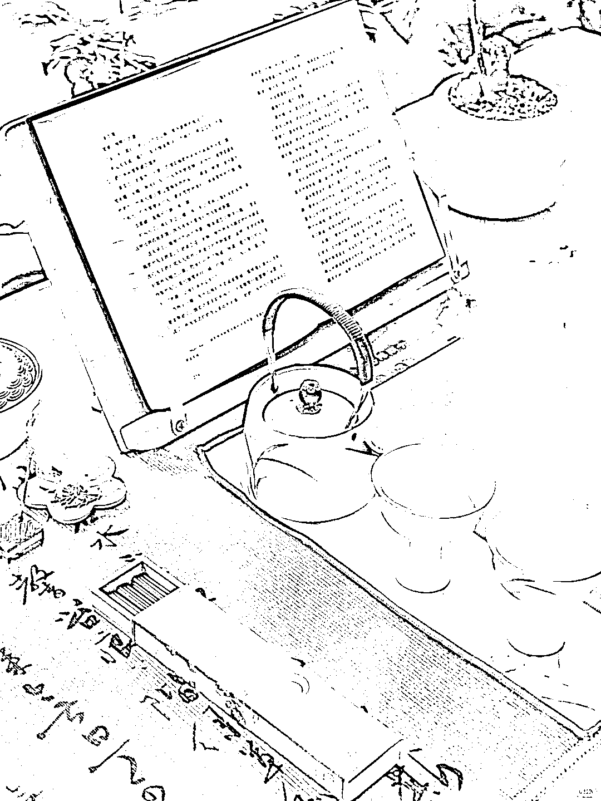

# 三年📕图文记录，7.3万粉丝到月入3万+，我踩过的坑和真正在用的方法

三年前我无意间开始做图文笔记，没想到这条路竟让我实现了带娃在家也能稳定变现的现状。现在粉丝7.3万，月收入稳定在3万以上。

大家问我最多的一句话是：现在都是短视频的天下，图文博主是不是已经没机会了？

我的答案很明确，有机会，而且机会就在你每天的生活里。

**先输入，才能持续输出**

做内容，最苛刻的要求其实不是才华，而是能坚持稳定地更新。想要输出不断，就必须先保证输入不断。

我刚开始做的时候，最大的优势就是在家里全职带娃。于是我就把陪娃的空档变成了输入时间。大量读书，把读到的东西立刻拆解成笔记。读书拆解、阅读方法、读书心得，再结合当时的热点话题，能写啥写啥。

就这么平推下来，更新频率起来了，心态也慢慢从“我试试看”变成了“我就是个博主”。

所以不管你做不做知识类、读书类赛道，阅读能力都是图文博主的基础功。随便翻开一本书，总能提炼出让人有共鸣的观点，这些就是你笔记的原材料。

**文笔平平也能做，但主题不能糊**

余华曾说过，他对语言只有一个标准，就是准确。他认为好作家的语言应该像核能一样，小体积大能量，而不是一堆堆不发光的煤。

这句话点醒了我。做笔记最致命的错误，不是文采不够，而是用一堆漂亮词把重点埋没了。很多新手喜欢营造岁月静好的氛围，段落里全是华丽的形容词，最后读者看完只记得“很美”，却完全不知道想说什么。

清晰大于优美，信息密度大于情绪渲染。

**好内容都长在生活里**

想写出有分量的东西，就得先过好自己的日子。生活可以简单平淡，但绝不能潦草敷衍。可以安静祥和，但不能毫无波澜。

去读书、去走路、去尝试新事物，把这些充实的生活感带进文字里。有趣的人，写出来的东西自然就有温度。

最后想说，博主是一场马拉松。有灵感就冲一波，没灵感就允许自己歇一歇。

秋日的午后，点一支香，房间里都是桂花味。泡杯茶，翻几页书，给自己一点不被打扰的松弛感，这份松弛感，恰恰也是我能坚持下来的底气。

---

*评论区互动：*
程序员赤小豆 : 可以详细讲一下怎么涨粉的嘛