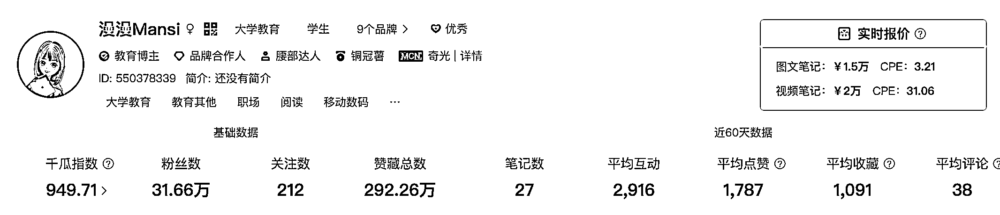
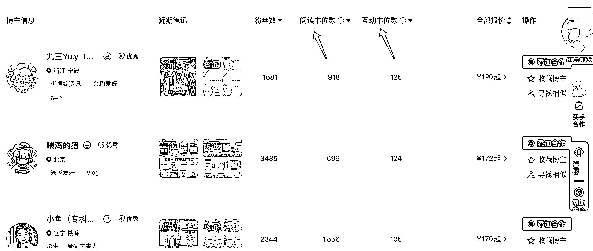
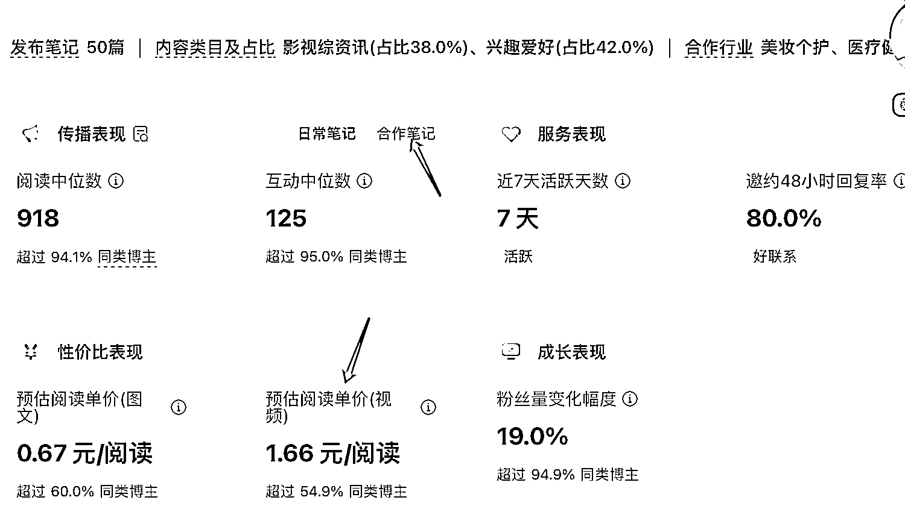

# 双十一想接广变现？这份📕品牌合作全攻略请收好

> 又到双十一了，最近打开后台，几乎隔天就能收到一个报备合作邀请。趁着这个节点，来聊聊我在📕接品牌广告的一些经验和思考。

## 一、到底多少粉才能接广告？

答案是：随时都能接，全看你自己怎么想。

有人几千粉就开始接，有人几万粉了依然不接。说白了，接广告对粉丝粘性影响真的没有想象中那么大，大家心知肚明博主得吃饭，现在用户对广告的包容度其实挺高的。关键是你怎么看待广告这件事，以及怎么权衡它和其他东西的比重。

## 二、品牌怎么才能主动找上门？

说到底，品牌方（或者说PR）找博主的方式，就是通过搜索关键词去大海捞针。他们会搜索自己产品的相关词条，或者用品牌名去搜相关笔记，如果你的内容恰好冒出来了，而且看起来质量不错，就会被他们记住。

所以一个很关键的道理是：**你想吸引什么样的PR，就去发什么方向的内容**。想接iPad类App的广告，就多发ipad使用技巧；想接运动品牌，就多穿多cue自己身上的运动装备。

## 三、接广告真的会伤号吗？

### （1）关键看你怎么选

想让广告不破坏账号发展，核心原则是：选**对你的粉丝真正有价值**的产品，而且宣传点要落在“解决什么问题”上，而不是干巴巴地念卖点。

举个例子，我习惯把某个产品嵌入教学场景里来讲，职场博主可以强调效率提升，宝妈博主可以强调育儿省心之类的。

说白了，现在用户都精着呢，一篇笔记有没有广告基本一眼看穿。区别只在于——让人反感，还是让人接受。这取决于三件事：粉丝有多喜欢你、产品好不好用、以及产品和你的赛道/粉丝需求匹配不匹配。

如果产品本身切中了粉丝需求，广告就不会显得生硬；反之，博主只能硬塞，粉丝自然不买账。所有笔记只要出现了某个产品，不管软硬，它都会被当成广告。反过来，你也可以模仿那些自然融入的笔记，根据粉丝需求来设计露出方式。如果你的粉丝对这类产品根本没需求，那就只能你自己权衡了——是几千块钱更重要，还是别的东西更重要。

### （2）站外广告要小心

把粉丝往👸号、淘宝、京东、其他App导流的广告，本质上是把用户带离📕，这在平台眼里就是“敌人”，大概率会被限流。如果一定要接，至少打个马赛克，或者用一些花哨的障眼法（我们引流课里也讲过具体操作）。

即使是走了报备的，也要提前做好数据大概率不好的心理预期，多搜搜别人同类型投放的真实数据，这样品牌方来问反馈时，你心里有底。

### （3）有些品牌只在特定阶段投你

有些品牌专盯着小博主投。道理也简单：小博主有成长潜力，涨粉期流量好，有时候曝光量反而比大号还惊艳，而且📕笔记本身有长尾效应，一篇高质量笔记很久之后还能被搜到。所以品牌方会在某个量级区间集中投放。

这类品牌具体有哪些，需要你自己观察。可以搜索该产品，看看推广者都是什么量级的博主。在接不到之前，能接就接吧。

## 四、广告报价怎么定？

### （1）行业大致区间

核心逻辑就两个：**粉丝的消费能力**和**你的数据效果**，不同赛道差异很大。

以学习博主为例：1w粉以下，单条大概700-1000；10w粉左右，可能1500-2000。但注意，学习赛道涨到20多万粉之后，价格就涨不动了。不过学习博主可以尝试做数码测评方向，数码科技类产品的报价普遍要高一些。

美妆护肤、母婴这类赛道，报价就高得多了。

再强调一遍：品牌投放看的是ROI，他们花出去的钱是想让用户买单的。所以粉丝消费能力强、数据好看，品牌就愿意花钱在你身上。这也是为什么很多大博主会做小号去用小号接单——花1000块能有2万曝光，谁愿意花2万只为等量的曝光呢？

### （2）利用数据平台查价

你可以去千瓜之类数据平台看看自己后台的参考价格，然后在蒲公英报价基础上自己降一点报出去。

千瓜需要个人或企业认证，做个人认证就行，把博主当作一份正经职业去认证就好。

另外两个实用路径：一是品牌方砍价的过程本身就是定价，他们一口答应说明你报低了，砍价到最后成交的那一档，大概就是你的市场价；二是直接问其他博主，发个小红包表示诚意，要礼貌。

### （3）品牌方反馈里藏着调价信号

谈判心理学：对方一口答应，说明你的报价对他们来说太好接受了，下次遇到新品牌，适当加一点没毛病。

如果已经低价接下，可以顺便说一句：“我的价格这么低，能不能给我投个流呀”——或者：“价格很优惠，以后多多合作哦！”

### （4）品牌方到底怎么估价的？

品牌方通常把官方报价的**粉丝数十分之一**视为最高上限。真正谈判时，他们会根据你近十篇笔记的互动量、阅读量单价来预估合理价。

科普一下：蒲公英后台可以看到每个博主商单笔记的性价比，也就是阅读量单价——报价÷阅读量（小眼睛数，用户点开一次就算一次）。比如报价1000，小眼睛1000，阅读量单价就是1块钱/次。

所以品牌方追求的是**最低报价+最高小眼睛**的最优组合。

日常写笔记除了关注点赞收藏，一定要善于**加热门话题、用爆款热词**，拉高小眼睛量。这样当PR在后台筛人时，你就能凭性价比胜出。

📕蒲公英筛选达人页面截图

蒲公英后台可以看到博主过往接过的商单以及单次商单的小眼睛数据，所以如果你已经入驻并接过单，品牌方也会来来回回看这些数据。

📕蒲公英筛选达人页面截图

还有个值得警惕的现象：很多博主日常笔记互动量很高，而一旦接广告，数据就惨不忍睹，阅读量和点赞都掉得厉害。这说明什么？说明广告要用心做啊！品牌方会通过你商单笔记的数据来评估你的合作态度。**商单内容绝对不能随便糊弄，认真对待，让数据说话。**

一个小技巧：当这篇广告数据不理想时，及时主动联系PR反馈。可以问能不能改封面、改标题，或者充薯条，再或者增加投流预算。毕竟数据好了对大家都有利，未来持续合作的机会也更大。

### （5）促成合作的谈判姿态

如果你目标是促成这单，就给出合理价格＋真诚态度。如果不太在乎，可以报高一点，能赚就接，不赚拉倒。

## 五、广告位到底怎么设计？

说实话，广告位真不是“设计”出来的，它本质上是你生活的一部分。

越纠结场景搭建，你对自媒体改变生活习惯的压迫感就会越强。本来不爱拍照的人，为了合作硬逼自己练习，得不到乐趣得不到正反馈，最后更讨厌拍照，合作也接不到，陷入死循环。

所以真正要植入的不是“拍照技巧”这些，而是你的生活审美和记录习惯。生活品质高的人，随手拍一张就是好看的plog/vlog。构图、色彩这些当然重要，但前提是——**先把日子过漂亮，把场景经营好，再通过画面传达自己当下的状态和心情。**

仔细观察你会发现，那些纯图文做得好看的博主，传递出来的往往是“我很快乐，我很幸福”的氛围。大家会不自觉把这种状态和“她用的东西是不是能让我也过得这么好”联系起来。

换个说法：如果你是个学习博主，你在内容里展示的应该是“我真的在努力，我从学习中获得了充实感”。

很多人为了发图而发图——笔记看着像那么回事，但成绩不行、状态不对，因为发图只是任务。真正该有的状态是：**我在记录我的过程，记录我的成长，记录我的美好生活。**

你的生活场景里有广告位，你藏都藏不住。不需要围绕产品硬夸，而是“我确实在用这个东西，我确实有真实感受”。想把广接好，平时就要在内容里自然地cue到同类产品，做出对粉丝有实际意义的介绍。

## 六、长期合作怎么维系？

想让品牌下次还找你，甚至你去找他们接单也容易些，需要注意这几点：

**1. 保持联系，好好沟通，及时反馈。**

沟通顺畅、及时跟进，大家都会记住你。合作前有任何疑问——不管是合作形式不清楚，还是报价自己觉得不满意，一定要多问一句，把颗粒度对齐再执行。所有话摊开说清楚，保持信息一致，这是最基本也最重要的一环。

如果这条广告数据不理想，别躲。主动联系：“这篇数据不太好，要不我改改标题和封面？您看行不行？”就这么简单，主动一点，反而体现你的专业度。

**2. 偶尔主动询问需求。**

问问对方：“最近有没有新品要推？合适的话我们再来一次合作？”主动才会有故事。

**3. 刷刷存在感。**

给PR的🛰️朋友圈点个赞，把笔记转发到朋友圈，让他们日常刷圈时就能看到你——这种轻量级的“脸熟”维系也很有价值。

祝大家这个双十一都能顺利变现！