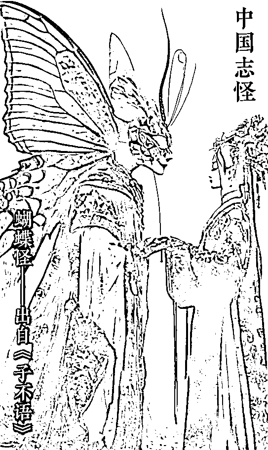
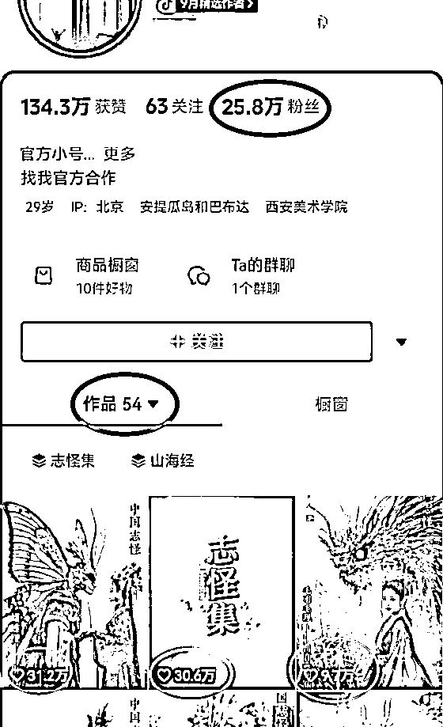
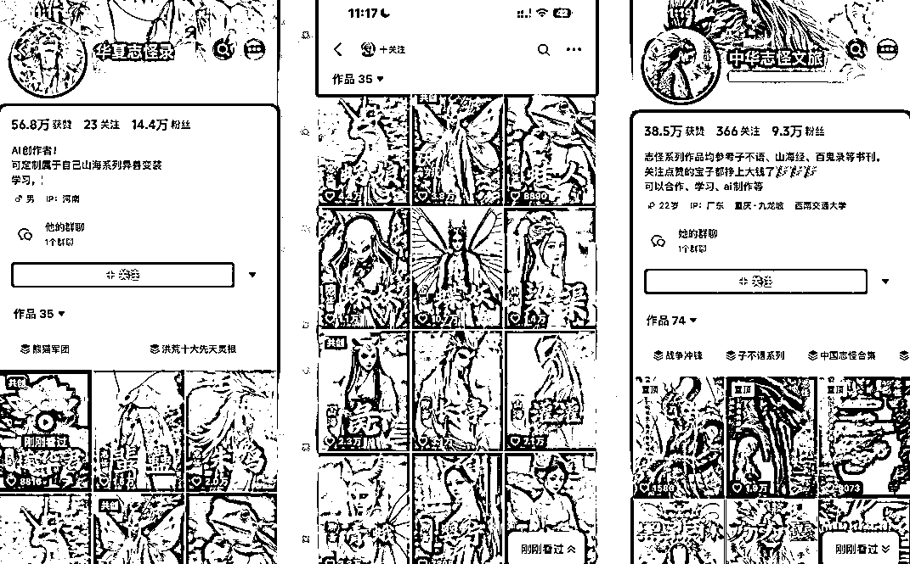
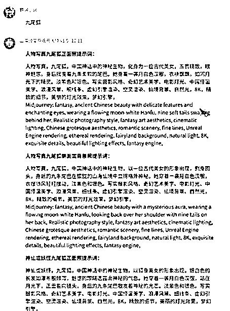
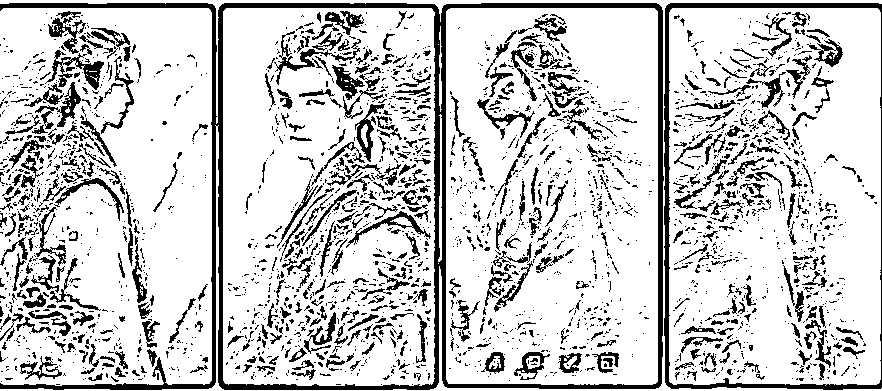
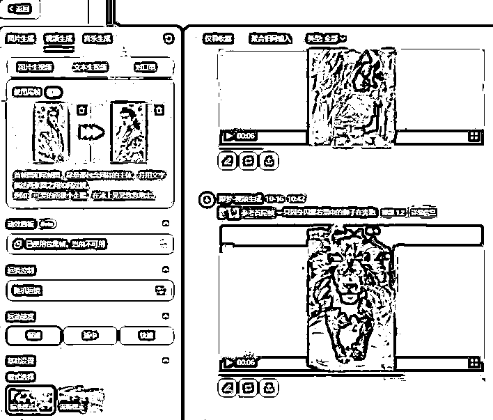

# ('50 条作品涨粉 26 万，AI 志怪视频玩法爆火，附教程', (2, 31))

刷到过神兽幻化成人的短视频吗？鳞片翻涌、毛发褪去，整段画面带着神话滤镜，每一帧都像电影特效。最近这类由 AI 完成的志怪题材，热度高得惊人。

有个账号只更新了五十多条，粉丝数便冲到 26 万上下；单条内容最高拿下 30 多万赞，低的时候也有数千赞，涨粉效率让人眼红。

这类作品不需要真人出镜，也不需要实景拍摄，AI 就能从无到有做出来。我见过不少同类账号，几乎都用同样的风格跑出高播放，算是谁做谁火的典型。

账号站稳之后，变现逻辑也很简单。橱窗里挂一本上古神兽彩绘册，单价 9.9 元，一个链接已经卖出上万份；也有人接商单或者收徒，都能赚到钱。

这种神兽变身视频究竟怎么复刻？拆开来看，一共四步。

第一步，先把画面描述准备好。网上有大佬配好的“神兽描述工具”，只需输入神兽名字，比如“狐仙”，它就会给出多组不同风格的描述。挑一段细节丰富、看着舒服的，拿去做图。

第二步，让 AI 把文字描述变成画面。我常用的是商汤旗下的秒画，一款国产绘图软件；用 Stable Diffusion 或 Midjourney 也一样没问题。选择平台上的新版本模型，设定尺寸与出图数量，一次出 4 张，挑一张最满意的下载。如果都不理想，就改描述再跑一次，直到画面顺眼。

第三步，把静态图变成动态视频。可以用可灵这类工具，Dreamina（即梦）也不错。操作上，选定两张图分别作为开头和结尾画面，AI 会主动补齐中间过程，形成顺滑变身。实际制作时至少准备 6 张画面，按顺序两两配对，就能得到 5 个小片段。遇到效果一般的片段，可以在描述里补一句动作方向。

第四步，剪辑收尾。将 5 个片段拖进剪映，先放大或裁切去掉水印，再检查衔接是否自然。遇到不够顺滑的地方，就调速度、加转场。最后配上合适的 BGM，一段成品就出来了。

眼下这个玩法还处在流量红利期，真正熟悉的人不多，是个不错的入场机会。上述这些描述工具、绘图软件和视频平台，在我之前的分享里都能找到，翻翻历史记录就能看到。动手做一条，或许下一匹黑马就是你。