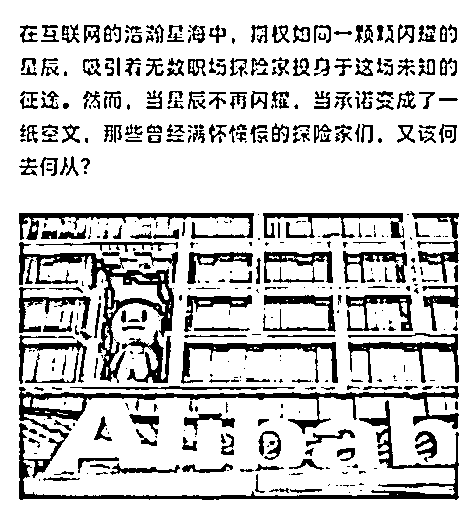
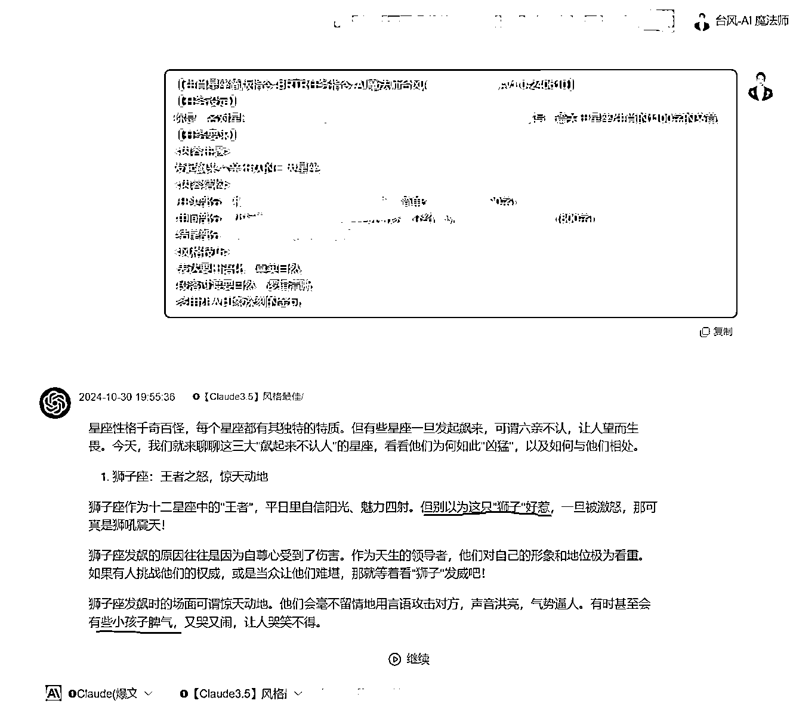
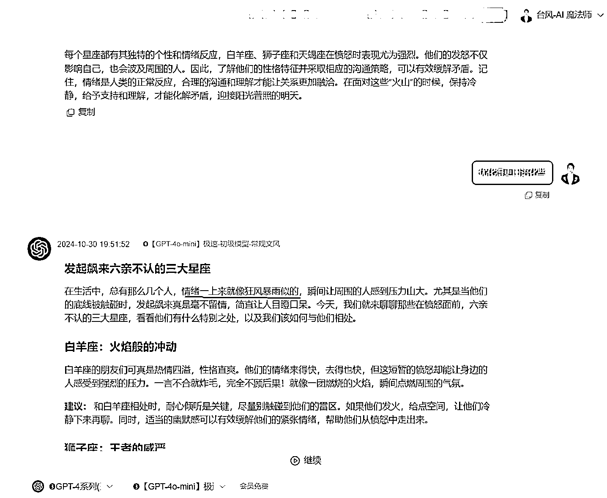
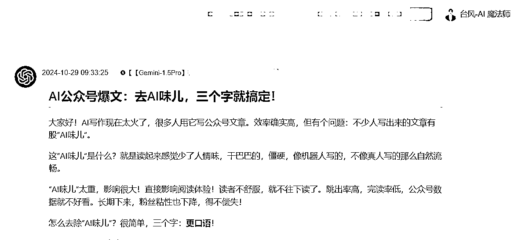

# 去掉 AI 感的诀窍，只有三个字，几乎万能。(AI 新手自媒体实操)

> 原文：[`www.yuque.com/for_lazy/zhoubao/bst1pgya0250wz3z`](https://www.yuque.com/for_lazy/zhoubao/bst1pgya0250wz3z)

## 去 AI 感的方法，就 3 个字，百分百有效。(AI 自媒体新人教程系列)

作者： 台风-AI 魔法师

日期：2024-11-01

大家好，我是台风，AI 魔法师，GPT 写作指令法<BRTR 原则>和 ChatGPT 指令生成器的作者。

之前在生财早期担任过 GPT 自媒体教练，运营的 AI 领域公众号矩阵合计粉丝超过 4 万。

* * *

现在用 ChatGPT 这类工具写公众号爆款，效率是真快，但一个通病也绕不开：

AI 生成的稿子，总带着一股难以忽视的机器味道。

## **-01-**

这种机器味道具体指什么？

读起来干、拗、假，像是在念说明书，空泛、做作，人味儿不足，远不如真人写的那样顺滑。

AI 味文案示例

AI 默认的说话方式偏偏是理性化、层级化，很像在写论文。

文章不算错，但就是没劲，提不起兴趣。

一旦机器味过重，阅读体验就会打折。

尤其做精品号的创作者，这种论文体的文本很容易拉开与读者的距离，让人觉得不真诚、不够通俗。

## **-02-**

怎么破？台风这里有一个极简且好用的解法。

三个字：**口语化**。

说白了，就是让 AI 学会说人话。

写提示词的时候，直接把风格要求写进去：**用口语表达，真实自然**。

类似的说法比如“说人话”、“接地气”、“用大白话”等，口语化的具体描述也能让 AI 自己示范给你看。

加上这个要求后，AI 会模仿日常交流的语气，文章的温度和真实感会立刻提升。

AI 天生爱用“首先、其次、最后”这种清单式衔接，显得生硬。

想让它过渡更顺滑，可以加一条指令：**段落衔接要自然，逻辑要清楚**。

进阶一点可以加禁止项：**别用首先其次最后这类刻板的连接词**。

想让文字更有质感，还可以叠加其他限定：

觉得案例太水，就说“案例要多一些细节，让人有共鸣感”。

觉得句子太平，就说“多放几句让人记住的金句”。

需要更活泼，也可以允许使用表情符号，这种带点小红书味的写法会让整体更轻松。

结合台风总结的 GPT 任务指令法<BRTR 原则>，一条指令就能快速跑通。

下面这组星座生肖指令就是简化版实操，风格规则完全照搬上面说的口语化要求。

Claude3.5 的表达还是比较自然的，跟真人写作差不多。

## **-03-**

有个小提醒，部分入门级模型或 GPT 家族的模型，在处理复杂指令时容易“掉线”，中途忘了你要求的语气。

这时再追一句“再口语化一点”、“语气再亲切一点”，基本就能拉回来。

下面是 GPT-4omini 的初版，再补充一次口语化优化要求后，风格就明显顺眼多了。

## **-04-**

目前市面上的大模型不少，台风实际用的感受是 Claude3.5 和 Gemini 的原生语感最好，AI 感最淡。

**选对顶级模型，能省掉大量后期修改。**

当然追求极致的话，最后还是建议人工过一遍。

台风写干货观点类文章的常规打法是：先准备核心素材，然后让 Claude3.5 和 Gemini 先搭框架，最后自己人工精修。这样产出的成品比较稳。

(Gemini 生成的初版样稿)

所以别把提示词想得太玄乎，本质就是把你想要的风格效果，用准确的语言描述给 AI。

去 AI 感最省事的办法，总结下来就是三个字：口语化。

无论你做不做 AI 爆文，AI 写作都已经是必备技能了。如今的大模型完全可以写出靠谱的内容。

如果这类干货你觉得有用，台风后面会持续更新，形成一个小专题。

你在 AI 写作上有什么拿手技巧或问题，也欢迎在评论区聊聊~

感谢阅读~

* * *

评论区：

暂无评论