# 绿书会是下一个风口？个人服务号开放注册，整套变现教程来了
作者：龙哥

分享人：高鹏｜时间：2024-10-31

🛰️前两天悄悄改了一条规则：普通个人也能申请服务号了。放在过去，这种账号必须有营业执照打底，还要交三百元的账号验证费，很多人就卡在这两道门槛上。现在拿手机上的🛰️直接操作就能把号拿下来，执照和费用统统免掉，入门难度被拉得很低。

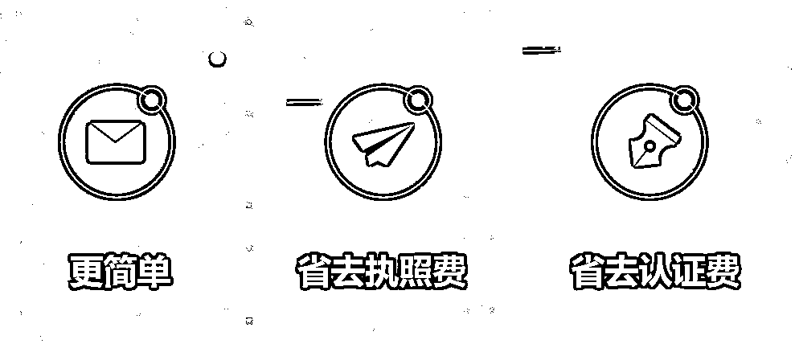

这一改动的真实意图，八成还是要推绿书。服务号在绿书这种内容生态里位权重、流量倾斜，平台想拉更多人进场。什么是绿书？简单说，它是公号板块中的一个模块，设计风格和📕非常像。对个人号主来说，靠这个板块赚钱的好时候已经到了。眼下绿书正处于火了又不够熟的发展期，内容库还薄，很多玩家直接趁早从📕找爆款、处理完水印后拿来发。我有个圈中好友已经在做绿书笔记的带货，两个号每天累计上百单，成绩稳得吓人。

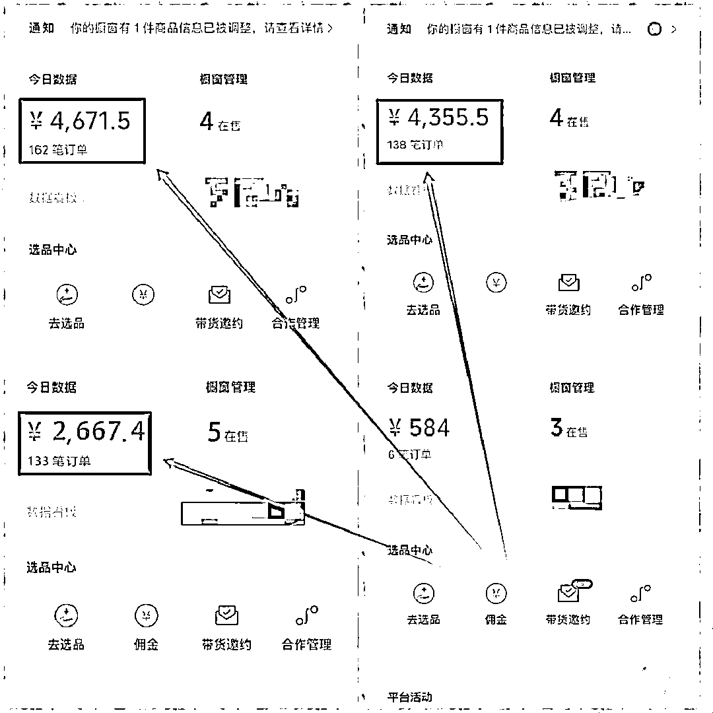

在动手之前，我得先把概念理一理：绿书并不是一个独立应用，不用单独去下载，它只是公号系统里生长出来的新板块，推出到现在才过了几个月。页面版式和📕几乎互为镜像：左边是绿书，右边是📕，内容完全同源，瀑布流和卡片感如出一辙，老用户几乎零学习成本。

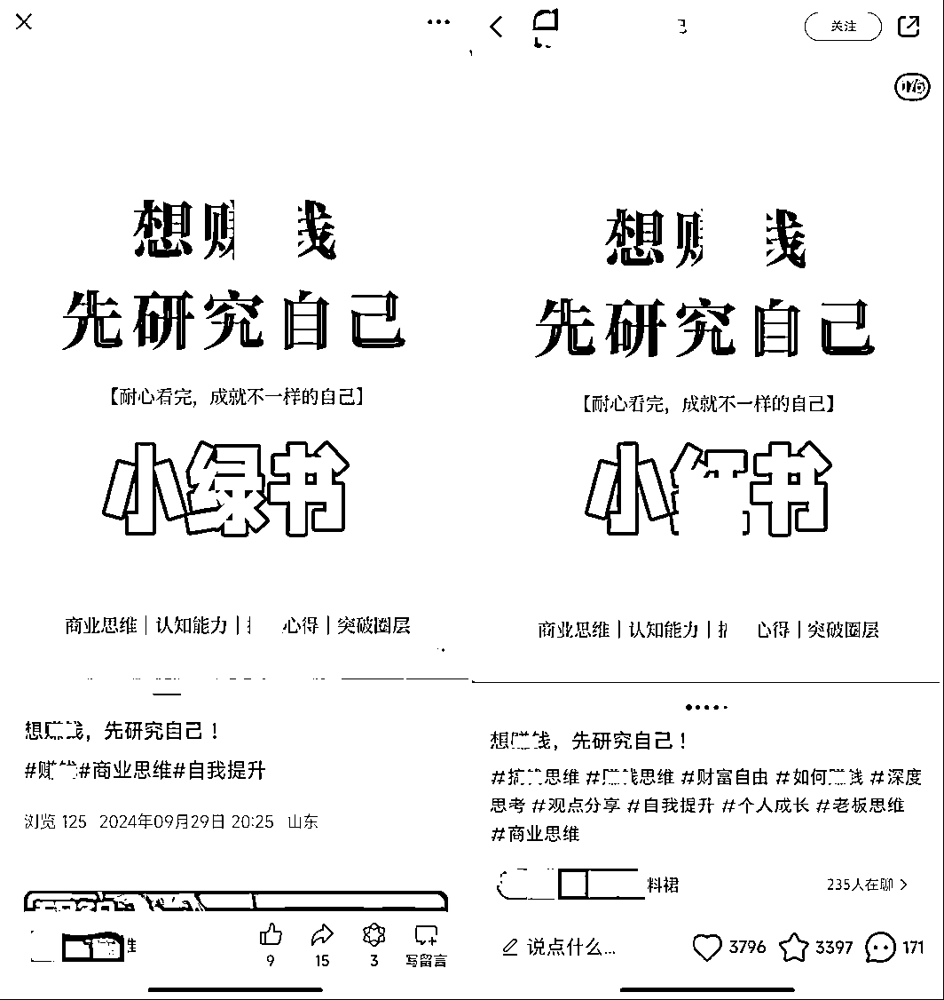

不过，两者的带货门槛差得很远。📕非要凑够1000个真实粉丝才给开带货，又慢又严；绿书这边100粉就行，这一百个粉丝怎么弄，懂行的人都有自己的路子，轻松就能满足。

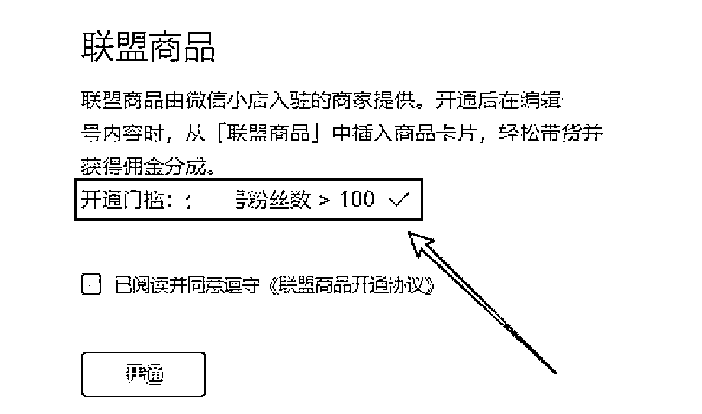

绿书长在🛰️生态里，现在个人服务号也放开了，官方的指向性已经很明显。这个赛道不缺流量，也还算新，起飞只是早或晚的问题。别等风口彻底热了再进场。流程熟练以后，做一条内容几乎用不了一杯咖啡的时间。并且收益能拿两份。最基础的一份是挂商品链接：有人下单，你就会获得对应的佣金。

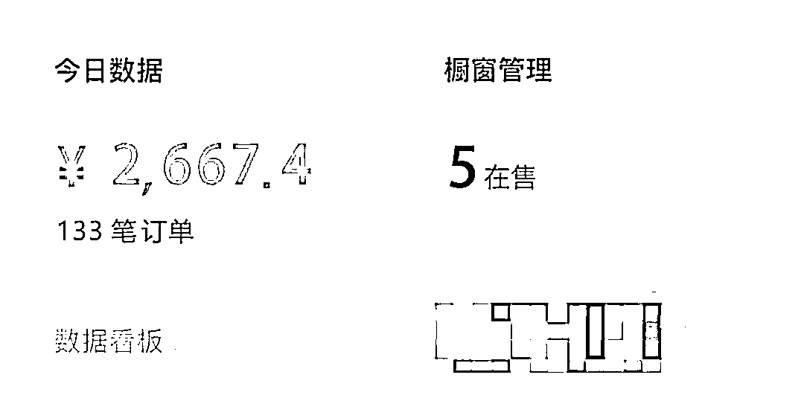

第二份收益来自流量主。笔记发出后不只有带货能变现，阅读量同样能产生广告分成；前提是粉丝数到500，就可以把这个功能打开。

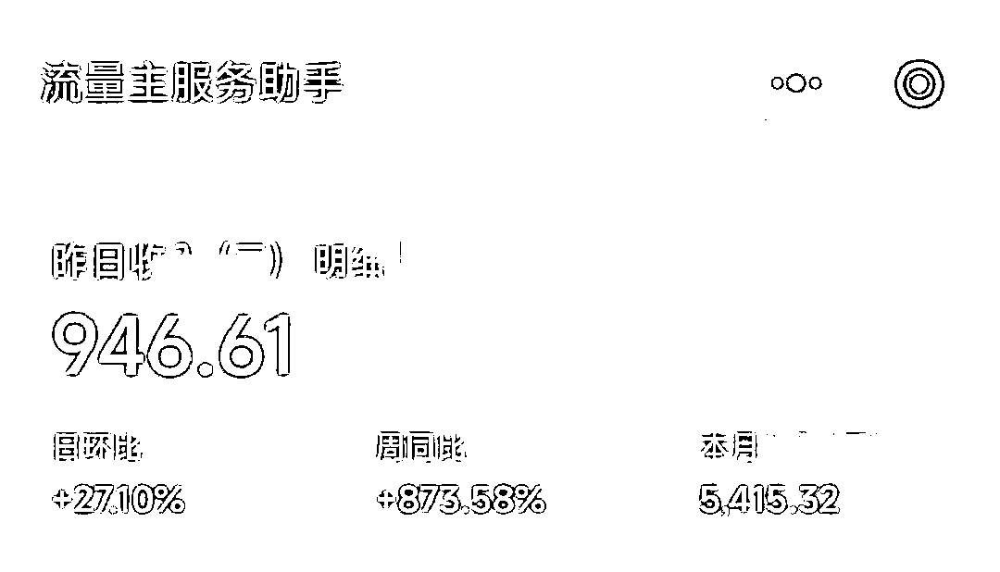

第一步，先把服务号拿下。目前的流程相当轻便：在🛰️小程序里找到入口，或者直接找我要码——那个二维码没办法公开摆出来。按提示把资料一填，注册就算完成。

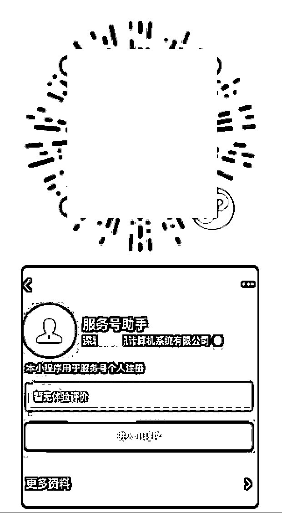

里面有几个要点值得记下来：一个人最多开十个服务号，但只能给其中一个做认证；想做带货或开流量主，就离不开这个认证号。来到内容环节，可以分成三个动作。先选方向，比如创业、育儿、穿搭，定好方向才知道要挂什么品。然后去📕翻爆款笔记，把合适的素材存下来，去掉水印备用。为什么能这么省事？因为绿书库容还很空，平台里没有的内容，基本都能发。假若你打算卖思维类书籍，就在📕搜“成长思维”之类的词，找到高赞笔记下载，再把水印清掉。

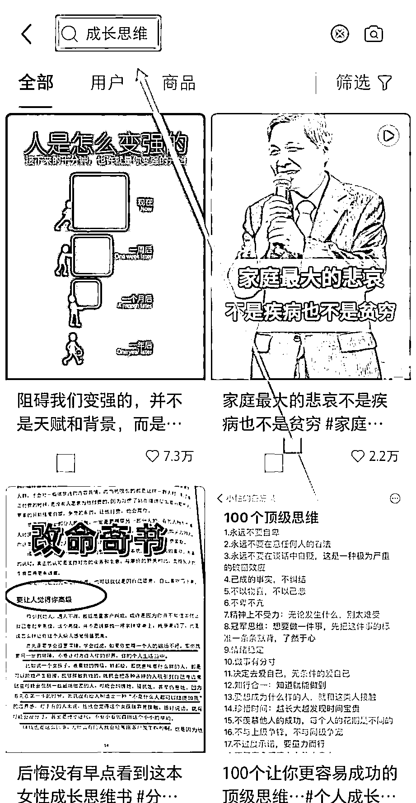

水印清理的步骤更简单：点进笔记，点分享，在底部菜单选“拷贝链接”。

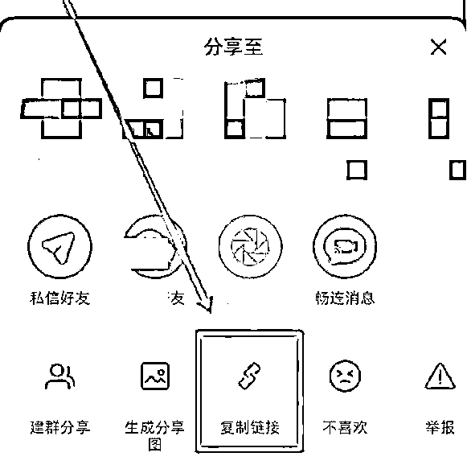

拿下来这条链接后，丢进任意一款水印清理的小程序，点“解析”，图片就会以高清原图的形式保存到相册。

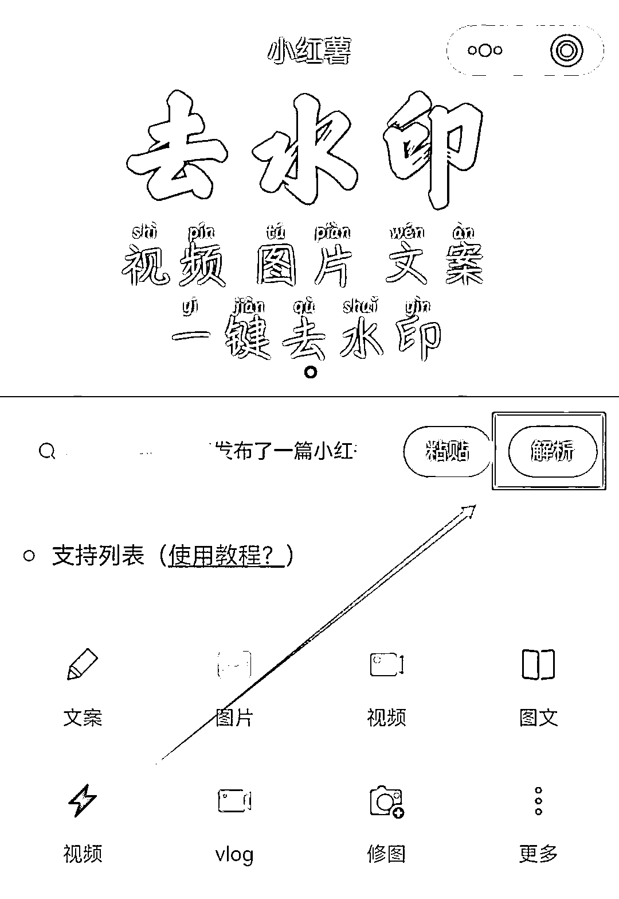

素材筹备完毕，进入发布环节。绿书作为公号的功能区，发内容时把模式切到“图文”。在编辑器右侧区域上传处理好的图片；标题一栏可空着不写，也可以从📕原文直接借一个过来，两全其美。

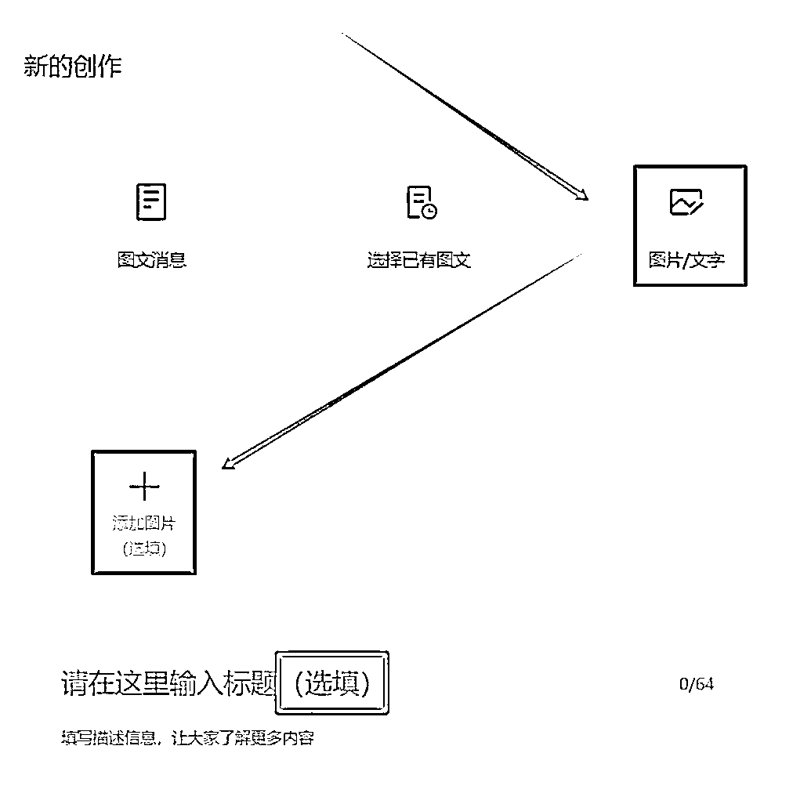

下面到了全篇最要紧的地方：发布页右上角有一个购物袋形状的小图标。点它，就能看到自营店铺商品和联盟选品两个入口。如果你没有自己开店，选联盟选品就行，成交依然有佣金入账。

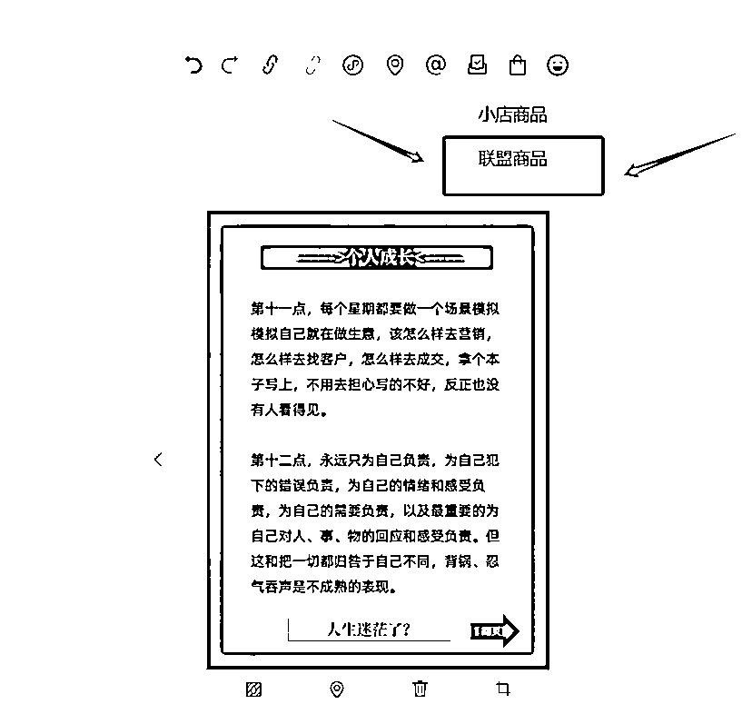

打开联盟选品页，用与内容相关的词条去检索货架。这里要特别留神：挂在文章里的商品，必须和笔记主题搭得上。否则平台不给分发，用户也不会买账，带不出任何效果。

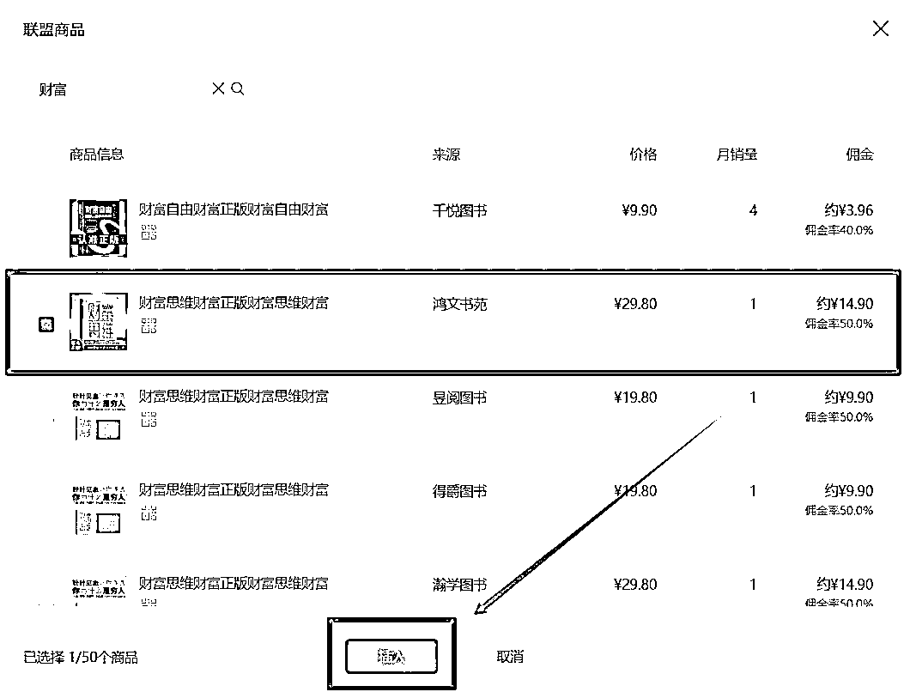

选定一件商品后，点下方的“插入”，整个挂载过程非常顺手。

把时间轴往回拨，现在的绿书很像五年前的📕。如果当时你赶到那个窗口期做了布局，如今手上大概率会有一笔不小的回报。眼下相似的机会正摆在绿书面前。当然，任何玩法都不能打包票适合所有人，我在这里只是给出一条已被验证的路径，愿不愿试还要你自己判断。关于绿书用的各类工具，我以前陆续写过几篇，翻翻历史消息就能找到。

高鹏，网创九年，拆过的项目已到第683个，日常研究变现模型，也欢迎同行交流。