# 小绿书带货 2 个账号都破首单！历经 14 天 112 篇文章，RPA 是幕后功臣

小绿书带货真的没那么快，很多人进来没几天就被流量的慢节奏磨得没脾气。但我还是硬着头皮更了两个号，第14天早上睡醒，后台突然蹦出一个订单；另一个号更争气，第8天就破了零。前后加起来，发了112篇笔记。

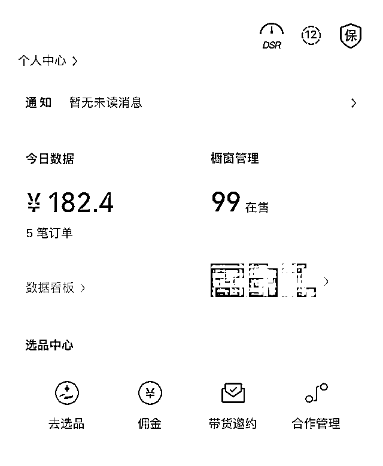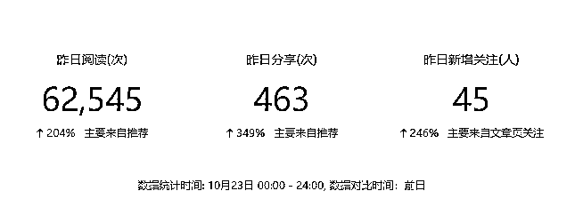

这篇文章我其实早写好了，但一直压着，没出单的时候发出来总觉得没底气。现在两个号都开了张，但我没有冲动去加第三个号——毕竟这项目收益不高，也不稳。倒是最近个人可以不用营业执照直接注册服务号，这算一个微弱的信号，虽然不知道腾讯准备下什么棋，但经验告诉我：先留在牌桌上。

能破零，我认为是三点叠加：运气好、平台的查重机制没卡我、RPA帮我把重复劳动全干了。一句话总结：做对的事，剩下的交给概率。

我接触的第一批玩家里，大概250个，至少有28个已经出单，比例大约是11%。要知道这28个里还有很多人只是偶尔发发，如果只算每天都坚持发笔记的人，出单率会更高。

关于RPA，可能很多人好奇。我从第一天起就是用自动化在发，流量和单量都没被影响。但如果你不会RPA，完全不用焦虑，更不用专门去学。最靠谱的路径是：先纯手动把项目跑通，再找人定制RPA来提效，RPA不是项目的重心。

我的RPA分两段：一个负责下载平台上的图片、切除水印，同时抓取标题和正文，再用AI改一遍稿，处理16篇大概10分钟；另一个负责把改好的文章批量保存成草稿，发布16篇也差不多10分钟。手动选品再点发布，全程10到20分钟。选品其实也可以自动化，但我不建议，因为一旦全自动，你就会失去对市场的敏感度——同行的笔记都没挂商品，你根本不知道该挂什么。

下面这几条经验，是我踩完坑之后的真心话：

第一，别纠结细节。图片裁歪了？没事。找不到合适的品？随便挂一个也能过。

第二，每天发8篇就够了，贪多反而容易把热情烧光。

第三，别去搞合集，把发文动作简化到极限，完美主义是跑通路上的敌人。

第四，现阶段不用垂直，垂直只会让你天天纠结选题。

第五，完读率、停留时长这些指标，统统别看。

第六，小绿书流量有延迟，我一开始也是颗粒无收，先发满一个月再下结论。

第七，这项目本身很简单，别自己加戏。

第八，先出单，再优化。

第九，别信什么100%出单的秘籍。

所以核心原则只有一条：日复一日地抄同行爆款，其他多余动作都不值得做。这句话值得每天默念三遍。

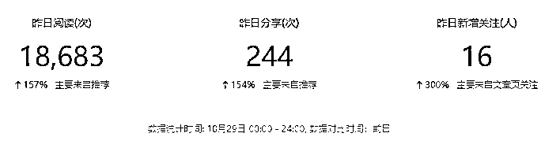

如果你想知道开头说的RPA怎么来，现在是29元/月，另外还有一个小绿书带货群，99元进群。群里互相交流，我也会回答一些操作问题，分享实战中遇到的坑。想加入的话，联系鱼丸要链接就行。

接下来是上手流程。先说个好消息：现在个人已经可以直接开通服务号了，不需要营业执照，直接扫码就行： 当然，如果你想开两个号做数据对比，可以去淘宝找人代办营业执照，代办36元，邮费到付24元，一共60元。我办过几张，这家商家服务不错：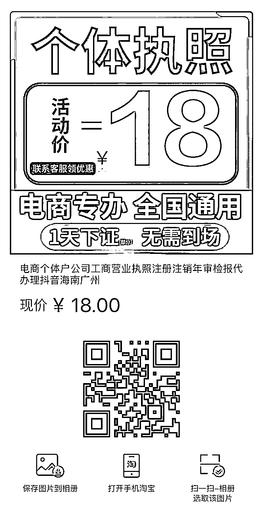 有营业执照就能注册两个号，互相验证数据。比如我同样操作，一个14天出单，一个8天出单，对比后才明白：不是我不行，也不是方法不对，就是运气还没来。

注册服务号的过程就不展开说了，关键是还得绑定视频号才能带货。操作是：用注册👸号的🛰️，点“我”→视频号，开通后绑定刚才的服务号：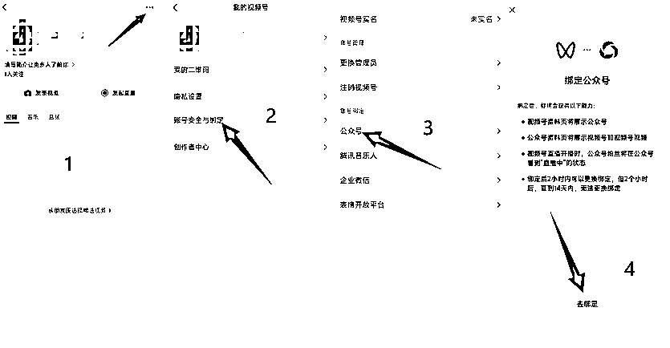

然后开通橱窗：点“我”→视频号→创作者中心→带货中心，再点“暂无带货权限”：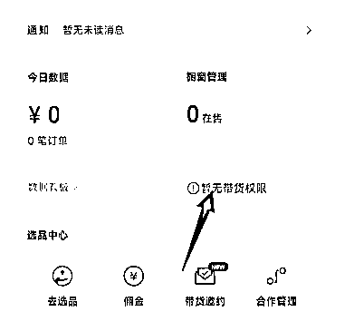 开通后要交100元保证金：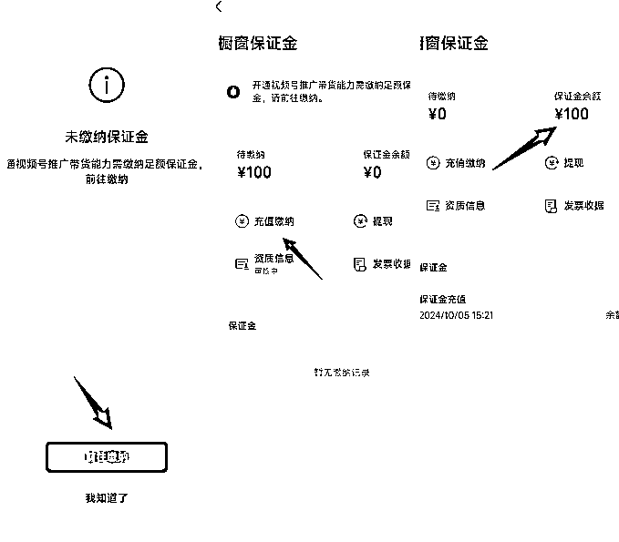 过程中如果提示认证，一律选“个人认证”，营业执照只用于注册服务号。一般20分钟就能过审。之后点“去选品”，把商品加进橱窗：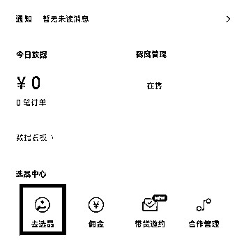 这时系统会弹带货方式，按提示操作：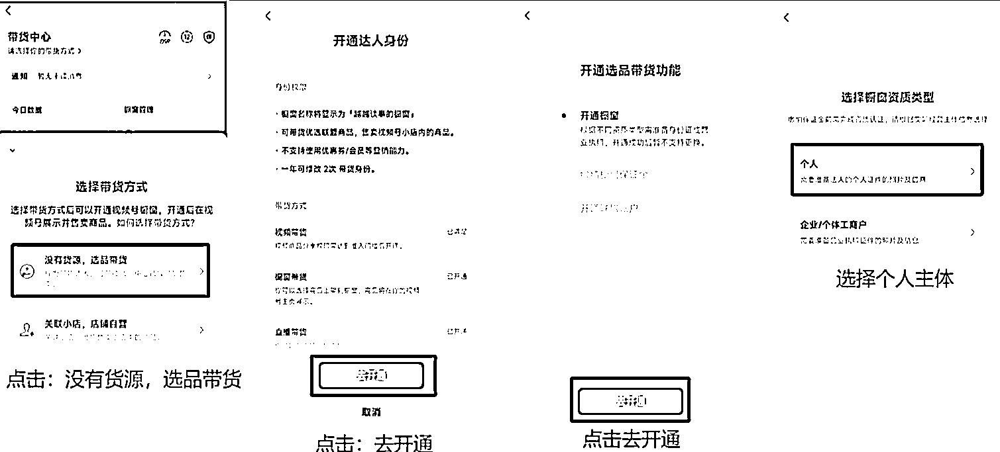

选品怎么找爆文？如果你的手机🛰️能看到“服务号”（和订阅号图标一样），可以直接从里面挑：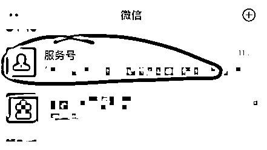 看不到就用次幂数据，会员一个月99元：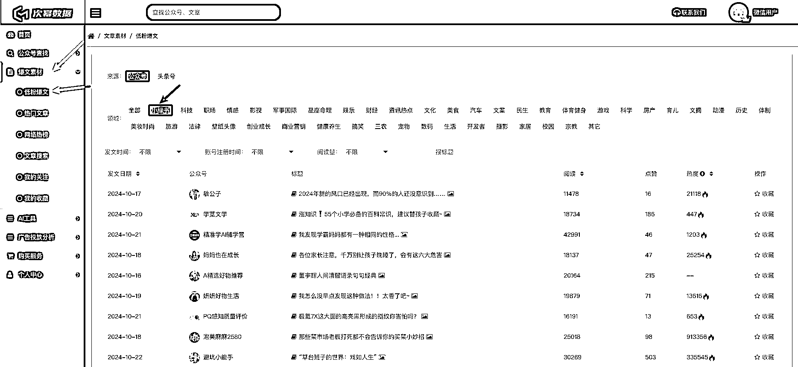 我每天上午挑16篇（两个号各8篇），裁掉水印，标题不变，正文用AI重写一遍，然后存成草稿。再打开电脑端视频号后台选品，基本上同行挂啥我挂啥：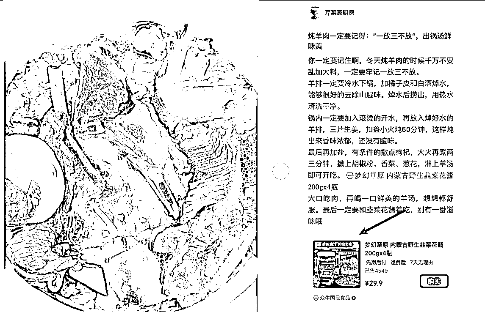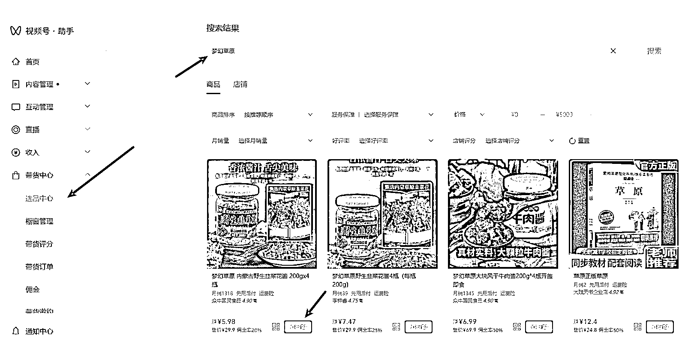 选好后把商品插入对应草稿：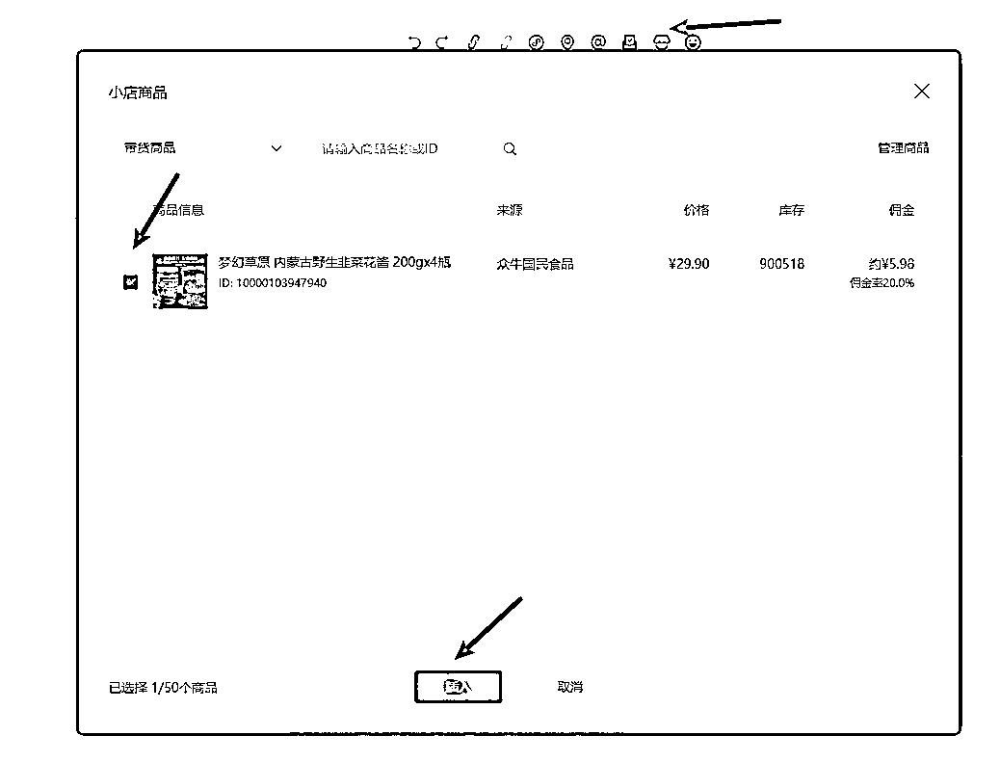 最后点击发表即可。

就在我写这篇文章的时候，又看到一单进来，接下来我也要开始做优化了。希望这篇经验能帮你少走点弯路。