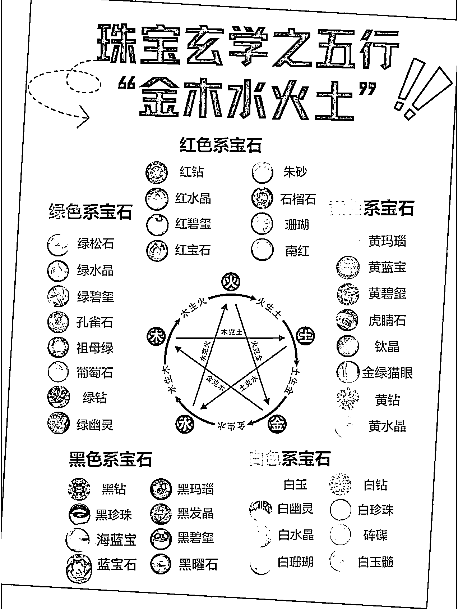

# 玄学水晶珠宝私域项目剖析-终于找到喜欢且长期做的副业项目了

最近刷到一个让人眼前一亮的私域副业案例：玄学水晶珠宝。一位二胎宝妈依靠这个赛道，从零开始做私域，目前每月稳定营收8万元，净利润约6万元。这个项目不仅利润高，而且越做越吃香，让人忍不住想一探究竟。

分享人贾璐Luca是一位深耕行业十年的创业者，同时也是两个孩子的妈妈。她的本职工作是直播电商，尤其熟悉无人直播和半无人直播。因为工作压力大，她开始接触手工和疗愈类活动，借此解压，还考取了蜡艺教师证和水晶疗愈师证，并皈依了道家。

今年3月，她注册了全新品牌“乐知国学珠宝”，用两个零粉丝的新微信号当客服号，从零起步，靠小红书引流。如今，私域月营收稳定在8万元，净利润约6万元。水晶手串的客单价集中在286元到1500元区间，很多订单都来自老顾客的转介绍和复购。用她的话说，这是一个做得越久越有价值的高利润长期项目。

她在飞书笔记中做了详细拆解，重点分析了三件事：在私域中靠什么产品能实现月入8万；为什么看好玄学五行水晶珠宝赛道；以及具体如何落地销售。想要深入了解的朋友可以直接查看她的飞书内容：

https://r7weuqivm5.feishu.cn/docx/A2dMdbiuNoCDQZxJZTkcovNhn7d

