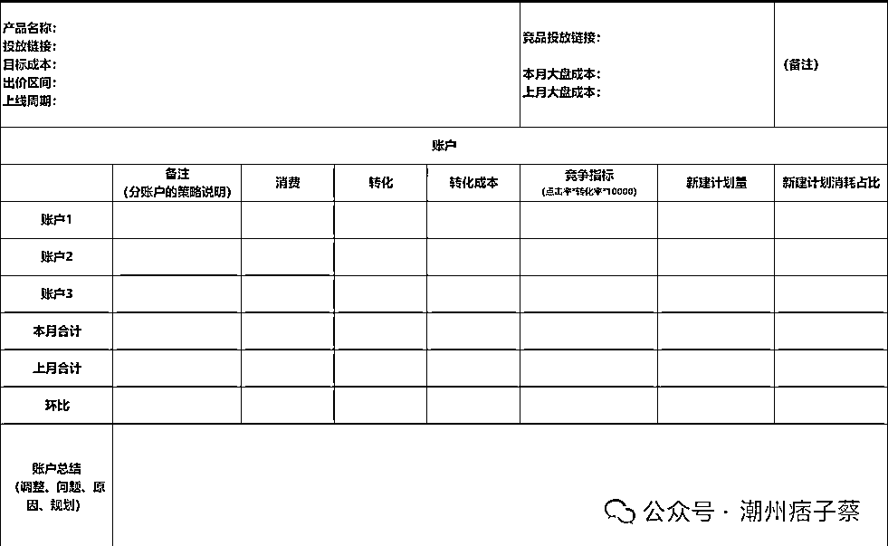
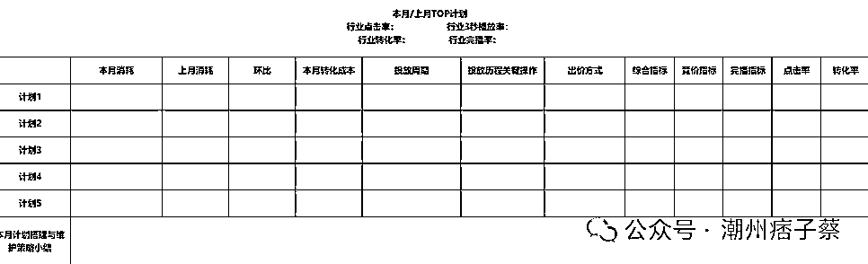

# 今年Q4，越来越多的中小老板亲自上手看投放了

## 今年Q4，越来越多的中小老板亲自上手看投放了

作者：潮州痞子蔡
日期：2024-10-31

你好，我是潮州痞子蔡。

今天这个话题虽然是聊投放管理，但不只是给投放人看，老板、投放负责人、优化师都能从里面get到东西。

先说明一下立场，这篇全是从广告主视角来写的，不是乙方视角，但对乙方同样有参考价值。

最近和不少公司交流、做咨询、做深度合作时，发现一个很明显的共同现象：中小型企业的老板们都开始直接下场管投放，或者说参与度越来越深了。

时间已到2024年Q4，年底倒计时进入两位数，业绩要收官、利润要兑现，每个掌舵人都在把压力拉满，也都想靠这波冲刺为明年打好基础。

老板们心里很清楚，自家业务的增长逻辑就是靠投放买量来跑，投放直接决定了公司能不能完成业绩、能不能赚到钱，这块已经成了企业最重要的命脉之一。

**一、老板们在投放上最头疼的十个疑问**

**  **

虽然老板们已经开始上手，但困惑也特别多：

1、定的ROI目标为什么总是达不到？
2、投放规模就是起不来，卡在瓶颈怎么破？
3、账户里每天浪费掉的预算高达四成以上，为什么没人及时停掉？最后ROI却还不算难看？
4、获客成本居高不下，到底卡在哪？
5、好素材出不来，有没有一套可复制的方法？
6、好素材跑出来了，为什么吃不下量？怎么把这条素材的价值榨干？
7、素材不好是设计的问题还是投放的问题？该怎么客观评判？
8、要不要靠提价或者改产品来换量？改了也不见效怎么办？怎么判断问题出在哪个环节？
9、怎么把投放里的经验、技巧、套路提炼成方法论，让新老优化师都能快速上手复制？
10、到底是人不行，还是招错了人？

以上只是老板们私下聊得最多的十个点，实际延伸下去的问题更多。这些烦恼，投放负责人和优化师自己也同样在承受。

**二、用数据来给投放问题定性**

**  **

我们这些年在投放一线摸爬滚打下来发现，以上绝大多数问题都是可以被数据界定、被数据解决的。

**判断的依据就是数据。**

**  **

用数据找问题、定问题、解问题，这是所有老板都认同的逻辑，甚至可以说100%认同。数据化管理大家都想做。

真正的难点在于，用什么数据才管用。

1、老板和投放负责人平时最看的是结果层数据，比如：

各团队当月/当周/当天的消耗额、ROI达成情况；

2、投放负责人还会看当月/当周/当天的总消耗、总ROI，以及各优化师的个人战绩，细一点会看优化师的工作报表：

光靠这些数据，大部分人能看到的是业绩进度和问题的表象，很小一部分能猜到问题大概在哪，但要想真正定位出投放困境里每个环节的问题、明确该改哪里，这类结果数据是远远不够的。

之前写过《广告素材能否消耗起来，是优化师还是设计师的责任？》那篇文章，就是在讲怎么用数据来划清投放和设计的责任边界。

现在很多团队一遇到定位不清，就变成分摊压力：让投放多开计划、让设计多出素材。结果我们接触到的团队里，设计和投放在素材规划上经常脱节，设计靠经验出图，缺少投放测试和迭代的逻辑，排期、流程、避重机制也不清晰，导致素材的有效性和跑量成功率都打了折扣。

优化师这边呢，就是有什么上什么，和设计沟通的素材很少，而且在“看菜下饭”的操作里，又没完全吃透账户和账户模型，很容易养出所谓的S户。

那到底该看什么数据，才能公平地判断投放和设计的责任，找出谁需要改进，让整个运转良性起来？

**三、决定性的数据，都在广告账户里**

**  **

答案在账户里，在那些非常细的数据里。“细节决定成败”不是口号。

一个优秀的投放负责人，最核心的标志就是能不能沉下去看账户数据，能不能保持住投放的手感和直觉。

所以我们常跟老板说，如果脱离了账户数据谈问题，很难彻底解决。因为细节是靠大量数据堆出来的，不是靠结果数字就能讲清楚的。

账户数据才能判断：

1、起不了量是素材没力，还是投放没做对；
2、成本高是素材问题，还是空耗和控本没做好；
3、计划起不来是素材不行，还是操作问题；

......

就这三个例子也能看出，这些问题根本从上层的消耗和ROI里看不出来，必须下沉到一线数据才能看清。

要定问题，就得用数据，从细节里找问题。

**四、发现问题的现实矛盾**

**  **

要解决投放问题，先要发现问题，而发现问题必须在投放一线去挖、去提炼、去反馈。

但现实的矛盾是：

1、老板和投放负责人更关注结果数据，他们对最终ROI负责，精力都放在结果和过程管理上；
2、一线优化师每天被预算和执行压着，忙得转不开，抽象总结能力、经验阅历也有限，很难把问题提炼清楚反馈上来；
3、优化师只能看到自己管的账户和计划，看不到团队甚至代理商整体的共性问题。

所以老板们如果真的想下场管，就必须沉到一线、沉到账户里去看数据。看不到这里，问题最终还是悬着，要么就只能把权限和责任彻底放给投放负责人。

**五、真正用的上的是多维数据**

要把投放里的问题定准，需要看很多维度的组合，有：

账户维度、计划维度、素材维度、周维度、日维度、甚至分时维度；

前端数据、后端数据、前端后端数据的时效性和匹配度......

前端数据包括消耗、策略、工具、出价......

这些还只是客观层面的，下面还有主观到客观的转化：

达标素材有哪些共性，能不能沉淀成方法论，这个方法论能不能稳定复用，如何在上计划时用它来做审核，以及怎么把方法论沉淀下来赋能给优化师......

那这个方法论最后该用什么数据来固化？

是不是觉得一下子很复杂？

实话说，拆开看确实信息量大，但一旦吃透用熟了，会发现逻辑非常清晰。这套分析思路不只用在投放上，也能用在多媒体管理、企业经营、部门管理，甚至副业和小项目上。

核心就两个字：

数据与细节！

我们容易重视数据，却忽略了细节。

还有一个很容易被忽略的点，不是认知问题，是心态问题：太急。

前两天看到经纬中国的视频，泡泡玛特老板说了一句话：尊重经营，尊重时间。

这话太对了。投放和投放管理，本质都是顺着规律走，只要尊重规律、尊重时间，都能做好。我们现在太急、太卷，反而把很多关键细节都丢掉了。

* * *

评论区：
暂无评论