# 我终于碰到一个能做长久、又真心喜欢的副业：玄学水晶珠宝

> 来源：[https://r7weuqivm5.feishu.cn/docx/A2dMdbiuNoCDQZxJZTkcovNhn7d](https://r7weuqivm5.feishu.cn/docx/A2dMdbiuNoCDQZxJZTkcovNhn7d)

大家好，我是贾璐Luca。创业十年，同时也是个二胎妈妈。

本职工作是直播电商，主打无人和半无人直播，之前的内容里也聊过不少。

主业节奏太紧，压力很大，索性找点能放松的事。慢慢就沉迷手工疗愈这一块，今年拿下了蜡艺教师证，也拿了水晶愈疗师证，对道家文化也开始深入了解并皈依。

今年三月我新注册了品牌「乐知国学珠宝」，用两个零粉丝的新微信号做客服运营，到现在已经能稳定做到每月8万的流水，净利润大概6万左右。主推的水晶手串客单价集中在286到1500元之间，客群非常粘，多数是老客带新和复购，越做越顺手，真的是一个高利润、能细水长流的项目。

# 究竟卖的是什么，能做到月入8万？

卖的是结合顾客五行喜用的水晶手串、项链和水晶摆件。

定位是半定制。库里有200多种水晶实拍图，已经按五行喜用分类好，顾客直接对照自己适合的五行挑选，不会眼花。

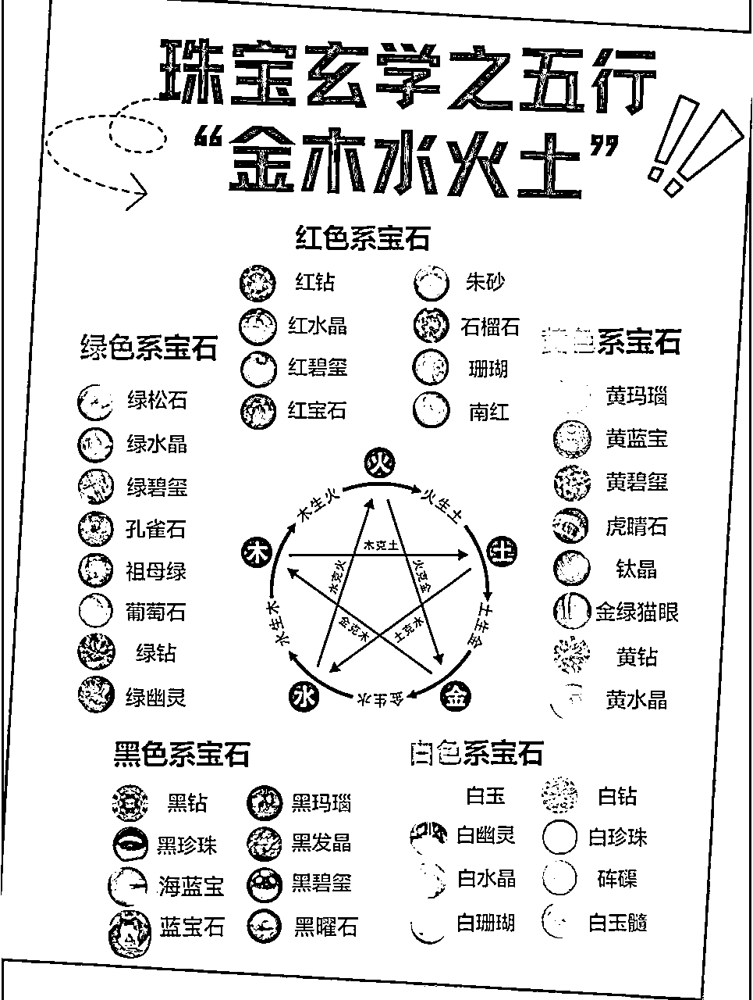

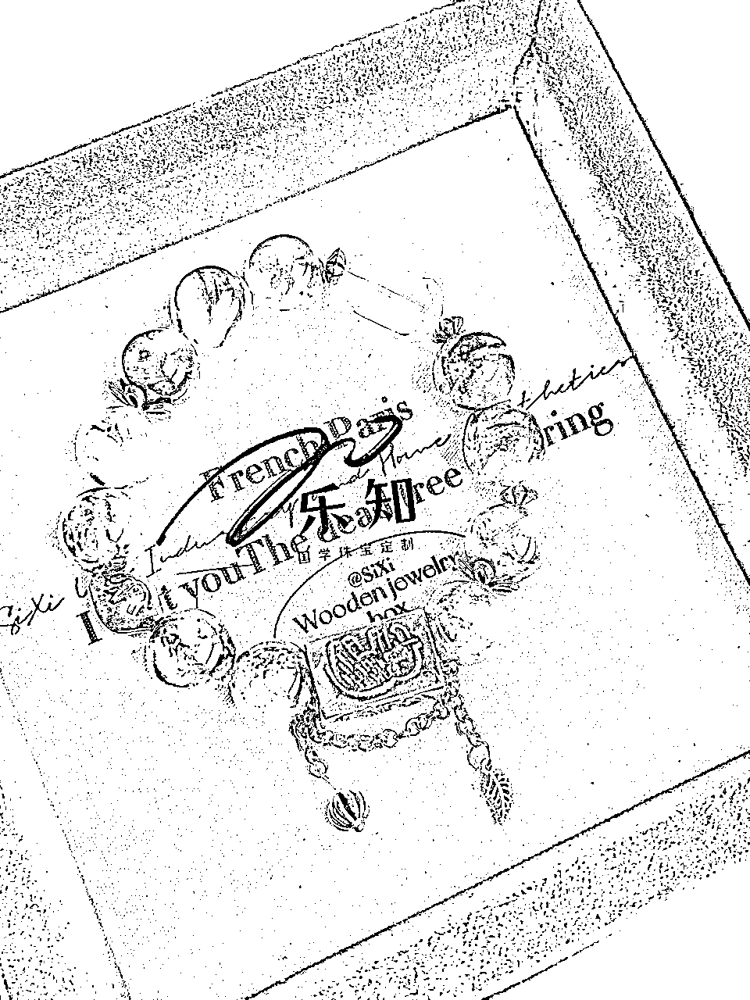

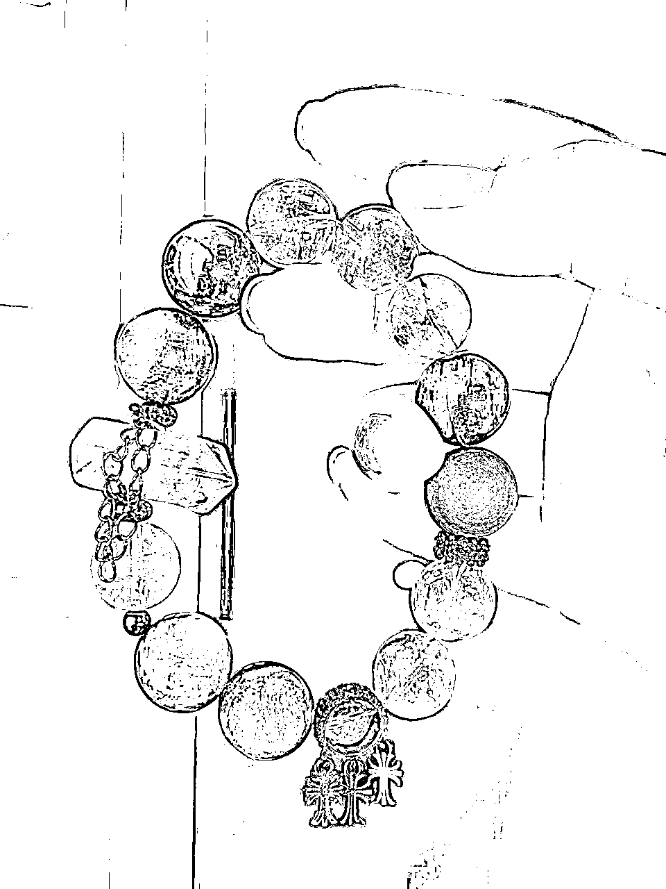

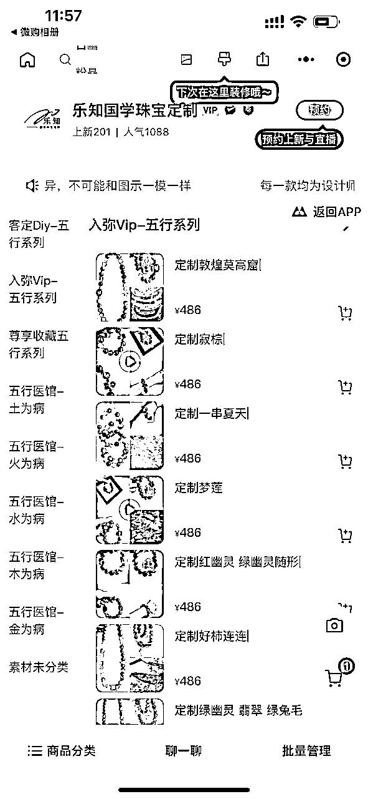

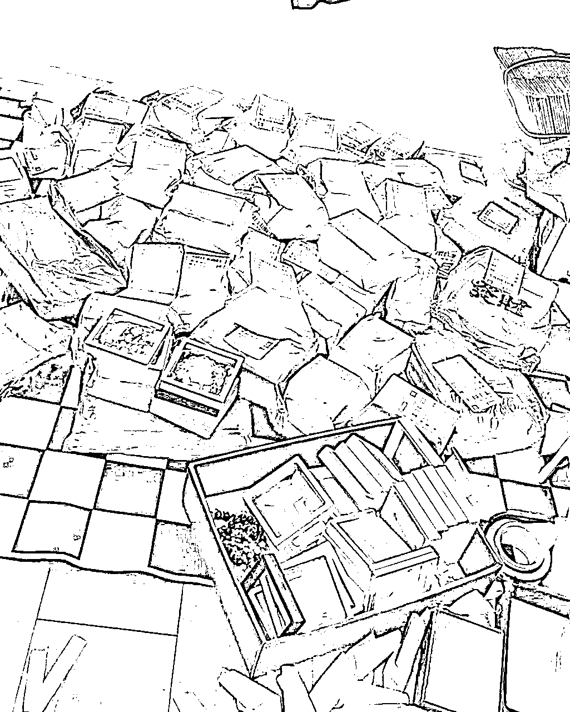

目前每周发货在50单以上，都是先付款后发货。因为是半定制，制作周期5-7天，发货不占用资金流，这点特别舒服。

# 为什么我会看好玄学五行水晶这个赛道？

我把原因归纳成七点：

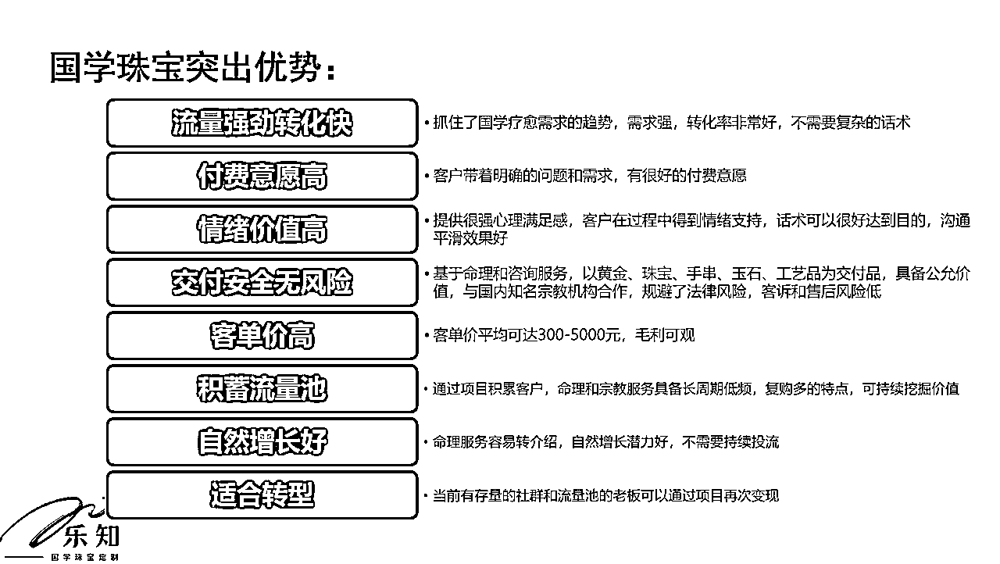

1、国学持续火热：当下环境下大家普遍缺乏安全感，对未来充满不确定，玄学带来的心理慰藉和疗愈需求越来越强。某种意义上，命理就是中国人自己的心理医生。
2、珠宝首饰受众极广：男女都爱戴饰品，潜在消费人群庞大。
3、流量足转化快：踩中国学疗愈的风口，需求刚性，转化效率很高，几乎不需要堆砌话术。
4、付费意愿强：用户带着祈福、转运的明确诉求来，掏钱毫不犹豫。
5、客单价高利润厚：珠宝市场本身支撑，客单价通常在300到5000元区间，利润率能做到70%左右。
6、情绪价值拉满：整个过程中能给到很强的心理满足和情绪支持，沟通顺畅，促单自然。
7、交付稳妥风险低：以免费命理咨询为切入点，以黄金、珠宝、手串、玉石等有公允价值的实物交付，既合规又降低客诉和售后风险。

# 具体是怎么卖的？

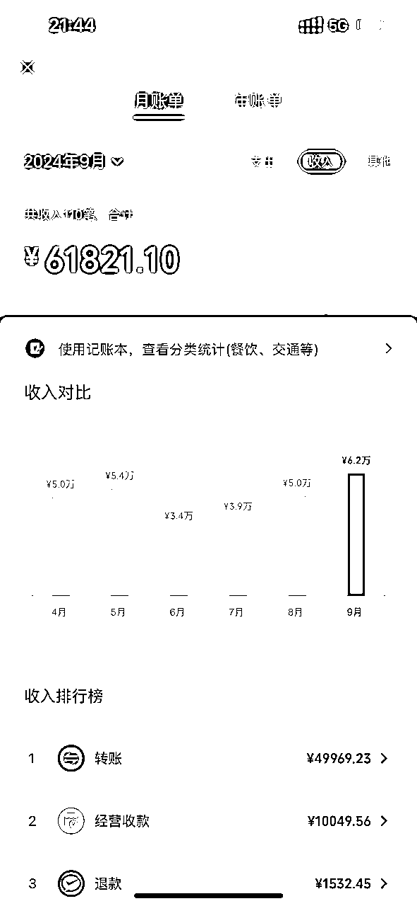

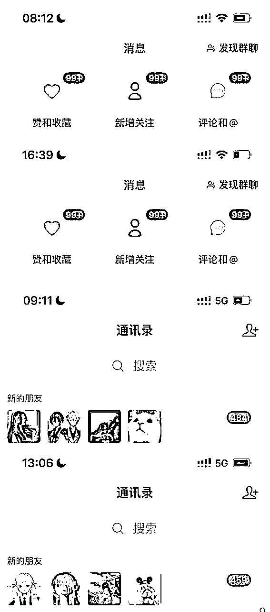

上图是我其中一个号的月度营业额，粉丝并不多，一个2300多粉，一个1900多粉，月销量却一直很稳定。

把半年来的实操梳理成了一条完整链路：

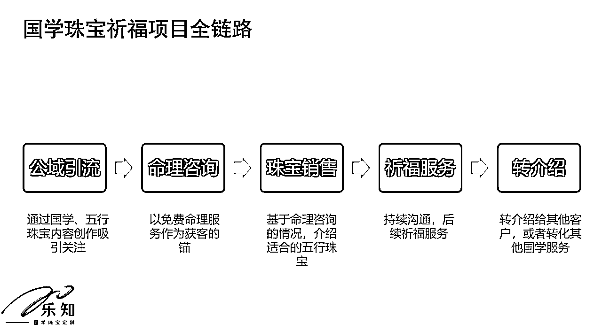

链路很清晰。我的两个助理分工明确，一个负责成交下单，一个负责小红书引流。手串货源直接对接水晶工厂，可以一件代发。

整体打法不复杂。手串颜值好不好看是次要的，核心是顾客觉得算命盘准、运势说得对，手串自带能量真的帮到她。负责命理的是我朋友，每单给20元费用。起初我也想过用软件或GPT来替代，但既不准，也缺少人情味。这个环节本质是心理学，是在提供情绪价值的同时辅助成交。

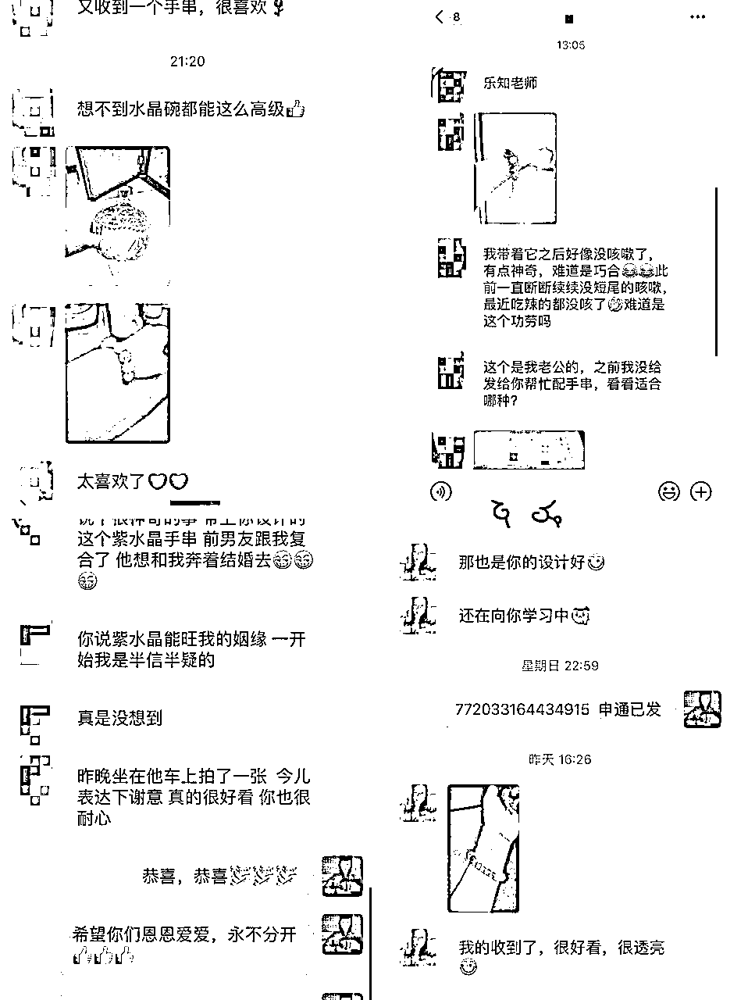

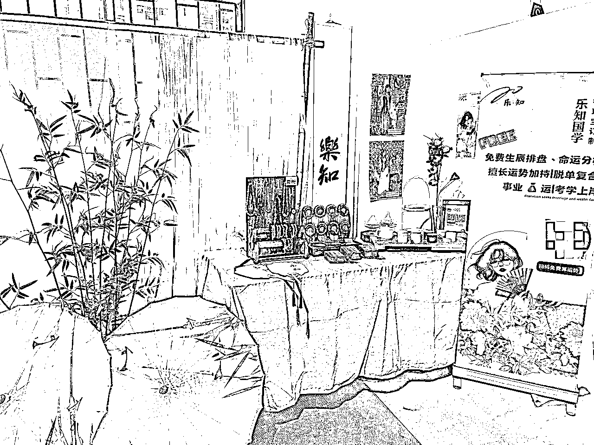

另外我在广州也有两家线下店，圈里的朋友如果路过，欢迎来店里挑喜用的手串，可以给代理价，也能约着现场聊聊。